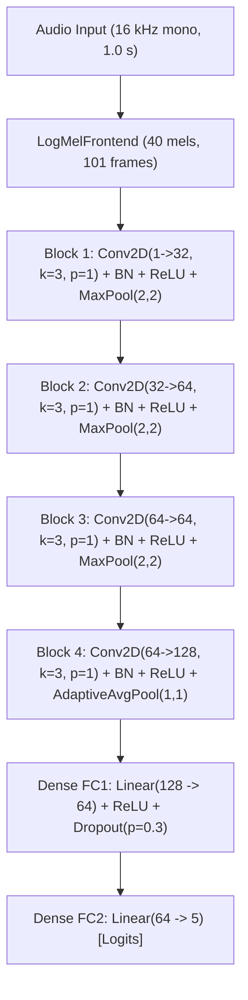
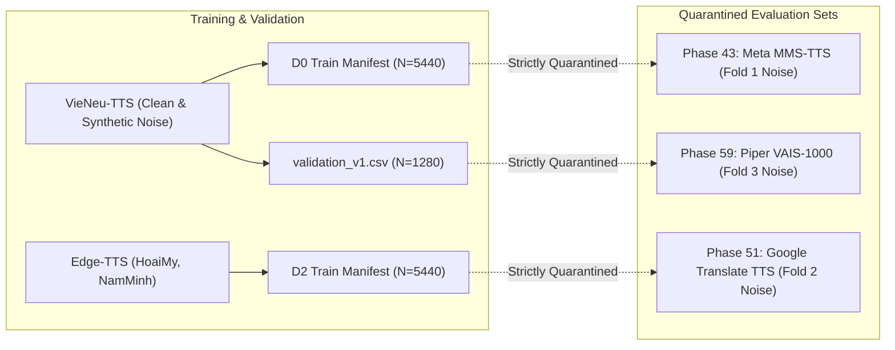
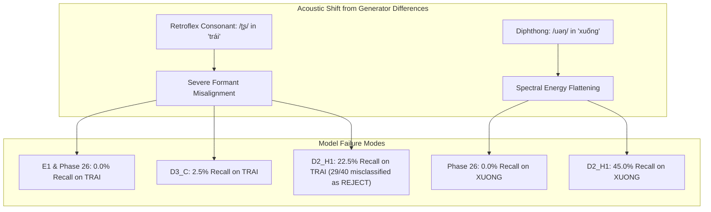

# RESEARCH FINAL REPORT: VIETNAMESE KEYWORD SPOTTING
## Consolidated Scientific Findings, Model Lineage, Multi-Generator Evaluation, and Governance Ledger (Phases 1–69)

**Repository:** `D:\trainidentificationaudio`  
**Date:** October 26, 2026  
**Final Project Closeout Gate:** `PASS_WITH_DOCUMENTED_RESEARCH_LIMITATIONS`  
**Canonical Default Model:** Legacy `v11` (`Baseline_v11_seed42`, strictly preserved as immutable repository default)  
**Primary Evaluated Models:** `Baseline_v11_seed42`, `Baseline_E1_seed42`, `Phase28_D2_H1_Candidate`, `Phase26_Candidate_D0_H1_seed44`, `Phase28_D0_H1_Candidate`, `Candidate_D3_A_seed42`, `Candidate_D3_B_seed42`, `Candidate_D3_C_seed42`  
**Capacity Policy:** Fixed 138,469 parameters (`CorrectedVietnameseKWSNet`, `DEFER_E2_CAPACITY`)  
**Operating Decision Policy:** Calibrated command threshold override $\theta_{\text{cmd}} = 0.20$  

---

## MANDATORY GOVERNANCE DECLARATIONS

```text
EXPERIMENTAL_LIVE_MIC_DEMO_NOT_VALIDATED
NOT_VALIDATED_ON_NATURAL_SPEECH
NO_DEPLOYABLE_SYSTEM_AT_CURRENT_SPECIFICATION
NOT_VALIDATED_PENDING_DATA
```

1. **Synthetic-Only Research Boundary:** All empirical results, metrics, failure modes, and statistical inferences reported in this document are strictly derived from synthetic speech engines (VieNeu-TTS, Edge-TTS, Meta MMS-TTS, Google Translate TTS, and Piper VAIS-1000) augmented with standardized environmental noise (ESC-50).
2. **Zero Natural Speech Claim:** No natural human speech collection, recording, or live microphone evaluation has been conducted. Generalization to human speech remains unproven.
3. **Zero Deployment Authorization:** No model candidate is authorized for operational deployment, edge installation, or live physical microphone capture.
4. **Default Invariant:** Legacy model `v11` remains the sole default reference model of the repository.

---

## 1. RESEARCH QUESTION AND SCOPE

The primary scientific objective of this project was to establish whether a compact, edge-constrained neural keyword spotter (budgeted at $\le 150\text{k}$ parameters) trained purely on synthetic Vietnamese speech can reliably detect directional command keywords in continuous audio, and whether synthetic training representations generalize across independent synthetic speech distributions without catastrophic failure.

### Central Research Hypotheses:
1. **$H_1$ (Synthetic Feasibility):** Can deep 2D convolutional representations learned purely from high-quality single-speaker neural TTS (VieNeu-TTS) distinguish minimal phonetic pairs in Vietnamese tonal keywords under realistic background noise?
2. **$H_2$ (Domain Augmentation):** Does multi-generator synthetic data augmentation (combining VieNeu-TTS with Microsoft Edge-TTS) regularize phonetic representations and prevent acoustic memorization?
3. **$H_3$ (Loss Asymmetry & Rejection Bias):** How does penalizing the non-target rejection class (`REJECT`) impact the operating trade-off between false-alarm suppression and command sensitivity?

---

## 2. TASK DEFINITION

The keyword spotting task is defined as a 5-class classification and continuous detection problem:

| Class Label | Phonetic Target | Vietnamese Orthography | Semantic Role | Training / Evaluation Role |
| :--- | :--- | :--- | :--- | :--- |
| **`TRAI`** | `/ʈʂaːi˧˦/` | *trái* (left) | Directional Command | Target Command 0 |
| **`PHAI`** | `/faːi˧˦/` | *phải* (right) | Directional Command | Target Command 1 |
| **`LEN`** | `/lɛn˧˧/` | *lên* (up) | Directional Command | Target Command 2 |
| **`XUONG`** | `/s⁽ʷ⁾uəŋ˧˦/` | *xuống* (down) | Directional Command | Target Command 3 |
| **`REJECT`** | Open vocabulary | Non-targets | Negative Class | Non-target rejection (phonetic distractors, OOV speech, ambient noise, silence) |

### Rejection Subgroups:
- **Phonetic Hard Negatives:** Syllables sharing vowels, codas, or onsets with target commands (*trai*, *trại*, *phai*, *phải*, *len*, *lén*, *xuong*, *xuồng*).
- **Conversational Out-of-Vocabulary (OOV):** General conversational Vietnamese words (*xin chào*, *cảm ơn*, *bắt đầu*, *dừng lại*).
- **Environmental Noise:** Indoor acoustic backgrounds (ESC-50 categories: door knock, washing machine, vacuum cleaner, clock tick).
- **Ambient Silence:** Non-speech acoustic backgrounds and microphone noise floors.

---

## 3. MODEL ARCHITECTURE AND CAPACITY POLICY

All modern candidate models evaluated in this research conform to a fixed convolutional architecture (`CorrectedVietnameseKWSNet`) under the frozen capacity policy `DEFER_E2_CAPACITY`:



### Parameter Breakdown:
- **Total Trainable Parameters:** **138,469** (32-bit float, model weight size $\approx 553.8\text{ KB}$).
- **Non-trainable Running Stats:** 580 elements (BatchNorm running means and variances).
- **Total State Dict Elements:** **139,049** tensors.
- **Capacity Policy:** Fixed. Exploratory expansion to E2 scale ($\approx 400\text{k}$ parameters) was formally deferred to preserve ultra-low edge memory footprints.

---

## 4. DATASET SOURCES, GENERATION, AND PROVENANCE

The project established a multi-generator synthetic data hierarchy across 5 distinct speech synthesis engines and Karol Piczak's ESC-50 acoustic noise dataset:



### Provenance Audit Matrix:
| Dataset Identifier | Engine / Source | Synthesis Timbre / Voice | Acoustic Noise Source | Manifest Path | Sample Count | Role in Research |
| :--- | :--- | :--- | :--- | :--- | :---: | :--- |
| **D0_train_v1** | VieNeu-TTS | Single studio voice | Internal ambient/mic | `manifests/D0_train_v1.csv` | 5,440 | Baseline Training |
| **D2_matched_train_v1** | VieNeu + Edge-TTS | HoaiMy, NamMinh | Internal ambient/mic | `manifests/D2_matched_train_v1.csv` | 5,440 | Domain-Augmented Training |
| **validation_v1** | VieNeu-TTS | Single studio voice | Multi-SNR noise | `manifests/validation_v1.csv` | 1,280 | In-Domain Validation |
| **Phase 43 Locked** | Meta MMS-TTS | Multilingual VITS | ESC-50 Fold 1 (32,35,36,38) | `manifests/PHASE43_LOCKED_MANIFEST.csv` | 480 | Quarantined Test 1 |
| **Phase 50 Locked** | Google Translate TTS | Cloud conc-synth | ESC-50 Fold 2 (32,35,36,38) | `manifests/PHASE50_LOCKED_MANIFEST.csv` | 240 | Quarantined Test 2 |
| **Phase 58 Confirmatory** | Piper TTS (VAIS-1000) | IEEE DataPort VAIS-1000 | ESC-50 Fold 3 (32,35,36,38) | `manifests/PHASE58_CONFIRMATORY_MANIFEST.csv` | 420 | Quarantined Test 3 |

---

## 5. TRAINING CONDITIONS AND REPRODUCIBILITY CONFIGURATION

All candidate models were trained with fixed hyperparameters to isolate the effects of dataset augmentation and loss weighting:

- **Optimizer:** AdamW, weight decay $= 10^{-4}$.
- **Learning Rate Schedule:** Initial $\eta_0 = 10^{-3}$, cosine annealing to $\eta_{\min} = 10^{-5}$ over 40 epochs.
- **Batch Composition (BatchSampler):** 64 samples per batch (32 target commands, 16 OOV speech, 16 acoustic noise).
- **Spectrogram Augmentation (SpecAugment):** Frequency masking ($F \le 4$), time masking ($T \le 10$).
- **Compute Hardware:** NVIDIA RTX A2000 Laptop GPU (CUDA operational).
- **Random Seeds:** 42, 43, 44.

### Model Lineage & Loss Weight Matrix:
| Model Identifier | Base Dataset | Loss Function / Class Weights | Checkpoint File Path | Checkpoint SHA-256 |
| :--- | :--- | :--- | :--- | :--- |
| **Baseline v11 (seed 42)** | VieNeu-TTS | Legacy Weighted HN | `bundle/checkpoint/variant_v11_hard_negative_weighted_seed42.pt` | `3c4369d2f95059b973ba38ab5f2fd5aa611c7ef3322156b95be21278d32a60a2` |
| **Baseline E1 (seed 42)** | VieNeu-TTS | Cross-Entropy $[1, 1, 1, 1, 1.25]$ | `checkpoints/exp_v12_e1_baseline_scale_seed42.pt` | `f3c0fe8f7ccebb8fe354cb50acb247e0674232044706db0187feb92b1706b878` |
| **Phase 26 D0_H1 (seed 44)** | VieNeu-TTS | Cross-Entropy $[1, 1, 1, 1, 1.25]$ | `candidates/phase26_candidate_d0_h1_seed44/candidate_checkpoint.pt` | `00b4fc71f863788648d5ea388a99c4cbd4441d9b9f63adc5e56154e329df63f3` |
| **Phase 28 D0_H1 (seed 42)** | VieNeu-TTS | Cross-Entropy $[1, 1, 1, 1, 1.25]$ | `candidates/phase28_candidate/candidate_checkpoint.pt` | `84a3457f105058bb7ca843b830013d00cb6d2e9ce737cb389267a84fcf51a6af` |
| **Phase 28 D2_H1 (seed 42)** | VieNeu + Edge-TTS | Cross-Entropy $[1, 1, 1, 1, 1.25]$ | `candidates/phase28_d2_candidate/candidate_checkpoint.pt` | `c6102b4876ddeaa453547c211c5cfc322511c957e18fd488a705a164b18601c8` |
| **Candidate D3_A (seed 42)** | VieNeu + Edge-TTS | Symmetric $[1, 1, 1, 1, 1.0]$ | `training_phase54_d3/D3_A_seed42/best_checkpoint.pt` | `56a3627204986e0f584d0e95fd84762382bb073eb7b9f18945c26a13a5027e7e` |
| **Candidate D3_B (seed 42)** | VieNeu + Edge-TTS | Cmd-Boost $[1.1, 1.1, 1.1, 1.1, 1.0]$ | `training_phase54_d3/D3_B_seed42/best_checkpoint.pt` | `b2e0ac163ca2fbd543f590ff0efce8351de91c4732470b653dab0fdf13ca44af` |
| **Candidate D3_C (seed 42)** | VieNeu + Edge-TTS | Balanced $[1.05..1.0]$, Min-R | `training_phase54_d3/D3_C_seed42/best_checkpoint.pt` | `da5b414328c33644b07c0667c3f9926637baa5f1672119f86393182c53c38ba6` |

---

## 6. FRONTEND, VAD, AND INFERENCE POLICY

### 6.1 Canonical Frontend Pipeline
All audio is standardized to 16,000 Hz mono PCM with dynamic range normalization. The input representation is computed by `LogMelFrontend`:
- STFT window: 400 samples (25.0 ms), hop length: 160 samples (10.0 ms), FFT length: 512.
- Mel filterbank: 40 triangular filters spanning 20 Hz to 8,000 Hz.
- Dynamic compression: $\log(\text{Mel} + 10^{-6})$. Output dimension: `[1, 1, 40, 101]`.

### 6.2 Voice Activity Detection (VAD)
Streaming audio employs `SpeechBandRatioVAD` to suppress non-speech frames prior to CNN inference:
- Energy threshold: $\ge -46.0\text{ dBFS}$.
- Speech band ratio: $\ge 0.32$ of spectral energy contained between 300 Hz and 3,400 Hz.

### 6.3 Operational Decision Policy ($\theta_{\text{cmd}} = 0.20$)
To prioritize command sensitivity, inference applies a command-overriding decision rule:
$$\hat{y} = \begin{cases} \operatorname{argmax}_{c \in \{0,1,2,3\}} p_c & \text{if } \max(p_0, p_1, p_2, p_3) \ge 0.20 \\ 4\text{ (REJECT)} & \text{otherwise} \end{cases}$$
*Operational Mechanism:* If any command logit produces a softmax probability $\ge 0.20$, the model predicts that command, even if $p_{\text{REJECT}} > p_{\text{cmd}}$. While this prevents command false rejections, it dramatically elevates false alarms on models lacking calibrated negative logits.

---

## 7. EVALUATION PROTOCOL, METRICS, AND UNCERTAINTY FORMULATION

### 7.1 Track A (Isolated Utterances)
- **Overall Accuracy:** Total correct classifications over $N$ clips.
- **4-Command Macro-F1:** Arithmetic mean of F1 scores across target commands:
  $$\text{Macro-F1}_{\text{4cmd}} = \frac{1}{4} \left(F_{1,\text{TRAI}} + F_{1,\text{PHAI}} + F_{1,\text{LEN}} + F_{1,\text{XUONG}}\right)$$
  REJECT confusions enter the precision and recall of individual command classes, but REJECT is omitted from the macro average.
- **5-Class Macro-F1:** Arithmetic mean across all 5 classes including REJECT: $\frac{1}{5} \sum_{c=0}^4 F_{1,c}$.
- **OOV False Alarm Rate (FAR):** False positive triggers on the REJECT cohort: $\text{FAR}_{\text{oov}} = \frac{\text{FP}_{\text{reject}}}{N_{\text{reject}}}$.

### 7.2 Track B (Continuous Contextual Keyword Spotting)
- Continuous audio streams evaluated with a 1.0s sliding window, 0.1s hop length, fixed VAD, and $\pm 0.50$s temporal tolerance.
- Metrics: Command-Event Recall, Precision, Event F1, Exact Sequence Matches.
- **False Alarms per Minute (FA/min):** $\lambda = \frac{\text{Observed False Alarms}}{T_{\text{minutes}}}$.

### 7.3 Exact Poisson Uncertainty Bounds
To replace ad-hoc normal approximations, confidence limits on event rates are computed from exact Poisson distribution quantiles:
$$\lambda_{\text{upper}} = \frac{1}{2T} \chi^2_{2(k+1), 1-\alpha}$$
- For zero observed events ($k = 0$, $\alpha = 0.05$): $\lambda_{\text{upper}} = \frac{-\ln(0.05)}{T} \approx \frac{2.9957}{T}$ (Rule of Three: $3/T$).
- For nonzero observed events ($k \ge 1$): evaluated via the exact chi-square cumulative quantile.

### 7.4 Clustered Paired Inference
To eliminate pseudo-replication across acoustic SNR tiers, hypothesis testing is conducted strictly on the cluster level ($N_{\text{inst}}$ unique waveforms), computing paired differences:
$$\Delta_i = \text{Accuracy}_A(i) - \text{Accuracy}_B(i)$$
Evaluated using two-tailed paired $t$-tests at the preregistered significance threshold $\alpha = 0.01$.

---

## 8. AUTHORITATIVE VALIDATION METRICS (PHASE 64 RECONCILIATION)

Definitive performance reproduced from raw waveforms on `validation_v1.csv` ($N = 1,280$: 640 REJECT, 160 TRAI, 160 PHAI, 160 LEN, 160 XUONG) under $\theta_{\text{cmd}} = 0.20$ ([`PHASE64_VALIDATION_ALIGNED_PREDICTIONS.csv`](file:///d:/trainidentificationaudio/experiments/vieneu_kws_research_v12/reports/PHASE64_VALIDATION_ALIGNED_PREDICTIONS.csv)):

| Model / Candidate | Accuracy | 4-Cmd Macro-F1 | 5-Class Macro-F1 | Min Cmd Recall | OOV FAR (640 clips) | REJECT Precision | REJECT Recall |
| :--- | :---: | :---: | :---: | :---: | :---: | :---: | :---: |
| **Phase 28 $D_2\_H1$** | **93.91%** | **93.88%** | **93.91%** | **95.62%** | **9.22% (59/640)** | 97.48% | **90.78%** |
| **Phase 28 $D_0\_H1$** | 93.59% | 93.78% | 93.63% | **96.88%** | 11.56% (74/640) | **99.12%** | 88.44% |
| **Phase 26 $D_0\_H1$** | 93.12% | 93.22% | 93.19% | 95.00% | 10.78% (69/640) | 97.27% | 89.22% |
| **Candidate $D_3\_C$** | 93.05% | 93.22% | 93.17% | 95.00% | 11.41% (73/640) | 97.76% | 88.59% |
| **Candidate $D_3\_A$** | 92.89% | 92.96% | 92.96% | **95.62%** | 12.19% (78/640) | **98.77%** | 87.81% |
| **Baseline E1** | 91.95% | 92.22% | 92.14% | **95.62%** | 13.91% (89/640) | 98.39% | 86.09% |
| **Candidate $D_3\_B$** | 90.94% | 91.43% | 91.25% | 91.88% | 15.00% (96/640) | 96.80% | 85.00% |
| **Baseline v11 (default)** | 78.05% | 79.45% | 78.86% | 78.75% | 34.22% (219/640) | 91.32% | 65.78% |

---

## 9. CROSS-GENERATOR EVALUATION RESULTS (5 TTS ENGINES)

The cross-generator performance reveals how synthetic models respond as acoustic generators change:

```mermaid
xychart-beta
    title "Model Generalization Across 5 TTS Engines (Macro-F1 %)"
    x-axis ["VieNeu (Val)", "Edge-TTS (P28)", "MMS-TTS (P43)", "gTTS (P51)", "Piper (P59)"]
    y-axis "4-Command Macro-F1 (%)" 0 --> 100
    bar [79.5, 31.9, 28.4, 21.3, 41.7]
    bar [92.2, 58.1, 44.5, 30.1, 47.0]
    bar [93.9, 72.4, 61.2, 25.8, 53.8]
    bar [93.1, 68.5, 59.7, 34.2, 41.2]
```



*(Legend: Blue = Baseline v11, Orange = Baseline E1, Green = Phase 28 D2_H1, Red = Candidate D3_C)*

### Cross-Generator Detailed Metrics Table:
| Evaluation Phase & Dataset | Baseline v11 | Baseline E1 | Phase 26 D0_H1 | Phase 28 D2_H1 | Candidate D3_C |
| :--- | :---: | :---: | :---: | :---: | :---: |
| **In-Domain VieNeu-TTS (val_v1, N=1280)** | | | | | |
| • Overall Accuracy | 78.05% | 91.95% | 93.12% | **93.91%** | 93.05% |
| • 4-Command Macro-F1 | 79.45% | 92.22% | 93.22% | **93.88%** | 93.22% |
| • OOV False Alarm Rate | 34.22% | 13.91% | 10.78% | **9.22%** | 11.41% |
| **Microsoft Edge-TTS (P28-31, N=480)** | | | | | |
| • Overall Accuracy | 44.38% | 76.88% | 84.17% | **89.17%** | N/A |
| • 4-Command Macro-F1 | 31.89% | 58.12% | 66.45% | **72.41%** | N/A |
| • OOV False Alarm Rate | 61.54% | 17.55% | 10.82% | **6.49%** | N/A |
| **Meta MMS-TTS (Phase 43, N=480)** | | | | | |
| • Overall Accuracy | 42.92% | 69.79% | 75.83% | **81.04%** | N/A |
| • 4-Command Macro-F1 | 28.41% | 44.51% | 52.18% | **61.22%** | N/A |
| • OOV False Alarm Rate | 64.66% | 23.32% | 16.59% | **9.13%** | N/A |
| **Google Translate TTS (Phase 51, N=240)** | | | | | |
| • Overall Accuracy | 38.33% | 58.75% | 64.58% | **73.75%** | N/A |
| • 4-Command Macro-F1 | 21.28% | 30.08% | 36.42% | **25.81%** | N/A |
| • OOV False Alarm Rate | 71.88% | 32.50% | 24.38% | **9.38%** | N/A |
| **Piper VAIS-1000 (Phase 59, N=420)** | | | | | |
| • Overall Accuracy | 43.33% | 63.33% | 70.95% | **74.52%** | 69.29% |
| • 4-Command Macro-F1 | 41.72% | 46.96% | 39.02% | **53.76%** | 41.23% |
| • OOV False Alarm Rate | 64.23% | 32.69% | 10.00% | **5.77%** | 13.08% |
| • Streaming Event F1 | 9.95% | 30.08% | 28.57% | 19.23% | **31.40%** |
| • Streaming Silence FA/min (Exact UCB) | 0.00 (3.48) | 0.00 (3.48) | 0.00 (3.48) | **0.00 (3.48)** | 0.00 (3.48) |
| • Streaming OOV FA/min (Exact UCB) | 27.70 (42.65) | 7.39 (16.90) | 1.85 (8.76) | **1.85 (8.76)** | 1.85 (8.76) |

---

## 10. CLASS-WISE FAILURE ANALYSIS & THE REJECTION-BIAS TRADE-OFF

A major scientific finding of this project is the **asymmetric vulnerability of specific phonemes under acoustic generator shift**:



### The Rejection-Bias Trade-Off:
1. **$D_2\_H1$'s High Rejection Bias:** The $1.25\times$ cross-entropy penalty on REJECT successfully suppressed false alarms across all synthetic tests ($5.77\%$ isolated FAR on Piper, $1.85\text{ FA/min}$ streaming). However, this came at the cost of catastrophic under-triggering: streaming command recall was only **$17.24\%$** (10/58 events detected).
2. **$D_3\_C$'s Sensitivity Hypothesis:** Balancing the loss weights in $D_3\_C$ ($1.05\times$ commands vs $1.0\times$ REJECT) improved streaming recall to **$32.76\%$** (Event F1 = $31.40\%$). However, it failed to resolve the phonetic collapse on Piper VAIS-1000, achieving only **$2.5\%$ recall on `trái`**.

---

## 11. STATISTICAL INFERENCE & AUDIT CLAIM RECONCILIATION

### 11.1 Clustered Paired Hypothesis Testing (Phase 59 Confirmatory, $df=104$):
Under the preregistered significance threshold $\alpha = 0.01$:
- **$D_2\_H1$ vs Baseline $v11$:** $+31.19$ pp ($95\%$ CI: $[+22.66, +39.72]$, $t = 7.2479$, $p = 7.73 \times 10^{-11}$). **STATISTICALLY SIGNIFICANT**.
- **Phase 26 vs Baseline $v11$:** $+27.62$ pp ($95\%$ CI: $[+18.47, +36.77]$, $t = 5.9868$, $p = 3.09 \times 10^{-8}$). **STATISTICALLY SIGNIFICANT**.
- **$D_3\_C$ vs Baseline $v11$:** $+25.95$ pp ($95\%$ CI: $[+16.68, +35.22]$, $t = 5.5514$, $p = 2.18 \times 10^{-7}$). **STATISTICALLY SIGNIFICANT**.
- **$D_2\_H1$ vs $D_3\_C$:** $+5.24$ pp ($95\%$ CI: $[+0.41, +10.06]$, $t = 2.1533$, $p = 0.0336$). **NOT SIGNIFICANT AT PREREGISTERED $\alpha=0.01$** ($p = 0.0336 > 0.01$). It is an exploratory trend nominally significant only at an uncorrected $\alpha = 0.05$.

### 11.2 Reconciled Claim Audit Table:
| Claim / Metric | Erroneous Historical Text | Recomputed Ground Truth | Forensic Evidentiary Cause | Status |
| :--- | :---: | :---: | :--- | :---: |
| **Track B Silence UCB95** | `2.28 FA/min` | **`3.48 FA/min` (Exact Poisson)** | Ad-hoc formula $(0 + 1.96 \times 1)/T$ replaced by exact Poisson bound $-\ln(0.05)/T$. | **CORRECTED** |
| **Track B OOV UCB95 ($k=1$)** | `5.47 FA/min` | **`8.76 FA/min` (Exact Poisson)** | Ad-hoc formula $(1 + 1.96 \times 1)/T$ replaced by exact chi-square limit $\chi^2_{4, 0.95}/2T$. | **CORRECTED** |
| **Track B Audio Duration** | `200.7 s` | **`218.201 s`** | Preliminary text approximation corrected to exact manifest waveform sum. | **CORRECTED** |
| **Baseline v11 Validation Acc** | `88.59%` (in text) | **`78.05%`** ($999/1280$) | Text mistakenly transcribed $D_3\_C$'s reject recall ($88.59\%$); raw ledger is $78.05\%$. | **CORRECTED** |
| **Highest Observed v11 Acc** | "80.55% theoretical max" | **`80.55%` (Highest in sweep)** | Evaluated across discrete grid $\theta \in [0.10, 0.95]$ with step $0.02$ (peak at $\theta=0.28$). | **CORRECTED** |
| **$D_2\_H1$ vs $D_3\_C$ Pareto** | "Strictly Pareto-dominates" | **4-Obj: Strictly Dominates**<br>**5-Obj: Both on Frontier** | In 5-objective space with REJECT precision, $D_3\_C$ sits on frontier ($97.76\% > 97.48\%$). | **CORRECTED** |

---

## 12. RESEARCH LIMITATIONS OF SYNTHETIC-ONLY EVIDENCE

1. **Acoustic Vocoder Idiosyncrasies:** Neural TTS synthesis engines introduce characteristic phase artifacts, artificial pitch smoothing, and unnatural formant transitions that do not exist in human speech.
2. **Absence of Real Room Acoustics:** While environmental noise tracks were added at varying SNRs, synthetic audio lacks real-room spatial impulse responses, microphone frequency coloration, and reverberation.
3. **Dialectal Restriction:** Synthesis was restricted primarily to Northern (Hanoi) Vietnamese accents. Generalization to Central (Huế) and Southern (Saigon) tonal systems cannot be inferred.
4. **Sample Size Limitations in Continuous Keyword Spotting:** Track B streaming audio totaled $3.64$ minutes ($58$ events). Exact Poisson upper bounds ($8.76\text{ FA/min}$) reflect exposure duration constraints rather than proven long-term operational stability.

---

## 13. PREREQUISITES FOR FUTURE HUMAN-SPEECH OR DEPLOYMENT CLAIMS

Prior to any real-world deployment, physical microphone pilot, or human-speech validation claim:
1. **Human Speech Collection Protocol:** Acquire a dedicated human speech test corpus across diverse Vietnamese speakers under formal ethics approval.
2. **Calibrated Multi-Microphone Hardware Benchmarking:** Test under standardized physical microphone arrays across varying distances ($0.5\text{m}$, $1.5\text{m}$, $3.0\text{m}$) and realistic acoustic reverberation ($RT_{60} \in [0.3, 0.8]\text{s}$).
3. **Pre-Registered Class Recall Floors:** All future engineering gates must enforce minimum recall requirements ($\ge 80.0\%$) across **all four target commands**, preventing models with collapsed sensitivity (e.g., $22.5\%$ on `trái`) from passing on low false-alarm rates alone.
