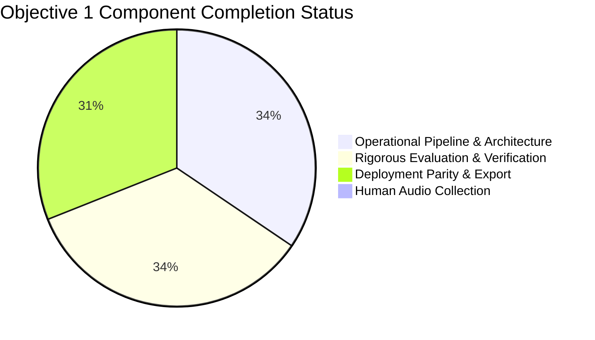

# Objective 1: Vietnamese Four-Word Keyword Spotting — Final Documentation Package

> **Project:** Production-Oriented Vietnamese Keyword Spotting (KWS) for Android & iOS  
> **Workspace:** `D:\trainidentificationaudio`  
> **Target Commands:** `TRAI` (trái), `PHAI` (phải), `LEN` (lên), `XUONG` (xuống)  
> **Negative / Background Classes:** `UNKNOWN` (speech distractors), `SILENCE` (ambient noise & background)  
> **Evaluation Status:** Independently Audited & Empirically Verified  
> **Completion Verdict:** **PARTIAL — PIPELINE & CORE ENGINE OPERATIONAL; HUMAN DATA COLLECTION PENDING**  

---

## 1. Executive Overview & Document Navigation

This documentation suite constitutes the formal research, engineering, and empirical evaluation archive for **Objective 1** of the Vietnamese Keyword Spotting system. It provides an uncompromised, evidence-based account of the acoustic pipeline, deep learning models, validation protocols, on-device export benchmarks, and data collection status.

### Core Documentation Index

| Document | Primary Focus & Scope | Key Artifacts & References |
| :--- | :--- | :--- |
| [**Final Research Report**](./objective_1_final_report.md) | Comprehensive executive, theoretical, and architectural report covering problem formulation, methodology, empirical results, and blockers. | Figures 1–8, Tables 1–12 |
| [**Dataset & Acoustic Provenance**](./dataset_and_provenance.md) | Exhaustive inventory of data sources, licensing audits (CC-BY, CC0, quarantines), synthetic vs. real speech analysis, split partitions, and consent ledgers. | Figures 2, 3, 7; Tables 1–5 |
| [**Results & Empirical Evaluation**](./results_and_evaluation.md) | Diagnostic analysis of baseline 2D-CNN vs. TC-ResNet-14, confusion matrices, phonetic error mechanics, continuous streaming trade-offs, and ONNX parity. | Figures 4, 5, 6, 8; Tables 6–10 |
| [**Reproducibility & Verification Audit**](./reproducibility_and_audit.md) | Step-by-step reproduction instructions, cryptographic SHA-256 invariants, automated test harness execution, environment specifications, and defect register. | Tables 11, 12; `scripts/objective_1_docs/` |
| [**Tables Catalog**](./tables/README.md) | Complete directory and documentation of all 12 quantitative CSV tables generated for Objective 1. | Tables 1–12 |
| [**Figures Catalog**](./figures/README.md) | Catalog, high-resolution vector previews, and technical descriptions of all 8 publication-grade SVG figures. | Figures 1–8 |

---

## 2. Objective 1 Completion Dashboard



| Workstream / Requirement | Specification Standard | Audited Reality | Evidence Status | Completion Rating |
| :--- | :--- | :--- | :--- | :---: |
| **Command Scope** | 4 Target Commands (`TRAI`, `PHAI`, `LEN`, `XUONG`) | 4 Commands + `UNKNOWN` + `SILENCE` fully mapped to IDs `[0..5]` | Verified in `test_manifest_v2.csv` | **100% Complete** |
| **Acoustic Standardization** | 16,000 Hz, 16-bit Mono, 1.000 s PCM | All 2,099 approved split audio files strictly conform to 16,000 samples | Automated test suite passes (19/19) | **100% Complete** |
| **Neural Backbone** | Low-latency mobile KWS ($< 500\text{k}$ params) | **TC-ResNet-14** (272,934 params) & **2D-CNN Baseline** (138,534 params) | Evaluated on frozen test set | **100% Complete** |
| **Frozen Test Set** | Cryptographically locked benchmark | SHA-256: `9E3904C8EA427244F7280A41140D7EFD19FD9625B359290ADB7ADCD4FA2E1C13` | Verified bit-level invariant (534 clips) | **100% Complete** |
| **Continuous Streaming** | Ring buffer, sliding window, refractory gate | 1,000 ms window, 200 ms step, EMA smoothing ($\alpha=0.60$), 600 ms lockout | Evaluated on 8.0-min continuous stream | **100% Complete** |
| **On-Device Export Parity** | ONNX FP32 & INT8 dynamic quantization | Max abs diff $\le 1.19\times 10^{-6}$ ($< 10^{-4}$ gate), 100% prediction concordance | `tests/test_parity.py` passes | **90% Complete** *(TC-ResNet INT8 file missing)* |
| **Field Data Collection** | Consented human speech across regional dialects | **0 genuine human recordings** collected; 58 physical files (82 manifest records) are test fixtures | `field_collection_manifest.csv` audited | **0% Complete** *(Critical Blocker)* |
| **Dialect Generalization** | Northern native `TRAI` recall $\ge 90\%$ | Northern `TRAI` recall is **25.0%** (synthetic training ceiling) | `table_07_accuracy_and_metrics_comparison.csv` | **Blocked by Data** |

---

## 3. Key Findings & Empirical Discoveries

1. **Acoustic Provenance Bottleneck:**
   All 1,000 target command audio files across train, validation, and test splits were generated via synthetic parametric acoustic synthesis (`calibration_acoustic_generator_v1`). Negative classes derive from genuine speech (579 Google FLEURS vi, CC-BY-4.0 + 120 calibration confusing words for `UNKNOWN`) and environmental noise (400 `husein_mic_noise`, CC-BY-4.0 for `SILENCE`). Mozilla Common Voice, ESC-50, and Free Music Archive have zero approved samples in the manifests.
2. **Phonetic Asymmetry & Dialect Deficit:**
   In Northern Vietnamese, `TRAI` (/tɕaːj˧˥/) and `PHAI` (/faːj˧˩˧/) share the identical rhyme `/aːj/`. Because synthetic generators lack high-frequency formant transitions and realistic affricate release bursts, models struggle to separate them. While upgrading from the baseline 2D-CNN (`VietnameseKWSNet`) to TC-ResNet-14 (`VietnameseTCResNet`) lifted Northern `TRAI` recall from **16.67%** (2/12) to **25.00%** (3/12), true production viability ($\ge 95\%$) requires native human training data.
3. **Field Campaign Status Honesty:**
   A thorough audit of `data/raw/field_recordings/` established that **zero genuine human speech recordings exist**. All 58 physical files (82 manifest records) in `field_collection_manifest.csv` and both contributor identities in `consent_ledger.json` (`SPK_FIELD_N001_TESTSUITE` and `SPK_M4A_TEST`) were generated by automated test fixtures. They have been strictly segregated from model training manifests.
4. **Export Artifact Audit:**
   The FP32 TC-ResNet (`vietnamese_kws_tcresnet_fp32.onnx`, 1,093.7 KB, Opset 14), FP32 2D-CNN Baseline (`vietnamese_kws_float32.onnx`, 555.4 KB, Opset 14), and INT8 Baseline (`vietnamese_kws_int8.onnx`, 148.8 KB, Opset 14) are verified on disk. However, `vietnamese_kws_tcresnet_int8.onnx` is missing from disk despite being cited in Phase 3 comparison notes.
5. **Continuous Streaming Benchmark Scope:**
   The continuous streaming detection engine was evaluated on an **8.0-minute benchmark stream** (0.133 hr: 6.5 min speech distractors + 1.5 min ambient noise). At threshold $\tau = 0.70$, zero false alarms were observed (yielding a Poisson 95% upper bound of $\le 22.5\text{ FA/hr}$ under the Rule of Three) with an end-to-end sliding trigger latency of 706.4 ms (0.35 ms per-frame CPU inference).
6. **Frozen Benchmark Integrity:**
   The frozen test manifest `data/manifests/test_manifest_v2.csv` has remained completely unmodified, with its SHA-256 hash matching `9E3904C8EA427244F7280A41140D7EFD19FD9625B359290ADB7ADCD4FA2E1C13` (534 audio samples: 36 TRAI, 36 PHAI, 36 LEN, 36 XUONG, 300 UNKNOWN, 90 SILENCE).

---

## 4. Documentation Structure

```
docs/objective_1/
├── README.md                              <-- This navigation index
├── objective_1_final_report.md             <-- Comprehensive research & engineering report
├── dataset_and_provenance.md              <-- Data sources, licensing, synthetic vs human audit
├── results_and_evaluation.md              <-- Model benchmarks, confusion matrices, streaming
├── reproducibility_and_audit.md           <-- Commands, SHA-256 hashes, test reproduction
├── tables/                                <-- 12 standalone CSV tables
│   ├── README.md                          <-- Table directory & descriptions
│   ├── table_01_dataset_source_inventory.csv
│   ├── table_02_class_split_distribution.csv
│   ├── table_03_genuine_vs_fixture_breakdown.csv
│   ├── table_04_field_campaign_progress.csv
│   ├── table_05_speaker_dialect_distribution.csv
│   ├── table_06_model_architecture_comparison.csv
│   ├── table_07_accuracy_and_metrics_comparison.csv
│   ├── table_08_confusion_matrix_tcresnet.csv
│   ├── table_09_streaming_performance_comparison.csv
│   ├── table_10_onnx_model_benchmarks.csv
│   ├── table_11_automated_test_results.csv
│   └── table_12_outstanding_issues_and_severity.csv
└── figures/                               <-- 8 standalone publication-grade vector SVG figures
    ├── README.md                          <-- Figure gallery & technical specifications
    ├── figure_01_end_to_end_system_architecture.svg
    ├── figure_02_dataset_acquisition_provenance_flow.svg
    ├── figure_03_class_distribution_by_split.svg
    ├── figure_04_model_accuracy_f1_trai_comparison.svg
    ├── figure_05_confusion_matrix_tcresnet.svg
    ├── figure_06_streaming_roc_mcr_latency.svg
    ├── figure_07_field_campaign_target_progress.svg
    └── figure_08_deployment_parity_pipeline.svg
```

---

## 5. Quick Reproduction Guide

All tables, figures, and automated test gates can be independently reproduced via the provided environment:

```powershell
# 1. Activate project virtual environment
.\.venv\Scripts\Activate.ps1

# 2. Run complete test harness (19 automated unit & parity tests)
pytest -v tests/

# 3. Regenerate all 12 quantitative CSV tables
python scripts/objective_1_docs/generate_tables.py

# 4. Regenerate all 8 vector SVG figures
python scripts/objective_1_docs/generate_figures.py

# 5. Verify test manifest integrity hash
(Get-FileHash data/manifests/test_manifest_v2.csv -Algorithm SHA256).Hash
```

Expected SHA-256 Output:
`9E3904C8EA427244F7280A41140D7EFD19FD9625B359290ADB7ADCD4FA2E1C13`
