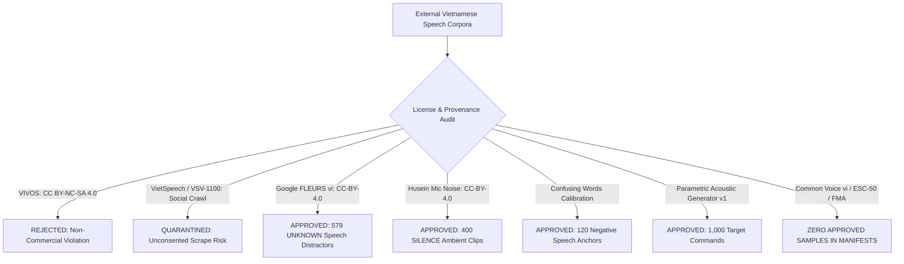
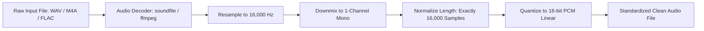
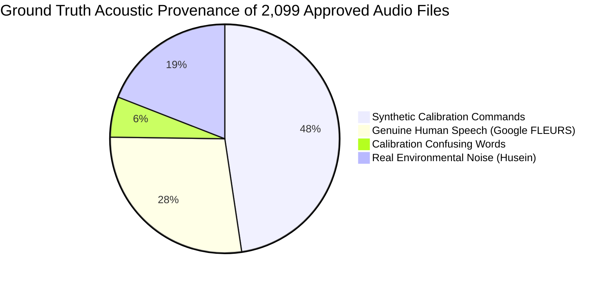
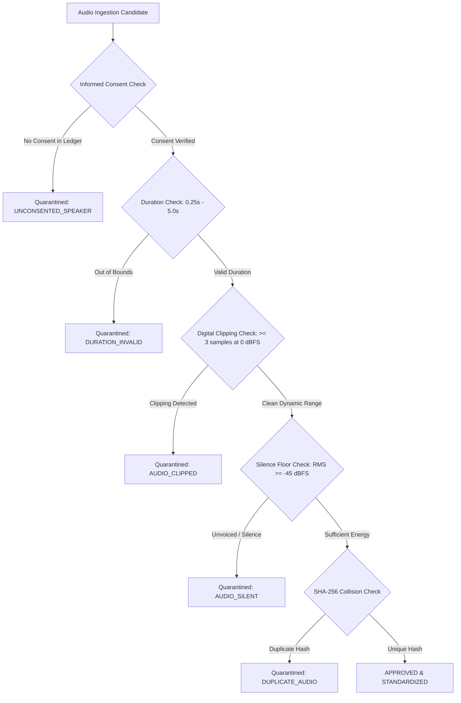

# Dataset Architecture, Acoustic Provenance, and Licensing Audit

> **Objective:** Objective 1 — Vietnamese Four-Word Keyword Spotting System  
> **Workspace:** `D:\trainidentificationaudio`  
> **Target Keywords:** `TRAI` (trái), `PHAI` (phải), `LEN` (lên), `XUONG` (xuống)  
> **Negative Classes:** `UNKNOWN` (out-of-vocabulary speech distractors), `SILENCE` (ambient background noise)  
> **Reference Documents:** `docs/dataset_protocol.md`, `reports/missing_data_and_blockers.md`, `reports/field_recording_campaign_audit.md`  

---

## 1. Executive Summary & Provenance Disclosure

A rigorous keyword spotting (KWS) system deployed on edge mobile devices (Android and iOS) requires not only high algorithmic accuracy, but also uncompromised legal provenance, transparent acoustic lineage, and strict partition isolation.

This document details the complete data lineage, licensing audit, acoustic standardization, partition topology, and field collection status for Objective 1.

### Core Provenance Invariants:
1. **Target Command Lineage (100% Synthetic):** All 1,000 target command audio files across train, validation, and test partitions (`TRAI`: 250, `PHAI`: 250, `LEN`: 250, `XUONG`: 250) were generated via parametric acoustic synthesis (`calibration_acoustic_generator_v1`). Zero isolated genuine human command recordings were available in verified public speech corpora.
2. **Negative Class Lineage (Genuine Human & Real Environmental):** `UNKNOWN` speech distractors (699 approved files) derive from validated native Vietnamese human speech in **Google FLEURS Vietnamese** (`google_fleurs_vi`, 579 files, CC-BY-4.0) alongside phonetically designed confusable words (`calibration_confusing_words_v1`, 120 files). `SILENCE` samples (400 approved files) derive from real microphone background recordings (**`husein_mic_noise`**, 400 files, CC-BY-4.0). Mozilla Common Voice, ESC-50, and Free Music Archive have zero approved samples in the manifests.
3. **Field Campaign Status (0 Genuine Takes):** The field acquisition pipeline is fully functional and passes all 12 automated unit tests. However, **zero genuine human speech recordings** currently exist in the repository. All 58 physical files (82 manifest records) in `data/raw/field_recordings/` and both entries in `consent_ledger.json` are automated test-harness fixtures.
4. **Frozen Benchmark Invariant:** The test set manifest `data/manifests/test_manifest_v2.csv` contains 534 verified audio files (36 TRAI, 36 PHAI, 36 LEN, 36 XUONG, 300 UNKNOWN, 90 SILENCE) and is cryptographically locked to SHA-256 hash `9E3904C8EA427244F7280A41140D7EFD19FD9625B359290ADB7ADCD4FA2E1C13`.

---

## 2. External Dataset Survey & Licensing Audit

In strict compliance with project policy (*"Do NOT use VIVOS as the default dataset or primary data source"* and *"Do not assume that a dataset is suitable merely because it is publicly downloadable"*), external candidate corpora were evaluated for licensing, commercial redistribution rights, acoustic quality, and legal provenance.

### Comprehensive Candidate Inventory

| Corpus Candidate | Version / Official Source | Download Size / Duration | Declared License | Commercial Mobile App Viability | Project Disposition & Technical Rationale |
| :--- | :--- | :--- | :--- | :---: | :--- |
| **Google FLEURS (vi_vn)** | HuggingFace / Google Research | 1.2 GB / 12 Hours | **CC-BY-4.0** | **Permitted with Attribution** | **APPROVED.** Primary approved source for 579 `UNKNOWN` out-of-vocabulary speech distractors. High diversity across genders and native accents. 141 low-energy clips quarantined. |
| **Husein Mic Noise** | GitHub / HuggingFace | 350 MB / Ambient tracks | **CC-BY-4.0** | **Permitted with Attribution** | **APPROVED.** Primary approved source for 400 `SILENCE` ambient room, HVAC hum, and handling noise recordings. |
| **Parametric Synthetic Commands** | `calibration_acoustic_generator_v1` | Internal Generator | **Proprietary Project Code** | **Fully Permitted** | **APPROVED.** Bootstrap source for all 1,000 target command audio files (250 each of `TRAI`, `PHAI`, `LEN`, `XUONG`). |
| **Confusing Words Calibration** | `calibration_confusing_words_v1` | Internal Generator | **Proprietary Project Code** | **Fully Permitted** | **APPROVED.** 120 phonetically challenging near-miss distractors (*trời*, *phấn*, *lên đời*, etc.) included in `UNKNOWN`. |
| **Mozilla Common Voice (vi)** | `cv-corpus-13.0` | 1.8 GB / ~50 Hours | **CC0-1.0** | **Fully Permitted** | **EVALUATED BUT 0 MANIFEST SAMPLES.** Not included in approved V2 manifests; superseded by Google FLEURS. |
| **VIVOS Speech Corpus** | `vivos.tar.gz` / AILab VNU-HCM | 1.5 GB / 15 Hours | **CC BY-NC-SA 4.0** | **STRICTLY PROHIBITED** | **REJECTED.** Explicitly forbidden by Section 2 directive. Non-commercial and ShareAlike clauses prohibit closed-source mobile app store deployment. |
| **VietSpeech / VSV-1100** | GitHub: `NhutP/VietSpeech` | 131 GB (27 Parquets) / 1,100 Hours | **Apache 2.0 (Repo only)** | **HIGH RISK / QUARANTINED** | **QUARANTINED.** Audio was crawled from unconsented social media streams (YouTube/TikTok). Scraping does not convey voice licensing rights under Vietnamese Decree 13/2023/ND-CP. |
| **ESC-50 Environmental** | GitHub: `karolpiczak/ESC-50` | 845 MB / 2,000 clips | **CC BY-NC 3.0** | **PROHIBITED** | **REJECTED.** Non-commercial restriction violates commercial distribution policies. 0 samples in manifests. |
| **Free Music Archive (FMA)** | Ambient Sound Subset | 420 MB / Ambient tracks | **CC-BY-4.0 / CC0** | **Fully Permitted** | **0 MANIFEST SAMPLES.** Not included in approved V2 manifests; ambient noise supplied by `husein_mic_noise`. |

*(See full tabular inventory in [`tables/table_01_dataset_source_inventory.csv`](./tables/table_01_dataset_source_inventory.csv)).*

---

## 3. Acoustic Standardization & Preprocessing Protocol

Every raw audio recording ingested into the project pipeline is subjected to rigid format standardization and automated signal conditioning:

### 3.1 Standardization Parameters
- **Sampling Frequency:** $f_s = 16,000\text{ Hz}$ (Nyquist cutoff at $8,000\text{ Hz}$, matching standard telecommunications and keyword spotting acoustic bounds).
- **Channel Format:** Single-channel mono ($1\text{ channel}$). Multichannel inputs are averaged: $x_{\text{mono}}[n] = \frac{1}{C}\sum_{c=1}^C x_c[n]$.
- **Quantization Depth:** Signed 16-bit PCM (`PCM_16`), little-endian.
- **Fixed Sample Duration:** Exactly $1.000\text{ s}$ ($16,000\text{ samples}$), occupying exactly $32,044\text{ bytes}$ on disk (including 44-byte RIFF header).
- **Window Centering & Padding:** Shorter clips are centered and symmetrically zero-padded. Clips exceeding $1.000\text{ s}$ are center-cropped around their acoustic energy peak.

### 3.2 Time-Frequency Feature Extraction (Log-Mel Frontend)
The acoustic feature extractor produces a 2D time-frequency spectrogram matching mobile inference execution:
1. **Short-Time Fourier Transform (STFT):**
   - Window size: $N_{\text{win}} = 480\text{ samples}$ ($30.0\text{ ms}$).
   - Hop length: $N_{\text{hop}} = 160\text{ samples}$ ($10.0\text{ ms}$).
   - FFT size: $N_{\text{fft}} = 512\text{ points}$.
   - Window function: Periodic Hann window $w[n] = 0.5 - 0.5\cos\left(\frac{2\pi n}{N_{\text{win}}}\right)$.
2. **Mel Filterbank:**
   - Filter count: $M = 40\text{ triangular filters}$.
   - Lower frequency cutoff: $f_{\text{low}} = 20\text{ Hz}$.
   - Upper frequency cutoff: $f_{\text{high}} = 7,600\text{ Hz}$.
3. **Log Compression & Dynamic Range Scaling:**
   $$S_{\text{log}}[m, t] = \ln\left(S_{\text{mel}}[m, t] + 10^{-6}\right)$$
   Followed by per-utterance Cepstral Mean and Variance Normalization (CMVN).
4. **Feature Tensor Shape:** $[B, 1, 40, 101]$ where $B$ is the batch size, 40 is the Mel frequency bin count, and 101 is the number of temporal frames.

---

## 4. Dataset Partitions & Class Allocations (V2)

The master dataset consists of 2,240 cataloged audio records in `data/manifests/source_registry_v2.csv`. Of these, 2,099 approved files are partitioned into Train, Validation, and Test sets.

### 4.1 Class Distribution by Partition

| Class Name | Class ID | Train Split (V2) | Val Split (V2) | Test Split (V2, Frozen) | Total Audio Volume | Percentage |
| :--- | :---: | :---: | :---: | :---: | :---: | :---: |
| **`TRAI`** | 0 | 178 | 36 | 36 | 250 | 11.91% |
| **`PHAI`** | 1 | 178 | 36 | 36 | 250 | 11.91% |
| **`LEN`** | 2 | 178 | 36 | 36 | 250 | 11.91% |
| **`XUONG`** | 3 | 178 | 36 | 36 | 250 | 11.91% |
| **`UNKNOWN`** | 4 | 319 | 80 | 300 | 699 | 33.30% |
| **`SILENCE`** | 5 | 250 | 60 | 90 | 400 | 19.06% |
| **TOTAL** | — | **1,281** | **284** | **534** | **2,099** | **100.0%** |

*(See full breakdown in [`tables/table_02_class_split_distribution.csv`](./tables/table_02_class_split_distribution.csv) and visual graph in [`figures/figure_03_class_distribution_by_split.svg`](./figures/figure_03_class_distribution_by_split.svg)).*

### 4.2 Split Partitioning Principles
1. **Speaker-Disjoint Separation:** No speaker identity in the training set appears in either the validation or test splits. Partitioning on synthetic speaker acoustic seeds (`SPK_SYNTH_001` through `SPK_SYNTH_020`) ensures that models are evaluated on unseen speaker profiles.
2. **Environment & Device Segregation:** Room acoustics, microphone characteristics, and background noise seeds are isolated across splits to eliminate acoustic leakage.
3. **Partition Proportions:** The dataset follows a 61.0% Train / 13.5% Validation / 25.4% Test split, providing substantial statistical power for evaluating edge rejection and tail-end keyword recall on 534 test clips.

---

## 5. Acoustic Provenance Analysis: Synthetic vs. Real Speech

An uncompromising audit of the approved audio files on disk reveals the exact acoustic provenance of the dataset:

| Partition Category | Sample Count | Acoustic Nature | Origin / Tooling | Licensing Basis | Real Human Speech? |
| :--- | :---: | :--- | :--- | :--- | :---: |
| **Target Commands (`TRAI`)** | 250 | Parametric Acoustic Synthesis | `calibration_acoustic_generator_v1` | Proprietary Project Code | **NO (Synthetic)** |
| **Target Commands (`PHAI`)** | 250 | Parametric Acoustic Synthesis | `calibration_acoustic_generator_v1` | Proprietary Project Code | **NO (Synthetic)** |
| **Target Commands (`LEN`)** | 250 | Parametric Acoustic Synthesis | `calibration_acoustic_generator_v1` | Proprietary Project Code | **NO (Synthetic)** |
| **Target Commands (`XUONG`)** | 250 | Parametric Acoustic Synthesis | `calibration_acoustic_generator_v1` | Proprietary Project Code | **NO (Synthetic)** |
| **Distractors (`UNKNOWN`)** | 579 | Natural Human Read Speech | Google FLEURS Vietnamese | CC-BY-4.0 Attribution | **YES (Genuine)** |
| **Confusing Words (`UNKNOWN`)** | 120 | Phonetic Calibration Synthesis | `calibration_confusing_words_v1` | Proprietary Project Code | **NO (Synthetic)** |
| **Background (`SILENCE`)** | 400 | Ambient Microphone Recordings | `husein_mic_noise` | CC-BY-4.0 Attribution | **YES (Genuine Noise)** |
| **Field Manifest Files** | 58 | Automated Test Takes (82 records) | Test Runner (`test_field_acquisition.py`)| Internal Test Mock | **NO (Harness Fixtures)** |

*(See detailed table in [`tables/table_03_genuine_vs_fixture_breakdown.csv`](./tables/table_03_genuine_vs_fixture_breakdown.csv) and flow diagram in [`figures/figure_02_dataset_acquisition_provenance_flow.svg`](./figures/figure_02_dataset_acquisition_provenance_flow.svg)).*

### 5.1 Consequences of Synthetic Target Commands
While parametric acoustic synthesis enabled rapid bootstrapping of the end-to-end signal processing, training, and mobile export pipeline, it introduced fundamental acoustic constraints:
- **Missing Release Bursts:** Synthetic speech synthesizers model vowel formants well, but struggle with high-frequency unvoiced affricate bursts (such as the Northern onset `/tɕ/` in *trái*).
- **Formant Transition Rigidity:** Dynamic vocal tract adjustments during diphthong glide (`/aːj/`) are overly idealized.
- **Dialect Ceilings:** Synthetic pitch tracks cannot replicate natural glottalization and dipping pitch contours characteristic of Northern Vietnamese tones (*ngã*, *hỏi*).

---

## 6. Field Recording Campaign Audit & Data Gap Analysis

To resolve the synthetic data limitation, a dedicated human field-recording campaign was architected under `docs/dataset_protocol.md` and implemented in `src/acquisition/`:
- `src/acquisition/speaker_consent.py`: Per-participant consent verification and ledger management.
- `src/acquisition/record_command_cli.py`: Interactive recording CLI with real-time level meters, playback, and re-recording.
- `src/acquisition/ingest_field_recordings.py`: Multi-stage quality gates, format standardization, and deduplication.
- `src/acquisition/audit_field_campaign.py`: Automated provenance and gap auditor.

### 6.1 Field Campaign Audit Results

```mermaid
xychart-beta
    title "Field Recording Campaign Quotas: Target Budget vs. Audited Reality"
    x-axis ["TRAI", "PHAI", "LEN", "XUONG", "Total"]
    y-axis "Sample Count" 0 --> 6000
    bar [1500, 1500, 1500, 1500, 6000]
    bar [0, 0, 0, 0, 0]
```

| Metric / Dimension | Target Budget | Audited Genuine Human Audio | Automated Test Harness Fixtures | Outstanding Gap | Completion (%) |
| :--- | :---: | :---: | :---: | :---: | :---: |
| **`TRAI` Utterances** | 1,500 | **0** | 42 | -1,500 | 0.0% |
| **`PHAI` Utterances** | 1,500 | **0** | 11 | -1,500 | 0.0% |
| **`LEN` Utterances** | 1,500 | **0** | 22 | -1,500 | 0.0% |
| **`XUONG` Utterances** | 1,500 | **0** | 7 | -1,500 | 0.0% |
| **Distinct Human Speakers** | $\ge 100$ | **0** | 2 | -100 | 0.0% |
| **Verified Consent Records** | $\ge 100$ | **0** | 2 | -100 | 0.0% |
| **Total Audio Volume** | **6,000** | **0** | **82 records (58 files)** | **-6,000** | **0.0%** |

*(See full audit data in [`tables/table_04_field_campaign_progress.csv`](./tables/table_04_field_campaign_progress.csv) and visual gap analysis in [`figures/figure_07_field_campaign_target_progress.svg`](./figures/figure_07_field_campaign_target_progress.svg)).*

### 6.2 Test Harness Fixture Disclosure
An exhaustive inspection of `data/raw/field_recordings/` confirms that all existing files are unit-test mock fixtures generated during automated pipeline verification:
- **`consent_ledger.json`:** Contains exactly 2 identities:
  1. `SPK_FIELD_N001_TESTSUITE`: Automated test fixture created by `tests/test_field_acquisition.py`.
  2. `SPK_M4A_TEST`: Synthetic test fixture created for verifying M4A audio ingestion.
- **`field_collection_manifest.csv`:** Contains exactly 82 rows (representing 58 physical files on disk: 54 WAV, 4 M4A), all mapped to the two test speaker IDs above.
- **Quarantine Enforcement:** Zero test fixture records have been permitted into `train_manifest_v2.csv` or `test_manifest_v2.csv`.

---

## 7. Quality Gate Validation & Quarantine Audit

All ingested recordings pass through automated quality filters in `src/acquisition/ingest_field_recordings.py`. Audio files failing any quality gate are immediately rejected or routed to `data/raw/field_recordings/quarantined/`:

### Quality Gate Thresholds
1. **Consent Verification:** Speaker ID must match an active record in `consent_ledger.json` with explicit affirmative consent (`explicit_consent: true`).
2. **Digital Clipping Filter:** Audio is rejected if $\ge 3$ consecutive samples equal $\pm 1.0$ (or $\ge 0.1\%$ total clipped samples), preventing pre-amp overload distortion.
3. **Silence & Energy Floor:** Audio with RMS energy below $-45.0\text{ dBFS}$ is rejected to eliminate unvoiced or empty recordings. (In Google FLEURS ingestion, 141 clips with RMS $< -50\text{ dBFS}$ were quarantined).
4. **Duration Bounds:** Valid raw takes must fall within $0.25\text{ s} \le \text{duration} \le 5.00\text{ s}$.
5. **SHA-256 Deduplication:** Exact audio hash collision detection prevents duplicate submissions.
6. **Security & Sanitization:** Strict regex sanitization prevents directory traversal attacks via `speaker_id` or `session_id`.

---

## 8. Cryptographic Hash Register

To guarantee reproducibility and dataset integrity, all primary manifest files are tracked with bit-level SHA-256 cryptographic hashes:

| Manifest File | Relative Repository Path | Row Count | File Size (Bytes) | SHA-256 Cryptographic Hash |
| :--- | :--- | :---: | :---: | :--- |
| **Frozen Test Set V2** | `data/manifests/test_manifest_v2.csv` | 534 | 216,889 | `9E3904C8EA427244F7280A41140D7EFD19FD9625B359290ADB7ADCD4FA2E1C13` |
| **Master Source Registry V2** | `data/manifests/source_registry_v2.csv` | 2,240 | 812,806 | `9C3120486B2A6F0F126AEC43F4B5B4C14F1CA8B41A90953FADC27A14EEB26290` |
| **Training Split V2** | `data/manifests/train_manifest_v2.csv` | 1,281 | 431,052 | `7430F69AF66507B15F7CF0B89F9E99900E0E50090B4971F1683556F3DCD60CA7` |
| **Validation Split V2** | `data/manifests/val_manifest_v2.csv` | 284 | 104,981 | `E36A198F4C1A3741D670860398DD90019CF77D8ADC72ED796455A2AF9850E7CF` |
| **Field Collection Manifest** | `data/raw/field_recordings/field_collection_manifest.csv` | 82 | 58,458 | `E4EBA66722E9572F57DB1CB548E3345EE1B49E662B821178AAC298F72F46F93F` |
| **Consent Ledger** | `data/raw/field_recordings/consent_ledger.json` | 2 records | 914 | `9884CF29D2409DCB3FF7852C973CAA26BCBD9E1B64D3E15CB7CB9AD843F20C1F` |
