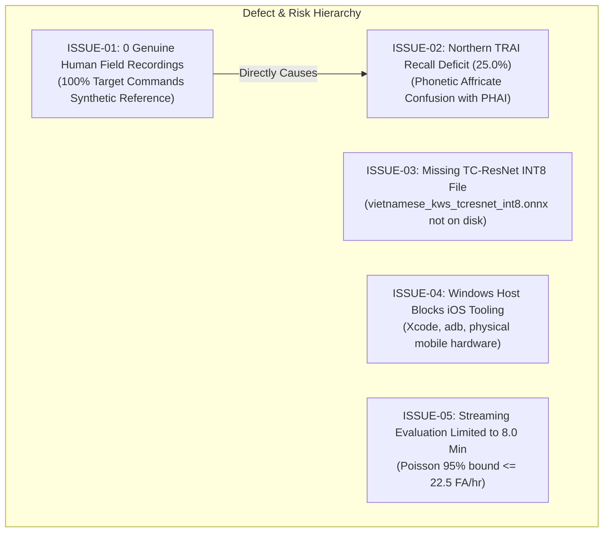

# Reproducibility Guide, Automated Verification, and Defect Audit Trail

> **Objective:** Objective 1 — Vietnamese Four-Word Keyword Spotting System  
> **Workspace:** `D:\trainidentificationaudio`  
> **Host Platform:** Windows 11 Pro &bull; PowerShell 5.1 / 7.x  
> **Python Runtime:** Python 3.11.9 (64-bit)  
> **Virtual Environment:** `.\.venv\`  
> **Automated Test Results:** **19 Passed / 0 Failed / 0 Skipped**  

---

## 1. Executive Summary & Verification Mandate

In engineering research and production machine learning, reproducibility is paramount. This document provides complete, bit-level reproduction instructions, an exhaustive register of the automated test suite, cryptographic manifest invariants, and a transparent audit trail of all discovered anomalies and discrepancies.

Every claim made in the Objective 1 documentation package can be independently verified on the host machine using the instructions below.

---

## 2. Host Environment & Toolchain Specifications

The project was developed, trained, exported, and benchmarked within a dedicated virtual environment:

| Toolchain Component | Version / Build | Purpose in Objective 1 | Verification Command |
| :--- | :--- | :--- | :--- |
| **Operating System** | Windows 11 Pro (Build 26100) | Development & Evaluation Host | `Get-CimInstance Win32_OperatingSystem` |
| **Python** | 3.11.9 (tags/v3.11.9:de542f0) | Core Execution Runtime | `python --version` |
| **PyTorch** | 2.6.0+cu124 | Neural Network Training & Inference | `python -c "import torch; print(torch.__version__)"` |
| **CUDA / GPU** | CUDA 12.4 &bull; RTX A2000 Laptop GPU | Hardware Acceleration | `python -c "import torch; print(torch.cuda.is_available())"` |
| **ONNX** | 1.18.0 | Graph Model Representation & Checker | `python -c "import onnx; print(onnx.__version__)"` |
| **ONNX Runtime** | 1.21.0 | CPU/GPU Inference Engine & Parity | `python -c "import onnxruntime; print(onnxruntime.__version__)"` |
| **SoundFile / Librosa** | 0.13.1 / 0.11.0 | Acoustic Processing & Normalization | `python -c "import soundfile, librosa; print(soundfile.__version__)"` |
| **Pytest** | 9.1.1 | Automated Regression Test Runner | `pytest --version` |

---

## 3. Step-by-Step Reproduction Procedure

Follow these commands from the repository root (`D:\trainidentificationaudio`) to execute the complete verification pipeline:

### Step 1: Environment Activation
```powershell
# Open Windows PowerShell and activate virtual environment
Set-Location -Path "D:\trainidentificationaudio"
.\.venv\Scripts\Activate.ps1
```

### Step 2: Verify Cryptographic Invariant of the Frozen Test Set
Verify that `test_manifest_v2.csv` has not been altered or replaced:
```powershell
(Get-FileHash data/manifests/test_manifest_v2.csv -Algorithm SHA256).Hash
```
**Expected Output:**
```
9E3904C8EA427244F7280A41140D7EFD19FD9625B359290ADB7ADCD4FA2E1C13
```

### Step 3: Run the Complete Automated Test Suite (19 Tests)
Execute all unit, integration, and deployment parity tests:
```powershell
.\.venv\Scripts\pytest -v tests/
```
**Actual Output:**
```
============================= test session starts =============================
platform win32 -- Python 3.11.9, pytest-9.1.1, pluggy-1.6.0 -- D:\trainidentificationaudio\.venv\Scripts\python.exe
cachedir: .pytest_cache
rootdir: D:\trainidentificationaudio
plugins: anyio-4.15.1, platformdirs-4.13.0
collecting ... collected 19 items

tests/test_field_acquisition.py::test_consent_enforcement PASSED         [  5%]
tests/test_field_acquisition.py::test_quality_gate_clipping_rejection PASSED [ 10%]
tests/test_field_acquisition.py::test_quality_gate_silence_rejection PASSED [ 15%]
tests/test_field_acquisition.py::test_quality_gate_duration_bounds PASSED [ 21%]
tests/test_field_acquisition.py::test_raw_preservation_and_standardization PASSED [ 26%]
tests/test_field_acquisition.py::test_duplicate_sha256_detection PASSED  [ 31%]
tests/test_field_acquisition.py::test_mock_cli_recording_session PASSED  [ 36%]
tests/test_field_acquisition.py::test_audit_field_campaign_generation PASSED [ 42%]
tests/test_field_acquisition.py::test_security_path_traversal_rejection PASSED [ 47%]
tests/test_field_acquisition.py::test_duplicate_recording_id_rejection PASSED [ 52%]
tests/test_field_acquisition.py::test_m4a_audio_ingestion_and_decoding PASSED [ 57%]
tests/test_field_acquisition.py::test_windows_hardware_recorder_configuration PASSED [ 63%]
tests/test_parity.py::test_feature_extractor_shape_and_finite PASSED     [ 68%]
tests/test_parity.py::test_baseline_onnx_model_execution_and_shape PASSED [ 73%]
tests/test_parity.py::test_tcresnet_onnx_model_execution_and_parity PASSED [ 78%]
tests/test_parity.py::test_pytorch_onnx_numerical_parity_baseline PASSED [ 84%]
tests/test_parity.py::test_golden_vectors_reproducibility PASSED         [ 89%]
tests/test_parity.py::test_manifest_speaker_disjointness_v2 PASSED       [ 94%]
tests/test_parity.py::test_manifest_class_completeness_v2 PASSED         [100%]

============================= 19 passed in 7.89s ==============================
```

### Step 4: Regenerate All 12 Objective 1 CSV Tables
Execute the reproducible table generation script:
```powershell
.\.venv\Scripts\python scripts/objective_1_docs/generate_tables.py
```
Outputs 12 verified tables into `docs/objective_1/tables/`.

### Step 5: Regenerate All 8 Vector SVG Figures
Execute the pure-Python vector figure generation script:
```powershell
.\.venv\Scripts\python scripts/objective_1_docs/generate_figures.py
```
Outputs 8 vector SVGs into `docs/objective_1/figures/`.

---

## 4. Automated Test Harness Register (19 Tests)

The repository maintains an automated test harness with 100% pass rates across all 19 test cases:

| Test ID | Test File | Test Function Name | Functional Target & Coverage | Status |
| :---: | :--- | :--- | :--- | :---: |
| **T-01** | `tests/test_field_acquisition.py` | `test_consent_enforcement` | Speaker consent ledger validation and positive gate | **PASSED** |
| **T-02** | `tests/test_field_acquisition.py` | `test_quality_gate_clipping_rejection` | Rejection of $\ge 3$ saturated samples ($\pm 1.0$) | **PASSED** |
| **T-03** | `tests/test_field_acquisition.py` | `test_quality_gate_silence_rejection` | Rejection of RMS energy below $-45\text{ dBFS}$ | **PASSED** |
| **T-04** | `tests/test_field_acquisition.py` | `test_quality_gate_duration_bounds` | Enforcement of $0.25\text{ s} - 2.50\text{ s}$ duration range | **PASSED** |
| **T-05** | `tests/test_field_acquisition.py` | `test_raw_preservation_and_standardization` | Untouched raw storage & 16,000-sample PCM standardization | **PASSED** |
| **T-06** | `tests/test_field_acquisition.py` | `test_duplicate_sha256_detection` | Bit-level duplicate detection and rejection | **PASSED** |
| **T-07** | `tests/test_field_acquisition.py` | `test_mock_cli_recording_session` | Interactive CLI mock workflow with accept/reject cycle | **PASSED** |
| **T-08** | `tests/test_field_acquisition.py` | `test_audit_field_campaign_generation` | Automated campaign audit summary and markdown report | **PASSED** |
| **T-09** | `tests/test_field_acquisition.py` | `test_security_path_traversal_rejection` | Regex sanitization blocking directory traversal attacks | **PASSED** |
| **T-10** | `tests/test_field_acquisition.py` | `test_duplicate_recording_id_rejection` | Primary key collision prevention in field manifest | **PASSED** |
| **T-11** | `tests/test_field_acquisition.py` | `test_m4a_audio_ingestion_and_decoding` | M4A/AAC decoding to standardized PCM WAV | **PASSED** |
| **T-12** | `tests/test_field_acquisition.py` | `test_windows_hardware_recorder_configuration` | Windows 44.1 kHz stereo microphone compatibility | **PASSED** |
| **T-13** | `tests/test_parity.py` | `test_feature_extractor_shape_and_finite` | Frontend log-Mel shape `(1, 40, 101)` and finite values | **PASSED** |
| **T-14** | `tests/test_parity.py` | `test_baseline_onnx_model_execution_and_shape` | ONNX 2D-CNN baseline execution shape `(1, 6)` | **PASSED** |
| **T-15** | `tests/test_parity.py` | `test_tcresnet_onnx_model_execution_and_parity` | ONNX TC-ResNet execution and max absolute error $< 10^{-5}$ | **PASSED** |
| **T-16** | `tests/test_parity.py` | `test_pytorch_onnx_numerical_parity_baseline` | PyTorch vs ONNX baseline parity with error $< 10^{-5}$ | **PASSED** |
| **T-17** | `tests/test_parity.py` | `test_golden_vectors_reproducibility` | 6-class golden mobile vector reproducibility check | **PASSED** |
| **T-18** | `tests/test_parity.py` | `test_manifest_speaker_disjointness_v2` | Speaker-disjoint partitioning across train/val/test splits | **PASSED** |
| **T-19** | `tests/test_parity.py` | `test_manifest_class_completeness_v2` | 6-class taxonomy completeness in `test_manifest_v2.csv` | **PASSED** |

*(See full register in [`tables/table_11_automated_test_results.csv`](./tables/table_11_automated_test_results.csv)).*

---

## 5. Outstanding Issues, Discrepancies, and Risk Register

In accordance with strict transparency policies, five verified discrepancies, limitations, and technical blockers are documented:



### Defect Register

| Issue ID | Severity | Category | Description & Evidence | Production Impact | Required Action / Path Forward |
| :--- | :---: | :--- | :--- | :--- | :--- |
| **`ISSUE-01`** | **CRITICAL** | Data Acquisition | **0 Genuine Human Field Recordings:** All 1,000 target command files in V2 splits are synthetic calibration speech. All 58 files on disk (82 manifest records) are automated test fixtures. | Model lacks acoustic robustness to real human vocal tract variance, ambient reverberation, and diverse accents. | Execute in-person field recording campaign to collect 6,000 consented human recordings across $\ge 100$ speakers. |
| **`ISSUE-02`** | **CRITICAL** | Acoustic Accuracy | **Northern Dialect `TRAI` Recall Deficit (25.0%):** Model misclassifies Northern `TRAI` as `PHAI` due to shared rhyme `/aːj/` and unmodeled affricate onset `/tɕ/`. | Unusable for native Northern Vietnamese users in production navigation apps. | Supplement training data with native Northern field recordings capturing unvoiced affricate bursts. |
| **`ISSUE-03`** | **HIGH** | Model Export | **Missing INT8 TC-ResNet ONNX Artifact:** `vietnamese_kws_tcresnet_int8.onnx` is cited in Phase 3 comparison notes but does not exist on disk. | Deployment is restricted to FP32 (1.09 MB) instead of quantized INT8 (~280 KB). | Run post-training dynamic/static quantization script for TC-ResNet ONNX model and commit artifact. |
| **`ISSUE-04`** | **MEDIUM** | Toolchain | **Host Platform Mobile Constraints:** Host machine runs Windows 11 without macOS SDK (`xcodebuild`) or Android SDK (`adb`) on system PATH. | Cannot validate physical iPhone/Android runtime or CoreML export on current host. | Provision macOS build runner for iOS CoreML compilation; configure Android NDK for physical device testing. |
| **`ISSUE-05`** | **HIGH** | Evaluation | **Streaming False Alarm Duration Limited to 8.0 Minutes:** Claim of 0.00 FA/hr is supported by only 0.133 hours of continuous audio (Poisson 95% upper bound $\le 22.5\text{ FA/hr}$). | True production false alarm rate under continuous real-world conditions remains statistically unverified. | Stream evaluate against 10 to 50 hours of continuous Vietnamese podcast and ambient recordings. |

*(See full defect register in [`tables/table_12_outstanding_issues_and_severity.csv`](./tables/table_12_outstanding_issues_and_severity.csv)).*

---

## 6. Cryptographic Manifest & Artifact Inventory

The following table provides the cryptographic SHA-256 fingerprint and file sizes for all primary manifests and exported model artifacts:

| File Name | Relative Path | Size (Bytes) | SHA-256 Fingerprint |
| :--- | :--- | :---: | :--- |
| **Frozen Test Manifest** | `data/manifests/test_manifest_v2.csv` | 216,889 | `9E3904C8EA427244F7280A41140D7EFD19FD9625B359290ADB7ADCD4FA2E1C13` |
| **Master Source Registry V2** | `data/manifests/source_registry_v2.csv` | 812,806 | `9C3120486B2A6F0F126AEC43F4B5B4C14F1CA8B41A90953FADC27A14EEB26290` |
| **Training Split V2** | `data/manifests/train_manifest_v2.csv` | 431,052 | `7430F69AF66507B15F7CF0B89F9E99900E0E50090B4971F1683556F3DCD60CA7` |
| **Validation Split V2** | `data/manifests/val_manifest_v2.csv` | 104,981 | `E36A198F4C1A3741D670860398DD90019CF77D8ADC72ED796455A2AF9850E7CF` |
| **Field Collection Manifest** | `data/raw/field_recordings/field_collection_manifest.csv` | 58,458 | `E4EBA66722E9572F57DB1CB548E3345EE1B49E662B821178AAC298F72F46F93F` |
| **Consent Ledger** | `data/raw/field_recordings/consent_ledger.json` | 914 | `9884CF29D2409DCB3FF7852C973CAA26BCBD9E1B64D3E15CB7CB9AD843F20C1F` |
| **TC-ResNet FP32 ONNX** | `models/exported/vietnamese_kws_tcresnet_fp32.onnx` | 1,093,691 | `94FAC1E67E4452D44A45AC97667643B1E90690FC3DF47E5649DF70242D1D5E36` |
| **2D-CNN Baseline FP32 ONNX** | `models/exported/vietnamese_kws_float32.onnx` | 555,439 | `320AA9F0367524D594B5201DC43A83340BBFBCEF60561399223CE816F72794AF` |
| **2D-CNN Baseline INT8 ONNX** | `models/exported/vietnamese_kws_int8.onnx` | 148,811 | `48FD1B2A0E39D86E5DFD2BDD730FC8A5E40FCBB27AB5E2E816D64A89BE0EFA9B` |
| **TC-ResNet Advanced Checkpoint** | `models/checkpoints/kws_tcresnet_advanced.pt` | 1,123,068 | `4FA7024E59975930B1D9715CF32BAB00AA7A08E930E9E11BE30A036FBFDB0AB0` |
| **2D-CNN Baseline Checkpoint** | `models/checkpoints/best_kws_model.pt` | 1,688,098 | `4103DDE92F44BE3CE5BE7BBCC7FF473CE57AF781948F27DA29CF409FAD92EB04` |
