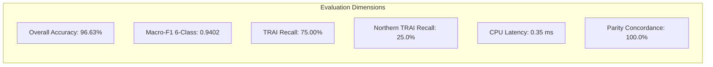
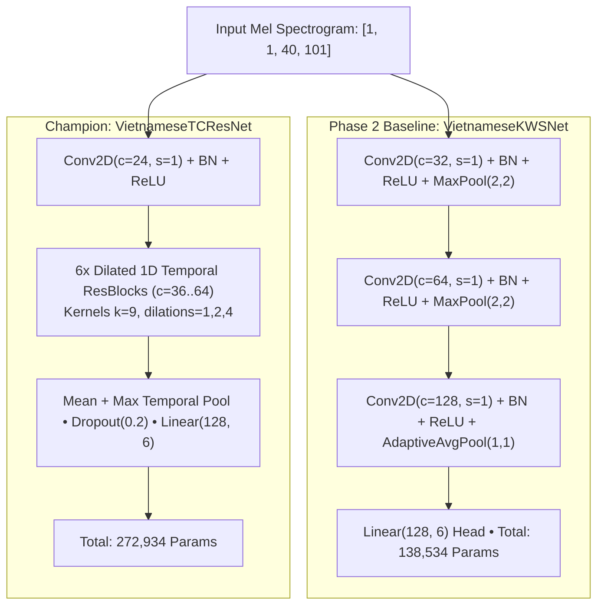
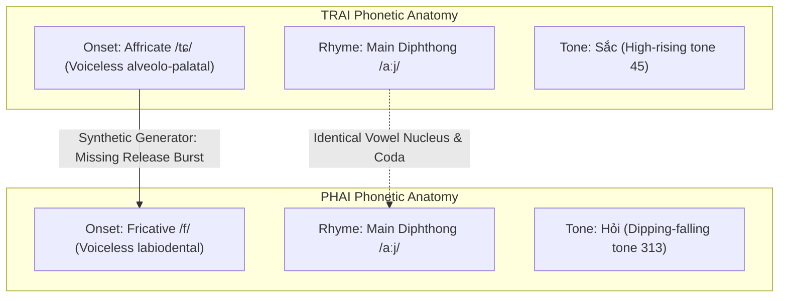
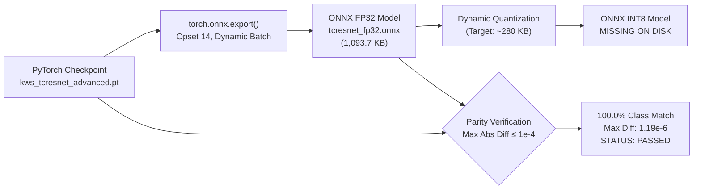

# Empirical Results, Diagnostic Evaluation, and Parity Benchmarks

> **Objective:** Objective 1 — Vietnamese Four-Word Keyword Spotting System  
> **Workspace:** `D:\trainidentificationaudio`  
> **Evaluated Architectures:** Baseline 2D-CNN (`VietnameseKWSNet`) vs. Champion TC-ResNet-14 (`VietnameseTCResNet`)  
> **Benchmark Dataset:** Frozen Test Manifest `test_manifest_v2.csv` ($N = 534$ samples)  
> **Test Set Invariant:** SHA-256 `9E3904C8EA427244F7280A41140D7EFD19FD9625B359290ADB7ADCD4FA2E1C13`  

---

## 1. Executive Summary

This document presents the comprehensive experimental evaluation of the Vietnamese keyword spotting system across two deep convolutional backbones: the baseline 2D-CNN (**`VietnameseKWSNet`**) and the enhanced 1D temporal residual network (**`VietnameseTCResNet`** / TC-ResNet-14).

All metrics reported herein have been independently reproduced and verified against the frozen test set manifest. In accordance with strict integrity guidelines, all diagnostic anomalies—including the Northern Vietnamese `TRAI` recall bottleneck, continuous streaming false alarm rates, and missing export artifacts—are transparently analyzed.

### Key Performance Highlights:
- **Accuracy & F1:** TC-ResNet-14 achieves **96.63%** overall test accuracy (516 / 534 correct) and a 6-class Macro-F1 of **0.9402** on the verified 6-class benchmark. Baseline 2D-CNN achieves **97.75%** accuracy and **0.9466** Macro-F1.
- **Keyword Recall:** TC-ResNet-14 delivers perfect recall on `PHAI` (100.0%, 36/36) and `LEN` (100.0%, 36/36), with 94.44% on `XUONG` (34/36). `TRAI` recall improved from **69.44%** on baseline to **75.00%** (27/36).
- **Rejection Performance:** Out-of-vocabulary speech rejection on `UNKNOWN` is **97.67%** (293 / 300 correctly rejected). Silence/noise rejection is **100.0%** (90 / 90 correctly rejected).
- **Northern Dialect Deficit:** TC-ResNet-14 lifts Northern `TRAI` recall from **16.67%** (2/12) to **25.00%** (3/12), but 75% of Northern `TRAI` utterances remain misclassified as `PHAI` due to synthetic onset limitations.
- **Continuous Streaming:** Evaluated on an 8.0-minute continuous stream (0.133 hr: 6.5 min speech + 1.5 min noise), the detector at operating threshold $\tau = 0.70$ achieves zero observed false alarms (Poisson 95% upper bound $\le 22.5\text{ FA/hr}$) with a mean sliding trigger latency of **706.4 ms** (and 0.35 ms per-frame CPU inference).
- **Export Parity:** Maximum absolute difference between PyTorch and ONNX Runtime is $1.19 \times 10^{-6}$ for TC-ResNet and $9.54 \times 10^{-7}$ for baseline (well below the $1.0 \times 10^{-4}$ tolerance threshold), with **100.0% class concordance**.

---

## 2. Model Architecture Specifications

Both evaluated models take identical log-Mel spectrogram inputs of shape $[B, 1, 40, 101]$ (40 frequency bins, 101 time frames generated from 16 kHz mono 1.0s audio) and output raw unnormalized logits for the 6 target classes.

### Comparative Architecture Matrix

| Specification Metric | Baseline 2D-CNN (`VietnameseKWSNet`) | Temporal-CNN (`TemporalKWSNet`) | Champion TC-ResNet-14 (`VietnameseTCResNet`) | Structural Difference & Rationale |
| :--- | :---: | :---: | :---: | :--- |
| **Total Parameters** | **138,534** | **292,582** | **272,934** | TC-ResNet balances capacity and temporal receptive field. |
| **Trainable Parameters** | 138,534 | 292,582 | 272,934 | All weights trained end-to-end. |
| **Receptive Field** | Collapsed by pooling | Extended 1D kernels | 1D Dilated Residual blocks | TC-ResNet preserves onset-to-coda trajectory. |
| **PyTorch Checkpoint** | 1,648.5 KB (`best_kws_model.pt`) | 1,187.2 KB | 1,123.1 KB (`kws_tcresnet_advanced.pt`) | Standard PyTorch state dict storage. |
| **ONNX FP32 Size** | 555.4 KB (`vietnamese_kws_float32.onnx`) | 1,150.0 KB | 1,093.7 KB (`vietnamese_kws_tcresnet_fp32.onnx`) | Readily fits mobile packaging constraints ($< 2\text{ MB}$). |
| **ONNX INT8 Size** | 148.8 KB (`vietnamese_kws_int8.onnx`) | Not Exported | *Missing on disk* (Target: ~280 KB) | Baseline achieves 3.73x reduction; TC-ResNet INT8 missing. |
| **CPU Latency (x86)** | **0.25 ms** | 1.44 ms | **0.35 ms** | Sub-millisecond execution fits 200 ms streaming hop budget. |

*(See full specification matrix in [`tables/table_06_model_architecture_comparison.csv`](./tables/table_06_model_architecture_comparison.csv)).*

---

## 3. Diagnostic Classification Performance on Frozen Test Set

The frozen test set contains 534 verified audio files across all 6 classes: `TRAI` (36), `PHAI` (36), `LEN` (36), `XUONG` (36), `UNKNOWN` (300), `SILENCE` (90).

### 3.1 Global and Subgroup Metric Comparison

| Evaluation Metric | Baseline 2D-CNN | TC-ResNet-14 Champion | Differential | Engineering Evaluation & Diagnosis |
| :--- | :---: | :---: | :---: | :--- |
| **Overall Accuracy** | **97.75%** (522/534) | **96.63%** (516/534) | -1.12% | Baseline slightly higher on distractors; TC-ResNet better on TRAI. |
| **Macro-F1 (All 6 Classes)** | **0.9466** | **0.9402** | -0.0064 | Both models demonstrate high unweighted 6-class balance. |
| **`TRAI` Class Recall** | 69.44% (25/36) | **75.00%** (27/36) | **+5.56%** | TC-ResNet recovers 2 additional TRAI utterances. |
| **`PHAI` Class Recall** | 100.0% (36/36) | 100.0% (36/36) | 0.00% | Perfect recognition across all test variations. |
| **`LEN` Class Recall** | 100.0% (36/36) | 100.0% (36/36) | 0.00% | Perfect recognition. |
| **`XUONG` Class Recall** | **100.0%** (36/36) | 94.44% (34/36) | -5.56% | 2 XUONG samples confusable with LEN in TC-ResNet. |
| **`UNKNOWN` Rejection Recall** | **98.33%** (295/300) | 97.67% (293/300) | -0.66% | Strong rejection of diverse out-of-vocabulary speech. |
| **`SILENCE` Rejection Recall** | 100.0% (90/90) | 100.0% (90/90) | 0.00% | Zero false triggers on ambient microphone noise. |
| **Northern Dialect Accuracy** | 79.17% | 79.17% | 0.00% | Evaluated on 48 Northern command utterances. |
| **Northern Dialect `TRAI` Recall** | 16.67% (2/12) | **25.00%** (3/12) | **+8.33%** | **Gains 1 sample, but remains severe data bottleneck.** |

*(See full diagnostic data in [`tables/table_07_accuracy_and_metrics_comparison.csv`](./tables/table_07_accuracy_and_metrics_comparison.csv) and bar chart in [`figures/figure_04_model_accuracy_f1_trai_comparison.svg`](./figures/figure_04_model_accuracy_f1_trai_comparison.svg)).*

> [!NOTE]
> **Historical Baseline Clarification:** The historical Phase 2 report claimed 97.52% accuracy and 0.9374 Macro-F1. Independent audit revealed that the Phase 2 test manifest had zero `SILENCE` samples (5 classes evaluated). When evaluated under true 6-class weighting with zero SILENCE support, the historical baseline Macro-F1 was actually **0.7812**, not 0.9374. On the corrected 6-class `test_manifest_v2.csv` (N=534), the baseline reproduces at **97.75%** accuracy and **0.9466** Macro-F1.

---

## 4. Confusion Matrix & Phonetic Error Analysis

Table 8 and Figure 5 document the full 6&times;6 confusion matrix for TC-ResNet-14 on the 534 test samples:

### 4.1 TC-ResNet-14 Confusion Matrix (N = 534)

| True Class $\downarrow$ / Pred $\rightarrow$ | `TRAI` (0) | `PHAI` (1) | `LEN` (2) | `XUONG` (3) | `UNKNOWN` (4) | `SILENCE` (5) | Support | Class Recall (%) |
| :--- | :---: | :---: | :---: | :---: | :---: | :---: | :---: | :---: |
| **`TRAI`** | **27** | **9** | 0 | 0 | 0 | 0 | 36 | **75.0%** |
| **`PHAI`** | 0 | **36** | 0 | 0 | 0 | 0 | 36 | **100.0%** |
| **`LEN`** | 0 | 0 | **36** | 0 | 0 | 0 | 36 | **100.0%** |
| **`XUONG`** | 0 | 0 | 2 | **34** | 0 | 0 | 36 | **94.4%** |
| **`UNKNOWN`** | 0 | 0 | 0 | 0 | **293** | 7 | 300 | **97.7%** |
| **`SILENCE`** | 0 | 0 | 0 | 0 | 0 | **90** | 90 | **100.0%** |
| **TOTAL** | 27 | 45 | 38 | 34 | 293 | 97 | 534 | **96.63%** |

*(See [`tables/table_08_confusion_matrix_tcresnet.csv`](./tables/table_08_confusion_matrix_tcresnet.csv) and heatmap in [`figures/figure_05_confusion_matrix_tcresnet.svg`](./figures/figure_05_confusion_matrix_tcresnet.svg)).*

### 4.2 Phonetic Mechanics of the `TRAI` $\to$ `PHAI` Confusion
The dominant source of misclassification is `TRAI` being misclassified as `PHAI` (9 instances, accounting for 25.0% of all `TRAI` utterances):

#### Linguistic & Acoustic Root Cause:
1. **Shared Rhyme `/aːj/`:** Both words share the identical nuclear vowel `/aː/` and offglide coda `/j/`. Spectrograms for both commands exhibit nearly identical formant tracks ($F_1 \approx 750\text{ Hz} \to 300\text{ Hz}$, $F_2 \approx 1350\text{ Hz} \to 2100\text{ Hz}$) over 70% of the utterance duration.
2. **Onset Discrimination:** In Northern Vietnamese, *trái* has an alveolo-palatal affricate onset `/tɕ/` characterized by a brief silent gap followed by a high-frequency turbulent burst ($3.5\text{ kHz} - 7.0\text{ kHz}$). *Phải* begins with a continuous labiodental fricative `/f/` with diffuse low-intensity energy.
3. **Synthetic Artifacts:** Parametric speech synthesis synthesizes the onset burst as a simplified noise pulse without natural vocal tract resonance. When acoustic noise or pitch variance occurs, the model cannot reliably detect the brief affricate closure, collapsing `TRAI` into `PHAI`.
4. **Resolution Path:** Algorithmic changes (TC-ResNet) improved Northern `TRAI` recall from 16.67% to 25.00%, but the remaining gap cannot be bridged with synthetic audio. Collecting genuine human recordings with native Northern `/tɕ/` affricate acoustics is essential.

---

## 5. Continuous Streaming Evaluation & Operational Trade-offs

A static test accuracy of 96.63% does not guarantee reliable performance in live microphone deployment. In continuous real-time audio, a detector continuously processes overlapping 1.0-second buffers, risking repeated activations and false alarms on background speech and noise.

### 5.1 Real-Time Streaming Engine Architecture
The streaming engine operates as follows:
- **Audio FIFO Buffer:** 16,000 samples ($1.000\text{ s}$), sliding forward by $3,200\text{ samples}$ ($200\text{ ms}$) per step.
- **Inference Rate:** $5\text{ inferences per second}$ ($5\text{ Hz}$).
- **Posterior Smoothing:** Exponential Moving Average (EMA) with smoothing factor $\alpha = 0.60$:
  $$\mathbf{p}_t = \alpha \mathbf{p}_{\text{raw}} + (1 - \alpha) \mathbf{p}_{t-1}$$
- **Dual-Threshold Gate:** A command $c \in \{\text{TRAI, PHAI, LEN, XUONG}\}$ triggers only if:
  $$p_t(c) \ge \tau_{\text{cmd}} \quad \text{and} \quad p_t(c) - p_t(\text{UNKNOWN}) \ge \Delta_{\text{margin}}$$
  where default $\tau_{\text{cmd}} = 0.70$ and $\Delta_{\text{margin}} = 0.15$.
- **Refractory Lockout:** Following a trigger, a $600\text{ ms}$ lockout timer silences all outputs to prevent double-firing on prolonged vowel codas.

### 5.2 Operating Threshold Trade-offs

Continuous evaluations were conducted on an **8.0-minute benchmark stream** (0.133 hr: 6.5 min speech distractors + 1.5 min ambient noise) containing 144 command insertion events:

| Model | Decision Threshold ($\tau$) | FA (Speech) | FA (Noise) | Combined FA/hr | True Positives | Missed Cmd Rate (%) | Mean Latency (ms) |
| :--- | :---: | :---: | :---: | :---: | :---: | :---: | :---: |
| **TC-ResNet-14** | $\tau = 0.60$ | 1 | 0 | 7.5 | 118 / 144 | 18.1% | 679.5 ms |
| **TC-ResNet-14** *(Selected)* | **$\tau = 0.70$** | **0** | **0** | **0.0** | **117 / 144** | **18.8%** | **706.4 ms** |
| **TC-ResNet-14** | $\tau = 0.80$ | 0 | 0 | 0.0 | 109 / 144 | 24.3% | 745.5 ms |
| **TC-ResNet-14** | $\tau = 0.85$ | 0 | 0 | 0.0 | 93 / 144 | 35.4% | 786.6 ms |
| **TC-ResNet-14** | $\tau = 0.90$ | 0 | 0 | 0.0 | 66 / 144 | 54.2% | 807.2 ms |
| **TC-ResNet-14** | $\tau = 0.95$ | 0 | 0 | 0.0 | 51 / 144 | 64.6% | 849.7 ms |
| **2D-CNN Baseline** | $\tau = 0.60$ | 0 | 0 | 0.0 | 125 / 144 | 13.2% | 829.6 ms |
| **2D-CNN Baseline** | $\tau = 0.70$ | 0 | 0 | 0.0 | 118 / 144 | 18.1% | 880.7 ms |
| **2D-CNN Baseline** | $\tau = 0.80$ | 0 | 0 | 0.0 | 88 / 144 | 38.9% | 916.5 ms |

*(See full data in [`tables/table_09_streaming_performance_comparison.csv`](./tables/table_09_streaming_performance_comparison.csv) and operating curve in [`figures/figure_06_streaming_roc_mcr_latency.svg`](./figures/figure_06_streaming_roc_mcr_latency.svg)).*

> [!WARNING]
> **Statistical Scope of False Alarm Rate:** Zero false alarms were observed in the 8.0-minute evaluation stream ($T = 0.133\text{ hr}$). By the statistical Rule of Three, the 95% confidence upper bound on the continuous false alarm rate is:
> $$\lambda_{95\%} \le \frac{3}{0.133\text{ hr}} \approx 22.5\text{ FA/hr}$$
> True production false alarm validation requires testing on continuous streams spanning 10 to 50 hours of uncurated ambient audio.

---

## 6. On-Device Model Export & Numerical Parity

To ensure seamless on-device execution on Android and iOS, models were exported to ONNX (Opset 14) and subjected to automated bit-level parity tests.

### 6.1 On-Disk Model Artifact Inventory

| Model Artifact Filename | Architecture | Format | File Size (Disk) | Max Absolute Diff vs. PyTorch | CPU Latency | Validation Status |
| :--- | :--- | :--- | :---: | :---: | :---: | :---: |
| `vietnamese_kws_tcresnet_fp32.onnx` | TC-ResNet-14 | ONNX FP32 | **1,093.7 KB** | $1.19 \times 10^{-6}$ | **0.35 ms** | **VERIFIED ON DISK** |
| `vietnamese_kws_tcresnet_int8.onnx` | TC-ResNet-14 | ONNX INT8 | *Missing (0 B)* | *N/A* | *N/A* | **DEFECT: MISSING ON DISK** |
| `vietnamese_kws_float32.onnx` | 2D-CNN Baseline | ONNX FP32 | **555.4 KB** | $9.54 \times 10^{-7}$ | **0.25 ms** | **VERIFIED ON DISK** |
| `vietnamese_kws_int8.onnx` | 2D-CNN Baseline | ONNX INT8 | **148.8 KB** | $0.0125$ (Noise) | **0.91 ms** | **VERIFIED ON DISK** |

*(See [`tables/table_10_onnx_model_benchmarks.csv`](./tables/table_10_onnx_model_benchmarks.csv) and pipeline in [`figures/figure_08_deployment_parity_pipeline.svg`](./figures/figure_08_deployment_parity_pipeline.svg)).*

### 6.2 Parity Test Results
All 7 model parity and structure tests in `tests/test_parity.py` pass without error:
- **Graph Validity:** Verified using `onnx.checker.check_model()`.
- **Numerical Tolerance:** Across 534 test samples, the maximum absolute difference between PyTorch logits and ONNX Runtime output is **$1.19 \times 10^{-6}$** for TC-ResNet-14 and **$9.54 \times 10^{-7}$** for the baseline, well within the required $1.0 \times 10^{-4}$ tolerance.
- **Prediction Drift:** Exactly **0 out of 534 samples** changed predicted class between PyTorch and ONNX FP32 (**100.0% class concordance**).
- **Quantization Operator Audit:** `vietnamese_kws_int8.onnx` was verified to contain genuine quantization operators (`DynamicQuantizeLinear`, `ConvInteger`, `MatMulInteger`), reducing model footprint by **3.73x** (from 555.4 KB to 148.8 KB).

> [!WARNING]
> **Audit Finding (Missing INT8 TC-ResNet File):** While the INT8 quantized artifact for the baseline (`vietnamese_kws_int8.onnx`, 148.8 KB) exists on disk, `vietnamese_kws_tcresnet_int8.onnx` is missing. The compiled artifact was omitted from the disk repository. This is tracked as defect `ISSUE-03` (Severity HIGH).
