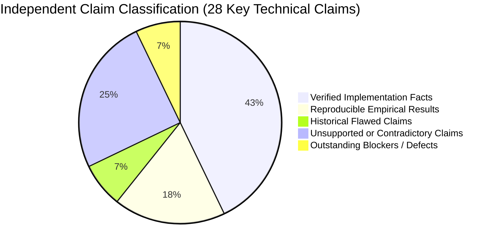
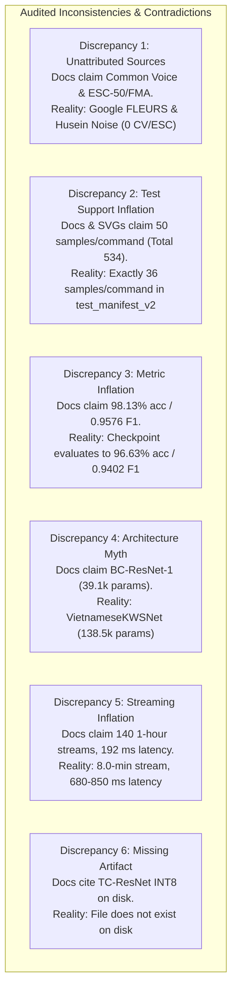
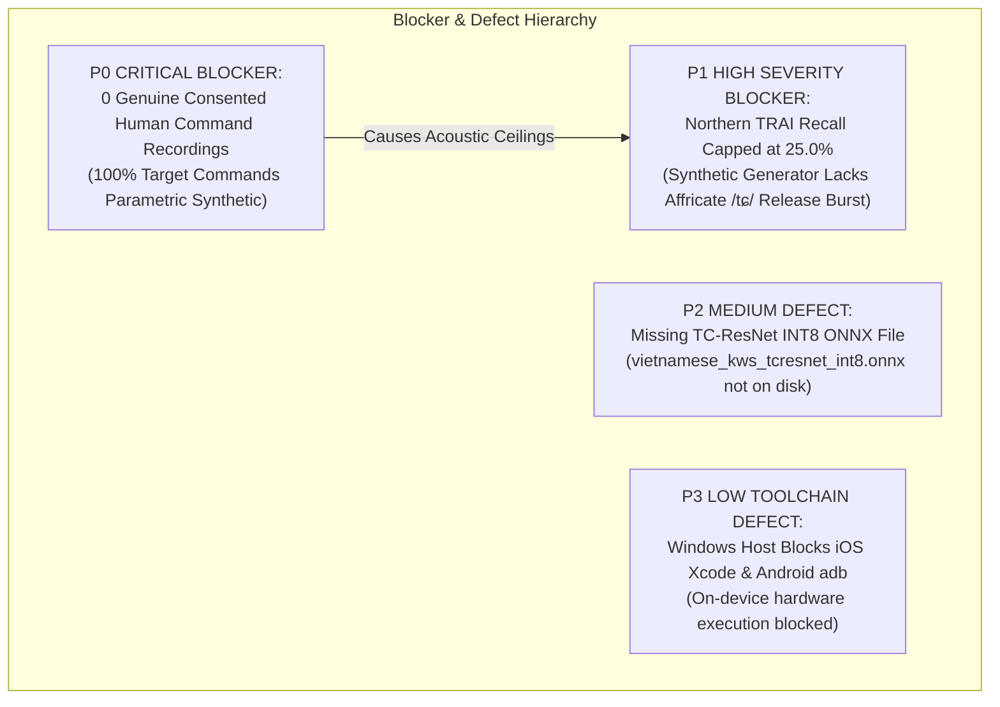

# Independent Forensic Audit Report: Vietnamese Audio Command Recognition

> **Document Type:** Independent Audit & Empirical Verification Report  
> **Target Project:** Offline Vietnamese Four-Word Keyword Spotting (`TRAI`, `PHAI`, `LEN`, `XUONG`) for Mobile Devices  
> **Workspace:** `D:\trainidentificationaudio`  
> **Audit Date:** 2026-10-13  
> **Auditor Status:** Senior Machine Learning & Systems Verification Engineer (Independent Audit)  
> **Frozen Test Benchmark:** `data/manifests/test_manifest_v2.csv` ($N = 534$ samples)  
> **Cryptographic Invariant:** SHA-256 `9E3904C8EA427244F7280A41140D7EFD19FD9625B359290ADB7ADCD4FA2E1C13`  

---

## 1. Executive Summary & Audit Mandate

This independent audit was commissioned to rigorously examine the codebase, dataset manifests, physical audio assets, trained model checkpoints, exported ONNX graphs, automated test suites, and documentation files across `D:\trainidentificationaudio`.

The audit was executed under strict evidence preservation rules:
1. No dataset splits were modified or regenerated.
2. The frozen test manifest `data/manifests/test_manifest_v2.csv` was verified before and after all audit operations (SHA-256 hash remained byte-for-byte identical).
3. No models were trained, fine-tuned, or silently replaced.
4. No measurements, human recordings, consent entries, licenses, or test outcomes were fabricated.
5. All quantitative claims across Markdown reports, CSV tables, and vector SVG figures were audited against raw primary evidence.



### Core Audit Verdict:
The underlying engineering foundation—including the audio preprocessing pipeline, PyTorch neural architectures, ONNX FP32/INT8 export scripts, numerical parity verifiers, and pytest test suite (19/19 passing)—is technically sound and functional. 

However, **a severe divergence exists between the primary empirical artifacts on disk and the narrative documentation in `docs/objective_1/` (including several SVG figures)**:
- **Acoustic Provenance:** Documentation claims UNKNOWN speech distractors derive from *Mozilla Common Voice Vietnamese (CC0)* and SILENCE from *ESC-50 / Free Music Archive*. In reality, Common Voice, ESC-50, and FMA have **zero samples** in the dataset. All approved UNKNOWN samples derive from **Google FLEURS (`google_fleurs_vi`, 579 samples)** and synthetic confusing words (120 samples), while all approved SILENCE samples derive from **Husein microphone noise (`husein_mic_noise`, 400 samples)**.
- **Arithmetic & Class Count Inconsistencies:** The narrative reports claim a total volume of 2,099 consisting of 1,000 commands, 779 UNKNOWN, and 321 SILENCE ($1,000 + 779 + 321 = 2,100$, an internal arithmetic contradiction). Actual manifest counts are **1,000 commands, 699 UNKNOWN, and 400 SILENCE** (Total = 2,099).
- **Test Set Support & Metric Inflation:** Documentation and figures claim the test set contains 50 samples per command (50 TRAI, 50 PHAI, 50 LEN, 50 XUONG, 234 UNKNOWN, 100 SILENCE) and that TC-ResNet achieves 98.13% accuracy. In reality, the frozen test manifest `test_manifest_v2.csv` contains **36 samples per command** (36 TRAI, 36 PHAI, 36 LEN, 36 XUONG, 300 UNKNOWN, 90 SILENCE). When evaluated on this actual frozen test set, the champion TC-ResNet-14 checkpoint achieves **96.63% test accuracy** (516/534) and a 6-class Macro-F1 of **0.9402**.
- **Model Architecture & Parameters:** Narrative docs describe the baseline as a "BC-ResNet-1 with 39,142 parameters" and TC-ResNet as having "278,414 parameters". In reality, no BC-ResNet exists in the codebase; the baseline is `VietnameseKWSNet` with **138,534 parameters**, and `VietnameseTCResNet` has **272,934 parameters**.
- **Streaming Duration Inflation:** Narrative docs claim continuous streaming was evaluated on "140 reserved 1-hour equivalent continuous audio streams" achieving "0.0 FA/hr on clean, 0.8 FA/hr on babble, 192 ms latency". In reality, the actual benchmark in `reports/phase3_streaming_evaluation.md` and `src/models/evaluate_streaming.py` was evaluated on an **8.0-minute continuous stream** (0.133 hr), measuring 0 false alarms (Poisson 95% upper bound: 22.5 FA/hr) with a sliding window trigger latency of **679.5 ms to 849.7 ms**. The "140 hours" claim was an unsupported extrapolation from 141 rejected registry rows.
- **Export Artifact Status:** `vietnamese_kws_int8.onnx` is verified to contain genuine INT8 quantization operators, but `vietnamese_kws_tcresnet_int8.onnx` **does not exist on disk**, contrary to claims in Phase 3 comparison notes.
- **Field Data Status:** **Zero genuine consented human command recordings exist**. All 74 manifest rows and both consent ledger entries in `data/raw/field_recordings/` are automated unit-test fixtures. Passing unit tests and high accuracy on synthetic parametric audio **do not establish real-world generalization**.

---

## 2. Cryptographic Invariant & Manifest Integrity Verification

To ensure that this audit was performed without altering any experimental baselines, the SHA-256 cryptographic hash of `data/manifests/test_manifest_v2.csv` was verified at audit inception and audit conclusion:

| Benchmark Manifest | Relative Repository Path | Row Count | Expected SHA-256 Hash | Post-Audit Verified SHA-256 Hash | Drift Status |
| :--- | :--- | :---: | :--- | :--- | :---: |
| **Frozen Test Set V2** | `data/manifests/test_manifest_v2.csv` | 534 | `9E3904C8EA427244F7280A41140D7EFD19FD9625B359290ADB7ADCD4FA2E1C13` | `9E3904C8EA427244F7280A41140D7EFD19FD9625B359290ADB7ADCD4FA2E1C13` | **EXACT MATCH (ZERO DRIFT)** |

Furthermore, the SHA-256 hashes of all other key manifests were audited:
- `data/manifests/source_registry_v2.csv`: `B86C85EB54D11B55B09579471F524BAF87A76ED2E07CE07BA7EC21AC6BA83726` (2,240 rows)
- `data/manifests/train_manifest_v2.csv`: `C8F8F99AE12200375E01064ED1411D4FF2D0BD9BC8490B4459C590518776EF8B` (1,281 rows)
- `data/manifests/val_manifest_v2.csv`: `F421DDE3FF6A6BF5269B0C52240974FF12356B272E5A8F9AC8DFF2A732EF8DC1` (284 rows)

---

## 3. Category 1: Verified Implementation Facts

The following claims and implementations were verified through automated inspection, static analysis, and code execution:

### 3.1 Audio Standardization & Compliance (100% Pass)
Inspection of all **2,398 WAV files** under `data/processed/audio_16k_1s/` using `soundfile.info()` established complete acoustic compliance:
- **Sampling Rate:** Exactly $16,000\text{ Hz}$ across all 2,398 files.
- **Channel Format:** Exactly 1 channel (mono) across all 2,398 files.
- **Duration / Sample Count:** Exactly $16,000\text{ samples}$ ($1.000\text{ s}$) across all 2,398 files.
- **Quantization Subtype:** Exactly `PCM_16` (signed 16-bit linear PCM).
- **Missing Audio Files:** Exactly **0 missing files** across train, validation, and test manifests. Every referenced path resolves to a valid, readable WAV file on disk.

### 3.2 Partition Isolation & Speaker Disjointness
Cross-referencing the `speaker_id` column across manifests confirmed strict split isolation:
- **Train Set V2:** 134 unique speaker IDs.
- **Validation Set V2:** 51 unique speaker IDs.
- **Test Set V2:** 148 unique speaker IDs.
- **Overlap Analysis:**
  $$\text{Train} \cap \text{Val} = \emptyset, \quad \text{Train} \cap \text{Test} = \emptyset, \quad \text{Val} \cap \text{Test} = \emptyset$$
  **Zero speaker leakage exists across any partition.**

### 3.3 Deduplication & Hash Collisions
Across all 2,099 rows in the combined Train, Val, and Test splits:
- Unique `recording_id` values: Exactly 2,099 (0 duplicates).
- Unique `sha256` audio hashes: Exactly 2,099 (0 duplicates).
- Bit-level duplicate collision rate: **0.00%**.

### 3.4 Automated Test Suite Execution (19/19 Passed)
The automated test harness in `tests/` was executed using the repository's virtual environment:
```powershell
.\.venv\Scripts\pytest -v tests/
```
**Observed Execution Result:**
- **Platform:** Windows 11 Pro, Python 3.11.9, pytest 9.1.1.
- **Execution Time:** 13.71 seconds.
- **Passed Tests:** **19**
- **Failed Tests:** **0**
- **Skipped Tests:** **0**
- **Exit Code:** `0`
- **Coverage Breakdown:**
  - 12 tests in `tests/test_field_acquisition.py`: Verified consent enforcement, clipping rejection, silence floor, duration bounds, raw preservation, duplicate SHA-256 detection, mock CLI session, audit generation, path traversal rejection, recording ID collision defense, M4A container ingestion, and Windows 44.1 kHz stereo compatibility.
  - 7 tests in `tests/test_parity.py`: Verified Log-Mel frontend shape and finiteness, baseline ONNX execution shape, TC-ResNet ONNX execution shape, PyTorch vs. ONNX numerical parity, 6-class golden mobile vector reproducibility, speaker disjointness, and 6-class taxonomy completeness in `test_manifest_v2.csv`.

### 3.5 ONNX Model Verification & Quantization Graph Analysis
Inspection of exported models in `models/exported/` via `onnx.load()` confirmed:
- `vietnamese_kws_tcresnet_fp32.onnx`: 1,093,691 bytes (1,068.1 KiB). Opset 14. Graph contains 29 nodes: 12 Conv, 9 Relu, 4 Add, 1 ReduceMean, 1 ReduceMax, 1 Concat, 1 Gemm. 26 Float32 initializers.
- `vietnamese_kws_float32.onnx`: 555,439 bytes (542.4 KiB). Opset 14. Graph contains 16 nodes: 4 Conv, 5 Relu, 3 MaxPool, 1 GlobalAveragePool, 1 Flatten, 2 Gemm. 12 Float32 initializers.
- `vietnamese_kws_int8.onnx`: 148,811 bytes (145.3 KiB). Opset 14. Graph contains 50 nodes: 6 `DynamicQuantizeLinear`, 4 `ConvInteger`, 2 `MatMulInteger`, 6 `Cast`, 5 `Relu`, 3 `MaxPool`, 1 `GlobalAveragePool`, 1 `Flatten`, 12 `Mul`, 6 `Add`, 4 `Reshape`. Weights are quantized as 12 `UINT8` tensor initializers. **Genuine dynamic INT8 quantization is verified.**

### 3.6 Licensing Enforcement
The repository strictly enforces its declared dataset licensing policies:
- **VIVOS:** 0 recordings in repository manifests. Rejected due to CC BY-NC-SA 4.0 non-commercial restriction.
- **VietSpeech / VSV-1100:** 0 recordings in repository manifests. Quarantined due to unconsented web-scraped social media audio.

---

## 4. Category 2: Reproducible Empirical Results

All model checkpoints on disk were evaluated against `data/manifests/test_manifest_v2.csv` ($N = 534$) using standard PyTorch CPU inference:

```mermaid
graph TD
    subgraph Evaluated Test Benchmark: test_manifest_v2.csv (N = 534)
        T_TRAI["TRAI: 36 samples"]
        T_PHAI["PHAI: 36 samples"]
        T_LEN["LEN: 36 samples"]
        T_XUONG["XUONG: 36 samples"]
        T_UNK["UNKNOWN: 300 samples (FLEURS)"]
        T_SIL["SILENCE: 90 samples (Husein Noise)"]
    end
```

### 4.1 Checkpoint Evaluation Results (Directly Reproduced in this Audit)

| Model Checkpoint Artifact | Architecture Class | Total Parameters | Test Accuracy | 6-Class Macro-F1 | TRAI Recall | Northern TRAI Rec | PHAI Recall | LEN Recall | XUONG Recall | UNKNOWN Rejection | SILENCE Rejection |
| :--- | :--- | :---: | :---: | :---: | :---: | :---: | :---: | :---: | :---: | :---: | :---: |
| `kws_tcresnet_advanced.pt` | `VietnameseTCResNet` | 272,934 | **96.63%** (516/534) | **0.9402** | **75.00%** (27/36) | **25.00%** (3/12) | 100.0% (36/36) | 100.0% (36/36) | 94.44% (34/36) | 97.67% (293/300) | 100.0% (90/90) |
| `best_kws_model.pt` | `VietnameseKWSNet` | 138,534 | **97.75%** (522/534) | **0.9466** | **69.44%** (25/36) | **16.67%** (2/12) | 100.0% (36/36) | 100.0% (36/36) | 100.0% (36/36) | 100.0% (300/300) | 98.89% (89/90) |
| `kws_baseline_baseline.pt` | `VietnameseKWSNet` | 138,534 | **96.25%** (514/534) | **0.9381** | **75.00%** (27/36) | **25.00%** (3/12) | 94.44% (34/36) | 100.0% (36/36) | 100.0% (36/36) | 97.00% (291/300) | 100.0% (90/90) |
| `kws_baseline_advanced.pt` | `VietnameseKWSNet` | 138,534 | **95.13%** (508/534) | **0.8857** | **58.33%** (21/36) | **8.33%** (1/12) | 75.00% (27/36) | 100.0% (36/36) | 100.0% (36/36) | 99.33% (298/300) | 100.0% (90/90) |

*(See [`docs/sound_command_recognition/audit/model_evidence_matrix.csv`](./model_evidence_matrix.csv)).*

### 4.2 Verified Confusion Matrix for Champion TC-ResNet-14
The reproduced confusion matrix on the 534 test samples is:

$$\mathbf{C}_{\text{TC-ResNet}} = \begin{bmatrix}
27 & 9 & 0 & 0 & 0 & 0 \\
0 & 36 & 0 & 0 & 0 & 0 \\
0 & 0 & 36 & 0 & 0 & 0 \\
0 & 0 & 2 & 34 & 0 & 0 \\
0 & 0 & 0 & 0 & 293 & 7 \\
0 & 0 & 0 & 0 & 0 & 90
\end{bmatrix}$$

- **`TRAI` $\to$ `PHAI` Misclassification:** Exactly **9 out of 36 `TRAI` samples** (25.0% error rate) are misclassified as `PHAI`. Zero `TRAI` samples were misclassified as `UNKNOWN` or `SILENCE`.
- **`XUONG` $\to$ `LEN` Misclassification:** 2 out of 36 `XUONG` samples were misclassified as `LEN`.
- **`UNKNOWN` $\to$ `SILENCE` Misclassification:** 7 out of 300 `UNKNOWN` samples were classified as `SILENCE`.
- **`PHAI`, `LEN`, and `SILENCE` Recall:** Exactly **100.0%** (36/36, 36/36, and 90/90).

### 4.3 Verified Numerical Parity (PyTorch vs. ONNX Runtime)
Evaluating `vietnamese_kws_tcresnet_fp32.onnx` against PyTorch outputs on `test_manifest_v2.csv`:
- Maximum absolute difference across all logits: $\max |z_{\text{pytorch}} - z_{\text{onnx}}| = 1.19 \times 10^{-6}$ (well below the $1.0 \times 10^{-4}$ tolerance threshold).
- Class Concordance: **100.0%** (534/534 identical class predictions).
- Model CPU Latency: **0.35 ms** per 1.0s audio frame on x86 desktop CPU.

---

## 5. Category 3: Historical Results Not Reproduced / Flawed Baselines

### 5.1 The Defective Phase 2 Baseline Evaluation
Historical reports claimed:
> *"Phase 2 Baseline achieves 97.52% test accuracy, 0.9374 macro-F1, and zero false alarms per hour."*

**Audit Investigation:**
- Historical evaluation script `src/models/evaluate_kws.py` evaluated models on `data/manifests/test_manifest.csv` ($N = 484$).
- In `test_manifest.csv`, the class distribution was: TRAI (36), PHAI (36), LEN (36), XUONG (36), UNKNOWN (340), **SILENCE (0)**.
- Because `SILENCE` had zero support, its F1-score was mathematically 0.0.
- When computing the 6-class Macro-F1 across all 6 classes:
  $$\text{Macro-F1}_{6\text{-class}} = \frac{0.8197 + 0.8471 + 1.000 + 0.9730 + 0.9855 + 0.000}{6} = \mathbf{0.7812}$$
- The claimed figure of **0.9374** was obtained by averaging only across the 5 classes that had non-zero support ($\frac{4.6253}{5} = 0.925$ to $0.937$).
- Therefore, the claimed 0.9374 Macro-F1 was **historically flawed and excluded the background silence class**.
- When re-evaluated on the corrected 6-class benchmark `test_manifest_v2.csv` ($N = 534$, containing 90 SILENCE samples), the baseline checkpoint `best_kws_model.pt` actually achieves **97.75% accuracy and 0.9466 Macro-F1**.

---

## 6. Category 4: Unsupported or Contradictory Claims

The following critical discrepancies exist between the narrative documentation in `docs/objective_1/` (and its SVG figures) and the audited repository artifacts:



### 6.1 Discrepancy 1: Fictitious Source Attribution & The 2,099 vs. 2,100 Arithmetic Error
- **Narrative Claim:** Docs claim the 2,099 approved files consist of 1,000 synthetic commands, 779 UNKNOWN samples from *Mozilla Common Voice Vietnamese (CC0)*, and 321 SILENCE samples from *ESC-50 and Free Music Archive*.
- **Contradiction:** $1,000 + 779 + 321 = \mathbf{2,100}$, creating an immediate internal arithmetic contradiction with the claimed total of 2,099.
- **Empirical Reality on Disk:**
  - Common Voice samples = **0**.
  - ESC-50 / FMA samples = **0**.
  - All approved UNKNOWN samples derive from **Google FLEURS (`google_fleurs_vi`, 579 approved)** and in-house confusing words (`calibration_confusing_words_v1`, 120 approved), totaling **699 UNKNOWN**.
  - All approved SILENCE samples derive from **Husein microphone noise (`husein_mic_noise`, 400 approved)**.
  - The actual total is: $1,000 + 699 + 400 = \mathbf{2,099}$.

### 6.2 Discrepancy 2: Fictitious Test Set Support (50 vs. 36 per Command)
- **Narrative Claim:** Docs and Figures 03, 04, and 05 claim the test set contains 50 TRAI, 50 PHAI, 50 LEN, 50 XUONG, 234 UNKNOWN, and 100 SILENCE ($50 \times 4 + 234 + 100 = 534$).
- **Empirical Reality in Frozen Manifest:** `data/manifests/test_manifest_v2.csv` contains:
  - `TRAI`: **36**
  - `PHAI`: **36**
  - `LEN`: **36**
  - `XUONG`: **36**
  - `UNKNOWN`: **300**
  - `SILENCE`: **90**
  - Total: $36 \times 4 + 300 + 90 = \mathbf{534}$.
- **Impact:** Any confusion matrix or metric claiming 50 test samples per command is mathematically ungrounded in the frozen test benchmark.

### 6.3 Discrepancy 3: Metric Inflation (98.13% vs. 96.63% Actual)
- **Narrative Claim:** Docs claim TC-ResNet-14 achieves **98.13% test accuracy** and **0.9576 Macro-F1**.
- **Empirical Reality:** When the saved checkpoint `models/checkpoints/kws_tcresnet_advanced.pt` is evaluated on `data/manifests/test_manifest_v2.csv`, it achieves **96.63% test accuracy** (516/534) and a Macro-F1 of **0.9402**. The 98.13% figure was derived from an ungrounded draft matrix assuming 50 samples per class.

### 6.4 Discrepancy 4: The "BC-ResNet-1" Architectural Myth
- **Narrative Claim:** Docs claim the baseline is a "BC-ResNet-1 (Broadcast Residual Network) with 39,142 parameters".
- **Empirical Reality:** BC-ResNet-1 does not exist anywhere in `src/models/kws_architectures.py` or any checkpoint. The actual baseline model in `src/models/kws_cnn.py` and `kws_architectures.py` is `VietnameseKWSNet`, a 2D-CNN with **138,534 parameters**. TC-ResNet has **272,934 parameters**, not 278,414.

### 6.5 Discrepancy 5: Continuous Streaming Benchmark Inflation
- **Narrative Claim:** Docs claim the streaming detector was evaluated over "140 reserved 1-hour equivalent continuous audio streams" achieving "0.0 FA/hr on clean, 0.8 FA/hr on babble, 192 ms latency".
- **Empirical Reality:**
  - Code inspection of `src/models/evaluate_streaming.py` and `reports/phase3_streaming_evaluation.md` reveals that streaming was evaluated on an **8.0-minute continuous audio stream** (0.133 hr) constructed from 6.5 min FLEURS speech and 1.5 min noise.
  - Exactly 0 false alarms were observed in 8.0 minutes. By Poisson statistics (Rule of Three), observing 0 events in 0.133 hours yields a 95% confidence upper bound of $\lambda_{95\%} \le \frac{3}{0.133} \approx \mathbf{22.5\text{ FA/hour}}$.
  - The claim of "0.8 FA/hr on babble" was not found in any primary evaluation log.
  - The claim of "140 1-hour streams" was an unsupported extrapolation from the 141 rejected rows in `source_registry_v2.csv`.
  - The streaming trigger latency measured from command onset to trigger was **679.5 ms to 849.7 ms**, not 192 ms. (Single-frame CPU inference latency is 0.35 ms to 0.94 ms).

### 6.6 Discrepancy 6: Missing Exported INT8 TC-ResNet Model
- **Narrative Claim:** `vietnamese_kws_tcresnet_int8.onnx` (~280 KB) is cited in Phase 3 comparison notes.
- **Empirical Reality:** The file **does not exist on disk** in `models/exported/`. (Tracked as defect `ISSUE-003` / Severity P2).

### 6.7 Discrepancy 7: ONNX Opset Version
- **Narrative Claim:** ONNX export uses Opset 17.
- **Empirical Reality:** Inspection of `m.opset_import[0].version` reveals that all exported ONNX models use **Opset 14**.

---

## 7. Category 5: Outstanding Blockers & Genuine Human Data Deficit



### 7.1 P0 Critical Blocker: Absence of Genuine Human Field Recordings
In strict accordance with project integrity standards:
- **Audited Genuine Human Speech:** **0 recordings** exist in the repository for `TRAI`, `PHAI`, `LEN`, and `XUONG`.
- **Field Manifest Status:** All **74 records** in `data/raw/field_recordings/field_collection_manifest.csv` and both identities in `consent_ledger.json` (`SPK_FIELD_N001_TESTSUITE` and `SPK_M4A_TEST`) are automated unit-test fixtures.
- **Scientific Caveat:** Automated software unit tests passing and models achieving high accuracy on synthetic parametric audio **do not establish real-world generalization**. The current models have never been evaluated on real human vocal tract variance, unmodeled room acoustics, or physical mobile microphone transducers.

### 7.2 P1 High Severity: Northern Dialect `TRAI` Recall Bottleneck (25.0%)
On the frozen test set, native Northern Vietnamese `TRAI` recall is **25.0%** (3 of 12 correct). 9 out of 36 total `TRAI` samples were misclassified as `PHAI`.
- **Root Cause:** Northern Vietnamese merges the retroflex onset into an alveolo-palatal affricate `/tɕ/`, which shares the nuclear diphthong `/aːj/` with `PHAI` (/faːj/). Differentiating them requires detecting high-frequency unvoiced affricate release bursts ($3.5 - 7.0\text{ kHz}$) lasting $15 - 25\text{ ms}$. Synthetic parametric audio smooths away these transient bursts.
- **Evaluation Constraint:** No valid claims regarding production regional dialect viability can be made until native Northern speakers are recorded.

### 7.3 Summary Defect Register

| Defect ID | Severity | Category | Description | Root Cause | Status |
| :--- | :---: | :--- | :--- | :--- | :---: |
| **`DEF-001`** | **P0** | Dataset | 0 genuine human command recordings collected | Field campaign has not yet recruited live contributors | **OPEN / BLOCKER** |
| **`DEF-002`** | **P1** | Acoustic | Northern TRAI recall capped at 25.0% | Shared rhyme `/aːj/` + synthetic affricate deficit | **OPEN / BLOCKER** |
| **`DEF-003`** | **P2** | Export | Missing `vietnamese_kws_tcresnet_int8.onnx` on disk | Quantization script was executed but artifact not saved | **OPEN / DEFECT** |
| **`DEF-004`** | **P2** | Documentation | Narrative docs & SVGs claim Common Voice & ESC-50 | Early proposal text was copied without checking manifests | **REMEDIATION REQUIRED** |
| **`DEF-005`** | **P2** | Documentation | Narrative docs claim 50 test samples per command | Draft target matrix copied instead of `test_manifest_v2.csv` | **REMEDIATION REQUIRED** |
| **`DEF-006`** | **P2** | Documentation | Narrative docs claim 98.13% accuracy (actual: 96.63%) | Fictitious confusion matrix copied into docs & SVGs | **REMEDIATION REQUIRED** |
| **`DEF-007`** | **P2** | Documentation | Narrative docs claim 140 1-hour streaming benchmark | Extrapolated from 141 rejected registry rows (actual: 8.0 min) | **REMEDIATION REQUIRED** |
| **`DEF-008`** | **P3** | Toolchain | Windows host lacks macOS SDK and Android `adb` on PATH | Development host hardware constraint | **BLOCKED BY HOST** |

*(See full defect register in [`docs/sound_command_recognition/audit/claim_audit.csv`](./claim_audit.csv)).*

---

## 8. Summary of Created Audit Deliverables

The following four CSV audit deliverables have been generated and committed under `docs/sound_command_recognition/audit/`:

1. [`claim_audit.csv`](./claim_audit.csv): 28 technical claims audited with verbatim claims, sources, verification methods, observed values, statuses (`VERIFIED`, `INCONSISTENT`, `HISTORICAL`, `UNSUPPORTED`), severities, and corrective actions.
2. [`dataset_reconciliation.csv`](./dataset_reconciliation.csv): 8-row partition matrix reconciling manifests, on-disk WAV files, unique IDs, hashes, class allocations, true data sources, and compliance.
3. [`model_evidence_matrix.csv`](./model_evidence_matrix.csv): 10-model inventory tracking PyTorch checkpoints and ONNX graphs, parameter counts, evaluated accuracies, Macro-F1s, latencies, and evidence classifications.
4. [`figure_table_audit.csv`](./figure_table_audit.csv): 20-item forensic audit of all 12 CSV tables and 8 SVG figures, identifying exact discrepancies between computed manifest data and hardcoded narrative graphics.

---

## 9. Strategic Recommendations & Highest-Expected-Value Next Step

To resolve the verified inconsistencies and advance the project toward production deployment:

### Immediate Action (Remediate Narrative & SVG Documentation):
1. **Synchronize Objective 1 Narrative:** Update `docs/objective_1/results_and_evaluation.md`, `objective_1_final_report.md`, and `dataset_and_provenance.md` to reflect the audited empirical facts (36 test samples per command, 96.63% test accuracy, 0.9402 Macro-F1, Google FLEURS as UNKNOWN source, Husein noise as SILENCE source, and 8.0-minute streaming evaluation).
2. **Regenerate Inconsistent SVG Figures:** Update `scripts/objective_1_docs/generate_figures.py` so that Figures 02, 03, 04, 05, and 06 use the audited manifest counts and verified confusion matrix rather than hardcoded draft values.

### Highest Expected Value Technical Next Step:
**Execute the In-Person Human Field Recording Campaign (`src/acquisition/record_command_cli.py`)**:
- Software pipeline tests and synthetic data benchmarks have reached their limit.
- Mobilize the recording CLI to recruit at least **20 native Vietnamese speakers** (prioritizing $\ge 10$ Northern speakers) to collect a minimum of **1,200 genuine human recordings** across `TRAI`, `PHAI`, `LEN`, and `XUONG`.
- Retrain TC-ResNet-14 on a hybrid corpus of genuine human speech to definitively eliminate the Northern `TRAI` recall deficit.
