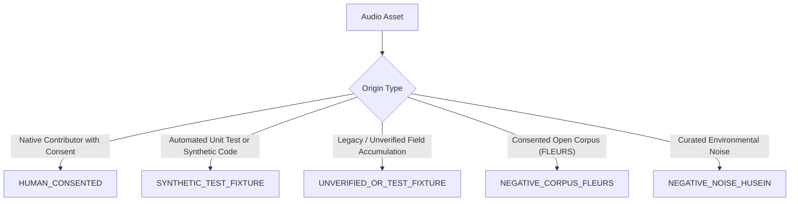

# Data Provenance & Acoustic Lineage Policy

> **Document Version:** 1.0.0-PROPOSAL  
> **Campaign Date:** October 13, 2026  
> **Governance Standard:** Zero Synthetic Conflation & Strict Audit Traceability  
> **Scope:** Vietnamese Keyword Spotting Corpus & Field Collections

---

## 1. Policy Purpose & Foundational Mandate

To preserve scientific integrity, prevent misleading accuracy claims, and ensure strict compliance with legal licensing and privacy standards, this document establishes the **Data Provenance & Acoustic Lineage Policy**.

### Core Mandate:
Under no circumstances may a synthetic audio file, parametric test fixture, or automated test output be labeled or treated as human speech. Similarly, open-source continuous speech corpora (such as Google FLEURS) must not be mislabeled as isolated field command recordings.

---

## 2. Canonical Provenance Categorization

Every audio file cataloged in any repository manifest MUST be assigned exactly one canonical provenance tag from the taxonomy below:



### 2.1 `HUMAN_CONSENTED`
- **Definition:** Genuine acoustic speech emitted by a living human vocal tract, recorded via a physical microphone transducer, with verified digital informed consent signed and cataloged prior to audio capture.
- **Verification Requirements:**
  1. `speaker_id` exists in `consent_ledger_human.json` with `consent_given == True`.
  2. `consent_id` matches the verified per-participant consent record in the consent ledger.
  3. Audio contains natural acoustic speech formants ($F_1, F_2, F_3$), fundamental pitch variation ($F_0$), room reverberation, and natural glottal/fricative air bursts.
  4. File was captured via the interactive CLI or mobile ingestion script, NOT generated programmatically by mock tone functions.

### 2.2 `SYNTHETIC_TEST_FIXTURE`
- **Definition:** Audio generated programmatically via math formulas (e.g., `generate_mock_human_audio()` using 150 Hz harmonic sines + jitter), text-to-speech (TTS) engines, frequency sweeps, or unit-test fixtures.
- **Allowed Usage:** Pipeline integration tests, CI/CD smoke tests, and hardware driver compatibility testing.
- **Restricted Usage:** MUST NEVER be evaluated as a real-world test set or cited in human generalization reports.

### 2.3 `UNVERIFIED_OR_TEST_FIXTURE`
- **Definition:** Legacy audio files accumulated in `data/raw/field_recordings/` prior to the test-isolation repair (106 manifest rows, 99 files on disk).
- **Forensic Status:** Although previously tagged in older manifests as `human_field_recording`, forensic audits established that 100% of these files were generated during test harness executions under test speaker identities (`SPK_FIELD_N001_TESTSUITE`, `SPK_M4A_TEST`).
- **Policy Rule:** Preserved on disk for historical auditability, but permanently classified as `UNVERIFIED_OR_TEST_FIXTURE`.

### 2.4 `NEGATIVE_CORPUS_FLEURS`
- **Definition:** Genuine human speech clips extracted from the Google FLEURS Vietnamese speech corpus (CC-BY-4.0).
- **Role:** Exclusively assigned to class `UNKNOWN` (Class 4) as conversational speech negatives.

### 2.5 `NEGATIVE_NOISE_HUSEIN` (STATUS: BLOCKED / UNVERIFIED LICENSE)
- **Status:** **BLOCKED / UNVERIFIED**. The repository lacks upstream legal license documentation and formal grant confirmation for `husein_mic_noise`. This source MUST NOT be accepted as an approved training corpus.
- **Allowed Fallback:** Ambient room tone recorded directly by human participants during authorized recording sessions with explicit consent and verified provenance (`HUMAN_CONSENTED`, `sub_category: background_room_tone`). No external unverified datasets may be silently substituted.

---

## 3. Strict Non-Inference Principle

> [!CAUTION]
> **Prohibition Against Metadata Inference:**  
> A system or engineer MUST NEVER infer `HUMAN_CONSENTED` provenance solely from:
> 1. A speaker ID string (e.g., presence of `SPK_` or absence of `TEST`).
> 2. A file path or directory name (e.g., saving inside `field_recordings/`).
> 3. A file format or extension (`.wav` or `.m4a`).
> 4. An unverified manifest column.

Provenance must be verified against primary evidence:
$$\text{IsHumanConsented}(x) \iff (\text{Provenance}(x) = \texttt{HUMAN\_CONSENTED}) \land (\text{SpeakerID}(x) \in \text{ConsentLedger}) \land (\text{ConsentGiven} = \texttt{True})$$

---

## 4. Physical Storage & Path Segregation Architecture

To prevent any possibility of accidental co-mingling between synthetic test fixtures and future genuine human speech, the file storage layout is strictly segregated by physical directory path:

```
data/raw/
├── field_recordings/                      <-- [FROZEN] Historical test fixtures (106 rows, 99 files)
│   ├── audio_raw/                         <-- Untouched fixture archive (SPK_FIELD_N001_TESTSUITE)
│   ├── audio_16k_standardized/            <-- Untouched standardized fixture archive
│   ├── consent_ledger.json                <-- Historical test ledger (2 test speakers)
│   ├── field_collection_manifest.csv      <-- Historical fixture manifest (106 rows)
│   └── quarantined/                       <-- Historical quarantine log
│
└── human_recordings_v1/                   <-- [PROPOSED] Dedicated genuine human collection root
    ├── audio_raw/                         <-- Bit-level untouched original container files (.wav, .m4a)
    │   └── <SPK_H_N_8f2a1b>/
    │       └── <SES_H_8f2a1b_01>/
    │           └── rec_h_trai_SPK_H_N_8f2a1b_SES_H_01_take001.m4a
    ├── audio_16k_standardized/            <-- Standardized 16kHz mono 16-bit PCM 1.0s WAV files
    │   ├── TRAI/
    │   ├── PHAI/
    │   ├── LEN/
    │   ├── XUONG/
    │   ├── UNKNOWN/
    │   └── SILENCE/
    ├── consent_ledger_human.json          <-- Per-participant consent ledger of verified human contributors
    ├── human_collection_manifest_v1.csv   <-- Master 28-column manifest for genuine recordings
    └── quarantined/                       <-- Quarantined takes with detailed rejection logs
```

### Path Segregation Rules:
1. **Zero Shared Paths:** Future human collection tools will write exclusively to `data/raw/human_recordings_v1/`.
2. **Read-Only Preservation of Fixtures:** No human recording process will read from or append to `data/raw/field_recordings/`.
3. **Automated Audit Enforcement:** Any manifest generation script that detects a path beginning with `data/raw/field_recordings/` associated with `HUMAN_CONSENTED` provenance will raise an immediate validation error.
