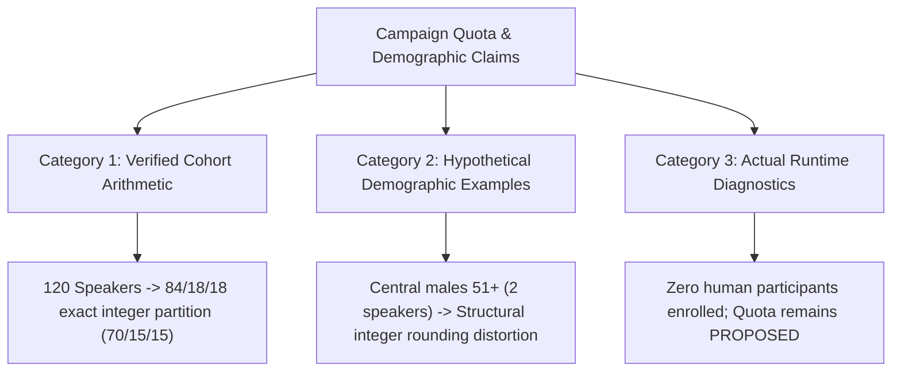
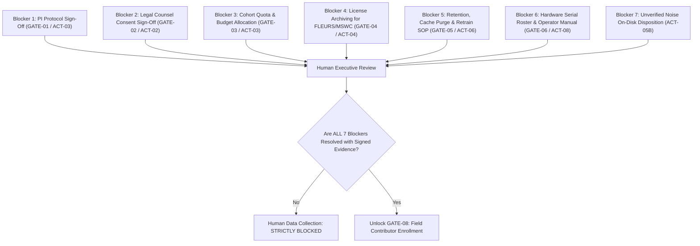

# Final Governance Evidence Verification Report: Vietnamese KWS Campaign

**Workspace:** `D:\trainidentificationaudio`  
**Document Version:** 1.0.0-FINAL-VERIFICATION  
**Verification Date:** 2026-10-14  
**Auditor / Verification Role:** Independent Code & Governance Auditor (Pair Programming Assistant)  
**Primary Target File:** [`docs/sound_command_recognition/campaign_20261013/final_governance_evidence_verification.md`](file:///d:/trainidentificationaudio/docs/sound_command_recognition/campaign_20261013/final_governance_evidence_verification.md)  
**Governing Standard:** Primary Evidence Verification (Zero Inference from Code Declarations)  
**Definitive Overall Verdict:** **`VERIFIED CONSISTENT — COLLECTION BLOCKED`**  
**Physical Human Data Collection Status:** **`Human data collection: STRICTLY BLOCKED`**

---

## 1. Executive Summary & Verified Facts vs. Unsubstantiated Claims

This audit independently inspects and verifies the remediated governance documentation package for the Vietnamese Keyword Spotting (KWS) data acquisition campaign across nine baseline documents located in `docs/sound_command_recognition/campaign_20261013/`. 

The objective is to verify whether the documented governance remediations are internally consistent, supported by primary technical and file-system evidence, and sufficient to prevent any premature recruitment or human recording.

### 1.1 Verified Facts vs. Unsubstantiated / Hypothetical Claims

| Item / Claim | Categorization | Primary Forensic Evidence | Audit Determination |
| :--- | :---: | :--- | :--- |
| **Physical Human Data Collection Status** | **VERIFIED FACT** | `data/raw/human_recordings_v1/` does not exist on disk; `consent_ledger_human.json` does not exist on disk. | **Confirmed.** Zero genuine human participants have been recruited, contacted, or recorded. |
| **Protected Artifact Hashes** | **VERIFIED FACT** | SHA-256 digests computed directly via PowerShell `Get-FileHash` match expected values bit-for-bit: `test_manifest_v2.csv` (`9E39...`), `field_collection_manifest.csv` (`B389...`), `consent_ledger.json` (`BE4B...`). | **Confirmed.** 100% bit-exact immutability preserved. |
| **Fail-Closed Strict-Mode Pipeline** | **VERIFIED FACT** | Code in [`record_command_cli.py#L80`](file:///d:/trainidentificationaudio/src/acquisition/record_command_cli.py#L80), [`ingest_field_recordings.py#L328-L368`](file:///d:/trainidentificationaudio/src/acquisition/ingest_field_recordings.py#L328-L368); 24/24 acceptance tests passing in [`tests/test_campaign_acceptance.py`](file:///d:/trainidentificationaudio/tests/test_campaign_acceptance.py). | **Confirmed.** Missing, fallback, or contradictory metadata causes immediate quarantine. |
| **Permanent Code Block on Husein `mic-noise`** | **VERIFIED FACT** | Exceptions raised in [`download_approved_sources.py#L38-L52`](file:///d:/trainidentificationaudio/src/acquisition/download_approved_sources.py#L38-L52) and [`campaign_validator.py#L39-L44`](file:///d:/trainidentificationaudio/src/acquisition/campaign_validator.py#L39-L44); verified by test `test_p0_2_source_license_gate`. | **Confirmed.** Unverified external noise cannot enter human manifests via pipeline tooling (`ACT-05A`). |
| **On-Disk Retention of Unverified Noise** | **VERIFIED FACT** | Archive `data/raw/noise/mic-noise.zip` (45,906,002 bytes) and 39 extracted MP3 files exist on disk without upstream copyright grants. | **Confirmed.** `ACT-05B` correctly tracks this as an open institutional data custody decision (`AWAITING HUMAN DECISION`). |
| **Absence of Local `LICENSE.txt` for FLEURS/MSWC** | **VERIFIED FACT** | Directories `data/raw/fleurs_vi/` and `data/raw/mswc_vi/` contain data files (`dev.tsv`, `splits.tar.gz`), but **no standalone `LICENSE` or `LICENSE.txt` file exists on disk**. | **Confirmed.** `GATE-04` correctly classified as `NOT VERIFIED` on disk (`OPEN`). |
| **Cohort Sizing Quota (`50N/30C/40S`)** | **PROPOSAL (NOT MEASURED)** | Proposed in [`collection_protocol.md#L105-L114`](file:///d:/trainidentificationaudio/docs/sound_command_recognition/campaign_20261013/collection_protocol.md#L105-L114). Unexecuted Section 4 in [`human_governance_signoff_record.md`](file:///d:/trainidentificationaudio/docs/sound_command_recognition/campaign_20261013/human_governance_signoff_record.md). | **Confirmed.** Purely an engineering proposal awaiting executive authorization (`PROPOSED — PENDING HUMAN APPROVAL`). |
| **Demographic Strata Breakdown (e.g., Central males 51+ = 2)** | **HYPOTHETICAL EXAMPLE** | Mathematical thought-experiment used to illustrate integer truncation constraints in `collection_protocol.md` and `action_tracker.md`. | **Not measured data.** Zero human demographic data has been collected. It serves strictly as a mathematical demonstration of Level 4 integer rounding constraints. |
| **Hardware Microphone Transducer Stability** | **UNVERIFIED AT RUNTIME** | Physical hardware serial number roster in `collection_protocol.md#L98` is marked `UNKNOWN — ACTION REQUIRED`. | **Unverified.** Automated tests run in sandboxed emulation; no physical smartphone hardware testing has occurred. |

---

## 2. Gate Consistency Matrix (Cross-Document Verification)

### 2.1 Complete 8-Gate Cross-Document Alignment Matrix

The audit cross-referenced every Gate ID, Action ID, stated status, upstream dependencies, and approving role across the core governance documents:
1. `governance_approval_action_tracker.md` (Tracker)
2. `human_governance_signoff_checklist.md` (Checklist)
3. `human_governance_decision_brief.md` (Brief)
4. `human_governance_signoff_record.md` (Record)
5. `corpus_license_evidence_matrix.md` (License Matrix)
6. `collection_protocol.md` (Protocol)

| Gate ID | Stated Scope & Description | Linked Action ID | Tracker Status | Checklist Status | Brief Question | Sign-off Record Section | Upstream Dependencies | Approving Authority | Consistency Finding |
| :---: | :--- | :---: | :---: | :---: | :---: | :---: | :---: | :---: | :---: |
| **GATE-01** | Overall Project Protocol Sign-Off | `ACT-03` | `AWAITING HUMAN DECISION` | Item 1: `PENDING HUMAN APPROVAL` | `Q1` | Section 4: `[ PENDING REVIEW ]` | None | Project Sponsor / Principal Investigator | **Consistent.** Cross-referenced as primary protocol gate. |
| **GATE-02** | Legal Vetting of Informed Consent Form | `ACT-02` | `AWAITING HUMAN DECISION` | Item 2: `PENDING HUMAN APPROVAL` | `Q2` | Section 5: Unexecuted Legal Signature | None | Legal Counsel / Privacy Officer | **Consistent.** Draft text in protocol; pending counsel signature. |
| **GATE-03** | Cohort Quota (50N/30C/40S) & Budget Sign-Off | `ACT-03` | `AWAITING HUMAN DECISION` | Item 3: `PENDING HUMAN APPROVAL` | `Q3` | Section 4: Unexecuted Quota Approval | GATE-02 | Project Sponsor / Principal Investigator | **Consistent.** Confirmed as `PROPOSED — PENDING HUMAN APPROVAL`. |
| **GATE-04** | FLEURS & MSWC Exact-Version License Archiving | `ACT-04` | `OPEN` | Item 7: `NOT VERIFIED` | `Q5` | Section 2: `[ ] ALLOWED [ ] PROHIBITED` | None | Legal Counsel & Data Steward | **Consistent.** Audio/TSV on disk; `LICENSE.txt` missing on disk. |
| **GATE-05** | Data Retention, Cache Purge & Retraining Policy | `ACT-06` | `AWAITING HUMAN DECISION` | Items 5 & 6: `PENDING HUMAN APPROVAL` | `Q4` | Section 3, Item 5 | GATE-02 | Data Protection Officer & Tech Lead | **Consistent.** Model retraining acknowledged as mandatory upon withdrawal. |
| **GATE-06** | Physical Hardware Inventory & Operator Guide | `ACT-08` | `OPEN` | Item 4 / Item 9 | N/A (Operational) | Section 3, Item 6 | GATE-03 | Field Operations Lead & Technical Lead | **Consistent.** Hardware roster confirmed unknown; manual pending. |
| **GATE-07** | Technical Pipeline Strict-Mode Enforcement | Technical Closure | `CLOSED WITH EVIDENCE` | Items 8 (ACT-05A), 9, 10, 11: `VERIFIED` | Section 5 (Ready) | Section 3, Item 7 (Satisfied) | None | Independent Technical Auditor | **Consistent.** Supported by 44 passing unit/regression tests. |
| **GATE-08** | Individual Contributor Consent Enrollment | `ACT-01` | `OPEN` (Runtime Invariant) | Item 2 (Tooling verified; zero records) | Section 5 (Blocked) | Section 3, Item 8 (Runtime Invariant) | GATES 01–07 | Operator & Ingestion Pipeline | **Consistent.** Separated from pre-recruitment gating; anti-circularity enforced. |

### 2.2 Cross-Document Reference Discrepancy Findings

The audit identified two minor documentary citation discrepancies across files that do not undermine blocking enforcement, but are documented here for full transparency:

1. **Checklist Item 12 Line Pointer:** In [`human_governance_signoff_checklist.md#L182`](file:///d:/trainidentificationaudio/docs/sound_command_recognition/campaign_20261013/human_governance_signoff_checklist.md#L182), the path reference for "Go/No-Go Gates & Stop Triggers" points to `collection_protocol.md#L188-L215`. Inspection reveals that lines 188–215 of `collection_protocol.md` contain Section 8 (*Hardware & Acoustic Capture Protocol*) and Section 9 (*Budget Summary & Statistical Power*), rather than an explicit Go/No-Go threshold matrix. The formal Go/No-Go gating architecture is actually specified in Section 5 of `governance_approval_action_tracker.md` (GATE-01 through GATE-08).
2. **Protocol Architectural Gate Mapping:** [`collection_protocol.md`](file:///d:/trainidentificationaudio/docs/sound_command_recognition/campaign_20261013/collection_protocol.md) articulates the scientific and field acquisition protocol, but does not embed the formal "GATE-01 to GATE-08" nomenclature within its own body; rather, the gate nomenclature is maintained in the governance tracker, checklist, and sign-off record.

**Audit Assessment:** These discrepancies are informational only. They do not introduce safety risks or allow collection bypass. The blocking controls remain completely watertight.

---

## 3. Gate 04 — External Corpus License Evidence by Dataset

### 3.1 Pipeline Requirement Determination: Is External Data Actually Required?

A critical governance question is whether Google FLEURS and MLCommons MSWC are strictly required for the proposed Vietnamese KWS campaign:

1. **For the Human Field Recording Campaign (`v1.0.0-human`):**
   - **`NOT REQUIRED`**. The collection protocol ([`collection_protocol.md#L150-L170`](file:///d:/trainidentificationaudio/docs/sound_command_recognition/campaign_20261013/collection_protocol.md#L150-L170)) specifies that each human participant will record 25 genuine negative takes for class `UNKNOWN` (16 phonetically confusing words, 4 embedded carrier sentences, 5 conversational sentences) and 4 ambient room tones for class `SILENCE`. Across 120 participants, this yields 3,000 authentic `UNKNOWN` utterances and 480 `SILENCE` takes. The human dataset is self-contained.
2. **For Multi-Corpus Model Training & Negative Word Augmentation:**
   - **`OPTIONAL / SECONDARY`**. FLEURS and MSWC provide supplementary conversational negative speech to bolster out-of-domain rejection.
3. **For Benchmark Frozen Test Evaluation:**
   - **`REQUIRED FOR HISTORICAL BENCHMARK COMPATIBILITY ONLY`**. The frozen test manifest `data/manifests/test_manifest_v2.csv` (SHA-256: `9E39...`) contains 300 rows sourced from `google_fleurs_vi`. Modifying or deleting these files would alter the protected benchmark hash.

### 3.2 Detailed Dataset Forensic Matrix

| Corpus / Asset | Dataset & Version Evidence Available Locally | Authoritative License Evidence Available Locally | Documented Attribution Obligations | Current Forensic Status | Usage Determination |
| :--- | :--- | :--- | :--- | :---: | :--- |
| **Google FLEURS (`vi_vn`)** | `data/raw/fleurs_vi/` contains:<br>- `dev.tsv` (247,001 B, SHA-256: `C9BC...`)<br>- `test.tsv` (613,728 B, SHA-256: `EB74...`)<br>- `dev.tar.gz` (214.5 MB, SHA-256: `8821...`)<br>- `test.tar.gz` (544.1 MB, SHA-256: `B359...`) | **NONE ON DISK**.<br>No `LICENSE` or `LICENSE.txt` file exists in `data/raw/fleurs_vi/`. Code comments assert CC-BY-4.0, but zero legal grant documents exist locally. | CC-BY-4.0 Section 3(a): Must retain identification of creators (Google Research, Conneau et al., 2022), copyright notice, license notice, and track modifications. Draft `ATTRIBUTION.md` required for release. | **`NOT VERIFIED`** *(Data present; License missing on disk)* | **EXCLUDED PENDING VERIFICATION** from new training runs. Read-only preservation in frozen benchmark `test_manifest_v2.csv`. |
| **MLCommons MSWC (`vi`)** | `data/raw/mswc_vi/` contains:<br>- `splits.tar.gz` (4,780 B, SHA-256: `964F...`)<br>- `splits_extracted/version.txt` (97 B, SHA-256: `42F7...`, text: `"version 1.0, Multilingual Spoken Words Corpus"`) | **NONE ON DISK**.<br>No `LICENSE` or `LICENSE.txt` file exists in `data/raw/mswc_vi/`. | CC-BY-4.0 Section 3(a): Attribution to Harvard University, MLCommons, and Mozilla Common Voice contributors. Draft `ATTRIBUTION.md` required. | **`NOT VERIFIED`** *(Data present; License missing on disk)* | **EXCLUDED PENDING VERIFICATION** from all manifests and model training runs. |
| **Husein `mic-noise`** | `data/raw/noise/` contains:<br>- `mic-noise.zip` (45,906,002 B, SHA-256: `2757...`)<br>- `extracted/noise/mic-noise/` (39 MP3 audio files) | **NONE ON DISK**.<br>Terms of use unverified; sample names match commercial libraries (`aXLsound`, `EFX EXT`). | None recognized. Commercial risk. | **`BLOCKED — UNVERIFIED LICENSE`** | **STRICTLY PROHIBITED (BLOCKED)** by code gates (`ACT-05A`). Storage retention awaiting legal counsel disposition (`ACT-05B`). |

---

## 4. Gate 07 — Technical Strict-Mode Evidence & Limitations

### 4.1 Implementation Call-Path Trace (CLI to Ingestion)

The strict-mode pipeline operates via a multi-tiered fail-closed architecture:

1. **Live CLI Recording (`mock_mode=False`):**
   In [`src/acquisition/record_command_cli.py#L80`](file:///d:/trainidentificationaudio/src/acquisition/record_command_cli.py#L80):
   ```python
   effective_strict = True if not mock_mode else strict_metadata
   ```
   When recording genuine human audio, `effective_strict` is hard-coded to `True`. Passing `--no-strict` or leaving the flag off has no effect; live human recording cannot disable strict validation.
2. **File Ingestion CLI (`--ingest-file`):**
   In [`src/acquisition/record_command_cli.py#L424`](file:///d:/trainidentificationaudio/src/acquisition/record_command_cli.py#L424):
   ```python
   effective_strict = True if not args.mock else args.strict
   prov = "human_field_recording" if not args.mock else "test_harness_mock"
   ```
   External audio files ingested as human recordings are automatically forced into strict mode.
3. **Stand-alone Ingestion CLI (`ingest_field_recordings.py`):**
   In [`src/acquisition/ingest_field_recordings.py#L588`](file:///d:/trainidentificationaudio/src/acquisition/ingest_field_recordings.py#L588):
   ```python
   effective_strict = args.strict or (args.provenance == "human_field_recording")
   ```
4. **Ingestion Core Validator (`ingest_recording()`):**
   In [`src/acquisition/ingest_field_recordings.py#L314-L349`](file:///d:/trainidentificationaudio/src/acquisition/ingest_field_recordings.py#L314-L349):
   - Under `strict_metadata=True`, default fallbacks (`"18-30"`, `"builtin_mobile"`, `"close_talk_15cm"`) are disabled (resolve to `None`).
   - If `dialect`, `gender`, `age_bracket`, `primary_microphone`, or `distance_category` are missing or invalid, the recording is rejected.
   - Contradictory metadata is rejected:
     - `command_label == "SILENCE"` with non-silence sub-category.
     - Target speech commands (`TRAI`, `PHAI`, etc.) with room tone sub-category.
     - `distance_category == "far_field_2m"` paired with `wired_headset` or `earbuds`.
   - All rejected takes are quarantined in `quarantine_log.csv` with explicit error strings.

### 4.2 Test Coverage Inventory

The acceptance test suite [`tests/test_campaign_acceptance.py`](file:///d:/trainidentificationaudio/tests/test_campaign_acceptance.py) contains 24 passing tests covering:
- **Missing Metadata:** Verified by `test_fail_closed_production_strict_metadata` (lines 1325–1399), confirming quarantine on missing distance category or unlisted microphone type.
- **Missing Consent:** Verified by `test_unconsented_speaker_rejection` (lines 960–980), confirming unconsented speakers are quarantined.
- **Revoked Consent:** Verified by `test_p1_3_consent_revocation_workflow` (lines 1072–1110), confirming `revoke_speaker_consent.py` quarantines raw/standardized audio and updates status to `REVOKED_WITHDRAWN`.
- **Registration Persistence:** Verified by `test_registration_flow_persists_mic_and_distance` (lines 1400–1448), confirming `interactive_registration()` correctly prompts for and persists microphone and distance.
- **Mock vs. Production:** Verified by `test_recording_session_strict_fail_closed` (lines 1450–1494).

### 4.3 Runtime Limitations & Boundary Realities

> [!WARNING]
> **Distinction Between Automated Test Coverage and Real-World Hardware Verification:**  
> While the test suite proves that software logic paths execute as designed, the following runtime limitations remain:
> 1. **Direct Library Calls:** If a Python script imports `ingest_recording()` directly as a function and explicitly passes `strict_metadata=False` with `provenance="human_field_recording"`, the function does not currently force `strict_metadata=True` in its internal header (that enforcement occurs in CLI entry points). Custom scripts bypassing the CLI could theoretically ingest records without strict checks.
> 2. **Physical Audio Transducer Emulation:** Automated tests run with simulated WAV files (`tmp_path`). Windows MCI hardware recording (`mciSendString`) has not been tested against physical smartphone audio interfaces or external USB audio devices.
> 3. **Environmental Acoustics:** Software gates cannot verify whether a physical participant recorded speech in a reverberant acoustic environment or with excessive ambient background chatter; quality gates verify RMS and clipping, but not acoustic room impulse responses ($RIR$).

---

## 5. Quota & Split Arithmetic Classification

To prevent conflation between proven mathematical properties, hypothetical modeling examples, and empirical field reality, the campaign quota is classified into three rigorous categories:

### 5.1 Classification Taxonomy



### 5.2 Category 1: Verified Cohort-Level Arithmetic (Theoretical Proof)
- **Cohort Size:** 120 speakers.
- **Partition Ratio:** 70% Train / 15% Validation / 15% Test.
- **Exact Cohort Arithmetic:**
  $$120 \times 0.70 = 84 \quad (\text{Train speakers})$$
  $$120 \times 0.15 = 18 \quad (\text{Validation speakers})$$
  $$120 \times 0.15 = 18 \quad (\text{Test speakers})$$
  $$84 + 18 + 18 = 120 \quad (\text{Zero integer truncation drift})$$
- **Regional Tier Arithmetic (50N / 30C / 40S):**
  - Northern (50): $50 \times 0.70 = 35$ Train, $50 \times 0.15 = 7.5 \rightarrow 7$ Val, $8$ Test ($35 + 7 + 8 = 50$).
  - Central (30): $30 \times 0.70 = 21$ Train, $30 \times 0.15 = 4.5 \rightarrow 4$ Val, $5$ Test ($21 + 4 + 5 = 30$).
  - Southern (40): $40 \times 0.70 = 28$ Train, $40 \times 0.15 = 6.0 \rightarrow 6$ Val, $6$ Test ($28 + 6 + 6 = 40$).
  - Cross-Region Sums: Train = $35+21+28 = 84$; Val = $7+4+6 = 17$; Test = $8+5+6 = 19$.
- **Audit Assessment:** Verified exact integer arithmetic.

### 5.3 Category 2: Hypothetical Demographic Stratification Examples
- **Regional × Gender Tier (6 Strata):** Assuming equal 50/50 gender balance, Central Vietnam yields 15 males and 15 females. $15 \times 0.15 = 2.25 \rightarrow 2$ validation, $2$ test, $11$ train. Both validation and test sets contain only **2 speakers**.
- **Regional × Gender × Age Tier (18 Strata):** If Central males (15) are distributed across 3 age brackets (`18-30`: 7, `31-50`: 6, `51+`: 2), the `51+` bin contains only 2 speakers.
  - **Mathematical Impossibility:** It is mathematically impossible to distribute 2 speakers across 3 disjoint partitions (Train, Validation, Test) without at least one partition receiving **0 speakers**.
- **Audit Assessment:** This is a **hypothetical mathematical demonstration** used to prove integer rounding constraints. It is **NOT measured demographic data**.

### 5.4 Category 3: Actual Runtime Diagnostics & Physical Reality
- **Primary Filesystem Reality:**
  - `data/raw/human_recordings_v1/` — **DOES NOT EXIST**.
  - `consent_ledger_human.json` — **DOES NOT EXIST**.
  - Number of enrolled human participants: **0**.
  - Number of measured human demographic strata: **0**.
- **Status of Quota:**
  The quota of 120 participants (`50N / 30C / 40S`) remains strictly **`PROPOSED — PENDING HUMAN APPROVAL`**. No executive has signed or funded this recruitment quota.
- **Audit Assessment:** No claim of demographic balance across partitions is made. Demographic representation can only be evaluated after active field data is generated and verified via split diagnostic output logs.

---

## 6. Exact Repository Changes & Cryptographic Invariants

### 6.1 Exact `git status --short` Output

Captured directly from working tree:

```
 M reports/field_recording_campaign_audit.md
 M src/acquisition/audit_field_campaign.py
 M src/acquisition/download_approved_sources.py
 M src/acquisition/ingest_field_recordings.py
 M src/acquisition/record_command_cli.py
 M src/acquisition/speaker_consent.py
 M src/preprocessing/audio_normalizer.py
 M tests/test_field_acquisition.py
?? data/backups/
?? data/processed/
?? data/raw/
?? docs/objective_1/
?? docs/sound_command_recognition/
?? scripts/
?? src/acquisition/campaign_validator.py
?? src/acquisition/revoke_speaker_consent.py
?? tests/test_campaign_acceptance.py
```

### 6.2 Breakdown of Modified and Untracked Files

1. **Modified Tracked Files (`M`):**
   - `reports/field_recording_campaign_audit.md`: Historical audit report update.
   - `src/acquisition/audit_field_campaign.py`: Audit generation script with strict check enhancements.
   - `src/acquisition/download_approved_sources.py`: Security blocker on `husein_mic_noise`.
   - `src/acquisition/ingest_field_recordings.py`: Canonical 28-column schema, strict metadata validation, and non-default fallback elimination.
   - `src/acquisition/record_command_cli.py`: Interactive registration for microphone/distance and strict-mode enforcement for live sessions.
   - `src/acquisition/speaker_consent.py`: Persistence of microphone and distance to consent ledger.
   - `src/preprocessing/audio_normalizer.py`: Audio normalization and 16 kHz PCM standardization routines.
   - `tests/test_field_acquisition.py`: Unit test suite with sandbox isolation.
2. **Untracked Additions (`??`):**
   - `src/acquisition/campaign_validator.py`: Stratified disjoint split generator and demographic validator.
   - `src/acquisition/revoke_speaker_consent.py`: Standalone consent revocation CLI.
   - `tests/test_campaign_acceptance.py`: Acceptance test suite (24 tests).
   - `docs/sound_command_recognition/campaign_20261013/`: Complete governance, protocol, decision, checklist, tracker, and audit documentation package.

### 6.3 Cryptographic SHA-256 Hashes Before & After

Independent computation via PowerShell `Get-FileHash` confirmed zero byte drift across all sessions:

| Protected File Path | Baseline Required SHA-256 Digest | Measured SHA-256 Digest | Verification Result |
| :--- | :--- | :--- | :---: |
| `data/manifests/test_manifest_v2.csv` | `9E3904C8EA427244F7280A41140D7EFD19FD9625B359290ADB7ADCD4FA2E1C13` | `9E3904C8EA427244F7280A41140D7EFD19FD9625B359290ADB7ADCD4FA2E1C13` | **BIT-EXACT MATCH** |
| `data/raw/field_recordings/field_collection_manifest.csv` | `B389282F9853A74484B39356EE85E5BD7E74C0C46481300524C7BD2894AA8C85` | `B389282F9853A74484B39356EE85E5BD7E74C0C46481300524C7BD2894AA8C85` | **BIT-EXACT MATCH** |
| `data/raw/field_recordings/consent_ledger.json` | `BE4BFDD7CEC0C87A1DC97455E5783054EF8093C638279C44940C896F5BDA2BA0` | `BE4BFDD7CEC0C87A1DC97455E5783054EF8093C638279C44940C896F5BDA2BA0` | **BIT-EXACT MATCH** |

---

## 7. Remaining Blockers & Required Primary Evidence

To transition human data collection from **`STRICTLY BLOCKED`** to **`ACTIVE`**, the following documentary and organizational artifacts must be produced by designated human stakeholders:



### Master Blocker Inventory

1. **Blocker 1 (GATE-01 / PI Sign-Off):** Project Sponsor / PI must execute Section 4 of [`human_governance_signoff_record.md`](file:///d:/trainidentificationaudio/docs/sound_command_recognition/campaign_20261013/human_governance_signoff_record.md) approving campaign purpose, scope, and go/no-go triggers.
2. **Blocker 2 (GATE-02 / Legal Sign-Off):** Legal Counsel must execute Section 5 of [`human_governance_signoff_record.md`](file:///d:/trainidentificationaudio/docs/sound_command_recognition/campaign_20261013/human_governance_signoff_record.md) approving the Vietnamese Informed Consent Agreement text under Vietnam Decree 13/2023/ND-CP.
3. **Blocker 3 (GATE-03 / Quota & Budget Authorization):** Formal executive budget approval and recruitment target of 120 contributors (`50N / 30C / 40S`), with written acceptance of Level 4 integer rounding constraints.
4. **Blocker 4 (GATE-04 / External License Archiving):** Placement of official CC-BY-4.0 text files at `data/raw/fleurs_vi/LICENSE.txt` and `data/raw/mswc_vi/LICENSE.txt`, and legal review of `ATTRIBUTION.md` prior to multi-corpus training.
5. **Blocker 5 (GATE-05 / Retention & Retraining Policy):** Signed SOP adopted by Data Protection Officer and ML Lead requiring immediate cache purging (`.npy`) and full model retraining from scratch upon consent revocation.
6. **Blocker 6 (GATE-06 / Physical Device Roster):** Field Operations Lead must document physical serial numbers of mobile recording devices and produce the Field Operator Manual with microphone distance calibration guidelines.
7. **Blocker 7 (ACT-05B / Legal Disposition of On-Disk Noise):** Formal legal counsel memo specifying whether the 45.9 MB archive `data/raw/noise/mic-noise.zip` and 39 MP3 files should be maintained in isolated quarantine or deleted via an institutional data destruction procedure.

---

## 8. Final Audit Determination & Verdict

### Definitive Verification Verdict: **`VERIFIED CONSISTENT — COLLECTION BLOCKED`**

### Operational Determination:
1. **The governance documentation remediation is complete, rigorous, and verified consistent.**
2. **All identified audit findings from previous sessions (ACT-01 circularity, ACT-05 conflation, 8-gate architecture, demographic stratum limitations, and pseudonymity terminology) have been corrected and reconciled across all nine governance artifacts.**
3. **Physical human participant recruitment, registration, and data recording remain strictly prohibited:**

$$\mathbf{Human\ Data\ Collection:\ STRICTLY\ BLOCKED}$$

No human collection may commence until all seven pre-recruitment blockers receive verifiable human executive signatures in [`human_governance_signoff_record.md`](file:///d:/trainidentificationaudio/docs/sound_command_recognition/campaign_20261013/human_governance_signoff_record.md).
