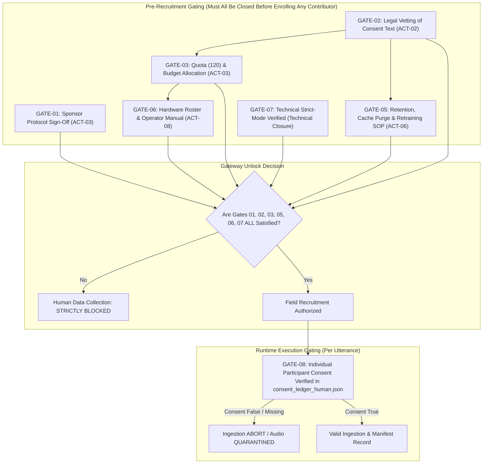

# Governance Approval Action Tracker

**Workspace:** `D:\trainidentificationaudio`  
**Document Version:** 1.0.0-ACTION-TRACKER  
**Creation Date:** 2026-10-14  
**Auditor / Tracker Role:** Independent Code & Governance Auditor (Pair Programming Assistant)  
**Governing Principle:** Evidence-Based Governance Tracking (No Automated Unlocking)  
**Overall Campaign Governance Verdict:** **`READY FOR HUMAN DECISION — COLLECTION BLOCKED`**  
**Physical Human Data Collection Status:** **`STRICTLY BLOCKED`** *(Prohibited until all mandatory items reach `CLOSED WITH EVIDENCE`)*

---

## 1. Executive Summary & Tracking Framework

This document converts the audited findings from [`governance_package_quality_review.md`](file:///d:/trainidentificationaudio/docs/sound_command_recognition/campaign_20261013/governance_package_quality_review.md) into an actionable, evidence-based tracking ledger. Its purpose is to guide human decision-makers (Project Sponsor/PI, Legal Counsel, Privacy Officer, Data Protection Officer, Machine Learning Lead) through the concrete documentary and legal steps required before participant recruitment may be considered.

### Status Definitions:
- **`OPEN`**: Action item identified; required evidence, legal artifacts, or operational assets have not yet been produced.
- **`AWAITING HUMAN DECISION`**: Technical documentation, draft legal texts, or decision briefs are fully prepared; awaiting formal human decision and signature.
- **`CLOSED WITH EVIDENCE`**: Definitive, verifiable primary evidence (signed agreement, on-disk license file, immutable code gate) exists and has been forensically verified.

---

## 2. Master Governance Action Matrix

| Finding ID | Governance Domain | Severity | Current Status | Responsible Role | Required Approver | Target Output |
| :---: | :--- | :---: | :---: | :--- | :--- | :--- |
| **ACT-01** | Human Consent & Participant Rights | **CRITICAL** | `OPEN` | Field Acquisition Lead | Project Sponsor / PI & Legal Counsel | Approved consent workflow (pre-campaign) & verified per-contributor ledger (runtime invariant) |
| **ACT-02** | Vietnamese Informed Consent Legal Vetting | **HIGH** | `AWAITING HUMAN DECISION` | Legal / Privacy Counsel | Legal / Privacy Counsel | Formal written legal sign-off on consent form |
| **ACT-03** | Project Sponsor Quota Approval (50N/30C/40S) | **HIGH** | `AWAITING HUMAN DECISION` | Project Coordinator | Project Sponsor / Principal Investigator | Signed Section 4 in `human_governance_signoff_record.md` |
| **ACT-04** | FLEURS & MSWC License & Attribution Evidence | **HIGH** | `OPEN` | Data Steward | Legal Counsel & Project Sponsor | Local `LICENSE.txt` files on disk & signed attribution text |
| **ACT-05A** | Software Ingestion Gate Active (Husein Block) | **HIGH** | `CLOSED WITH EVIDENCE` | Security / Pipeline Engineer | Technical Lead | Permanent code gate blocking `husein_mic_noise` from manifests |
| **ACT-05B** | External Corpus Storage Retention & Legal Review | **MEDIUM** | `AWAITING HUMAN DECISION` | Data Steward & Legal Counsel | Project Sponsor / PI & Legal Counsel | Institutional legal disposition of on-disk noise files (`data/raw/noise/`) |
| **ACT-06** | Retention, Withdrawal, Cache, & Retraining SOP | **MEDIUM** | `AWAITING HUMAN DECISION` | Data Protection Officer | Project Sponsor / PI & ML Lead | Approved Data Deletion & Retraining SOP |
| **ACT-07** | Terminology Alignment (Pseudonym vs. Anonymous) | **MEDIUM** | `AWAITING HUMAN DECISION` | Technical Documentation Lead | Privacy Officer / Legal Counsel | Updated protocol and consent disclosure text |
| **ACT-08** | Physical Device Inventory & Operator Readiness | **LOW** | `OPEN` | Field Operations Lead | Technical Lead | Approved Hardware Procurement & Calibration Roster |
| **ACT-09** | Stratified Split Small-Bin Rounding Handling | **LOW** | `AWAITING HUMAN DECISION` | Machine Learning Lead | Machine Learning Lead | Transparent documentation in model evaluation card |

---

## 3. Detailed Action Ledger by Governance Section

### Section 3.1: Human Consent and Participant Rights

#### Action Item ACT-01: Separation of Pre-Campaign Workflow Readiness from Runtime Consent Registration
- **Finding ID & Severity:** `F-01` | **`CRITICAL`**
- **Exact Evidence & File Location:**
  - `data/raw/human_recordings_v1/consent_ledger_human.json` — **DOES NOT EXIST ON DISK** (zero human contributors enrolled).
  - `data/raw/field_recordings/consent_ledger.json` — Contains 74 test fixture records (`SPK_FIELD_N001_TESTSUITE`), not human participants.
- **Architectural Scope Separation:**
  1. **Pre-Campaign Readiness (Prerequisite for Field Recruitment):** Submission and formal sign-off of the Vietnamese Informed Consent Form (ACT-02) and testing of strict-mode CLI workflows. This is a pre-condition for opening field enrollment.
  2. **Runtime Execution Invariant (`GATE-08`):** Every real contributor must be registered with `consent_given: true` in `consent_ledger_human.json` before any audio recording take is saved. Enforced continuously per utterance.
- **Strict Anti-Circularity Prohibition:**
  > [!CAUTION]
  > **No Pre-Authorization Recruitment or Synthetic Records:**  
  > Human contributors must **NEVER** be recruited, contacted, or recorded merely to close ACT-01 in this action tracker prior to all pre-collection gates (GATES 1–7) being signed off. Furthermore, automated or dummy placeholder records must **NOT** be inserted into `consent_ledger_human.json` to manufacture artificial closure. Physical human data collection remains **`STRICTLY BLOCKED`**.
- **Responsible Role:** Field Acquisition Lead
- **Required Approver:** Project Sponsor / Principal Investigator (PI) & Legal Counsel
- **Evidence Needed to Close:**
  - *Pre-Recruitment Phase:* Written legal approval of consent text (ACT-02) and PI authorization (ACT-03).
  - *Active Collection Phase:* Verified per-participant records in `data/raw/human_recordings_v1/consent_ledger_human.json` with `consent_given: true`, pseudonymous nonce IDs (`SPK_H_<N|C|S>_<hex6>`), and verified timestamps.
- **Dependencies:** ACT-02, ACT-03, ACT-08
- **Current Status:** **`OPEN`** *(Pre-campaign workflow: PENDING APPROVAL; Runtime ledger: OPEN / ZERO RECORDS)*
- **Explicit Closure Criteria:**
  Pre-campaign legal sign-offs achieved, followed by legitimate runtime participant registration under the approved protocol once collection gates are unlocked by human authorities.

---

#### Action Item ACT-02: Legal Vetting of Vietnamese Informed Consent Form
- **Finding ID & Severity:** `F-04` | **`HIGH`**
- **Exact Evidence & File Location:**
  - Draft Consent Disclosure: [`docs/sound_command_recognition/campaign_20261013/collection_protocol.md#L41-L67`](file:///d:/trainidentificationaudio/docs/sound_command_recognition/campaign_20261013/collection_protocol.md#L41-L67)
  - Review Finding: [`docs/sound_command_recognition/campaign_20261013/governance_evidence_review.md#L55`](file:///d:/trainidentificationaudio/docs/sound_command_recognition/campaign_20261013/governance_evidence_review.md#L55)
- **Action Required:**
  Submit the draft Vietnamese Informed Consent Agreement to organizational Legal/Privacy Counsel for statutory vetting under Vietnam Decree 13/2023/ND-CP and international privacy norms. Review scope of use, voluntary participation, commercial evaluation rights, and unconditional withdrawal rights prior to dataset release freeze.
- **Responsible Role:** Legal / Privacy Counsel
- **Required Approver:** Legal Counsel / Ethics Reviewer
- **Evidence Needed to Close:**
  Formal written endorsement or executed Section 5 in [`human_governance_signoff_record.md`](file:///d:/trainidentificationaudio/docs/sound_command_recognition/campaign_20261013/human_governance_signoff_record.md) approving the Vietnamese text without material reservation.
- **Dependencies:** None
- **Current Status:** **`AWAITING HUMAN DECISION`**
- **Explicit Closure Criteria:**
  Verifiable legal approval token or signature recorded in `human_governance_signoff_record.md` Section 5.

---

### Section 3.2: Project Sponsor/PI Approval and Proposed 120-Person Quota

#### Action Item ACT-03: Formal Quota & Budget Sign-Off (`50N / 30C / 40S`)
- **Finding ID & Severity:** `F-02` | **`HIGH`**
- **Exact Evidence & File Location:**
  - Proposal Specification: [`docs/sound_command_recognition/campaign_20261013/collection_protocol.md#L105-L114`](file:///d:/trainidentificationaudio/docs/sound_command_recognition/campaign_20261013/collection_protocol.md#L105-L114)
  - Forensic Status: [`docs/sound_command_recognition/campaign_20261013/governance_evidence_review.md#L63-L95`](file:///d:/trainidentificationaudio/docs/sound_command_recognition/campaign_20261013/governance_evidence_review.md#L63-L95)
- **Action Required:**
  Project Sponsor / PI must review the mathematical split justification and dialect acoustics rationale (Northern `/tɕ/` affricate burst vs. Southern `/ʈ/` retroflex stop). PI must formally approve the recruitment target of 120 participants and commit necessary operational budget/incentives.
- **Stratification Feasibility & Rounding Limitation Disclosure:**
  - *Level 1 (Full Cohort - 120 Speakers):* Exact integer partition: 84 Train (70%), 18 Val (15%), 18 Test (15%) with zero truncation drift ($84+18+18=120$).
  - *Level 2 (Regional Tiers - 50/30/40):* Manageable integer rounding ($35/7/8$, $21/4/5$, $28/6/6$).
  - *Level 3 (Regional × Gender - 6 Strata):* Central 15M / 15F splits into $11$ train, $2$ val, $2$ test; validation and test subsets contain only 2 speakers each.
  - *Level 4 (Regional × Gender × Age - 18 Strata):* Small demographic bins with $\le 2$ speakers (e.g. Central males aged 51+, ~2 contributors) cannot mathematically populate 3 disjoint partitions without at least one partition receiving **0 speakers**.
  > [!IMPORTANT]
  > **Prohibition on Unverified Demographic Balance Claims:**  
  > The documentation must distinguish Level 1 cohort arithmetic from Level 4 fine-grained demographic stratum realities. The project must **never claim full demographic balance across all three partitions** without empirical verification from `generate_stratified_disjoint_splits()` diagnostic output logs.
- **Responsible Role:** Project Coordinator
- **Required Approver:** Project Sponsor / Principal Investigator
- **Evidence Needed to Close:**
  Executed Section 4 in [`human_governance_signoff_record.md`](file:///d:/trainidentificationaudio/docs/sound_command_recognition/campaign_20261013/human_governance_signoff_record.md) with decision `APPROVED` or `APPROVED WITH CONDITIONS`.
- **Dependencies:** ACT-02
- **Current Status:** **`AWAITING HUMAN DECISION`** *(Quota Status: `PROPOSED — PENDING HUMAN APPROVAL`)*
- **Explicit Closure Criteria:**
  Physical or verifiable digital signature of Project Sponsor/PI approving the 120-participant target and regional ratio, with documented acceptance of Level 4 integer rounding constraints.

---

### Section 3.3: Exact-Version FLEURS/MSWC License and Attribution Evidence

#### Action Item ACT-04: Local License Text Archiving & Attribution Review (FLEURS & MSWC)
- **Finding ID & Severity:** `F-03` | **`HIGH`**
- **Exact Evidence & File Location:**
  - FLEURS Directory: `data/raw/fleurs_vi/` — Data present (`dev.tsv`, `test.tsv`, `dev.tar.gz`, `test.tar.gz`), but **`LICENSE.txt` IS MISSING ON DISK**.
  - MSWC Directory: `data/raw/mswc_vi/` — Data present (`splits.tar.gz`, `splits_extracted/version.txt`), but **`LICENSE.txt` IS MISSING ON DISK**.
  - Forensic Matrix: [`docs/sound_command_recognition/campaign_20261013/corpus_license_evidence_matrix.md`](file:///d:/trainidentificationaudio/docs/sound_command_recognition/campaign_20261013/corpus_license_evidence_matrix.md)
- **Action Required:**
  1. Retrieve official, unedited CC-BY-4.0 license text from Creative Commons and place canonical copies at:
     - `data/raw/fleurs_vi/LICENSE.txt`
     - `data/raw/mswc_vi/LICENSE.txt`
  2. Legal Counsel must review the CC-BY-4.0 attribution notice and confirm compliance with Section 3(a) of the license regarding commercial model training and distribution.
  3. Prepare draft `ATTRIBUTION.md` to accompany any exported model binaries (`.onnx`, `.pt`).
  *(Note: Do not download additional audio files; only legal text documents are to be placed).*
- **Responsible Role:** Data Steward & Legal Counsel
- **Required Approver:** Legal Counsel & Project Sponsor
- **Evidence Needed to Close:**
  Physical presence of `LICENSE.txt` files on disk with verified SHA-256 digests; signed approval of attribution notices in sign-off record.
- **Dependencies:** None
- **Current Status:** **`OPEN`** *(Corpus Status: `NOT VERIFIED` on disk)*
- **Explicit Closure Criteria:**
  `data/raw/fleurs_vi/LICENSE.txt` and `data/raw/mswc_vi/LICENSE.txt` exist on disk, matching official CC-BY-4.0 legal text; attribution text approved by counsel.

---

#### Action Item ACT-05A: Maintenance of Technical Software Block on Husein `mic-noise` (Technical Control Only)
- **Finding ID & Severity:** Pre-collection blocker | **`HIGH`**
- **Exact Evidence & File Location:**
  - Acquisition Script: [`src/acquisition/download_approved_sources.py#L38-L52`](file:///d:/trainidentificationaudio/src/acquisition/download_approved_sources.py#L38-L52)
  - Dataset Validator: [`src/acquisition/campaign_validator.py#L39-L44`](file:///d:/trainidentificationaudio/src/acquisition/campaign_validator.py#L39-L44)
  - Acceptance Test: [`tests/test_campaign_acceptance.py::test_p0_2_source_license_gate`](file:///d:/trainidentificationaudio/tests/test_campaign_acceptance.py#L1040)
- **Action Required:**
  Ensure that `mic-noise` from `huseinzol05/noise-dataset` remains permanently blocked from production manifests by automated software guards due to unverified upstream copyright grants. Mandate that environmental background noise for the `SILENCE` class be sourced exclusively from physical ambient room tone captured from consented human participants (`HUMAN_CONSENTED`, `sub_category: background_room_tone`).
- **Scope Limitation:**
  This action item covers **strictly the software ingestion and validation controls**. It verifies that unverified noise cannot enter training or validation manifests via pipeline tooling. It does **not** indicate institutional legal clearance or physical storage disposition (tracked separately under ACT-05B).
- **Responsible Role:** Security / Pipeline Engineer
- **Required Approver:** Technical Lead
- **Evidence Needed to Close:**
  Automated tests confirming runtime exception upon attempting to download or validate `mic-noise`.
- **Dependencies:** None
- **Current Status:** **`CLOSED WITH EVIDENCE`** *(Software Workflow Gate: Active & Enforced)*
- **Explicit Closure Criteria:**
  Permanent code gates active in downloader and manifest validator, confirmed by passing regression test suite.

---

#### Action Item ACT-05B: Storage Retention and Institutional Legal Disposition of Unverified On-Disk Noise Files
- **Finding ID & Severity:** Governance Data Custody | **`MEDIUM`**
- **Exact Evidence & File Location:**
  - Archive on disk: `data/raw/noise/mic-noise.zip` (45,906,002 bytes).
  - Extracted files: `data/raw/noise/extracted/noise/mic-noise/` (39 MP3 files).
  - Upstream source: `huseinzol05/noise-dataset` (unverified upstream copyright grants).
- **Forensic Status & Risk:**
  While technical controls (ACT-05A) prevent these files from entering manifests or pipelines, 45.9 MB of unverified audio files remain stored on developer disk. Upstream copyright permissions have not been established. Legal counsel has not formally determined whether physical retention on disk conforms to corporate data custody and copyright policies.
- **Action Required:**
  Data Steward and Legal Counsel must determine the formal disposition of the physical files:
  1. *Option A (Quarantine Retention):* Retain on disk strictly in isolated quarantine with restricted access for benchmark historical reference, subject to written legal clearance.
  2. *Option B (Secure Deprecation/Purge):* Execute institutional data purge protocol to remove unverified external noise archives from repository storage.
  > [!IMPORTANT]
  > **Filesystem Stability Mandate:**  
  > The physical files `data/raw/noise/mic-noise.zip` and the 39 extracted MP3s must **NOT be modified or deleted during this phase** without formal legal directive and explicit change authorization, preserving filesystem stability and audit traceability.
- **Responsible Role:** Data Steward & Legal Counsel
- **Required Approver:** Project Sponsor / PI & Legal Counsel
- **Evidence Needed to Close:**
  Formal written legal memo or disposition order determining retention or deprecation path for on-disk noise files.
- **Dependencies:** None
- **Current Status:** **`AWAITING HUMAN DECISION`** *(Source Status: `BLOCKED_UNVERIFIED_LICENSE`; Disk Status: Preserved in Quarantine)*
- **Explicit Closure Criteria:**
  Documented human decision from Legal Counsel authorizing either formal quarantine retention or executing an approved data purge procedure.

---

### Section 3.4: Retention, Consent Withdrawal, Feature Caches, Backups, and Model Retraining

#### Action Item ACT-06: Adoption of Data Retention, Cache Purge, & Model Retraining SOP
- **Finding ID & Severity:** `F-06` | **`MEDIUM`**
- **Exact Evidence & File Location:**
  - Revocation Script: [`src/acquisition/revoke_speaker_consent.py`](file:///d:/trainidentificationaudio/src/acquisition/revoke_speaker_consent.py)
  - Boundary Analysis: [`docs/sound_command_recognition/campaign_20261013/governance_evidence_review.md#L151-L165`](file:///d:/trainidentificationaudio/docs/sound_command_recognition/campaign_20261013/governance_evidence_review.md#L151-L165)
- **Action Required:**
  Formally establish and sign off on an operational Standard Operating Procedure (SOP) governing participant withdrawal:
  1. **Automated Layer:** `revoke_speaker_consent.py` isolates raw/standardized audio to quarantine and updates manifest/ledger status to `REVOKED_WITHDRAWN`.
  2. **Manual Cache Layer:** Operators must execute a full feature cache purge (`rm -rf data/processed/*.npy`, `.cache`) prior to regenerating dataset splits.
  3. **Cold Backup Layer:** Data Protection Officer records withdrawal in an audit log; cold backups (`data/backups/`) must not be used to restore withdrawn participants.
  4. **Neural Weights Layer:** Formally mandate that neural network checkpoints (`.pt`, `.onnx`) cannot unlearn voice acoustics via gradient descent; if a participant withdraws before release, models must be retrained completely from scratch without that contributor's data.
- **Responsible Role:** Data Protection Officer & Machine Learning Lead
- **Required Approver:** Project Sponsor / PI & Technical Lead
- **Evidence Needed to Close:**
  Signed Data Retention & Model Retraining Policy document referenced in `human_governance_signoff_record.md`.
- **Dependencies:** ACT-02
- **Current Status:** **`AWAITING HUMAN DECISION`**
- **Explicit Closure Criteria:**
  Approved operational SOP specifying exact commands for cache purging and binding policy requiring model retraining upon withdrawal.

---

### Section 3.5: Terminology: Pseudonymization versus Anonymization

#### Action Item ACT-07: Protocol & Disclosure Terminology Harmonization
- **Finding ID & Severity:** `F-05` | **`MEDIUM`**
- **Exact Evidence & File Location:**
  - Protocol Inconsistency: [`docs/sound_command_recognition/campaign_20261013/collection_protocol.md#L18`](file:///d:/trainidentificationaudio/docs/sound_command_recognition/campaign_20261013/collection_protocol.md#L18) mentions "anonymity" in prose, whereas Section 3 specifies "Structured Nonce IDs" (`SPK_H_...`).
  - Legal Basis: Under GDPR Recital 26 and biometric data principles, vocal recordings retain biometric acoustics and are pseudonymous personal data, NOT anonymous data.
- **Action Required:**
  Harmonize all occurrences of "anonymity" across [`collection_protocol.md`](file:///d:/trainidentificationaudio/docs/sound_command_recognition/campaign_20261013/collection_protocol.md) and participant-facing disclosures. Replace with precise legal phrasing: "cryptographically pseudonymized data (no direct personal identifiers collected; voice recordings detached from personal contact details)".
- **Responsible Role:** Technical Documentation Lead
- **Required Approver:** Privacy Officer / Legal Counsel
- **Evidence Needed to Close:**
  Updated protocol text removing claims of full acoustic anonymity and affirming pseudonymous protection.
- **Dependencies:** ACT-02
- **Current Status:** **`AWAITING HUMAN DECISION`**
- **Explicit Closure Criteria:**
  Zero claims of "complete voice anonymity" in active protocol and consent documents.

---

### Section 3.6: Device Inventory and Field-Operator Readiness

#### Action Item ACT-08: Hardware Procurement Roster & Field Operator Manual
- **Finding ID & Severity:** `F-08` | **`LOW`**
- **Exact Evidence & File Location:**
  - Generic References: [`docs/sound_command_recognition/campaign_20261013/collection_protocol.md#L98`](file:///d:/trainidentificationaudio/docs/sound_command_recognition/campaign_20261013/collection_protocol.md#L98) mentions generic devices (`iPhone 13`, `Laptop Mic`).
  - Specific Hardware Roster: `UNKNOWN — ACTION REQUIRED` (no physical serial number inventory or testing checklist currently documented).
- **Action Required:**
  1. Finalize the exact inventory of physical smartphones and recording equipment allocated to field teams (e.g. 2x iPhone 13, 2x Samsung Galaxy S22, 2x wired 3.5mm headsets, 2x Bluetooth earbuds).
  2. Produce a Field Operator SOP detailing microphone distance calibration (15 cm handheld vs. 50 cm mid-field vs. 2 m room distance) and enforcing the CLI command syntax (`python src/acquisition/record_command_cli.py --speaker-id ...`).
- **Responsible Role:** Field Operations Lead
- **Required Approver:** Technical Lead
- **Evidence Needed to Close:**
  Written Field Hardware Inventory & Operator Guide appended to campaign documentation.
- **Dependencies:** ACT-03
- **Current Status:** **`OPEN`**
- **Explicit Closure Criteria:**
  Physical device inventory documented with acoustic testing confirmation before field deployment.

---

### Section 3.7: Stratified Split Rounding and Minimum Stratum-Size Limitations

#### Action Item ACT-09: Demographic Stratification Integer Rounding Limitation Disclosure
- **Finding ID & Severity:** `F-07` | **`LOW`**
- **Exact Evidence & File Location:**
  - Generator Logic: [`src/acquisition/campaign_validator.py::generate_stratified_disjoint_splits`](file:///d:/trainidentificationaudio/src/acquisition/campaign_validator.py#L390)
  - Diagnostic Output: Diagnostic dictionary records `partition_class_counts`, `age_representation`, and strata bin allocations.
- **Action Required:**
  Acknowledge in the research benchmark documentation and model cards that while the overall cohort (120 participants) divides cleanly into $84/18/18$ (70%/15%/15%), fine-grained demographic strata cannot mathematically guarantee balance:
  1. *Level 3 (Regional × Gender):* 15 Central male speakers splits into $11$ train, $2$ val, $2$ test ($15 \times 0.15 = 2.25 \rightarrow 2$ validation, $2$ test, $11$ train), creating an inevitable integer rounding asymmetry.
  2. *Level 4 (Regional × Gender × Age):* Small demographic bins with $\le 2$ speakers (such as Central males aged 51+, ~2 contributors) cannot mathematically populate Train, Val, and Test without at least one partition receiving **0 speakers**.
  > [!IMPORTANT]
  > **Prohibition on Unverified Demographic Balance Claims:**  
  > The documentation must never claim demographic balance across partitions unless verified empirically by split diagnostic logs. Stratified subgroup metrics and confidence intervals must be reported.
- **Responsible Role:** Machine Learning Lead
- **Required Approver:** Machine Learning Lead / Technical Lead
- **Evidence Needed to Close:**
  Formal disclosure statement integrated into the Model Evaluation Specification.
- **Dependencies:** ACT-03
- **Current Status:** **`AWAITING HUMAN DECISION`**
- **Explicit Closure Criteria:**
  Disclosure note present in dataset documentation and benchmark reporting templates.

---

## 4. Governance Action Status Breakdown

| Status Category | Action Items | Total Count |
| :--- | :--- | :---: |
| **`OPEN`** | ACT-01 (Consent Template & Runtime Invariant), ACT-04 (License Archiving), ACT-08 (Device Roster) | **3** |
| **`AWAITING HUMAN DECISION`** | ACT-02 (Consent Legal Sign-off), ACT-03 (120 Quota Approval), ACT-05B (On-Disk Noise Retention/Disposition), ACT-06 (Retention/Retraining SOP), ACT-07 (Terminology Harmonization), ACT-09 (Stratum Rounding Disclosure) | **6** |
| **`CLOSED WITH EVIDENCE`** | ACT-05A (Software Ingestion Gate Active on Unverified Noise) | **1** |
| **TOTAL TRACKED ACTIONS** | | **10** |

---

## 5. Canonical Campaign Gateways (Pre-Requisites for Unlock)

Before physical human speech collection can transition from **`STRICTLY BLOCKED`** to **`ACTIVE`**, all pre-recruitment gates must be independently satisfied with documentary evidence. The complete canonical gate architecture consists of **8 Gates**:

| Gate ID | Gate Scope & Description | Required Primary Evidence | Approving Authority | Upstream Dependencies | Gate Type | Blocking Status | Current State |
| :---: | :--- | :--- | :--- | :---: | :---: | :---: | :---: |
| **GATE-01** | **Overall Project Protocol Sign-Off** | Signed Section 4 in `human_governance_signoff_record.md` | Project Sponsor / Principal Investigator | None | Pre-Recruitment | **STRICT BLOCKER** | `AWAITING HUMAN DECISION` |
| **GATE-02** | **Legal Vetting of Informed Consent Form** | Signed Section 5 in `human_governance_signoff_record.md` | Legal / Privacy Counsel | None | Pre-Recruitment | **STRICT BLOCKER** | `AWAITING HUMAN DECISION` |
| **GATE-03** | **Cohort Quota (50N/30C/40S) & Budget Authorization** | Written executive resource allocation & approved targets | Project Sponsor / Principal Investigator | GATE-02 | Pre-Recruitment | **STRICT BLOCKER** | `AWAITING HUMAN DECISION` |
| **GATE-04** | **FLEURS & MSWC Exact-Version License Archiving** | Official `LICENSE.txt` files on disk; signed attribution approval | Legal Counsel & Project Sponsor | None | Pre-Training / Pre-Release | **BLOCKER (for multi-corpus training)** | `OPEN` |
| **GATE-05** | **Data Retention, Cache Purge & Retraining Policy** | Approved operational SOP covering `.npy` purge & model retrain | Data Protection Officer & Tech Lead | GATE-02 | Pre-Recruitment | **STRICT BLOCKER** | `AWAITING HUMAN DECISION` |
| **GATE-06** | **Physical Hardware Inventory & Operator Calibration** | Approved Device Serial Roster & Operator Manual | Field Operations Lead & Tech Lead | GATE-03 | Pre-Recruitment | **STRICT BLOCKER** | `OPEN` |
| **GATE-07** | **Technical Pipeline Strict-Mode Enforcement** | Automated test suite passing; `effective_strict=True` forced | Independent Technical Auditor | None | Infrastructure Baseline | **SATISFIED (VERIFIED)** | `CLOSED WITH EVIDENCE` |
| **GATE-08** | **Individual Contributor Consent Enrollment** | Valid record in `consent_ledger_human.json` prior to any recording | Field Acquisition Operator & Ingestion Pipeline | GATES 01–07 | Runtime Per-Participant | **STRICT RUNTIME BLOCKER** | `OPEN (Zero records)` |

### 5.1 Campaign Dependency Flowchart

---

## 6. Audit & Governance Sign-Off Verdict

- **Governance Documentation Consistency:** **`CONSISTENT — COLLECTION BLOCKED`**
- **Physical Participant Collection Status:** **`STRICTLY BLOCKED`**
- **Definitive Package Status:** **`READY FOR HUMAN DECISION — COLLECTION BLOCKED`**
