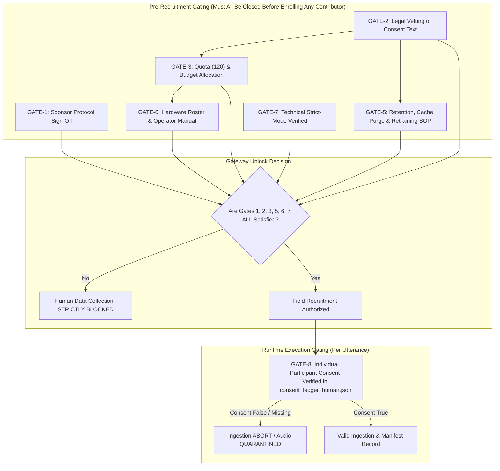

# Governance Gate Consistency & Action Tracker Audit

**Workspace:** `D:\trainidentificationaudio`  
**Audit Document Version:** 1.0.0-GATE-AUDIT  
**Audit Date:** 2026-10-14  
**Auditor:** Independent Code & Governance Auditor (Pair Programming Assistant)  
**Primary Target File:** [`docs/sound_command_recognition/campaign_20261013/governance_approval_action_tracker.md`](file:///d:/trainidentificationaudio/docs/sound_command_recognition/campaign_20261013/governance_approval_action_tracker.md)  
**Cross-Check Reference Baseline:**
- [`governance_package_quality_review.md`](file:///d:/trainidentificationaudio/docs/sound_command_recognition/campaign_20261013/governance_package_quality_review.md)
- [`governance_evidence_review.md`](file:///d:/trainidentificationaudio/docs/sound_command_recognition/campaign_20261013/governance_evidence_review.md)
- [`technical_closure_report.md`](file:///d:/trainidentificationaudio/docs/sound_command_recognition/campaign_20261013/technical_closure_report.md)
- [`human_governance_signoff_checklist.md`](file:///d:/trainidentificationaudio/docs/sound_command_recognition/campaign_20261013/human_governance_signoff_checklist.md)
- [`human_governance_decision_brief.md`](file:///d:/trainidentificationaudio/docs/sound_command_recognition/campaign_20261013/human_governance_decision_brief.md)
- [`corpus_license_evidence_matrix.md`](file:///d:/trainidentificationaudio/docs/sound_command_recognition/campaign_20261013/corpus_license_evidence_matrix.md)
- [`human_governance_signoff_record.md`](file:///d:/trainidentificationaudio/docs/sound_command_recognition/campaign_20261013/human_governance_signoff_record.md)
- [`collection_protocol.md`](file:///d:/trainidentificationaudio/docs/sound_command_recognition/campaign_20261013/collection_protocol.md)
- [`data_provenance_policy.md`](file:///d:/trainidentificationaudio/docs/sound_command_recognition/campaign_20261013/data_provenance_policy.md)

---

## 1. Executive Verdict

### Definitive Audit Verdict: **`INCONSISTENT — COLLECTION BLOCKED`**
**Physical Human Data Collection Status:** **`Human data collection: STRICTLY BLOCKED`**

### Summary of Audit Assessment:
1. **Safety Enforcement Is Maintained:** The action tracker correctly and unreservedly preserves the prohibition on physical participant recruitment and recording (`STRICTLY BLOCKED`).
2. **Internal Tracker Inconsistencies Identified:**
   - **Conflation in ACT-05:** ACT-05 is labeled `CLOSED WITH EVIDENCE`, but its cited evidence only establishes technical pipeline gating (blocking ingestion in code), NOT complete governance data-removal or upstream legal clearance. Labeling this action "closed" risks misinterpretation by compliance reviewers.
   - **Incomplete Gate Mapping in Section 5:** The tracker diagrammed only 5 pre-collection gates, omitting technical strict-mode verification and runtime participant-level consent validation from its dependency architecture.
   - **Circularity in ACT-01 Closure Criteria:** ACT-01 requires a registered participant record to close, but physical enrollment cannot begin until all pre-collection gates pass, creating a circular dependency unless ACT-01 is explicitly separated into an operational runtime requirement.
   - **Theoretical Quota Arithmetic vs. Empirical Stratification:** The 70/15/15 cohort-level arithmetic (84/18/18) is clean, but fine-grained demographic stratification (`dialect × gender × age`) cannot mathematically avoid empty partitions or integer rounding distortion for small strata (e.g. Central males aged 51+ with only 2 contributors).

---

## 2. Detailed Audit Table: ACT-01 through ACT-09

| Action ID & Title | Stated Status | Stated Evidence & Evaluation | Objectivity of Closure Criteria | Role Separation | Dependency Specification | Audit Finding & Recommendation |
| :---: | :---: | :--- | :--- | :---: | :---: | :--- |
| **ACT-01** Zero Active Consent Records | `OPEN` | **Supported.** `consent_ledger_human.json` does not exist on disk; zero human records exist. | **Circular.** Requires participant registration to close, but recruitment is blocked by gates ACT-02 and ACT-03. | Distinct (Acquisition Lead vs. PI & Legal). | ACT-02, ACT-03, ACT-08. | **Scope Inconsistency:** Re-classify ACT-01 as a *Runtime Ingestion Invariant Gate*, rather than a pre-recruitment gating prerequisite. |
| **ACT-02** Informed Consent Legal Vetting | `AWAITING HUMAN DECISION` | **Supported.** Draft text exists in `collection_protocol.md#L41-L67`, unreviewed by counsel. | **Objective.** Checks for executed legal signature in `human_governance_signoff_record.md`. | Distinct (Legal Counsel vs. Legal Reviewer). | None. | **Consistent.** Accurately tracked as awaiting human decision. |
| **ACT-03** Quota Sign-Off (50N/30C/40S) | `AWAITING HUMAN DECISION` | **Supported.** Quota is explicitly labeled `PROPOSED — PENDING HUMAN APPROVAL`. | **Objective.** Checks for signed Section 4 in `human_governance_signoff_record.md`. | Distinct (Coordinator vs. PI). | ACT-02. | **Consistent.** Accurately distinguishes technical proposal from executive authorization. |
| **ACT-04** FLEURS & MSWC License Archiving | `OPEN` | **Supported.** Audio/TSV files exist on disk, but `LICENSE.txt` files are missing on disk. | **Objective.** Physical check for `LICENSE.txt` on disk and counsel-approved attribution text. | Distinct (Data Steward vs. Legal & PI). | None. | **Consistent.** Correctly held at `OPEN` (status `NOT VERIFIED`). |
| **ACT-05** Block on Husein `mic-noise` | `CLOSED WITH EVIDENCE` | **Partially Supported.** Code and tests block ingestion, but files remain on disk and no legal clearance exists. | **Ambiguous.** Conflates technical workflow blocking with full governance closure. | Distinct (Security Engineer vs. Tech Lead). | None. | **Inconsistent / Conflated.** Re-scope to *Technical Workflow Gate Active*; keep governance status as `BLOCKED_UNVERIFIED_LICENSE`. |
| **ACT-06** Retention, Cache & Retraining SOP | `AWAITING HUMAN DECISION` | **Supported.** Boundary analysis in `governance_evidence_review.md#L151-L165` defines requirements. | **Objective.** Signed operational SOP mandating manual cache purge and model retraining. | Distinct (DPO & ML Lead vs. PI & Tech Lead). | ACT-02. | **Consistent.** Accurately reflects that neural weights cannot unlearn gradients automatically. |
| **ACT-07** Terminology Harmonization | `AWAITING HUMAN DECISION` | **Supported.** `collection_protocol.md#L18` used "anonymity"; biometric voice is pseudonymous. | **Objective.** Verification of protocol text removing all claims of full voice anonymity. | Distinct (Doc Lead vs. Privacy Officer). | ACT-02. | **Consistent.** Necessary to prevent legal misrepresentation under privacy statutes. |
| **ACT-08** Device Roster & Operator Manual | `OPEN` | **Supported.** Hardware roster is explicitly marked `UNKNOWN — ACTION REQUIRED`. | **Objective.** Physical hardware inventory documented with calibration confirmation. | Distinct (Ops Lead vs. Tech Lead). | ACT-03. | **Consistent.** Correctly marked as open action. |
| **ACT-09** Stratum Rounding Limitation | `AWAITING HUMAN DECISION` | **Supported.** Diagnostic output in `campaign_validator.py` confirms integer truncation. | **Objective.** Disclosure note present in Model Evaluation Specification. | Distinct (ML Lead vs. ML Lead / PI). | ACT-03. | **Consistent.** Correctly prevents false claims of demographic balance in small bins. |

---

## 3. Specific Determination on ACT-05 (`husein_mic_noise`)

### 3.1 Background & Forensic Reality
In [`governance_approval_action_tracker.md`](file:///d:/trainidentificationaudio/docs/sound_command_recognition/campaign_20261013/governance_approval_action_tracker.md#L126-L143), Action Item **ACT-05** is titled *"Maintenance of Technical Block on Husein mic-noise"* and categorized as **`CLOSED WITH EVIDENCE`**.
The supporting evidence cited is:
1. Runtime download exception in [`src/acquisition/download_approved_sources.py#L38-L52`](file:///d:/trainidentificationaudio/src/acquisition/download_approved_sources.py#L38-L52).
2. Manifest validation exception in [`src/acquisition/campaign_validator.py#L39-L44`](file:///d:/trainidentificationaudio/src/acquisition/campaign_validator.py#L39-L44).
3. Passing automated test [`tests/test_campaign_acceptance.py::test_p0_2_source_license_gate`](file:///d:/trainidentificationaudio/tests/test_campaign_acceptance.py#L1040).

### 3.2 Conflation Analysis: Meaning (a) vs. Meaning (b)
The audit evaluated whether ACT-05 represents:
- **Meaning (a):** The source is blocked from entering the human training/validation workflow by automated software guards.
- **Meaning (b):** All governance, licensing, and data-removal obligations for that source are complete.

**Forensic Finding:**
- **The primary evidence supports ONLY Meaning (a).**
- **The primary evidence DOES NOT support Meaning (b):**
  1. The physical archive `data/raw/noise/mic-noise.zip` (45,906,002 bytes) and 39 extracted MP3 files in `data/raw/noise/extracted/noise/mic-noise/` **still reside on disk**.
  2. The upstream legal license remains unverified. No formal copyright grant or release documentation has been obtained from the upstream repository author (`huseinzol05`).
  3. No decision has been made by legal counsel regarding whether physical retention of these unverified files on developer storage violates corporate data custody standards.

### 3.3 Audit Determination & Mandatory Correction
> [!WARNING]
> **Conflation Warning:**  
> Marking ACT-05 as `CLOSED WITH EVIDENCE` creates an audit vulnerability. A compliance inspector may infer that the legal status of the dataset is resolved or that all data-removal obligations are complete.
> 
> **Required Documentation Correction:**
> 1. Retitle ACT-05 to: **`ACT-05: Software Workflow Ingestion Gate Active (Technical Control Only)`**.
> 2. Clarify in the status notes that **licensing remains `BLOCKED_UNVERIFIED_LICENSE`** and physical storage retention is an unresolved governance item.
> 3. Do NOT delete or modify the files on disk during this phase (preserving filesystem stability).

---

## 4. Collection-Gate Dependency Matrix

To ensure that human data collection cannot be unlocked prematurely, the gate architecture is derived from the complete repository baseline. The audit establishes an **8-Gate Matrix** distinguishing **Pre-Recruitment Gating** from **Runtime Gating**:

| Gate ID | Gate Scope & Description | Required Primary Evidence | Approving Authority | Upstream Dependencies | Gate Type | Blocking Status | Current State |
| :---: | :--- | :--- | :--- | :---: | :---: | :---: | :---: |
| **GATE-1** | **Overall Project Protocol Sign-Off** | Signed Section 4 in `human_governance_signoff_record.md` | Project Sponsor / Principal Investigator | None | Pre-Recruitment | **STRICT BLOCKER** | `AWAITING HUMAN DECISION` |
| **GATE-2** | **Legal Vetting of Informed Consent Form** | Signed Section 5 in `human_governance_signoff_record.md` | Legal / Privacy Counsel | None | Pre-Recruitment | **STRICT BLOCKER** | `AWAITING HUMAN DECISION` |
| **GATE-3** | **Cohort Quota (50N/30C/40S) & Budget Authorization** | Written executive resource allocation & approved targets | Project Sponsor / Principal Investigator | GATE-2 | Pre-Recruitment | **STRICT BLOCKER** | `AWAITING HUMAN DECISION` |
| **GATE-4** | **FLEURS & MSWC Exact-Version License Archiving** | Official `LICENSE.txt` files on disk; signed attribution approval | Legal Counsel & Project Sponsor | None | Pre-Training / Pre-Release | **BLOCKER (for multi-corpus training)** | `OPEN` |
| **GATE-5** | **Data Retention, Cache Purge & Retraining Policy** | Approved operational SOP covering `.npy` purge & model retrain | Data Protection Officer & Tech Lead | GATE-2 | Pre-Recruitment | **STRICT BLOCKER** | `AWAITING HUMAN DECISION` |
| **GATE-6** | **Physical Hardware Inventory & Operator Calibration** | Approved Device Serial Roster & Operator Manual | Field Operations Lead & Tech Lead | GATE-3 | Pre-Recruitment | **STRICT BLOCKER** | `OPEN` |
| **GATE-7** | **Technical Pipeline Strict-Mode Enforcement** | Automated test suite passing; `effective_strict=True` forced | Independent Technical Auditor | None | Infrastructure Baseline | **SATISFIED (VERIFIED)** | `CLOSED WITH EVIDENCE` |
| **GATE-8** | **Individual Contributor Consent Enrollment** | Valid record in `consent_ledger_human.json` prior to any recording | Field Acquisition Operator & Ingestion Pipeline | GATES 1–7 | Runtime Per-Participant | **STRICT RUNTIME BLOCKER** | `OPEN (Zero records)` |

### 4.1 Dependency Flowchart

---

## 5. Quota & Stratified Splitting Assessment

### 5.1 Quota Governance Status
- The proposed cohort sizing of **`50 Northern / 30 Central / 40 Southern`** (total 120 participants) remains strictly **`PROPOSED — PENDING HUMAN APPROVAL`**.
- It is documented as an engineering proposal in [`collection_protocol.md#L105-L114`](file:///d:/trainidentificationaudio/docs/sound_command_recognition/campaign_20261013/collection_protocol.md#L105-L114) and has not received executive sign-off.

### 5.2 Mathematical Analysis: Cohort Arithmetic vs. Fine-Grained Stratification
The audit reconciled the arithmetic examples presented in earlier reports against the actual mathematical constraints of `generate_stratified_disjoint_splits()`:

#### Level 1: Full Cohort Level (120 Speakers)
- $120 \times 0.70 = 84$ Train speakers
- $120 \times 0.15 = 18$ Validation speakers
- $120 \times 0.15 = 18$ Test speakers
- **Assessment:** Exact integer partition ($84 + 18 + 18 = 120$). Zero rounding drift.

#### Level 2: Regional Cohort Level (50 / 30 / 40)
- Northern ($50$): $50 \times 0.15 = 7.5 \rightarrow$ rounded to $7$ validation, $8$ test (or vice versa), $35$ train.
- Central ($30$): $30 \times 0.15 = 4.5 \rightarrow$ rounded to $4$ validation, $5$ test (or vice versa), $21$ train.
- Southern ($40$): $40 \times 0.15 = 6.0 \rightarrow$ exact integer: $6$ validation, $6$ test, $28$ train.
- **Assessment:** Integer rounding across regional tiers is manageable ($35+21+28=84$; $7+5+6=18$; $8+4+6=18$).

#### Level 3: Regional × Gender Tier (6 Strata)
- Assuming equal 50/50 gender balance:
  - Northern (25 M, 25 F): $25 \times 0.15 = 3.75 \rightarrow$ splits into $17$ train, $4$ val, $4$ test ($17+4+4=25$).
  - Central (15 M, 15 F): $15 \times 0.15 = 2.25 \rightarrow$ splits into $11$ train, $2$ val, $2$ test ($11+2+2=15$).
  - Southern (20 M, 20 F): $20 \times 0.15 = 3.0 \rightarrow$ exact integer: $14$ train, $3$ val, $3$ test ($14+3+3=20$).
- **Assessment:** Central validation and test subsets contain only **2 speakers each** ($2/15 = 13.3\%$, whereas train is $11/15 = 73.3\%$).

#### Level 4: Regional × Gender × Age Tier (18 Strata)
- If Central male contributors (15 total) are distributed across 3 age brackets (`18-30`: 7, `31-50`: 6, `51+`: 2):
  - The `51+` stratum contains only **2 speakers**.
  - **Mathematical Impossibility:** It is mathematically impossible to distribute 2 speakers across 3 disjoint partitions (Train, Validation, Test) without at least one partition receiving **0 speakers**.
- **Audit Mandate:**  
  The documentation must clearly distinguish the theoretical cohort arithmetic (Level 1) from fine-grained demographic stratum realities (Level 4). **Demographic balance cannot be guaranteed for small demographic bins.** The project must never claim full demographic balance across all three partitions unless explicitly confirmed by split diagnostic logs.

---

## 6. Identified Inconsistencies & Recommended Corrections

| # | Document | Section / Location | Identified Inconsistency | Recommended Correction |
| :-: | :--- | :--- | :--- | :--- |
| **1** | `governance_approval_action_tracker.md` | Table 2 & Section 3.3 (ACT-05) | ACT-05 is labeled `CLOSED WITH EVIDENCE`, but evidence only proves technical ingestion blocking, not governance data-removal or license clearance. | Retitle ACT-05 to clarify it tracks the *Technical Ingestion Gate Only*. Note that source data remains `BLOCKED_UNVERIFIED_LICENSE`. |
| **2** | `governance_approval_action_tracker.md` | Section 5 (Diagram) | Diagram maps only 5 gates, omitting technical strict-mode verification (GATE-7) and runtime participant consent enrollment (GATE-8). | Update the gate matrix and flowchart to incorporate all 8 gates (GATES 1–8). |
| **3** | `governance_approval_action_tracker.md` | Section 3.1 (ACT-01) | Closure criteria for ACT-01 require a registered participant, which is impossible before collection gates are unlocked. | Re-classify ACT-01 as an operational runtime invariant enforced during active collection. |
| **4** | `collection_protocol.md` | Section 1, Line 18 | Uses the word "anonymity" in prose, conflicting with the pseudonymous ID specification in Section 3. | Replace "anonymity" with "cryptographic pseudonymity". |
| **5** | `collection_protocol.md` & `action_tracker.md` | Section 4.1 | Describes 70/15/15 split as "clean" without acknowledging that Level 4 strata (e.g. 2 speakers) will have empty partitions. | Add explicit caveat regarding fine-grained stratum integer rounding limitations. |

---

## 7. Mandatory Criteria to Reconsider Human Data Collection

Human data collection must remain **`STRICTLY BLOCKED`** until all of the following eight criteria are independently verified with documentary evidence:

1. **Criterion 1 (PI Authorization):** Project Sponsor/PI signs Section 4 of [`human_governance_signoff_record.md`](file:///d:/trainidentificationaudio/docs/sound_command_recognition/campaign_20261013/human_governance_signoff_record.md).
2. **Criterion 2 (Legal Consent Sign-off):** Legal Counsel signs Section 5 of [`human_governance_signoff_record.md`](file:///d:/trainidentificationaudio/docs/sound_command_recognition/campaign_20261013/human_governance_signoff_record.md) approving the Vietnamese Informed Consent Agreement.
3. **Criterion 3 (Quota Commitment):** Executive budget allocation and recruitment target of 120 participants are formally approved.
4. **Criterion 4 (SOP Adoption):** Operational SOP governing intermediate cache purging (`.npy`) and full model retraining upon consent revocation is signed by DPO and ML Lead.
5. **Criterion 5 (Hardware Roster):** Field operations lead finalizes the physical smartphone serial number inventory and calibration manual.
6. **Criterion 6 (Terminology Rectification):** All instances of "anonymity" in protocol documents are revised to "pseudonymity".
7. **Criterion 7 (License Archiving):** Unedited text files `data/raw/fleurs_vi/LICENSE.txt` and `data/raw/mswc_vi/LICENSE.txt` are placed on disk before those datasets are merged into training runs.
8. **Criterion 8 (Runtime Ledger Isolation):** Every participant must have a verified record in `data/raw/human_recordings_v1/consent_ledger_human.json` prior to any recording take being saved.

---

## 8. Final Audit Sign-Off Determination

- **Audit Evaluation:** **`INCONSISTENT — COLLECTION BLOCKED`**
- **Action Tracker Integrity:** The tracker successfully prevents premature collection, but requires documentation corrections regarding ACT-05 scope, gate mapping completeness, and stratum rounding disclosures.
- **Operational Status:** **`Human data collection: STRICTLY BLOCKED`**
