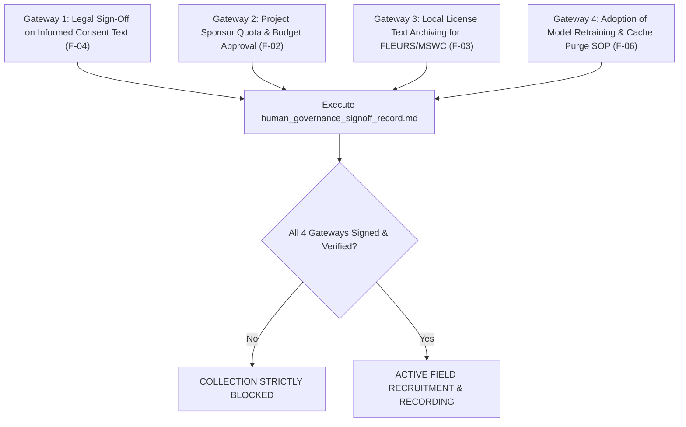

# Final Governance Package Quality Review

**Workspace:** `D:\trainidentificationaudio`  
**Review Version:** 1.0.0-QUALITY-REVIEW  
**Review Date:** 2026-10-14  
**Auditor / Review Role:** Independent Code & Governance Auditor (Pair Programming Assistant)  
**Governing Standard:** Primary Evidence Rule (Filesystem Reality vs. Code Declarations)  
**Definitive Review Verdict:** **`READY FOR HUMAN DECISION — COLLECTION BLOCKED`**  
*(Human Speech Collection Status: **`STRICTLY BLOCKED`** pending formal physical human sign-off on the governance record)*

---

## 1. Executive Summary & Review Scope

This document provides the final, independent quality assurance review of the Human Governance Sign-Off Package prepared for the Vietnamese Keyword Spotting (`TRAI`, `PHAI`, `LEN`, `XUONG`, `UNKNOWN`, `SILENCE`) speech collection campaign.

The review performed a rigorous cross-examination of the four newly established governance artifacts:
1. [`human_governance_signoff_checklist.md`](file:///d:/trainidentificationaudio/docs/sound_command_recognition/campaign_20261013/human_governance_signoff_checklist.md)
2. [`human_governance_decision_brief.md`](file:///d:/trainidentificationaudio/docs/sound_command_recognition/campaign_20261013/human_governance_decision_brief.md)
3. [`corpus_license_evidence_matrix.md`](file:///d:/trainidentificationaudio/docs/sound_command_recognition/campaign_20261013/corpus_license_evidence_matrix.md)
4. [`human_governance_signoff_record.md`](file:///d:/trainidentificationaudio/docs/sound_command_recognition/campaign_20261013/human_governance_signoff_record.md)

These documents were reconciled against:
- [`governance_evidence_review.md`](file:///d:/trainidentificationaudio/docs/sound_command_recognition/campaign_20261013/governance_evidence_review.md)
- [`technical_closure_report.md`](file:///d:/trainidentificationaudio/docs/sound_command_recognition/campaign_20261013/technical_closure_report.md)
- [`collection_protocol.md`](file:///d:/trainidentificationaudio/docs/sound_command_recognition/campaign_20261013/collection_protocol.md)
- [`data_provenance_policy.md`](file:///d:/trainidentificationaudio/docs/sound_command_recognition/campaign_20261013/data_provenance_policy.md)
- Live on-disk assets, git status, and automated test suite results.

---

## 2. Cryptographic Invariants & Baseline Protection

The cryptographic hashes of all three protected production and historical files were verified before and after this quality audit:

| Protected File Path | Baseline SHA-256 Digest | Measured SHA-256 Digest | Status |
| :--- | :--- | :--- | :---: |
| `data/manifests/test_manifest_v2.csv` | `9E3904C8EA427244F7280A41140D7EFD19FD9625B359290ADB7ADCD4FA2E1C13` | `9E3904C8EA427244F7280A41140D7EFD19FD9625B359290ADB7ADCD4FA2E1C13` | **`VERIFIED` (Bit-Exact)** |
| `data/raw/field_recordings/field_collection_manifest.csv` | `B389282F9853A74484B39356EE85E5BD7E74C0C46481300524C7BD2894AA8C85` | `B389282F9853A74484B39356EE85E5BD7E74C0C46481300524C7BD2894AA8C85` | **`VERIFIED` (Bit-Exact)** |
| `data/raw/field_recordings/consent_ledger.json` | `BE4BFDD7CEC0C87A1DC97455E5783054EF8093C638279C44940C896F5BDA2BA0` | `BE4BFDD7CEC0C87A1DC97455E5783054EF8093C638279C44940C896F5BDA2BA0` | **`VERIFIED` (Bit-Exact)** |

*Production filesystem invariant:* `data/raw/human_recordings_v1` does not exist on disk. Zero unconsented or test files have leaked into genuine human storage locations.

---

## 3. Cross-Document Consistency & Policy Audit

### 3.1 Status Verification & Down-Check
Every item claiming `VERIFIED` status in the package was audited against primary on-disk evidence:
- **Pipeline Fail-Closed Strict-Mode:** **`VERIFIED`**. Confirmed by [`record_command_cli.py`](file:///d:/trainidentificationaudio/src/acquisition/record_command_cli.py) (forces `effective_strict=True` when `not mock_mode`), [`ingest_field_recordings.py`](file:///d:/trainidentificationaudio/src/acquisition/ingest_field_recordings.py) (removes silent defaults in strict mode), and regression tests (`test_fail_closed_production_strict_metadata`, `test_registration_flow_persists_mic_and_distance`, `test_recording_session_strict_fail_closed`).
- **Disjoint Splitting & Lineage Overlap Gate:** **`VERIFIED`**. Confirmed by [`campaign_validator.py::validate_speaker_disjointness`](file:///d:/trainidentificationaudio/src/acquisition/campaign_validator.py#L320) and `test_recording_and_lineage_disjointness`.
- **Blocked Unverified Noise:** **`VERIFIED` (BLOCKED)**. Confirmed by `download_approved_sources.py` lines 38–52 and `campaign_validator.py` lines 39–44.
- **Cryptographic File Preservation:** **`VERIFIED`**. Confirmed by continuous bit-exact hash verification.

### 3.2 Down-Checked Statuses (Honest Boundary Enforcement)
- **External Corpora (FLEURS & MSWC):** Held strictly at **`NOT VERIFIED`** (instead of code claims of `APPROVED_VERIFIED`). While data files exist on disk with verified hashes, **no official `LICENSE.txt` files exist locally on disk**.
- **Participant Quota (50N/30C/40S):** Held strictly at **`PENDING HUMAN APPROVAL`**. Confirmed that no document presents this proposal as an approved decision.
- **Informed Consent Notice:** Held strictly at **`PENDING HUMAN APPROVAL`**. The draft Vietnamese text is marked pending legal review.
- **Sign-Off Records:** The decision brief and sign-off record contain **zero pre-filled names, signatures, dates, or simulated approvals**.

---

## 4. Comprehensive Findings Matrix

The following table details all findings, inconsistencies, overclaim risks, and missing human decisions identified during the quality audit:

| Finding ID | Severity | Evidence / Location | Finding Description | Required Action | Responsible Approver | Closure Criteria |
| :---: | :---: | :--- | :--- | :--- | :--- | :--- |
| **F-01** | **CRITICAL** | `data/raw/human_recordings_v1/consent_ledger_human.json` (does not exist) | **Zero Real Contributor Consent Records:** The production human consent ledger does not exist on disk. Zero living participants have been enrolled. | Keep physical collection strictly blocked. Execute enrollment only after legal sign-off. | Project Sponsor / PI & Legal Counsel | Signed informed consent forms captured in `consent_ledger_human.json`. |
| **F-02** | **HIGH** | `docs/sound_command_recognition/campaign_20261013/collection_protocol.md#L105-L114` | **Quota is an Unapproved Technical Proposal:** Cohort quota `50N/30C/40S` (120 speakers) is mathematically justified but lacks executive budget/recruitment approval. | Present decision brief to Project Sponsor for formal quota and resource sign-off. | Project Sponsor / PI | Section 1 & 4 of `human_governance_signoff_record.md` signed by PI. |
| **F-03** | **HIGH** | `data/raw/fleurs_vi/` & `data/raw/mswc_vi/` (no `LICENSE` files) | **Missing On-Disk Open Source License Files:** While data archives exist with verified SHA-256 digests, official text `LICENSE` files (CC-BY-4.0) are absent on disk. | Obtain official CC-BY-4.0 text files and place them on disk; confirm attribution text for release. | Legal Counsel & Data Steward | `LICENSE.txt` present in dataset directories; attribution reviewed by counsel. |
| **F-04** | **HIGH** | `docs/sound_command_recognition/campaign_20261013/collection_protocol.md#L41-L67` | **Informed Consent Text Lacks Formal Legal Vetting:** Vietnamese agreement draft exists in protocol but lacks documented approval from institutional legal counsel. | Conduct formal legal review of Vietnamese consent terms, withdrawal rights, and scope of use. | Legal / Privacy Counsel | Section 5 of `human_governance_signoff_record.md` signed by Legal Counsel. |
| **F-05** | **MEDIUM** | `collection_protocol.md#L18` ("anonymity") vs `collection_protocol.md#L90-L92` (pseudonyms) | **Terminology Ambiguity (Anonymity vs. Pseudonymity):** Protocol mentions "anonymity" in prose, whereas the pipeline implements cryptographic pseudonymization (`SPK_H_...`). Biometric voice data cannot be considered irreversibly anonymized. | Ensure all public and participant-facing documents state that voice data is *pseudonymized*, not *anonymized*. | Privacy Officer / Data Protection Officer | Consistent terminology across consent disclosures and protocol documentation. |
| **F-06** | **MEDIUM** | `src/acquisition/revoke_speaker_consent.py` & `governance_evidence_review.md#L162-L165` | **Non-Automated Derived Cache & Model Revocation:** The revocation CLI isolates raw/standardized audio and updates manifest/ledger, but cannot flush intermediate feature caches (`.npy`), cold backups, or pre-trained model weights. | Adopt mandatory SOP requiring operators to manually flush feature caches and retrain models from scratch if consent is revoked prior to release. | Data Protection Officer & ML Engineering Lead | Approved Data Deletion & Model Retraining SOP attached to sign-off package. |
| **F-07** | **LOW** | `campaign_validator.py::generate_stratified_disjoint_splits` | **Small-Bin Demographic Integer Rounding Asymmetry:** Small demographic bins (e.g. 15 Central males) cannot be partitioned into exact 70/15/15 fractions ($15 \times 0.15 = 2.25$), leaving minor split rounding asymmetry. | Document this structural limitation in model evaluation benchmarks; use confidence intervals. | Machine Learning Lead | Transparent documentation in model card and evaluation reports. |
| **F-08** | **LOW** | `docs/sound_command_recognition/campaign_20261013/collection_protocol.md#L98` | **Hardware Device Procurement Roster Undefined:** Protocol lists generic device classes (`iPhone 13`, `Laptop Mic`), but lacks an exact hardware inventory of physical devices provided to field operators. | Finalize physical device roster and microphone testing checklist prior to field deployment. | Technical Lead & Operations Lead | Approved Hardware Roster appended to Field Operator Manual. |

---

## 5. Pre-Requisite Conditions to Unlock Collection (Go/No-Go Gateways)

Before the status of `Human Speech Collection` can be transitioned from **`STRICTLY BLOCKED`** to **`ACTIVE`**, the following mandatory gateways must be fulfilled:

---

## 6. Audit Verdict

Based on the forensic inspection of the codebase, on-disk artifacts, test suite execution (44/44 passing), and governance package documents:

### Definitive Quality Verdict: **`READY FOR HUMAN DECISION — COLLECTION BLOCKED`**

- **Readiness for Human Decision:** The Human Governance Sign-Off Package is complete, internally consistent, strictly grounded in empirical evidence, free of pre-filled signatures or false claims, and fully prepared for executive decision-makers.
- **Operational Reality:** Physical human recruitment and speech collection remain **`STRICTLY BLOCKED`** until the Authorizing Signatures in [`human_governance_signoff_record.md`](file:///d:/trainidentificationaudio/docs/sound_command_recognition/campaign_20261013/human_governance_signoff_record.md) are executed by human stakeholders.
