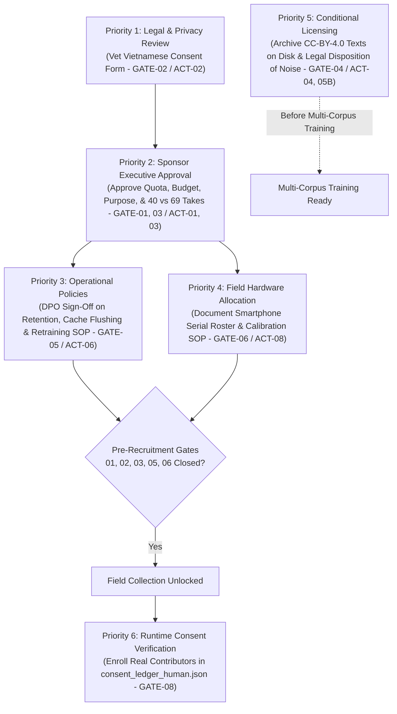

# Governance Review Package Index: Vietnamese KWS Campaign

**Workspace:** `D:\trainidentificationaudio`  
**Document Version:** 1.0.0-REVIEW-INDEX  
**Assessment Date:** 2026-10-14  
**Target Ingestion Target:** Genuine Human Field Speech Collection (`v1.0.0-human`)  
**Auditor / Custodian Role:** Independent Code & Governance Auditor (Pair Programming Assistant)  
**Governing Standard:** Evidence-Based Governance Review (No Automated Unlocking)  
**Physical Human Data Collection Status:** **`STRICTLY BLOCKED`**  
*(Prohibited until all mandatory pre-recruitment gates are formally authorized by designated human stakeholders)*

---

## 1. Executive Summary

This Governance Review Package Index consolidates all findings, evidence, draft policies, and pending human decisions across the Vietnamese Keyword Spotting (`TRAI`, `PHAI`, `LEN`, `XUONG`, `UNKNOWN`, `SILENCE`) field recording campaign.

The purpose of this document is to provide a single, evidence-based reference index for the **Project Sponsor / Principal Investigator (PI)**, **Legal & Privacy Counsel**, and **Data Protection Officer (DPO)** to evaluate campaign readiness, resolve documented discrepancies, and execute required governance sign-offs before any human participant may be contacted or enrolled.

#### 1.1 Summary of Readiness State
- **Technical Pipeline & Ingestion Core:** **`VERIFIED WITH EVIDENCE`**. The ingestion pipeline enforces fail-closed provenance allowlists, mandatory strict metadata validation (`effective_strict=True`), explicit consent ledger checks, pre-existing destination collision safeguards, and atomic rollback on manifest commit failure. All 49 acceptance tests pass without warnings or hangs (`pytest tests/test_campaign_acceptance.py -q`), and historical baseline hashes remain bit-exact.
- **Human Governance & Legal Authorizations:** **`PENDING HUMAN APPROVAL`**. Zero living human participants have been recruited or consented; the Vietnamese informed consent disclosure text has not received formal legal endorsement; the 120-participant quota and operational budget are unapproved proposals; physical hardware inventories remain open; and external corpus license texts are not archived locally on disk.
- **Collection Status:** **`STRICTLY BLOCKED`**. Technical infrastructure readiness does **not** grant authorization to recruit or record human participants.

---

## 2. Gate-by-Gate Approval Matrix

The campaign adheres to the canonical 8-gate governance model established in [`governance_approval_action_tracker.md`](file:///D:/trainidentificationaudio/docs/sound_command_recognition/campaign_20261013/governance_approval_action_tracker.md). Requirements are strictly segregated into:
- **Mandatory Pre-Recruitment Approvals (`GATE-01`, `GATE-02`, `GATE-03`, `GATE-05`, `GATE-06`):** Must all be formally executed in `human_governance_signoff_record.md` before participant recruitment or contact is permitted.
- **Conditional External Corpus Licensing (`GATE-04`):** Conditional on actual use of external corpora (FLEURS/MSWC) in multi-corpus pre-training, augmentation, or release; not a blocker for collection if self-contained Option B is executed.
- **Technical Pipeline Strict-Mode Baseline (`GATE-07`):** Technical evidence only (52/52 tests passing, bit-exact baselines); validates software baseline readiness but does NOT grant governance authorization to collect human data.
- **Per-Participant Runtime Invariant (`GATE-08`):** Mandatory per-participant consent verification before recording required for each individual contributor.
- **Independent Institutional Ethics / IRB Review:** Additional organizational requirement; must be documented and executed alongside `GATE-01` and `GATE-02` if mandated by institutional policy. Does not alter or replace canonical gates `GATE-01` through `GATE-08`. (No legal or ethics approval has occurred).

| Gate ID | Gate Scope & Description | Responsible Approver | Evidence Available | Missing Evidence | Exact Closure Condition | Current Status |
| :---: | :--- | :--- | :--- | :--- | :--- | :--- | :---: |
| **`GATE-01`** | **Overall Project Protocol Sign-Off** Formal authorization of collection purpose (offline edge KWS research and product evaluation) and prohibition of biometric surveillance. | Project Sponsor / Principal Investigator (PI) | Draft purpose in [`collection_protocol.md#L46-L48`](file:///D:/trainidentificationaudio/docs/sound_command_recognition/campaign_20261013/collection_protocol.md#L46-L48); Decision Brief Section 6 (Q1). | Signed Section 4 in [`human_governance_signoff_record.md`](file:///D:/trainidentificationaudio/docs/sound_command_recognition/campaign_20261013/human_governance_signoff_record.md). | Formal written approval endorsing project purpose and forbidding unauthorized scope expansion. | **`PENDING HUMAN APPROVAL`** |
| **`GATE-02`** | **Informed Consent Legal Vetting** Statutory vetting of Vietnamese consent agreement under Vietnam Decree 13/2023/ND-CP and international privacy norms. | Legal / Privacy Counsel | Draft Vietnamese disclosure in [`collection_protocol.md#L41-L67`](file:///D:/trainidentificationaudio/docs/sound_command_recognition/campaign_20261013/collection_protocol.md#L41-L67); revocation CLI in `src/acquisition/revoke_speaker_consent.py`. | Written legal endorsement from corporate/institutional counsel; executed Section 5 in `human_governance_signoff_record.md`. | Verifiable legal approval token or written opinion approving the Vietnamese consent form without material reservation. | **`PENDING HUMAN APPROVAL`** |
| **`GATE-03`** | **Cohort Quota & Budget Authorization** Approval of 120-participant target (`50N / 30C / 40S`), operational budget/honorarium, and acknowledgement of Level 4 integer rounding constraints. | Project Sponsor / Principal Investigator (PI) | Cohort sizing specification in [`collection_protocol.md#L105-L114`](file:///D:/trainidentificationaudio/docs/sound_command_recognition/campaign_20261013/collection_protocol.md#L105-L114); mathematical partition analysis ($84/18/18$). | Formal financial resource allocation; written acceptance of small-strata rounding limitations. | Signed quota and budget authorization in Section 4 of `human_governance_signoff_record.md`. | **`PENDING HUMAN APPROVAL`** |
| **`GATE-04`** | **External Corpus License & Attribution Archiving** Local disk archiving of official CC-BY-4.0 `LICENSE.txt` files for Google FLEURS (`vi_vn`) and MLCommons MSWC (`vi`), with approved attribution notices. | Legal Counsel & Data Steward | Audio and metadata archives on disk with verified SHA-256 digests in [`corpus_license_evidence_matrix.md`](file:///D:/trainidentificationaudio/docs/sound_command_recognition/campaign_20261013/corpus_license_evidence_matrix.md). | Official standalone `LICENSE.txt` files in `data/raw/fleurs_vi/` and `data/raw/mswc_vi/`; signed attribution approval. | Local disk placement of license files and legal confirmation of attribution text. *(Conditional on multi-corpus use)* | **`PENDING CONDITIONAL APPROVAL`** *(Conditional on multi-corpus use)* |
| **`GATE-05`** | **Data Retention, Cache Purge & Retraining Policy** Binding policy governing 3-year data retention, manual feature cache flushing (`.npy`), backup isolation, and mandatory retraining from scratch upon consent withdrawal. | Data Protection Officer (DPO) & Tech Lead | Tooling support in `src/acquisition/revoke_speaker_consent.py`; forensic cache boundary analysis in `governance_evidence_review.md`. | Approved operational SOP covering administrator feature-cache flushing and retraining budget commitment. | Formally approved Data Deletion, Cache Purging, and Model Retraining SOP signed by DPO and Tech Lead. | **`PENDING HUMAN APPROVAL`** |
| **`GATE-06`** | **Physical Hardware Inventory & Operator Calibration** Allocation of specific physical smartphones and accessories, paired with an operator manual for microphone distance calibration (15 cm, 50 cm, 2 m). | Field Operations Lead & Tech Lead | Interactive CLI syntax in `record_command_cli.py`; target hardware categories defined in protocol. | Approved hardware serial roster (e.g. 2x iPhone 13, 2x Galaxy S22) and completed Operator Calibration Manual. | Physical device inventory documented and acoustic calibration guide appended to field documentation. | **`PENDING HUMAN APPROVAL`** |
| **`GATE-07`** | **Technical Pipeline Strict-Mode Enforcement** Verification that ingestion rejects missing metadata, provenance allowlists fail closed, and baseline manifests are immutable. | Independent Technical Auditor | 52/52 tests passing in `tests/test_campaign_acceptance.py`; bit-exact baseline SHA-256 digests; [`provenance_boundary_hardening_report.md`](file:///D:/trainidentificationaudio/docs/sound_command_recognition/campaign_20261013/provenance_boundary_hardening_report.md). | None (Technical evidence complete and verified). | Infrastructure baseline validated. *(Does not authorize human recruitment or data collection).* | **`CLOSED WITH EVIDENCE`** |
| **`GATE-08`** | **Individual Contributor Consent Enrollment** Continuous runtime invariant: mandatory per-participant consent verification before recording in `consent_ledger_human.json` prior to capturing any physical recording take. | Field Acquisition Operator & Ingestion Core | Automated ledger lookup and verification logic in `src/acquisition/speaker_consent.py` and `ingest_field_recordings.py`. | Real consented human contributor records on disk (currently 0 human records enrolled). | Runtime verification of `consent_given == True` per participant during authorized collection sessions. | **`PENDING EXECUTION AT RUNTIME`** *(Per-Participant Invariant)* |

---

## 3. Discrepancy Reconciliation: Recording Counts and Corpus Plans

A detailed forensic cross-check of project documentation revealed material discrepancies in proposed utterance counts, take distributions, and corpus dependencies. Authorizing decision-makers must review and resolve these conflicting figures:

### 3.1 Recording Count Discrepancies

| Document & Section | Target Commands (`TRAI`, `PHAI`, `LEN`, `XUONG`) | Negative Takes (`UNKNOWN`) | Room Tone Takes (`SILENCE`) | Total Takes per Speaker | Total Campaign Yield (120 Speakers) | Discrepancy Analysis & Status |
| :--- | :---: | :---: | :---: | :---: | :---: | :--- |
| **`human_governance_decision_brief.md#L28`** | 40 takes (10 per command) | Unspecified (0 takes cited) | Unspecified (0 takes cited) | **40 takes** | **4,800 recordings** | **Narrow Target-Only Count:** Counts exclusively the 4 active keywords. Omits negative and silence classes from the campaign total. |
| **`collection_protocol.md#L205-L220`** | 40 takes (10 per command) | 25 takes (16 confusers, 4 carrier, 5 open) | 4 takes (ambient room tones) | **69 takes** | **8,280 recordings** (~2.38 hours) | **Comprehensive Full-Cohort Count:** Includes all 6 target classes. Yields 4,800 keywords, 3,000 confusers, and 480 room tone samples. |
| **`governance_approval_action_tracker.md#L97-L98`** | 40 takes | Unspecified | Unspecified | 40 or 69 takes | 4,800 or 8,280 recordings | Cites 120 speakers with 70/15/15 split ($84/18/18$ speakers), but does not state total utterance yield. |

### 3.2 Partition Distribution Impact

Depending on which recording plan the Project Sponsor authorizes, the resulting partition yields differ substantially:

| Partition Split | Speaker Allocation | Yield under 40 Takes/Speaker (Keywords Only) | Yield under 69 Takes/Speaker (Complete Protocol) |
| :--- | :---: | :---: | :---: |
| **Train (70%)** | 84 speakers | 3,360 takes | 5,796 takes |
| **Validation (15%)** | 18 speakers | 720 takes (180 / command) | 1,242 takes (180 / command + 450 UNK + 72 SIL) |
| **Test (15%)** | 18 speakers | 720 takes (180 / command) | 1,242 takes (180 / command + 450 UNK + 72 SIL) |
| **TOTAL YIELD** | **120 speakers** | **4,800 takes** | **8,280 takes** |
| **Estimated Audio Storage** | **120 speakers** | **~1.51 GB Primary Audio (~2.57 GB Itemized Working Footprint)** - Raw capture (44.1k stereo, ~1.6s nominal): **1.355 GB** - Standardized (16k mono, 1.0s): **0.154 GB** - Feature caches (`.npy` @ $80 \times 101 \times 4\text{ B}$): **0.155 GB** - Cold backup archive (Raw + Standardized, ~50% unmeasured planning assumption): **0.754 GB** ($50\% \times 1.509\text{ GB}$) - Temp / provisional quarantine headroom: **0.150 GB** - **Total Explicit Working Footprint:** **~2.57 GB** *(Consolidated $1.5\times$ primary audio allowance: ~2.26 GB)* | **~2.60 GB Primary Audio (~4.42 GB Itemized Working Footprint)** - Raw capture (44.1k stereo, ~1.6s nominal): **2.337 GB** - Standardized (16k mono, 1.0s): **0.265 GB** - Feature caches (`.npy` @ $80 \times 101 \times 4\text{ B}$): **0.268 GB** - Cold backup archive (Raw + Standardized, ~50% unmeasured planning assumption): **1.301 GB** ($50\% \times 2.603\text{ GB}$) - Temp / provisional quarantine headroom: **0.250 GB** - **Total Explicit Working Footprint:** **~4.42 GB** *(Consolidated $1.5\times$ primary audio allowance: ~3.90 GB)* |

> [!IMPORTANT]
> **Action Required from Project Sponsor (Decision Q3):**  
> The Project Sponsor must formally specify whether field operators will collect **40 takes per participant** (focusing strictly on keywords and relying on external negative corpora) or **69 takes per participant** (capturing native confusers and room tones to produce a completely self-contained dataset).

---

### 3.3 External Corpus Planning & Licensing Status

1. **Google FLEURS (`vi_vn`) & MLCommons MSWC (`vi`):**
   - *Status:* `NOT VERIFIED (LICENSE FILES MISSING ON DISK)`.
   - *Dependency:* If the full 69-take protocol is executed, human recordings supply 3,000 native `UNKNOWN` samples, reducing reliance on external speech corpora for baseline evaluation. However, if external corpora are utilized for background augmentation or large-scale multi-corpus pre-training, official CC-BY-4.0 `LICENSE.txt` files must be placed locally on disk (`GATE-04`). Note that missing local text files indicate a documentation gap, not proof that upstream licenses are absent.
2. **Husein `mic-noise`:**
   - *Status:* `BLOCKED IN SOFTWARE (ACT-05A) / RETENTION DISPOSITION PENDING (ACT-05B)`.
   - *Enforcement:* Permanently blocked by software ingestion gates. Prohibited from production manifests. The on-disk archive `data/raw/noise/mic-noise.zip` (45.9 MB) and 39 extracted MP3 files remain preserved in quarantine pending institutional legal disposition.
3. **Parametric Tone Fixtures (`data/raw/reference_confusing_words/`):**
   - *Status:* `SYNTHETIC_TEST_FIXTURE`.
   - *Enforcement:* Prohibited from being merged into human manifests or cited as human evaluation data.

---

## 4. Verification of Operational, Privacy & Hardware Procedures

The governance review confirmed that all core operational and privacy procedures are explicitly addressed:

### 4.1 Cohort Quota & Demographic Balance Limitations
- **Proposed Sizing:** 120 native speakers: 50 Northern (41.7%), 30 Central (25.0%), 40 Southern (33.3%).
- **Integer Rounding Limitation Disclosure:** While the overall cohort partitions cleanly into $84/18/18$ ($70\%/15\%/15\%$), fine-grained demographic strata (Level 4: `regional × gender × age`) with $\le 2$ speakers (such as Central males aged 51+) cannot mathematically populate Train, Val, and Test without at least one partition receiving **0 speakers**. The documentation explicitly forbids claiming demographic balance across partitions unless verified empirically by split diagnostic logs.

### 4.2 Financial Budget & Participant Honorarium
- Field operator compensation, mobile device procurement, and participant recruitment honoraria have not been committed. Budget sign-off is pending PI authorization (`ACT-03`).

### 4.3 Data Retention & Storage Architecture
- Proposed retention period: **3 years from dataset release freeze**.
- Role-Based Access Control (RBAC): Storage restricted to authorized ML and audio researchers. Cold backups in `data/backups/` are preserved for regulatory audit compliance.
- Reproducible Audio Storage: Raw capture (44.1 kHz stereo 16-bit, ~282.3 KB/take nominal) and standardized audio (16 kHz mono 16-bit, ~32.0 KB/take) are both preserved on disk. Engineering estimates are ~1.51 GB Primary Audio (~2.57 GB itemized working footprint; ~2.26 GB consolidated $1.5\times$ primary audio allowance) for Option A, and ~2.60 GB Primary Audio (~4.42 GB itemized working footprint; ~3.90 GB consolidated $1.5\times$ primary audio allowance) for Option B. 1.6 seconds represents a nominal acquisition buffer configuration in `record_command_cli.py`, not an empirical guarantee that every saved file is exactly 1.6s. Cold backup estimates assume a 50% compression ratio across raw plus standardized audio as an unmeasured planning assumption (empirical compression efficiency has not been measured on production speech). Temporary and quarantine headroom figures (~0.150 GB for Option A, ~0.250 GB for Option B) remain explicitly provisional.

### 4.4 Participant Withdrawal & Deletion Mechanics
- Contributors retain an unconditional right to withdraw prior to dataset freeze.
- **Implemented Automated CLI:** `src/acquisition/revoke_speaker_consent.py` safely relocates raw and standardized audio to quarantine (`quarantine/withdrawn_speakers/<SPK>/`), updates manifest rows to `REVOKED_WITHDRAWN`, logs audit events in `quarantine_log.csv`, and records revocation in `consent_ledger.json`.
- **Operational SOP Required:** The CLI does **NOT** purge intermediate training feature caches (`.npy`, spectrograms), does not touch cold backups in `data/backups/`, and does not retrain models. An operational SOP for manually flushing caches upon withdrawal remains pending DPO sign-off (`ACT-06` / `GATE-05`).

### 4.5 Model Retraining Mandate — `PARTIALLY VERIFIED — POLICY PROPOSED`
- Deep neural networks cannot mathematically unlearn vocal representations through gradient descent.
- *Status:* **`PARTIALLY VERIFIED — POLICY PROPOSED`**. While the technical reality is documented in CLI warning notices and engineering briefs, formal institutional policy approval, operational retraining execution SOPs, and compute budget commitments from the Project Sponsor remain unapproved.

### 4.6 PII Protection & Pseudonymization
- **Zero Direct Identifiers:** No names, national identity numbers (CCCD/CMND), telephone numbers, email addresses, or physical addresses are collected or stored.
- **Cryptographic Pseudonymization:** Every participant is assigned a random cryptographic nonce (`SPK_H_<N|C|S>_<6-hex-nonce>`, e.g., `SPK_H_N_8f2a1b`) generated via `secrets.token_hex(3)`. Acoustic data is treated as pseudonymous rather than fully anonymous.

### 4.7 Physical Hardware Roster & Distance Calibration
- Target device mix: modern smartphones across price tiers (e.g. Apple iPhone 13, Samsung Galaxy S22).
- Verification Status: **`UNVERIFIED`** pending physical device allocation and operator calibration manual completion (`ACT-08` / `GATE-06`).
- Microphone distance categories: close-talk handheld (15 cm), mid-field desk (50 cm), and far-field room tone (2 m). The physical equipment serial roster and operator manual remain pending completion (`ACT-08`).

---

## 5. Prioritized Action List for Human Stakeholders

To proceed toward campaign authorization, stakeholders must complete the following actions in order of priority:

### Detailed Action Steps:
1. **Priority 1 (Legal & Privacy Counsel):** Review and formally execute Section 5 in `human_governance_signoff_record.md`, approving the Vietnamese Informed Consent Agreement (`GATE-02` / `ACT-02`).
2. **Priority 2 (Project Sponsor / PI):** 
   - Execute Section 4 in `human_governance_signoff_record.md`, authorizing purpose, budget, and 120-participant quota (`GATE-01`, `GATE-03` / `ACT-01`, `ACT-03`).
   - Resolve the recording count discrepancy: authorize either 40 takes (4,800 total) or 69 takes (8,280 total) per participant.
3. **Priority 3 (Data Protection Officer & Tech Lead):** Formally endorse the Data Retention, Intermediate Cache Purging, and Model Retraining Policy (`GATE-05` / `ACT-06`).
4. **Priority 4 (Field Operations Lead & Tech Lead):** Document the allocated smartphone hardware inventory and approve the operator distance calibration guide (`GATE-06` / `ACT-08`).
5. **Priority 5 (Data Steward & Legal Counsel):** Place official CC-BY-4.0 `LICENSE.txt` files on disk for FLEURS and MSWC (`GATE-04` / `ACT-04`), and determine legal disposition of quarantined noise files (`ACT-05B`).
6. **Priority 6 (Field Operators):** Upon formal unlocking of pre-recruitment gates, enroll real participants with verified consent in `consent_ledger_human.json` (`GATE-08`).

---

## 6. Official Evidence & Reference Documents

1. **Governance Action Tracker:** [`docs/sound_command_recognition/campaign_20261013/governance_approval_action_tracker.md`](file:///D:/trainidentificationaudio/docs/sound_command_recognition/campaign_20261013/governance_approval_action_tracker.md)
2. **Sign-Off Record (Unexecuted Blank):** [`docs/sound_command_recognition/campaign_20261013/human_governance_signoff_record.md`](file:///D:/trainidentificationaudio/docs/sound_command_recognition/campaign_20261013/human_governance_signoff_record.md)
3. **Decision Brief:** [`docs/sound_command_recognition/campaign_20261013/human_governance_decision_brief.md`](file:///D:/trainidentificationaudio/docs/sound_command_recognition/campaign_20261013/human_governance_decision_brief.md)
4. **Sign-Off Checklist:** [`docs/sound_command_recognition/campaign_20261013/human_governance_signoff_checklist.md`](file:///D:/trainidentificationaudio/docs/sound_command_recognition/campaign_20261013/human_governance_signoff_checklist.md)
5. **Collection Protocol:** [`docs/sound_command_recognition/campaign_20261013/collection_protocol.md`](file:///D:/trainidentificationaudio/docs/sound_command_recognition/campaign_20261013/collection_protocol.md)
6. **Corpus License Matrix:** [`docs/sound_command_recognition/campaign_20261013/corpus_license_evidence_matrix.md`](file:///D:/trainidentificationaudio/docs/sound_command_recognition/campaign_20261013/corpus_license_evidence_matrix.md)
7. **Final Technical Audit Report:** [`docs/sound_command_recognition/campaign_20261013/provenance_boundary_hardening_report.md`](file:///D:/trainidentificationaudio/docs/sound_command_recognition/campaign_20261013/provenance_boundary_hardening_report.md)

---

## 7. Final Governance Status

- **Technical Infrastructure Readiness:** **`READY (GATE-07 CLOSED WITH EVIDENCE)`**
- **Human Governance Status:** **`PENDING HUMAN APPROVAL (GATES 01, 02, 03, 04, 05, 06, 08 OPEN)`**
- **Campaign Execution State:** **`STRICTLY BLOCKED`**  
*(No participant recruitment or speech recording may occur until formal human signatures are executed in `human_governance_signoff_record.md`).*
