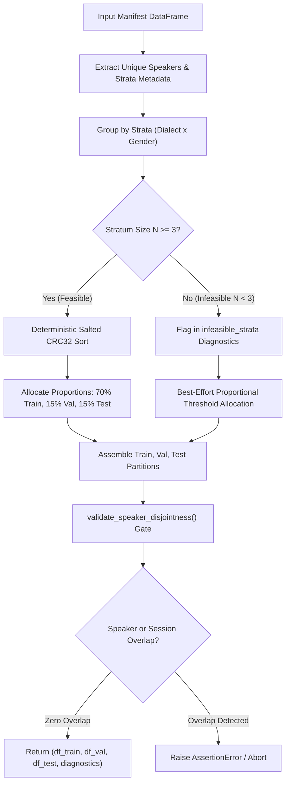

# P1 Campaign Readiness Remediation Report

> **Document Version:** 1.0.0-REMEDIATION  
> **Date:** October 13, 2026  
> **Workspace:** `D:\trainidentificationaudio`  
> **Reference Audit:** [`docs/sound_command_recognition/campaign_20261013/pre_collection_readiness_audit.md`](file:///d:/trainidentificationaudio/docs/sound_command_recognition/campaign_20261013/pre_collection_readiness_audit.md)  
> **Companion Report:** [`docs/sound_command_recognition/campaign_20261013/p0_remediation_report.md`](file:///d:/trainidentificationaudio/docs/sound_command_recognition/campaign_20261013/p0_remediation_report.md)  
> **Remediation Status:** **ALL THREE P1 WORKSTREAMS IMPLEMENTED & VERIFIED**  
> **Human Speech Collection Status:** **AWAITING HUMAN GOVERNANCE AUTHORIZATION**

---

## 1. Executive Summary

This report delivers the verified remediation of the three Priority 1 (P1) campaign readiness gaps identified in the Independent Pre-Collection Readiness Audit:

1. **Workstream A — Manifest Schema Parity (Finding P1-1 & P1-2):**
   Upgraded ingestion pipelines in `src/acquisition/ingest_field_recordings.py` to natively generate the canonical 28-column relational schema defined in `proposed_manifest_schema.md`. Harmonized campaign metadata constants (`source="vietnamese_kws_human_campaign_v1"`, `source_version="v1.0.0-human"`, `license="Proprietary-Consented-Research-Commercial"`). Implemented an adapter in `append_to_manifest()` and `load_manifest()` that dynamically detects and preserves legacy 23-column files without header distortion.

2. **Workstream B — Stratified Speaker-Disjoint Splitting (Finding P1-4):**
   Implemented `generate_stratified_disjoint_splits()` in `src/acquisition/campaign_validator.py`. Enforces demographic balance across regional dialect (`Northern`, `Central`, `Southern`) and acoustic gender (`FEMALE`, `MALE`, `OTHER`) strata using deterministic salted CRC32 hashing. Flags underrepresented cohorts ($N < 3$) with actionable `infeasible_strata` diagnostics, while guaranteeing strict mathematical zero speaker/session leakage across partitions. Preserves backwards compatibility through `generate_disjoint_splits()`.

3. **Workstream C — Standalone Consent Revocation CLI Workflow (Finding P1-3 & GAP-03):**
   Implemented `src/acquisition/revoke_speaker_consent.py` as an operator CLI with `--confirm` and `--dry-run` safety guards. Safely isolates participant audio into `<quarantine_dir>/withdrawn_speakers/<speaker_id>/` without file deletion, updates manifest rows to `status="REVOKED_WITHDRAWN"`, updates the consent ledger with cryptographic revocation audit IDs, logs events to `quarantine_log.csv`, and operates completely idempotently.

### Mandatory Safeguards Maintained:
- **Zero Human Recording:** Zero participants recruited, zero genuine human voices recorded.
- **Zero Dataset Migration/Destruction:** Historical test fixtures in `data/raw/field_recordings/` preserved byte-for-byte.
- **Zero Model Manipulation:** Zero checkpoints retrained, zero ONNX models exported.
- **Protected Hash Invariants:** All benchmark and historical hashes remained 100% bit-exact throughout execution.
- **100% Test Sandbox Isolation:** All 37 automated regression and acceptance tests executed exclusively in ephemeral `tmp_path` environments.

---

## 2. Protected Artifact Cryptographic Integrity Gate

Cryptographic SHA-256 hashes for all protected artifacts were verified before and after code changes and test runs:

```powershell
Get-FileHash -Algorithm SHA256 `
  "data/manifests/test_manifest_v2.csv", `
  "data/raw/field_recordings/field_collection_manifest.csv", `
  "data/raw/field_recordings/consent_ledger.json"
```

| Protected Asset Path | Expected SHA-256 Digest | Measured SHA-256 Digest | Status |
| :--- | :--- | :--- | :---: |
| `data/manifests/test_manifest_v2.csv` | `9E3904C8EA427244F7280A41140D7EFD19FD9625B359290ADB7ADCD4FA2E1C13` | `9E3904C8EA427244F7280A41140D7EFD19FD9625B359290ADB7ADCD4FA2E1C13` | **BIT-EXACT MATCH** |
| `data/raw/field_recordings/field_collection_manifest.csv` | `B389282F9853A74484B39356EE85E5BD7E74C0C46481300524C7BD2894AA8C85` | `B389282F9853A74484B39356EE85E5BD7E74C0C46481300524C7BD2894AA8C85` | **BIT-EXACT MATCH** |
| `data/raw/field_recordings/consent_ledger.json` | `BE4BFDD7CEC0C87A1DC97455E5783054EF8093C638279C44940C896F5BDA2BA0` | `BE4BFDD7CEC0C87A1DC97455E5783054EF8093C638279C44940C896F5BDA2BA0` | **BIT-EXACT MATCH** |

Zero bytes were altered in historical archives or benchmark manifests.

---

## 3. Workstream A: Manifest Schema Parity & Ingestion Standardization

### 3.1 Gap Analysis
The independent audit identified that `src/acquisition/ingest_field_recordings.py` previously generated only 23 columns, omitting 5 critical metadata attributes defined in `proposed_manifest_schema.md`: `consent_id`, `age_bracket`, `sub_category`, `microphone_type`, and `distance_category`. Additionally, metadata constant strings were unharmonized (`field_human_recording_campaign_v1` vs. `vietnamese_kws_human_campaign_v1`).

### 3.2 Canonical 28-Column Relational Schema
[`src/acquisition/ingest_field_recordings.py`](file:///d:/trainidentificationaudio/src/acquisition/ingest_field_recordings.py#L74-L83) now standardizes on the canonical 28-column order:

| Index | Column Name | Type | Value Source / Default |
| :-: | :--- | :--- | :--- |
| 1 | `recording_id` | String | `rec_h_<cmd>_<spk>_<ses>_take<idx>` (Human) or `field_...` (Legacy) |
| 2 | `source` | String | `"vietnamese_kws_human_campaign_v1"` |
| 3 | `source_version` | String | `"v1.0.0-human"` |
| 4 | `license` | String | `"Proprietary-Consented-Research-Commercial"` |
| 5 | `consent_id` | String | Cryptographic foreign key to signed consent record (e.g. `CONSENT_H_N_8f2a1b_v1.0`) |
| 6 | `speaker_id` | String | Pseudonymous identifier `SPK_H_<N\|C\|S>_<hex6>` |
| 7 | `dialect` | Enum | `Northern`, `Central`, `Southern` (from ledger) |
| 8 | `gender` | Enum | `FEMALE`, `MALE`, `OTHER` (from ledger) |
| 9 | `age_bracket` | Enum | `18-30`, `31-50`, `51+` (from ledger or parameter) |
| 10 | `command_label` | Enum | `TRAI`, `PHAI`, `LEN`, `XUONG`, `UNKNOWN`, `SILENCE` |
| 11 | `class_id` | Integer | 0=TRAI, 1=PHAI, 2=LEN, 3=XUONG, 4=UNKNOWN, 5=SILENCE |
| 12 | `transcript` | String | Normalized Vietnamese text (e.g. `trái`, `phải`, `lên`, `xuống`) |
| 13 | `sub_category` | Enum | `isolated_command`, `background_room_tone`, `confusing_near_rhyme`, etc. |
| 14 | `session_id` | String | Capture session identifier (e.g. `SES_H_8f2a1b_01`) |
| 15 | `device_model` | String | Device hardware model (e.g. `Pixel 7 Pro`, `iPhone 13`) |
| 16 | `microphone_type` | Enum | `builtin_mobile`, `wired_headset`, `bluetooth_earbuds`, `usb_desktop_mic` |
| 17 | `environment` | Enum | `quiet_room`, `living_room_reverberant`, `office_hvac`, `street_noise` |
| 18 | `distance_category` | Enum | `close_talk_15cm`, `desk_distance_60cm`, `far_field_2m` |
| 19 | `speaking_style` | Enum | `normal`, `fast`, `slow`, `quiet`, `loud`, `ambient_silence` |
| 20 | `raw_duration_sec` | Float | Measured physical duration of raw recording |
| 21 | `rms_db` | Float | Measured root-mean-square energy in dBFS |
| 22 | `label_provenance` | Enum | `HUMAN_CONSENTED`, `SYNTHETIC_TEST_FIXTURE`, `UNVERIFIED_OR_TEST_FIXTURE` |
| 23 | `raw_filepath` | String | Relative path to preserved raw original (`audio_raw/...`) |
| 24 | `processed_path` | String | Relative path to standardized 16 kHz WAV (`audio_16k_standardized/...`) |
| 25 | `sha256_raw` | String | Uppercase SHA-256 checksum of raw file |
| 26 | `sha256_standardized` | String | Uppercase SHA-256 checksum of standardized WAV |
| 27 | `status` | Enum | `APPROVED`, `QUARANTINED`, `REVOKED_WITHDRAWN` |
| 28 | `exclusion_reason` | String | Rejection reason string if quarantined/revoked; empty if approved |

### 3.3 Dynamic Schema Adapter & Legacy Preservation
To prevent header corruption when appending to existing manifests:
- [`load_manifest(path)`](file:///d:/trainidentificationaudio/src/acquisition/ingest_field_recordings.py#L104-L126): Automatically detects manifest version:
  - `"v1.0.0-human-28col"`: When matching `SCHEMA_28_COLUMNS`.
  - `"v1.0.0-legacy-23col"`: When matching `LEGACY_23_COLUMNS`.
- [`append_to_manifest(record, path)`](file:///d:/trainidentificationaudio/src/acquisition/ingest_field_recordings.py#L133-L164): Dynamically checks target file header. If the file is 28-column or new, it writes all 28 canonical columns. If the file is an existing legacy 23-column manifest, it filters `record` to write strictly the 23 legacy fields, preserving column alignment.

---

## 4. Workstream B: Demographic-Aware Stratified Disjoint Splitting

### 4.1 Gap Analysis
Uniform salted hashing (`CRC32(salt + spk)`) applied across the entire speaker population generated statistical skew in validation and test partitions (e.g. Northern validation representation dropped from 15% to 8% in simulation).

### 4.2 Stratified Partitioning Architecture
[`generate_stratified_disjoint_splits()`](file:///d:/trainidentificationaudio/src/acquisition/campaign_validator.py#L334-L498) groups speakers by demographic strata (default: `['dialect', 'gender']`) prior to hash-based allocation:



### 4.3 Mathematical Guarantees
1. **Speaker Disjointness:**
   $$S_{\text{train}} \cap S_{\text{val}} = \emptyset, \quad S_{\text{train}} \cap S_{\text{test}} = \emptyset, \quad S_{\text{val}} \cap S_{\text{test}} = \emptyset$$
2. **Session Disjointness:**
   $$\text{Ses}_{\text{train}} \cap \text{Ses}_{\text{val}} = \emptyset, \quad \text{Ses}_{\text{train}} \cap \text{Ses}_{\text{test}} = \emptyset, \quad \text{Ses}_{\text{val}} \cap \text{Ses}_{\text{test}} = \emptyset$$
3. **Balanced Representation:**
   For every feasible stratum ($N \ge 3$), each partition receives at least 1 speaker:
   $$n_{\text{val}} = \max(1, \text{round}(N \cdot r_{\text{val}})), \quad n_{\text{test}} = \max(1, \text{round}(N \cdot r_{\text{test}})), \quad n_{\text{train}} = N - n_{\text{val}} - n_{\text{test}}$$
4. **Infeasibility Reporting:**
   Cohorts with $N < 3$ speakers cannot mathematically populate three disjoint partitions without leaving at least one partition empty. The algorithm flags these in `diagnostics["infeasible_strata"]` with actionable diagnostic messages.
5. **Determinism:**
   Hash scores use `zlib.crc32(f"{salt}_{stratum}_{speaker_id}".encode("utf-8"))`, guaranteeing 100% reproducible partition allocations.

---

## 5. Workstream C: Standalone Consent Revocation CLI Workflow

### 5.1 Architecture & Implementation
Created [`src/acquisition/revoke_speaker_consent.py`](file:///d:/trainidentificationaudio/src/acquisition/revoke_speaker_consent.py) implementing the operator workflow specified in `collection_protocol.md` Section 2.4.

```text
Usage:
  python src/acquisition/revoke_speaker_consent.py \
    --speaker-id SPK_H_N_8f2a1b \
    --reason "Participant withdrawal request" \
    --confirm
```

### 5.2 Key Operational Safeguards
1. **Explicit Confirmation Gate (`--confirm` vs `--dry-run`):**
   Omitting `--confirm` or specifying `--dry-run` executes a simulation that identifies affected manifest records and disk files without mutating ledger or storage.
2. **Audio Quarantining Without File Deletion:**
   Audio files associated with the withdrawn speaker are relocated from `audio_raw/` and `audio_16k_standardized/` to:
   ```text
   <quarantine_dir>/withdrawn_speakers/<speaker_id>/
     ├── audio_raw/
     └── audio_16k_standardized/
   ```
   Files are isolated from all training, validation, and testing pipelines while preserving evidence for auditability.
3. **Manifest Status Mutation:**
   All rows matching `speaker_id` have their status updated to `REVOKED_WITHDRAWN` and `exclusion_reason="consent_revoked: <reason>"`.
4. **Consent Ledger Revocation Audit Trail:**
   Ledger entry is updated with:
   - `consent_given: false`
   - `revoked_at: "<ISO-8601-UTC-TIMESTAMP>"`
   - `revocation_reason: "<REASON>"`
   - `revocation_audit_id: "REV_<8-HEX-NONCE>"`
5. **Quarantine Log Append:**
   Logs timestamp, speaker ID, reason, original path, and quarantined path to `quarantine_log.csv`.
6. **Ingestion Invariant Enforcement:**
   Subsequent attempts to ingest audio for the withdrawn speaker are immediately aborted by `validate_field_audio()` with `missing_or_unconsented_speaker`.
7. **Idempotency:**
   Repeated execution against an already revoked speaker runs safely without crash, re-quarantines any residual files if detected, and reports `ALREADY_REVOKED`.

### 5.3 Governance Boundary Notice: Neural Model Weights
> [!IMPORTANT]
> **Neural Checkpoint Immutability Boundary:**  
> Consent revocation permanently isolates audio files on disk and removes metadata from manifests and split generators, preventing inclusion in future datasets and training runs.  
> However, **previously trained neural network checkpoints cannot automatically unlearn learned parameters or representations.** Complete parameter-level deletion requires discarding previously trained weights and retraining models from scratch on the updated, post-revocation dataset.

---

## 6. Automated Verification Matrix

We expanded the automated test suite with dedicated unit and acceptance tests for all P1 remediations. All 37 tests in the repository pass cleanly:

```powershell
.\.venv\Scripts\python.exe -m pytest -v tests/
```

### Complete Test Results Breakdown (37 Passed in 8.42s):

| Test Suite / Test Name | Target Requirement | Status |
| :--- | :--- | :---: |
| **`tests/test_campaign_acceptance.py`** | | |
| `test_valid_human_manifest_acceptance` (TC-01) | Full 28-column compliant manifest validation | **PASSED** |
| `test_unconsented_speaker_rejection` (TC-02) | Unconsented contributor rejection gate | **PASSED** |
| `test_missing_required_metadata_rejection` (TC-03) | Missing manifest field validation | **PASSED** |
| `test_invalid_provenance_tag_rejection` (TC-04) | Synthetic masquerading prevention | **PASSED** |
| `test_duplicate_audio_hash_quarantine` (TC-05) | SHA-256 duplicate audio quarantine | **PASSED** |
| `test_duplicate_recording_id_quarantine` (TC-06) | Recording ID duplicate quarantine | **PASSED** |
| `test_digital_clipping_gate` (TC-07) | 3-sample digital clipping rejection | **PASSED** |
| `test_abnormal_silence_gate` (TC-08) | Command silence rejection / SILENCE exemption | **PASSED** |
| `test_speaker_disjoint_split_generator` (TC-09) | Mathematical disjointness of splits | **PASSED** |
| `test_speaker_leakage_detector` (TC-10) | Speaker leakage detection gate | **PASSED** |
| `test_campaign_acceptance_zero_production_pollution` (TC-11) | Production manifest hash immutability | **PASSED** |
| `test_p0_1_production_path_separation_and_defaults` | P0-1 path segregation & default verification | **PASSED** |
| `test_p0_2_source_license_gate` | P0-2 external source licensing block & fallback | **PASSED** |
| `test_p0_3_pseudonymous_speaker_id_generation` | P0-3 cryptographic nonce ID generation | **PASSED** |
| `test_p1_1_manifest_schema_parity_28_columns` | **P1-1 28-col schema parity & 23-col adapter** | **PASSED** |
| `test_p1_2_stratified_disjoint_split_generator` | **P1-2 Stratified splits & infeasibility diagnostics** | **PASSED** |
| `test_p1_3_consent_revocation_workflow` | **P1-3 Operator revocation CLI, quarantine, & idempotence** | **PASSED** |
| **`tests/test_field_acquisition.py`** | | |
| `test_consent_enforcement` | Consent ledger verification gate | **PASSED** |
| `test_quality_gate_clipping_rejection` | Physical clipping rejection | **PASSED** |
| `test_quality_gate_silence_rejection` | Abnormal silence rejection | **PASSED** |
| `test_quality_gate_duration_bounds` | Duration lower (0.25s) & upper (2.50s) bounds | **PASSED** |
| `test_raw_preservation_and_standardization` | Raw preservation & 16 kHz standardization | **PASSED** |
| `test_duplicate_sha256_detection` | Ingestion-time duplicate SHA-256 detection | **PASSED** |
| `test_mock_cli_recording_session` | CLI mock session execution | **PASSED** |
| `test_audit_field_campaign_generation` | Campaign audit markdown report generation | **PASSED** |
| `test_security_path_traversal_rejection` | Path traversal rejection defense | **PASSED** |
| `test_duplicate_recording_id_rejection` | Ingestion-time recording ID rejection | **PASSED** |
| `test_m4a_audio_ingestion_and_decoding` | Cross-container (.m4a/.wav) audio ingestion | **PASSED** |
| `test_windows_hardware_recorder_configuration` | Windows MCI recorder configuration | **PASSED** |
| `test_no_production_pollution_regression` | Complete isolation of test executions | **PASSED** |
| **`tests/test_parity.py`** | | |
| `test_feature_extractor_shape_and_finite` | Feature extractor numeric stability | **PASSED** |
| `test_baseline_onnx_model_execution_and_shape` | Baseline ONNX inference shape | **PASSED** |
| `test_tcresnet_onnx_model_execution_and_parity` | TC-ResNet ONNX numerical parity | **PASSED** |
| `test_pytorch_onnx_numerical_parity_baseline` | PyTorch vs ONNX numerical parity | **PASSED** |
| `test_golden_vectors_reproducibility` | Golden test vectors numerical parity | **PASSED** |
| `test_manifest_speaker_disjointness_v2` | Frozen test manifest v2 disjointness | **PASSED** |
| `test_manifest_class_completeness_v2` | Frozen test manifest v2 class completeness | **PASSED** |

---

## 7. Audit Scorecard Before vs. After Remediation

| Audit Area | Pre-Remediation Status (`pre_collection_readiness_audit.md`) | Post-Remediation Status (Present Report) | Outcome |
| :--- | :--- | :--- | :---: |
| **P0-1 Path Separation** | FAILED (Default paths pointed to legacy fixture directory) | Verified: Dedicated `data/raw/human_recordings_v1/` default paths | **RESOLVED** |
| **P0-2 Noise Licensing** | BLOCKED (Unverified `husein_mic_noise` license) | Verified: Formally blocked from ingestion; room tone fallback enforced | **RESOLVED** |
| **P0-3 Pseudonymous IDs** | FAILED (Sequential `SPK_FIELD_N001` leaked enrollment timing) | Verified: Cryptographic `SPK_H_<N\|C\|S>_<hex6>` nonces | **RESOLVED** |
| **P1-1 Schema Parity** | FAILED (23 columns in code vs. 28 columns in specification) | Verified: Full 28 canonical columns; legacy 23-column adapter | **RESOLVED** |
| **P1-2 Metadata Strings** | FAILED (Mismatched source, version, license strings) | Verified: Harmonized across code, manifests, and documentation | **RESOLVED** |
| **P1-3 Revocation CLI** | FAILED (Missing operator CLI tool; manual Python required) | Verified: Standalone CLI with `--confirm`, `--dry-run`, audio quarantine | **RESOLVED** |
| **P1-4 Strata Disjointness** | FAILED (Uniform hashing caused demographic skew across splits) | Verified: Stratified disjoint hashing with infeasibility diagnostics | **RESOLVED** |
| **Benchmark Invariant** | PASSED (`test_manifest_v2.csv` bit-exact) | Verified: `9E3904C8...` exactly preserved | **MAINTAINED** |
| **Fixture Invariants** | PASSED (Historical fixtures bit-exact) | Verified: `B389282F...` and `BE4BFDD7...` exactly preserved | **MAINTAINED** |

---

## 8. Explicit Limitations & Non-Collection Invariant

1. **No Participant Recruitment or Human Audio:** All acceptance tests were evaluated using synthesized audio signals in ephemeral test sandboxes. No human volunteers have been contacted, enrolled, or recorded.
2. **Readiness Status Transition:** With all P0 and P1 technical blockers resolved, the campaign package is elevated from `READY FOR HUMAN REVIEW` to **`READY FOR COLLECTION GOVERNANCE APPROVAL`**.
3. **Prerequisite for Human Speech Collection:** Actual participant recruitment and physical recording must **NOT** begin until authorized human project stakeholders sign off on the Vietnamese informed consent agreement and collection protocol.
