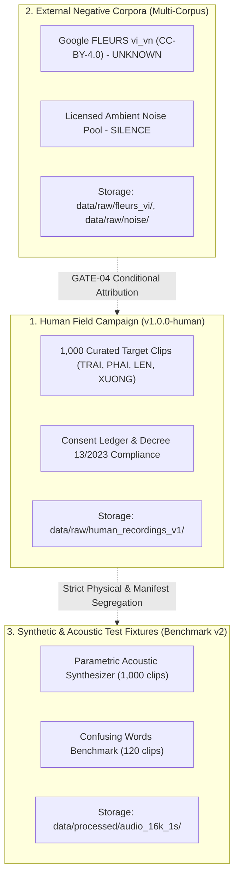

# Pilot Dataset Plan: 1,000-Clip Curated Vietnamese Keyword Spotting Dataset

**Document Version:** `v1.0.0-pilot-proposal`  
**Date:** 2026-10-15  
**Target Ingestion Target:** Curated Vietnamese Keyword Spotting Pilot Dataset  
**Workspace:** `D:\trainidentificationaudio`  
**Intended Application:** On-device low-latency voice-command recognition (e.g., voice-controlled gaming: saying "LÊN" to trigger a jump)  
**Governance Status:** **`PROPOSED PILOT SPECIFICATION — HUMAN DATA COLLECTION STRICTLY BLOCKED`**

---

## 1. Executive Summary & Objective

This document defines the technical, acoustic, and governance specification for a **1,000-clip curated pilot dataset** for Vietnamese Keyword Spotting (KWS), responding to the Lecturer / PI's proposed pilot target.

The primary objective is to evaluate and demonstrate robust edge voice-command recognition on four navigational and control keywords:
1. **`TRAI`** (Trái / Turn Left)
2. **`PHAI`** (Phải / Turn Right)
3. **`LEN`** (Lên / Jump / Move Up)
4. **`XUONG`** (Xuống / Crouch / Move Down)

The dataset target is **1,000 accepted audio clips in total**, provisionally interpreted as the final curated dataset size after signal quality gating and acceptance filtering:
- **Exactly 250 accepted clips per command class**.
- **Diverse Vietnamese regional accents** covering Northern (*Giọng Bắc*), Central (*Giọng Trung*), and Southern (*Giọng Nam*) dialects.
- **Strictly speaker-independent** train, validation, and test partitions to guarantee unbiased acoustic evaluation.

> [!IMPORTANT]
> **Open Scope Decision for Lecturer / Project Sponsor (PI):**  
> This specification documents a proposed pilot target. It does **not** grant authorization to initiate human recording or participant recruitment. The Project Sponsor / PI must explicitly determine:
> - **Option 1 (New Field Campaign):** Whether the 1,000 clips must be 1,000 newly recorded, authentic human speech samples acquired under an approved consent protocol (displacing existing synthetic acoustic fixtures); OR
> - **Option 2 (Hybrid / Corpus Integration):** Whether existing verified acoustic data (e.g., synthetic calibration fixtures or licensed corpora) may be incorporated into the pilot benchmark alongside human samples.
> Incompatible datasets will not be silently merged.

---

## 2. Command Definitions & Acoustic Specifications

### 2.1 Keyword Phonetics & Acoustic Distinctions

| Command | Orthography | Target IPA (Northern / Central / Southern) | Tone (Thanh Điệu) | Key Acoustic Challenge & Distinguishing Feature |
| :--- | :--- | :--- | :--- | :--- |
| **`TRAI`** | Trái | `/tɕaːj˧ˀ˥/` (N) <br> `/ʈaːj˧˩˨/` (C) <br> `/ʈaːj˧ˀ˥/` (S) | Sắc (High-rising / Creaky) | **Initial burst:** Northern voiceless alveolo-palatal affricate `/tɕ/` vs. Southern/Central retroflex stop `/ʈ/`. High confusion potential with phonetic confusers (*trời*, *trên*, *chái*). |
| **`PHAI`** | Phải | `/faːj˧˩˨/` (N) <br> `/faːj˧˩˨/` (C) <br> `/faːj˧˩˨/` (S) | Hỏi (Dipping-rising) | **Initial fricative:** Voiceless labiodental fricative `/f/`. Pitch contour dips before rising. Confusion potential with *phép*, *phải*. |
| **`LEN`** | Lên | `/lɛn˧˧/` (N) <br> `/lɛn˧˧/` (C) <br> `/lɛŋ˧˧/` (S) | Ngang (Mid-level) | **Final consonant:** Southern nasal velarization (`-n` -> `[ŋ]`). Flat pitch contour. Confusion potential with *đen*, *quen*. |
| **`XUONG`** | Xuống | `/sᶷɔŋ˧˩˨/` (N) <br> `/sᶷɔŋ˧˩˨/` (C) <br> `/ʃᶷɔŋ˧˩˨/` (S) | Sắc (High-rising) | **Diphthong & labialization:** Initial voiceless fricative `/s/` or `/ʃ/` followed by labialized diphthong `[uə]`. Confusion potential with *xương*, *xong*. |

### 2.2 Standardized Audio Quality Acceptance Criteria

Every candidate recording must pass automated signal quality gating before being classified as an **accepted clip**. Raw recording attempts that fail any criterion are automatically rejected and excluded:

1. **Sampling Rate & Container:** Exactly **16,000 Hz (16 kHz)**, single-channel (**mono**), uncompressed **16-bit linear PCM** (`.wav`).
2. **Standardized Window Duration:** Fixed window length of **1.0 second (16,000 samples)** centered on the utterance energy peak, with 100–150 ms leading/trailing acoustic context. (Raw capture buffer: 1.2–1.6 seconds nominal).
3. **Digital Clipping Gate:** Maximum consecutive samples at digital ceiling ($\ge 0.999$ or $\le -0.999$) must be **$< 3$ samples**. Any recording with $\ge 3$ consecutive clipped samples is immediately rejected.
4. **Energy Floor & Abnormal Silence Gate:** Root Mean Square (RMS) energy must satisfy:
   $$\text{RMS}_{\text{dBFS}} = 10 \log_{10}\left(\frac{1}{N}\sum_{i=1}^N x_i^2 + 10^{-12}\right) \ge -45.0\text{ dBFS}$$
   Recordings below $-45.0\text{ dBFS}$ are classified as abnormal silence or muted microphone and rejected.
5. **Signal-to-Noise Ratio (SNR):** Estimated speech-to-ambient SNR must be **$\ge 15.0\text{ dB}$**.
6. **Utterance Truncation:** Voice activity detection (VAD) must confirm that speech start ($t_{\text{start}} > 50\text{ ms}$) and speech end ($t_{\text{end}} < 950\text{ ms}$) fall completely inside the 1.0s window without clipping either word onset or coda.
7. **Phonetic Integrity:** No background speech, coughs, tongue clicks, or severe audio packet dropouts.

---

## 3. Speaker Diversity & Regional Accent Strategy

To ensure robust acoustic generalization across Vietnam, the pilot dataset requires diverse accent representation.

### 3.1 Proposed Regional Accent Allocation (Draft for PI Approval)

Rather than inventing an unverified requirement, the following balanced allocation is submitted for Lecturer / PI review:

| Dialect Region | Vietnamese Term | Target Accepted Clips per Class | Target Accepted Clips Total | Target Ratio | Primary Phonetic Rationale |
| :--- | :--- | :---: | :---: | :---: | :--- |
| **Northern** | Giọng Bắc | 90 | 360 | 36.0% | Essential for affricate `/tɕ/` burst and distinctive high-broken creaky tone (*ngã* vs *hỏi*). |
| **Central** | Giọng Trung | 80 | 320 | 32.0% | Glottal stop dynamics, heavy tone neutralization (*hỏi* / *ngã* merged), vowel shortening. |
| **Southern** | Giọng Nam | 80 | 320 | 32.0% | Retroflex `/ʈ/`, final consonant velarization (`-n` -> `[ŋ]`), melodic dipping pitch. |
| **Total** | | **250** | **1,000** | **100.0%** | Balanced national acoustic representation. |

> [!NOTE]
> *Status:* **Draft Recommendation**. Exact regional quotas are marked for formal confirmation by the Project Sponsor / PI under `GATE-03`.

### 3.2 Speaker Sizing & Take Distribution Models

To collect 1,000 accepted clips without acoustic over-fitting to individual voices, two speaker distribution models are submitted for consideration:

* **Model A (Moderate Cohort — Recommended):**
  - **40 distinct speakers**: 15 Northern, 13 Central, 12 Southern.
  - Each speaker provides **25 accepted takes** across the 4 commands (~6–7 takes per command).
  - Provides a healthy balance between recruitment logistics and acoustic variety.
* **Model B (Compact Cohort — Rapid Pilot):**
  - **25 distinct speakers**: 9 Northern, 8 Central, 8 Southern.
  - Each speaker provides **40 accepted takes** across the 4 commands (10 takes per command across varying vocal effort: normal, fast, whisper, distant).
  - Faster recruitment, slightly higher intra-speaker repetition.

Both models strictly satisfy the requirement that no single speaker contributes $> 5\%$ of the total dataset.

### 3.3 Demographic & Metadata Tracking

Every recorded utterance must be accompanied by non-identifying acoustic and demographic metadata:
- **Speaker ID:** Cryptographic pseudonym nonce (e.g. `SPK_H_N_a1b2c3`), eliminating sequential enrollment leakage.
- **Dialect Region:** `Northern` | `Central` | `Southern`.
- **Gender:** `FEMALE` | `MALE` | `OTHER` (Targeting approximately 50/50 female/male balance per region).
- **Age Bracket:** `18-30` | `31-45` | `46-60` | `61+`.
- **Device Model:** Specific physical smartphone model (e.g. `iPhone 13`, `Samsung Galaxy A52`).
- **Microphone Category:** `built_in_bottom` | `wired_headset` | `wireless_earbud`.
- **Acoustic Environment:** `quiet_indoor` | `office_ambient` | `living_room` | `street_noise`.
- **Distance Category:** `near_field` (15–30 cm) | `mid_field` (50–100 cm).

---

## 4. Source Provenance, Licensing & Data Separation

The pilot dataset plan strictly separates three distinct classes of data:



1. **Human Field Speech (`HUMAN_CONSENTED`):**
   - Provenance tag: `HUMAN_CONSENTED`.
   - Requires verified entry in `consent_ledger.json` (`consent_given == True`).
   - Stored in isolated path: `data/raw/human_recordings_v1/`.
   - Zero commercial or third-party proprietary corpus dependencies.
2. **External Negative Corpora (`google_fleurs_vi`, etc.):**
   - Evaluated solely for `UNKNOWN` (conversational speech rejection) and `SILENCE` (background ambient tone).
   - Must satisfy CC-BY-4.0 license archiving under `GATE-04`.
   - Never re-labeled as target keywords without explicit native utterance re-annotation.
3. **Synthetic / Calibration Test Fixtures (`calibration_acoustic_generator_v1`):**
   - Labeled `acoustic_reference_utterance` / `SYNTHETIC_TEST_FIXTURE`.
   - Reserved strictly for baseline software integration and pipeline verification.
   - **Never conflated with or reported as genuine human field recordings.**

---

## 5. Quality Control, Rejection & Replacement Rules

To achieve exactly 250 **accepted** clips per command, an automated rejection and replacement protocol is enforced:

1. **Pre-Ingestion Check:** Every incoming file is scanned by `validate_audio_file()` and `validate_manifest_row()`.
2. **Immediate Failure Classification:**
   - `DIGITAL_CLIPPING`: $\ge 3$ ceiling samples -> Prompt for re-recording at lower gain.
   - `ABNORMAL_SILENCE`: RMS $< -45\text{ dBFS}$ -> Check microphone permission / distance.
   - `DUPLICATE_HASH`: SHA-256 matches an existing recording -> Discard as duplicate take.
   - `MISPRONUNCIATION / TRUNCATION`: Keyword truncated or wrong word spoken -> Flagged by operator, rejected from accepted manifest.
3. **Quota Accounting:** Quotas increment **only upon receipt of an APPROVED record**. If a recording is quarantined or rejected, the target remaining count for that speaker/class remains unfilled until a valid replacement take is provided.

---

## 6. Speaker-Independent Split Policy

The curated 1,000-clip pilot dataset must be partitioned into three disjoint splits following the campaign's strict non-leakage invariant:

### 6.1 Split Sizing Target (70% Train / 15% Val / 15% Test)

| Partition | Share | Target Clips per Command | Total Target Keyword Clips | Speaker Isolation Invariant |
| :--- | :---: | :---: | :---: | :--- |
| **Train** | 70% | 175 | 700 | Disjoint speaker set $S_{\text{train}}$ |
| **Validation** | 15% | 37–38 | 150 | Disjoint speaker set $S_{\text{val}} \cap S_{\text{train}} = \emptyset$ |
| **Test** | 15% | 37–38 | 150 | Disjoint speaker set $S_{\text{test}} \cap (S_{\text{train}} \cup S_{\text{val}}) = \emptyset$ |
| **Total** | 100% | **250** | **1,000** | **Zero speaker, session, or lineage overlap** |

### 6.2 Preflight Validation Enforcement

All split manifests generated from the pilot dataset must be verified via:
```python
validate_split_manifests_preflight(
    df_train, df_val, df_test,
    validation_profile="human_campaign"
)
```
The preflight guarantees:
- Pairwise speaker disjointness ($\text{train} \cap \text{val} = \emptyset$, $\text{train} \cap \text{test} = \emptyset$, $\text{val} \cap \text{test} = \emptyset$).
- Pairwise session disjointness.
- Complete lineage tracking (`parent_recording_id` resolution) with zero cross-partition leakage.
- Fail-closed evaluation: execution halts immediately if validation fails.

---

## 7. Pilot Manifest Schema Specification

Pilot campaign manifests must adhere to the 28-column specification approved in `proposed_manifest_schema.md`:

```csv
recording_id,source,source_version,license,speaker_id,consent_id,dialect,gender,age_bracket,command_label,class_id,transcript,session_id,device_model,microphone_type,environment,distance_category,speaking_style,parent_recording_id,augmentation_type,raw_duration_sec,rms_db,label_provenance,raw_filepath,processed_path,sha256_raw,sha256_standardized,status
```

Key schema validation invariants:
- `command_label` $\in \{\text{TRAI}, \text{PHAI}, \text{LEN}, \text{XUONG}\}$ (with optional $\text{UNKNOWN}, \text{SILENCE}$).
- `dialect` $\in \{\text{Northern}, \text{Central}, \text{Southern}\}$.
- `status` $\in \{\text{APPROVED}, \text{QUARANTINED}, \text{REVOKED_WITHDRAWN}\}$.
- `parent_recording_id`: Nullable for root human takes; mandatory for augmented or trimmed child clips.

---

## 8. Summary of Open Actions & PI Sign-Off Requirements

| Gate | Description | Responsible Authority | Required Pilot Sign-Off Action | Status |
| :---: | :--- | :--- | :--- | :---: |
| **GATE-01** | Protocol Purpose & Scope | Project Sponsor / PI | Approve 1,000-clip pilot scope and gaming voice-trigger use case | **OPEN** |
| **GATE-02** | Vietnamese Informed Consent | Legal / Privacy Counsel | Approve draft Vietnamese participant consent agreement | **OPEN** |
| **GATE-03** | Cohort Quota & Budget | Project Sponsor / PI | Authorize 250/cmd quota, regional ratio (36N/32C/32S), and cohort model (Model A vs B) | **OPEN** |
| **GATE-04** | External Corpus Licenses | Legal Counsel | Conditional: verify CC-BY-4.0 notice archiving if FLEURS/MSWC is used | **CONDITIONAL** |
| **GATE-05** | Retention & Retraining SOP | DPO & Tech Lead | Authorize cache purging and retraining commitment upon consent withdrawal | **OPEN** |
| **GATE-06** | Hardware & Calibration | Operations Lead | Approve physical recording device roster and acoustic calibration guide | **OPEN** |
| **GATE-07** | Technical Evidence | Technical Auditor | Automated pipeline verification (52 passing acceptance tests) | **CLOSED** |
| **GATE-08** | Consent Verification | Recording Operator | Runtime invariant: verify participant consent before every session | **RUNTIME INVARIANT** |

**Current Campaign Execution Status:** **`HUMAN DATA COLLECTION STRICTLY BLOCKED`**
