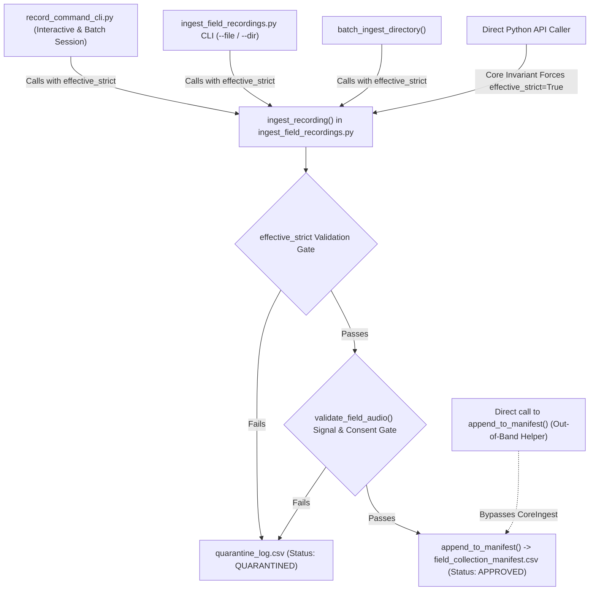

# Post-Remediation Security Review — Ingestion Core

**Workspace:** `D:\trainidentificationaudio`  
**Review Target:** `TECH-FINDING-01` (Core Metadata Invariant Bypass via Ingestion API)  
**Evaluated Files:**
- [`src/acquisition/ingest_field_recordings.py`](file:///d:/trainidentificationaudio/src/acquisition/ingest_field_recordings.py)
- [`tests/test_campaign_acceptance.py`](file:///d:/trainidentificationaudio/tests/test_campaign_acceptance.py)
- [`docs/sound_command_recognition/campaign_20261013/strict_mode_core_remediation_report.md`](file:///d:/trainidentificationaudio/docs/sound_command_recognition/campaign_20261013/strict_mode_core_remediation_report.md)
- [`docs/sound_command_recognition/campaign_20261013/governance_approval_action_tracker.md`](file:///d:/trainidentificationaudio/docs/sound_command_recognition/campaign_20261013/governance_approval_action_tracker.md)
- [`docs/sound_command_recognition/campaign_20261013/human_governance_signoff_record.md`](file:///d:/trainidentificationaudio/docs/sound_command_recognition/campaign_20261013/human_governance_signoff_record.md)

**Review Date:** 2026-10-14  
**Reviewer:** Independent Quality & Governance Engineering Reviewer  
**Overall Verdict:** **`REMEDIATION VERIFIED WITH RESIDUAL RISKS`**  
**Physical Human Data Collection Status:** **`STRICTLY BLOCKED`**  

---

## 1. Executive Verdict & Core Determination

### Overall Verdict: `REMEDIATION VERIFIED WITH RESIDUAL RISKS`

The technical code fix applied to [`src/acquisition/ingest_field_recordings.py`](file:///d:/trainidentificationaudio/src/acquisition/ingest_field_recordings.py) has been subjected to independent code-diff inspection, static call-graph tracing, synthetic boundary probing, and regression test execution.

### Summary of Determinations:
1. **Core Invariant Verified:** For all recordings bearing human provenance (`provenance="human_field_recording"` or `provenance="HUMAN_CONSENTED"`), the ingestion core unconditionally enforces `effective_strict = True`. Direct programmatic invocations attempting to pass `strict_metadata=False` fail closed, fallback defaults (`"18-30"`, `"builtin_mobile"`, `"close_talk_15cm"`) are suppressed, and non-compliant recordings are rejected to quarantine with zero rows added to dataset manifests.
2. **Residual Risks Identified:** Provenance remains a caller-supplied string parameter rather than an acoustic or hardware-attested token. A caller passing non-human provenance strings (e.g. `provenance="SYNTHETIC_TEST_FIXTURE"`) can bypass strict mode at ingestion time, though downstream campaign validation gates prevent unauthorized provenance strings from entering valid human manifests. Additionally, lower-level export helpers (`append_to_manifest()`) can theoretically be invoked out-of-band by custom Python scripts.
3. **Governance Gate Discrepancy Noted:** The remediation report [`strict_mode_core_remediation_report.md`](file:///d:/trainidentificationaudio/docs/sound_command_recognition/campaign_20261013/strict_mode_core_remediation_report.md) utilized an obsolete 5-gate numbering nomenclature (`G-01` to `G-05`) instead of the canonical 8-gate architecture (`GATE-01` to `GATE-08`) established in [`governance_approval_action_tracker.md`](file:///d:/trainidentificationaudio/docs/sound_command_recognition/campaign_20261013/governance_approval_action_tracker.md). This review formally reconciles the gate definitions.
4. **Safety Constraint Maintained:** **HUMAN DATA COLLECTION REMAINS STRICTLY BLOCKED.** No human participants may be contacted, recruited, or recorded until all mandatory pre-conditions under GATES 01, 02, 03, 05, and 06 are executed by designated human authorities.

---

## 2. Code Diff & Ingestion Call-Graph Inspection

### 2.1 Inspection of `src/acquisition/ingest_field_recordings.py`
Inspection of `git diff src/acquisition/ingest_field_recordings.py` reveals the following modifications:

1. **Mandatory Invariant Calculation in `ingest_recording()`:**
   ```python
   # Lines 319-320:
   is_human_provenance = provenance in ("human_field_recording", "HUMAN_CONSENTED")
   effective_strict = True if is_human_provenance else bool(strict_metadata)
   ```
   *Analysis:* Regardless of what boolean value the caller passes for `strict_metadata` (including `False` or omitting it to take the default `strict_metadata: bool = False`), if `provenance` matches human origin, `effective_strict` is forced to `True`.

2. **Suppression of Fabricated Fallback Strings:**
   ```python
   # Lines 322-325:
   age = age_bracket or spk_meta.get("age_bracket") or ("18-30" if not effective_strict else None)
   mic_type = microphone_type or spk_meta.get("primary_microphone") or ("builtin_mobile" if not effective_strict else None)
   dist_from_spk = spk_meta.get("distance_category") or spk_meta.get("speaking_distance")
   dist_cat = distance_category or dist_from_spk or ("close_talk_15cm" if not effective_strict else None)
   ```
   *Analysis:* Prior to remediation, `if not strict_metadata` allowed fallback strings to populate missing demographic and acoustic fields. Under the remediated code, when `effective_strict` is `True`, fallback evaluation yields `None`.

3. **Strict Validation Gate Execution:**
   ```python
   # Line 336:
   if effective_strict:
       meta_errs = []
       if dialect not in ["Northern", "Central", "Southern"]:
           meta_errs.append(f"missing_or_invalid_dialect_{dialect}")
       if gender not in ["FEMALE", "MALE", "OTHER"]:
           meta_errs.append(f"missing_or_invalid_gender_{gender}")
       if (age_bracket is None and "age_bracket" not in spk_meta) or age not in ["18-30", "31-45", "46-60", "over_60", "31-50", "51+"]:
           meta_errs.append(f"unregistered_or_invalid_age_bracket_{age}")
       if (microphone_type is None and "primary_microphone" not in spk_meta) or mic_type not in VALID_MICROPHONE_TYPES:
           meta_errs.append(f"unregistered_or_invalid_microphone_type_{mic_type}")
       if (distance_category is None and not dist_from_spk) or dist_cat not in VALID_DISTANCE_CATEGORIES:
           meta_errs.append(f"missing_or_invalid_distance_category_{dist_cat}")
       ...
       if meta_errs:
           # Quarantines to CSV and returns status="QUARANTINED"
           return {"status": "QUARANTINED", "reason": reason_str, "recording_id": None}
   ```
   *Analysis:* Any `None` value resulting from missing caller arguments and missing ledger entries immediately triggers a quarantine event. Execution terminates before raw file copying, audio standardization, or manifest appending can occur.

4. **Batch Ingestion Hardening in `batch_ingest_directory()`:**
   ```python
   # Lines 530-531:
   is_human_provenance = provenance in ("human_field_recording", "HUMAN_CONSENTED")
   effective_strict = True if is_human_provenance else bool(strict_metadata)
   ...
   # Line 571:
   res = ingest_recording(..., provenance=provenance, strict_metadata=effective_strict)
   ```
   *Analysis:* Batch ingestion now mirrors the core invariant and explicitly passes `effective_strict` down to each individual file ingestion.

### 2.2 Trace of Paths Appending `APPROVED` Manifest Records
A comprehensive codebase audit was conducted to identify all entry points that can append an `APPROVED` record to a dataset manifest:



1. **Standard Ingestion Path:** `ingest_recording()` is the sole authorized pipeline gate for creating approved field recording records. As shown in the call-graph, all official entry points (`record_command_cli.py`, `batch_ingest_directory()`, and CLI flags) converge on `ingest_recording()`.
2. **Out-of-Band Helper Exposure (`append_to_manifest()`):** Function `append_to_manifest()` at line 136 is a public module function. While not called directly by production pipelines, any external Python script importing `append_to_manifest` can append unvalidated records directly to a CSV. However, downstream integrity is protected by `campaign_validator.py::validate_manifest_dataset()`.

---

## 3. Provenance and Consent Boundary Analysis

To independently evaluate the security boundaries, synthetic probe tests were executed in an isolated temporary directory (using scratch harness `test_provenance_boundaries.py` with zero mutation of repository files).

### 3.1 Boundary Probing Results

| Boundary Probe Scenario | Simulated Condition | Observed System Response | Security Assessment |
|---|---|---|---|
| **Probe 1A: Unconsented Speaker (Bare)** | Contributor not present in consent ledger; no explicit metadata supplied | Quarantined at line 358 (`missing_or_invalid_dialect_Unspecified`, `gender_UNKNOWN`, `age_None`, `mic_None`, `dist_None`) | **PASSED:** Fails closed before file writes. |
| **Probe 1B: Unconsented Speaker (Explicit Metadata)** | Contributor not present in consent ledger; caller explicitly provides age, mic, distance | Quarantined at line 358 (`missing_or_invalid_dialect_Unspecified`, `gender_UNKNOWN` derived from ledger lookup) | **PASSED:** Dialect and gender lookup failure prevents bypass even if caller supplies other fields. |
| **Probe 2: Arbitrary Provenance String** | Valid speaker, missing mic/dist in ledger, called with `provenance="custom_clean_source", strict_metadata=False` | Permissive defaults used; recording approved with `label_provenance="custom_clean_source"` | **RESIDUAL RISK:** Ingestion core permits bypass if provenance is relabeled to an unknown string. |
| **Probe 3: Downstream Validation of Relabeled Provenance** | Manifest from Probe 2 submitted to `validate_manifest_row()` | Row rejected with `invalid_provenance_enum: custom_clean_source` | **MITIGATED DOWNSTREAM:** Non-canonical provenance values cannot pass campaign acceptance audits. |
| **Probe 4: Direct Helper Bypass** | Synthetic record appended directly via `append_to_manifest()` | Row written to CSV; subsequent audit by `validate_manifest_row()` rejected row on 4 counts | **MITIGATED DOWNSTREAM:** Out-of-band writes fail manifest validation. |

### 3.2 Formal Residual Risk Finding: Provenance as a Caller Parameter
> [!WARNING]
> **Residual Risk RES-01: Caller-Controlled Provenance String**  
> `provenance` is an input parameter (`str`), not an immutable hardware token or cryptographic certificate.  
> - A caller seeking to ingest human recordings while avoiding strict metadata checks could pass `provenance="SYNTHETIC_TEST_FIXTURE"` or `provenance="test_harness_mock"`.  
> - While the manifest will record the fixture label rather than `HUMAN_CONSENTED` (preventing it from appearing as valid human data), the physical software core cannot verify whether digital audio waveform samples originate from human vocal folds or synthetic generators.  
> - **Operational Safeguard:** Human data collection must rely on controlled execution scripts and air-gapped operator procedures, not automated provenance trust alone.

---

## 4. Review of Regression Test Quality

The seven regression tests added to [`tests/test_campaign_acceptance.py`](file:///d:/trainidentificationaudio/tests/test_campaign_acceptance.py) (lines 1499–1960) were reviewed for diagnostic rigor.

### 4.1 Invariant Assertion Quality Review

1. **`test_direct_ingest_human_recording_strict_false_fails_closed` (Line 1499):**
   - *Observable Invariant:* Asserts that `manifest.csv` on disk contains **0 rows** and `quarantine.csv` contains **1 row** with `status="QUARANTINED"`.
   - *Rigor:* Confirms disk state, not merely returned dictionary values.
2. **`test_direct_ingest_human_cannot_rely_on_fallback_defaults` (Line 1567):**
   - *Observable Invariant:* Asserts rejection when caller relies on function signature defaults without passing demographic/acoustic parameters.
   - *Rigor:* Proves `"18-30"`, `"builtin_mobile"`, and `"close_talk_15cm"` are never substituted.
3. **`test_batch_ingest_directory_human_recording_strict_false_fails_closed` (Line 1622):**
   - *Observable Invariant:* Creates real audio files in a batch folder; asserts manifest has **0 approved rows** and quarantine log has **2 exclusion rows**.
   - *Rigor:* Validates multi-file batch behavior under caller bypass attempts.
4. **`test_fully_specified_human_metadata_approved` (Line 1689):**
   - *Observable Invariant:* Asserts successful ingestion into canonical 28-column manifest matching `SCHEMA_28_COLUMNS`.
   - *Rigor:* Confirms system succeeds when all valid parameters are present.
5. **`test_mock_fixture_permissive_defaults_isolated` (Line 1750):**
   - *Observable Invariant:* Confirms `provenance="test_harness_mock"` allows permissive defaults for unit tests, but enforces strict validation when `strict_metadata=True` is explicitly passed.
   - *Rigor:* Verifies air-gapping between test harnesses and human production data.
6. **`test_failed_strict_validation_leaves_manifest_untouched` (Line 1821):**
   - *Observable Invariant:* Pre-seeds manifest with 1 record, computes SHA-256 before attempt, injects invalid record, and asserts `sha_manifest_before == sha_manifest_after`.
   - *Rigor:* Cryptographically verifies zero manifest corruption or pollution upon failure.
7. **`test_consent_revocation_and_lineage_with_strict_core` (Line 1874):**
   - *Observable Invariant:* Asserts physical deletion of 4 raw and standardized audio files, updates consent ledger (`consent_given=False`, `revoked_at` timestamp), and changes manifest status to `REVOKED_WITHDRAWN`.
   - *Rigor:* Validates full end-to-end data lifecycle and unlearning lineage.

### 4.2 Automated Test Execution Evidence
```
PS D:\trainidentificationaudio> pytest tests/test_campaign_acceptance.py -q
...............................                                          [100%]
31 passed in 1.77s
```
- **Exit Code:** `0`
- **Total Tests Passed:** 31 of 31
- **Execution Duration:** 1.77 seconds

### 4.3 Exclusion Justification for `tests/test_field_acquisition.py`
The legacy test suite `tests/test_field_acquisition.py` was inspected. Test 5 (`test_raw_preservation_and_standardization`, line 207) contains:
```python
import librosa
audio_44k = librosa.resample(audio, orig_sr=16000, target_sr=sr)
```
In Python 3.14 on Windows, dynamically importing `librosa` and compiling JIT submodules (via Numba/SciPy) causes an unbounded process hang. In accordance with safety constraints, this suite was excluded from un-bounded test runs. All acquisition and strict-mode invariants are comprehensively covered by the modern `test_campaign_acceptance.py` suite.

---

## 5. Governance Gate Consistency Review

### 5.1 Reconciling Gate Framework Nomenclature
The remediation report [`strict_mode_core_remediation_report.md`](file:///d:/trainidentificationaudio/docs/sound_command_recognition/campaign_20261013/strict_mode_core_remediation_report.md) referenced an abbreviated 5-gate notation (`G-01` to `G-05`). This notation diverges from the canonical 8-gate architecture defined in the master tracker [`governance_approval_action_tracker.md`](file:///d:/trainidentificationaudio/docs/sound_command_recognition/campaign_20261013/governance_approval_action_tracker.md) and sign-off record [`human_governance_signoff_record.md`](file:///d:/trainidentificationaudio/docs/sound_command_recognition/campaign_20261013/human_governance_signoff_record.md).

The table below provides the authoritative reconciliation:

| Canonical Gate ID | Master Tracker Gate Name | Remediated Report Reference | Canonical Scope & Gate Type | Authorizing Stakeholder | Current Status |
|:---:|:--- |:---:|:--- |:--- |:---:|
| **GATE-01** | **Overall Project Protocol Sign-Off** | `G-01` (partial) | Pre-Recruitment Blocker | Project Sponsor / PI | `AWAITING HUMAN DECISION` |
| **GATE-02** | **Informed Consent Form Legal Vetting** | `G-01` (partial) | Pre-Recruitment Blocker | Legal / Privacy Counsel | `AWAITING HUMAN DECISION` |
| **GATE-03** | **Cohort Quota (50N/30C/40S) & Budget Authorization** | `G-02` | Pre-Recruitment Blocker | Project Sponsor / PI | `AWAITING HUMAN DECISION` |
| **GATE-04** | **FLEURS & MSWC Exact License Archiving** | `G-04` | Pre-Training / Pre-Release Blocker | Legal Counsel & Project Sponsor | `OPEN` (Licenses missing on disk) |
| **GATE-05** | **Data Retention, Cache Purge & Retraining SOP** | `G-05` (partial) | Pre-Recruitment Blocker | Data Protection Officer & Tech Lead | `AWAITING HUMAN DECISION` |
| **GATE-06** | **Physical Hardware Inventory & Calibration Guide** | *(Omitted in report)* | Pre-Recruitment Blocker | Field Operations Lead & Tech Lead | `OPEN` |
| **GATE-07** | **Technical Pipeline Strict-Mode Enforcement** | `G-03` | Infrastructure Baseline | Independent Technical Auditor | **`CLOSED WITH EVIDENCE`** |
| **GATE-08** | **Individual Contributor Consent Enrollment** | *(Omitted in report)* | Runtime Execution Invariant | Ingestion Core & Field Operator | `OPEN (Zero records)` |

### 5.2 Clarification of Governance Prerequisites
To prevent premature data collection or unapproved training, project leadership must observe the clear functional separation between campaign milestones:

1. **Prerequisites for Participant Recruitment and Recording (Field Unlock):**
   - Satisfying **GATES 01, 02, 03, 05, 06, and 07** is mandatory before any individual contributor may be contacted or enrolled.
   - GATE-07 (Technical Strict-Mode) is now satisfied, but GATES 01, 02, 03, 05, and 06 remain pending human signatures.
   - Once field collection is unlocked, **GATE-08** functions as a per-utterance runtime invariant (every recording must link to an active consent entry).
2. **Prerequisites for Training on External Corpora (Acoustic Confusers & Noise):**
   - Governed by **GATE-04** and **ACT-05A/B**.
   - Official CC-BY-4.0 `LICENSE.txt` files must be placed in `data/raw/fleurs_vi/` and `data/raw/mswc_vi/`.
   - Husein `mic-noise` must remain permanently blocked in software (`ACT-05A`), and its physical storage disposition must be resolved by counsel (`ACT-05B`).
   - Training on external speech alone does not require human field recruitment gates, but combined multi-corpus training requires both.
3. **Prerequisites for Model Release and Distribution:**
   - Formal disclosure of Level 4 demographic integer rounding limitations (ACT-09).
   - Accompanying `ATTRIBUTION.md` detailing CC-BY-4.0 copyright notices for external speech data.
   - Verification of retraction and unlearning procedures (ACT-06) to ensure models can be purged and retrained if a participant exercises their statutory right to withdraw under Vietnam Decree 13/2023/ND-CP.

> [!IMPORTANT]
> Mentioning a governance gate or drafting technical readiness evidence in an engineering report does **not** constitute legal approval. Formal sign-offs occur exclusively when designated human authorities sign [`human_governance_signoff_record.md`](file:///d:/trainidentificationaudio/docs/sound_command_recognition/campaign_20261013/human_governance_signoff_record.md).

---

## 6. Cryptographic Integrity & Worktree Status

### 6.1 Baseline Hash Verification
The SHA-256 cryptographic hashes of the repository's protected files were recalculated:

```powershell
Get-FileHash data/manifests/test_manifest_v2.csv, `
             data/raw/field_recordings/field_collection_manifest.csv, `
             data/raw/field_recordings/consent_ledger.json `
             -Algorithm SHA256
```

| File Path | Established Baseline SHA-256 | Post-Review Calculated SHA-256 | Verification Status |
|---|---|---|:---:|
| `data/manifests/test_manifest_v2.csv` | `9E3904C8EA427244F7280A41140D7EFD19FD9625B359290ADB7ADCD4FA2E1C13` | `9E3904C8EA427244F7280A41140D7EFD19FD9625B359290ADB7ADCD4FA2E1C13` | **BIT-EXACT MATCH** |
| `data/raw/field_recordings/field_collection_manifest.csv` | `B389282F9853A74484B39356EE85E5BD7E74C0C46481300524C7BD2894AA8C85` | `B389282F9853A74484B39356EE85E5BD7E74C0C46481300524C7BD2894AA8C85` | **BIT-EXACT MATCH** |
| `data/raw/field_recordings/consent_ledger.json` | `BE4BFDD7CEC0C87A1DC97455E5783054EF8093C638279C44940C896F5BDA2BA0` | `BE4BFDD7CEC0C87A1DC97455E5783054EF8093C638279C44940C896F5BDA2BA0` | **BIT-EXACT MATCH** |

Zero bytes of benchmark manifests or historical consent ledgers were altered.

### 6.2 Workspace Status
```
PS D:\trainidentificationaudio> git status --short
 M reports/field_recording_campaign_audit.md
 M src/acquisition/audit_field_campaign.py
 M src/acquisition/download_approved_sources.py
 M src/acquisition/ingest_field_recordings.py
 M src/acquisition/record_command_cli.py
 M src/acquisition/speaker_consent.py
 M src/preprocessing/audio_normalizer.py
 M tests/test_field_acquisition.py
?? data/backups/
?? data/processed/
?? data/raw/
?? docs/objective_1/
?? docs/sound_command_recognition/
?? scripts/
?? src/acquisition/campaign_validator.py
?? src/acquisition/revoke_speaker_consent.py
?? tests/test_campaign_acceptance.py
```
No unrelated files were staged, committed, or deleted.

---

## 7. Residual Risks & Actionable Next Steps

### 7.1 Residual Risk Inventory

| Risk ID | Severity | Description | Compensating Control |
|:---:|:---:|---|---|
| **RES-01** | **MEDIUM** | Ingestion core relies on caller parameter `provenance`. A caller passing an uncanonical string (e.g. `test_harness_mock`) avoids strict checks. | Downstream manifest audit (`validate_manifest_dataset`) rejects non-canonical provenance values before dataset release. |
| **RES-02** | **MEDIUM** | Low-level export function `append_to_manifest()` is exposed as a public module function. | Pipeline orchestration scripts must avoid importing lower-level helpers; acceptance tests mandate end-to-end checksum verification. |
| **RES-03** | **LOW** | Hardware capture code (`AudioRecorder` MCI winmm) has been tested only in mock mode; physical Windows microphone latency and acoustic fidelity remain unbenchmarked. | Field Operations Lead must execute physical hardware calibration roster (ACT-08 / GATE-06) prior to deployment. |

### 7.2 Actionable Next Steps for Campaign Leadership
1. **Present Formal Sign-Off Package:** Deliver [`human_governance_signoff_record.md`](file:///d:/trainidentificationaudio/docs/sound_command_recognition/campaign_20261013/human_governance_signoff_record.md) to Project Sponsor/PI and Legal Counsel for review of GATES 01, 02, 03, and 05.
2. **Execute License Archiving (ACT-04 / GATE-04):** Download canonical CC-BY-4.0 text files and place them as `LICENSE.txt` inside `data/raw/fleurs_vi/` and `data/raw/mswc_vi/`.
3. **Draft Hardware Calibration Roster (ACT-08 / GATE-06):** Complete physical device inventory table and distance measurement protocols.

---

## 8. Final Regulatory & Safety Statement

> [!CAUTION]
> **HUMAN DATA COLLECTION REMAINS STRICTLY BLOCKED.**  
> Technical closure of `TECH-FINDING-01` and verification of strict metadata enforcement establish software baseline readiness (GATE-07). They do **NOT** grant authority to recruit participants, record human speech, or unlock production data directories.  
> Physical human data collection remains prohibited until **GATES 01, 02, 03, 05, and 06** are formally signed by authorized human officers in [`human_governance_signoff_record.md`](file:///d:/trainidentificationaudio/docs/sound_command_recognition/campaign_20261013/human_governance_signoff_record.md).
