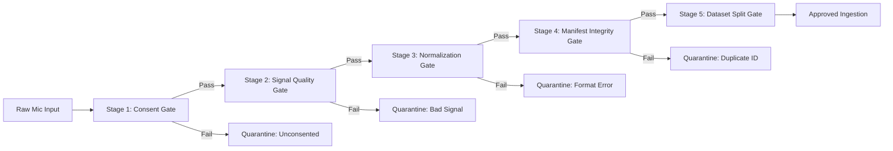

# Quality Control & Acceptance Checklist for Field Recordings

> **Document Version:** 1.0.0-PROPOSAL  
> **Campaign Date:** October 13, 2026  
> **Governance Standard:** Zero Defect Ingestion & Multi-Stage Acoustic Verification  
> **Target Manifest:** `data/raw/human_recordings_v1/human_collection_manifest_v1.csv`

---

## 1. Multi-Stage Quality Gate Architecture

To ensure that only high-integrity, uncorrupted, and properly consented audio enters the repository, every candidate recording passes through a 5-stage quality pipeline:



---

## 2. Comprehensive Quality Control Checklist

The checklist below defines the mandatory checks executed by automated ingestion tools (`ingest_recording`, `campaign_validator.py`):

| Check # | Quality Gate Name | Threshold / Verification Rule | Failure Code / Action | Rationale |
| :-: | :--- | :--- | :--- | :--- |
| **QC-01** | **Informed Consent** | `speaker_id` exists in `consent_ledger_human.json` with `consent_given == True`. | `missing_or_unconsented_speaker`<br/>*(Immediate Abort)* | Legal & ethical prerequisite. Unconsented voice capture is prohibited. |
| **QC-02** | **Identifier Sanitization** | `speaker_id`, `session_id`, `command_label` must match regex `^[A-Za-z0-9_\-]+$`. | `invalid_identifier_format`<br/>*(Immediate Abort)* | Prevents path traversal vulnerabilities (`../`) and shell injection. |
| **QC-03** | **Audio Parseability** | File header parses cleanly with `soundfile` or `audioread` without decoding errors. | `corrupt_file_read_error`<br/>*(Quarantined)* | Rejects zero-byte files, truncated transfers, or invalid media containers. |
| **QC-04** | **Duration Bounds (Speech)** | Raw duration satisfies: $0.25\text{ s} \le t \le 2.50\text{ s}$ for isolated commands (`TRAI`, `PHAI`, `LEN`, `XUONG`, `UNKNOWN`). | `truncated_utterance` ($<0.25$ s)<br/>`excessive_duration` ($>2.50$ s)<br/>*(Quarantined)* | Rejects accidental clicks ($<0.25$ s) or continuous rambling sentence bleed ($>2.5$ s). |
| **QC-05** | **Duration Bounds (Silence)** | Raw duration satisfies: $1.00\text{ s} \le t \le 2.50\text{ s}$ for ambient background (`SILENCE`). | `silence_too_short`<br/>*(Quarantined)* | Ensures sufficient stationary noise frames for sliding window sampling. |
| **QC-06** | **Digital Clipping** | No more than 2 consecutive samples at $\ge 0.999$ full scale: $\max(\text{consecutive}(\|x[n]\| \ge 0.999)) < 3$. | `digital_clipping_detected`<br/>*(Quarantined)* | Rejects microphone pre-amp distortion, ADC overload, or severe mouth pops. |
| **QC-07** | **Abnormal Silence (Speech)** | RMS energy satisfies: $\text{RMS} \ge -45.0\text{ dBFS}$ for classes 0, 1, 2, 3, 4. | `abnormal_silence`<br/>*(Quarantined)* | Rejects unvoiced commands, delayed speech starting after window, or muted mic. |
| **QC-08** | **Digital Silence (Background)**| Signals for `SILENCE` (class 5) must NOT be pure mathematical zeros: $\text{RMS} > -80.0\text{ dBFS}$. | `mathematical_zero_silence`<br/>*(Quarantined)* | Mobile microphones contain thermal noise. Pure zero vectors cause division-by-zero. |
| **QC-09** | **Duplicate Audio Detection**| $\text{SHA256}(\text{raw\_audio}) \notin \text{Manifest}(\texttt{sha256\_raw})$. | `duplicate_recording_sha256_match`<br/>*(Quarantined)* | Prevents accidental double-upload or repeated take ingestion. |
| **QC-10** | **Duplicate ID Detection** | $\texttt{recording\_id} \notin \text{Manifest}(\texttt{recording\_id})$. | `duplicate_recording_id_already_exists`<br/>*(Quarantined)* | Guarantees primary key uniqueness across the entire dataset. |
| **QC-11** | **Standardization Parity** | Processed audio must be exactly 16,000 Hz, 1 channel (mono), 16-bit PCM, exactly 16,000 frames (1.000 s). | `standardization_format_mismatch`<br/>*(Quarantined)* | Strictly aligns with mobile TFLite/CoreML frontend expectations. |
| **QC-12** | **Raw Audio Preservation** | Raw source file is copied bit-for-bit into `audio_raw/` with original file extension. | `raw_preservation_failure`<br/>*(Immediate Error)* | Preserves lossless originals for future feature extractor retraining. |
| **QC-13** | **Provenance Attestation** | Provenance must be explicitly set to `HUMAN_CONSENTED` for human takes. | `invalid_provenance_tag`<br/>*(Quarantined)* | Prevents lazy fallback to unverified provenance tags. |
| **QC-14** | **Speaker Disjointness** | $S_{\text{train}} \cap S_{\text{val}} = \emptyset$, $S_{\text{train}} \cap S_{\text{test}} = \emptyset$, $S_{\text{val}} \cap S_{\text{test}} = \emptyset$. | `speaker_leakage_detected`<br/>*(Dataset Freeze Blocked)* | Ensures zero speaker leakage across data partitions. |

---

## 3. Quarantine Logging & Remediation Procedure

Every rejected take that fails Gates QC-03 through QC-13 is automatically logged in:  
`data/raw/human_recordings_v1/quarantined/quarantine_log.csv`

### Quarantine Log Schema:
```csv
input_filename,speaker_id,command_label,session_id,dialect,exclusion_reason,raw_duration_sec,rms_db,status
clipped_take_01.wav,SPK_H_N_8f2a1b,TRAI,SES_H_01,Northern,digital_clipping_detected,0.72,-0.0001,QUARANTINED
silent_take_02.wav,SPK_H_S_a1d3f5,PHAI,SES_H_01,Southern,abnormal_silence (RMS=-52.1 dBFS < -45.0 dBFS),0.55,-52.10,QUARANTINED
```

### Remediation Protocol:
1. **Interactive Re-recording:** During live recording CLI sessions, if a take is quarantined, the CLI prints the exact rejection reason (e.g., `[QUALITY REJECTION] digital_clipping_detected: please back away from the microphone`) and automatically prompts the user to re-record that take.
2. **Quarantine Inspection:** Operators inspect the quarantine log daily to identify systemic hardware faults (e.g., faulty headphone mic, aggressive Android AGC).
3. **No Unilateral Promotion:** A quarantined file may NEVER be moved into the approved manifest without passing all 14 gates in a full automated re-validation run.
