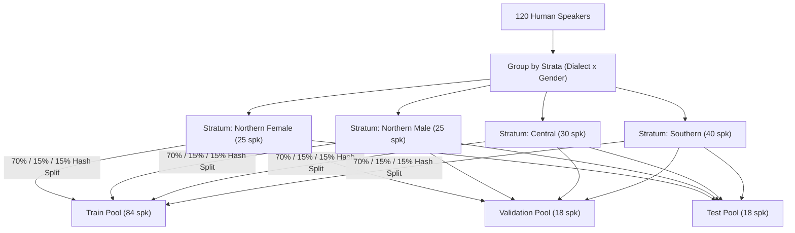

# Speaker-Disjoint Partitioning & Leakage Prevention Policy

> **Document Version:** 1.0.0-PROPOSAL  
> **Campaign Date:** October 13, 2026  
> **Governance Standard:** Zero Acoustic Leakage & Strict Generalization Guarantee  
> **Mathematical Invariant:** $S_{\text{train}} \cap S_{\text{val}} = \emptyset \land S_{\text{train}} \cap S_{\text{test}} = \emptyset \land S_{\text{val}} \cap S_{\text{test}} = \emptyset$

---

## 1. Acoustic Justification: The Speaker Leakage Hazard

In audio speech classification and keyword spotting, deep neural networks (including temporal 1D-CNNs and TC-ResNet models) are highly sensitive to speaker biometric characteristics:
- **Pitch and Glottal Dynamics:** Fundamental frequency contour ($F_0$), harmonic-to-noise ratio (HNR), and glottal pulse shaping.
- **Vocal Tract Resonance:** Formant frequency ratios ($F_1, F_2, F_3$) determined by physical vocal tract length and oral cavity geometry.
- **Idiolect & Micro-Acoustics:** Subtle idiosyncratic timing, aspiration length, and microphone distance habits.

If even a single speaker is shared between the training set and the test set, the neural network learns to identify the contributor rather than the underlying Vietnamese phonemes. This produces artificially inflated laboratory test accuracies (e.g., >98%) that collapse when deployed to unseen real-world users on mobile devices.

---

## 2. Formal Mathematical Invariants

Let $U$ be the universe of all audio recordings in the human dataset. Each recording $u \in U$ has an associated speaker $\text{spk}(u)$, capture session $\text{ses}(u)$, and source recording $\text{src}(u)$.

### Invariant 1: Strict Speaker Disjointness
Let $S_{\text{train}}, S_{\text{val}}, S_{\text{test}}$ be the sets of unique speakers in the respective partitions:
$$S_{\text{train}} = \{\text{spk}(u) \mid u \in U_{\text{train}}\}$$
$$S_{\text{val}} = \{\text{spk}(u) \mid u \in U_{\text{val}}\}$$
$$S_{\text{test}} = \{\text{spk}(u) \mid u \in U_{\text{test}}\}$$

The partitioning MUST satisfy:
$$S_{\text{train}} \cap S_{\text{val}} = \emptyset$$
$$S_{\text{train}} \cap S_{\text{test}} = \emptyset$$
$$S_{\text{val}} \cap S_{\text{test}} = \emptyset$$

### Invariant 2: Session Cohesion
No session may be split across multiple partitions:
$$\forall s \in \text{Sessions}, \quad |\{\text{partition}(u) \mid u \in U \land \text{ses}(u) = s\}| = 1$$

### Invariant 3: Augmentation Cohesion
Any augmented derivative (pitch shift, time stretch, speed perturbation, SpecAugment, noise injection, or room impulse response convolution) of a recording $u$ MUST remain in the same partition as $u$:
$$\forall u' \in \text{Augmentations}(u), \quad \text{partition}(u') = \text{partition}(u)$$

---

## 3. Stratified Partitioning Algorithm

To guarantee that regional dialect and gender balance are preserved across all three splits while enforcing strict speaker disjointness, the partitioning algorithm operates at the **speaker level**, not the clip level:

### 3.1 Proposed Cohort Allocation (120 Speakers)

| Strata Group | Total Speakers | Train Allocation (70%) | Validation Allocation (15%) | Test Allocation (15%) |
| :--- | :---: | :---: | :---: | :---: |
| **Northern (Giọng Bắc)** | 50 | **35 speakers** (~1,400 takes) | **8 speakers** (~320 takes) | **7 speakers** (~280 takes) |
| **Central (Giọng Trung)** | 30 | **20 speakers** (~800 takes) | **5 speakers** (~200 takes) | **5 speakers** (~200 takes) |
| **Southern (Giọng Nam)** | 40 | **29 speakers** (~1,160 takes) | **5 speakers** (~200 takes) | **6 speakers** (~240 takes) |
| **TOTAL** | **120** | **84 speakers** (~5,796 takes) | **18 speakers** (~1,242 takes) | **18 speakers** (~1,242 takes) |

> [!NOTE]
> **Reconciliation Note on Projected Takes:**  
> The individual dialect rows (~1,400, ~800, ~1,160) reflect the 40-take keyword-only model (summing to 3,360 train, 720 val, 720 test = 4,800 total takes). The table TOTAL row (~5,796, ~1,242, ~1,242) reflects the full 69-take protocol (including 25 UNKNOWN and 4 SILENCE takes, summing to 8,280 total takes). The definitive choice between 40 vs. 69 takes per contributor is an open governance decision for the Project Sponsor.

### 3.2 Deterministic Pseudorandom Partitioning
To guarantee reproducibility, speaker assignment is computed using a deterministic salted hash function:
$$\text{HashScore}(s) = \frac{\text{CRC32}(\text{Salt} + s)}{2^{32} - 1}$$
Where $\text{Salt} = \texttt{"kws\_vietnamese\_campaign\_2026\_v1"}$.
- If $\text{HashScore} < 0.70 \implies \texttt{train}$
- If $0.70 \le \text{HashScore} < 0.85 \implies \texttt{validation}$
- If $\text{HashScore} \ge 0.85 \implies \texttt{test}$

---

## 4. Benchmark Manifest Invariant & Dual-Track Evaluation

### 4.1 Frozen Synthetic Benchmark Invariant
The existing held-out test set:
- Path: `data/manifests/test_manifest_v2.csv`
- Cryptographic SHA-256: `9E3904C8EA427244F7280A41140D7EFD19FD9625B359290ADB7ADCD4FA2E1C13`
- Size: 216,889 bytes (534 test clips)

**Policy Mandate:**  
`test_manifest_v2.csv` is the frozen historical benchmark established in Phase 3. It MUST NOT be modified, overwritten, or augmented with human data. It remains the anchor against which retrospective progress is measured.

### 4.2 Dedicated Human Evaluation Benchmark
When genuine human data collection is complete:
1. The 18 test speakers (~1,242 takes) will be compiled into a separate, immutable test manifest:  
   `data/manifests/human_test_manifest_v1.csv`
2. Its cryptographic SHA-256 hash will be recorded and committed into the repository audit ledger.
3. Model evaluation will report dual-track metrics:
   - **Track A (Historical Benchmark):** Accuracy & F1 on `test_manifest_v2.csv` (synthetic targets).
   - **Track B (Human Native Benchmark):** Accuracy, F1, and Northern `TRAI` recall on `human_test_manifest_v1.csv` (genuine native human speech).

### 4.3 Schema Disjointness Evidence Classification
For existing 16-column benchmark manifests (`data/manifests/*_manifest*.csv`):
- **Speaker Disjointness:** **`PASS`** (Empirically verified: zero overlapping speakers across train, val, and test).
- **Recording ID Disjointness:** **`PASS`** (Empirically verified: zero overlapping recording IDs across all three pairs).
- **Session Disjointness:** **`NOT VERIFIABLE — REQUIRED COLUMN ABSENT`** (`session_id` is genuinely unavailable from the underlying benchmark data sources—FLEURS, calibration generator, environmental noise—and is intentionally absent from the 16-column schema).
- **Augmentation-Parent Lineage:** **`NOT VERIFIABLE — REQUIRED COLUMN ABSENT`** (`parent_recording_id` is genuinely unavailable from underlying static files, and dynamic augmentations are applied on-the-fly during training rather than pre-generated in manifests).
- **Campaign Enforcement Rule:** Full session cohesion and augmentation-parent lineage validation are required and enforced when evaluating against the proposed 28-column human campaign schema (`proposed_manifest_schema.md`), which explicitly defines these metadata columns.

---

## 5. Operational Boundary & Downstream Leakage Prevention

### 5.1 Offline Decoupling from Ingestion
- Ingestion CLIs ([`record_command_cli.py`](file:///D:/trainidentificationaudio/src/acquisition/record_command_cli.py) and [`ingest_field_recordings.py`](file:///D:/trainidentificationaudio/src/acquisition/ingest_field_recordings.py)) do **not** assign partition tags. They append unpartitioned rows to the collection manifest.
- Partition assignment is strictly an **offline batch operation** executed via [`src/acquisition/campaign_validator.py::generate_stratified_disjoint_splits()`](file:///D:/trainidentificationaudio/src/acquisition/campaign_validator.py#L371-L560).

### 5.2 Mandatory Downstream Pipeline Consumption
- Downstream training pipelines must explicitly load the three disjoint partition manifests (`train`, `val`, `test`) generated by the batch tool.
- Naive row-level random sampling (`df.sample()` or `sklearn.model_selection.train_test_split()`) in training scripts is **strictly prohibited**, as it introduces catastrophic acoustic leakage across partitions.
- Any perturbation or augmentation pipeline (SpecAugment, pitch shift, room impulse response) must strictly inherit the partition of the parent utterance (`sha256_raw` / `recording_id`).

