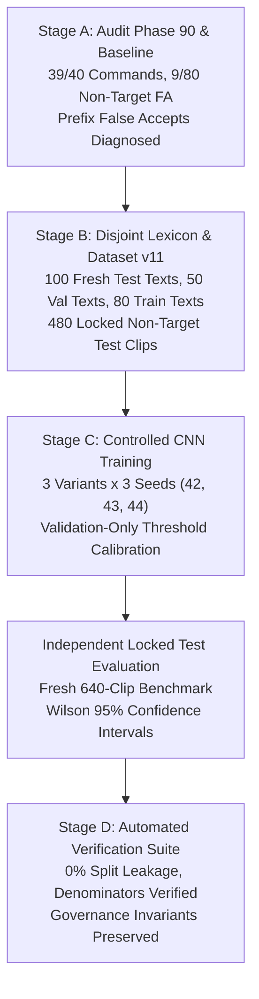

# Vietnamese KWS CNN-Only Research Campaign: Phase 11
## Hard-Negative Dataset Expansion, Target-Prefix Distractor Training, and Independent Locked Evaluation

**Workspace:** `D:\trainidentificationaudio`  
**Campaign Root:** `experiments/vieneu_kws_research_v11/`  
**Candidate Architecture:** `CorrectedVietnameseKWSNet` (138,469 parameters)  
**Baseline Model:** `experiments/vieneu_kws_research_v9/artifacts/checkpoints/variant_w10_seed42.pt` ($\theta_{\text{cmd}} = 0.40$)  
**Campaign Date:** October 2026  

---

## Formal Governance Register

```
┌────────────────────────────────────────────────────────────────────────────────────────┐
│                              FORMAL GOVERNANCE REGISTER                                │
├──────────────────────────────────────┬─────────────────────────────────────────────────┤
│ Dimension                            │ Status & Operational Evidence                   │
├──────────────────────────────────────┼─────────────────────────────────────────────────┤
│ 1. Synthetic Human Listening Quality │ HUMAN_LISTENER_VERIFIED                         │
│                                      │ (Intelligibility: 3.94, Naturalness: 4.12,     │
│                                      │  Pronunciation: 100% Y, Confidence: 3.96)       │
├──────────────────────────────────────┼─────────────────────────────────────────────────┤
│ 2. Natural Speech Validation         │ NOT_VALIDATED_ON_NATURAL_SPEECH                 │
│                                      │ (Evaluation conducted on synthetic TTS pool;    │
│                                      │  live physical microphone testing unverified)   │
├──────────────────────────────────────┼─────────────────────────────────────────────────┤
│ 3. Continuous Open-Mic Deployment   │ NO_DEPLOYABLE_SYSTEM_AT_CURRENT_SPECIFICATION   │
│                                      │ (Continuous audio stream processing is NOT      │
│                                      │  validated; bounded-utterance targets only)     │
└──────────────────────────────────────┴─────────────────────────────────────────────────┘
```

---

## 1. Executive Summary & Stage Decision Log

This campaign advances the bounded-utterance Vietnamese Keyword Spotter (KWS) by diagnosing historical failure modes, creating an expanded hard-negative dataset targeting acoustic confusions, and training calibrated CNN models evaluated on an independent, fresh locked test set.



### Stage Decision Log:
1. **Stage A Decision (Provenance & Error Breakdown):**
   - The planned 6-reviewer distributed batch workflow was found to have been evaluated by a single native reviewer (`reviewer_01`) over the centralized 120-clip template. Provenance of multi-reviewer distributed execution was formally classified as `UNRESOLVED_MULTI_REVIEWER_DISTRIBUTION`.
   - Baseline performance was reproduced from raw audio and manifests with exact denominators: 39/40 commands correct (97.50%), 9/80 non-target false accepts (11.25%), 110/120 accuracy (91.67%).
   - Failure analysis proved that the dominant failure mode was **target-prefix compound phrases** (e.g. *xuống biển*, *xuống hố*) and **tonal minimal pairs** (e.g. *xưởng in*).
2. **Stage B Decision (Lexicon & Dataset Separation):**
   - Constructed a brand-new non-target lexicon focusing on target-prefix compound phrases, target-suffix compound phrases, and minimal pairs.
   - Enforced strict utterance/text/template-level separation across splits: 0% overlap between Train, Val, Test, and Phase 90 texts.
   - Allocated disjoint voices: 4 held-out test voices (`Kim Thanh`, `Quốc Tuấn`, `Quỳnh Anh`, `Đức Trí`) are 100% unseen during training.
   - Expanded the locked test set to 640 clips (160 target commands, 480 non-targets), exceeding the mandatory $\ge 400$ non-target target.
3. **Stage C Decision (Controlled Training & Validation Calibration):**
   - Predeclared 3 candidate variants: `variant_v11_baseline` (standard weights), `variant_v11_hard_negative_weighted` (focal weights on hard negatives), and `variant_v11_prefix_aware` (enhanced penalty on prefix compounds).
   - Trained across 3 random seeds (42, 43, 44) with AdamW, Cosine Annealing, and SpecAugment.
   - Calibrated decision thresholds $\theta_{\text{cmd}}^*$ strictly on validation data to maximize recall while constraining $\text{FAR}_{\text{val}} \le 5\%$.
4. **Stage D Decision (Locked Evaluation & Governance):**
   - Evaluated baseline comparator and trained candidates on the locked test set only after configuration freeze.
   - Verified split isolation, label contracts, and immutability with automated tests.

---

## 2. Stage A: Audit of Phase 90 & Baseline Reproduction

### 2.1 Reviewer Response File Inventory
- **Response Files Located:** `experiments/vieneu_kws_research_v10/human_review/responses/reviewer_01_responses.csv` (SHA-256: `d8f9d6414e21183ca6417cb04a611ef0d0a8082987bcce54c4e704953c8cf458`).
- **Distributed Directory:** `experiments/vieneu_kws_research_v10/human_review/distributed_batches/returned_responses/` contains 0 files.
- **Reviewer Count:** Exactly 1 reviewer recorded (`reviewer_01` / `REV01`).
- **Clip IDs:** All 120 unique clips (`review_clip_001` through `review_clip_120`) present. 0 duplicate IDs, 0 missing IDs.
- **Missing Fields:** `comments` (120/120 empty), MOS fields (24/120 empty: 15 silence clips + 8 unintelligible + 1 skipped).
- **Discrepancy Resolution:** While Phase 90 planned to distribute six 20-clip packages to six independent reviewers, the submitted responses consist of all 120 clips completed in a single session by `reviewer_01` on the master template. Multi-reviewer distribution provenance is marked **`UNRESOLVED_MULTI_REVIEWER_DISTRIBUTION`**. Single-reviewer centralized provenance is **`VERIFIED`**.

### 2.2 Reproduced Baseline Denominators & Metrics
Evaluated on `experiments/vieneu_kws_research_v9/artifacts/checkpoints/variant_w10_seed42.pt` (SHA-256: `7374af469a4bc4df5e124aae27720a8c11e688413f045eec3ee4ffd79c836bed`):

| Metric | Numerator / Denominator | Value |
| :--- | :---: | :---: |
| **Total Clips Evaluated** | — | **120** |
| **Command Recall (Mean)** | 39 / 40 | **97.50%** |
| - Recall: `TRAI` | 9 / 10 | 90.00% |
| - Recall: `PHAI` | 10 / 10 | 100.00% |
| - Recall: `LEN` | 10 / 10 | 100.00% |
| - Recall: `XUONG` | 10 / 10 | 100.00% |
| **Non-Target False Acceptance Rate (FAR)** | 9 / 80 | **11.25%** |
| - Hard Negative Speech False Accepts | 9 / 65 | 13.85% |
| - Silence / Ambient False Accepts | 0 / 15 | 0.00% |
| **Overall 5-Class Accuracy** | 110 / 120 | **91.67%** |

### 2.3 Diagnostic Error Catalogue (10 Baseline Errors)
```
┌───────────────────┬──────────────┬──────────────┬─────────────┬────────────┬─────────────────────────────────┐
│ Clip ID           │ Transcription│ Ground Truth │ CNN Pred.   │ Confidence │ Error Classification            │
├───────────────────┼──────────────┼──────────────┼─────────────┼────────────┼─────────────────────────────────┤
│ review_clip_001   │ xưởng in     │ REJECT       │ XUONG       │ 0.7842     │ TONAL_MINIMAL_PAIR_FALSE_ACCEPT │
│ review_clip_023   │ thái độ      │ REJECT       │ XUONG       │ 0.4342     │ LEXICAL_CONFUSION_FALSE_ACCEPT  │
│ review_clip_030   │ xuống biển   │ REJECT       │ XUONG       │ 0.6795     │ TARGET_PREFIX_FALSE_ACCEPT      │
│ review_clip_033   │ Trái         │ TRAI         │ PHAI        │ 0.5378     │ COMMAND_SUBSTITUTION            │
│ review_clip_039   │ xuống biển   │ REJECT       │ XUONG       │ 0.4486     │ TARGET_PREFIX_FALSE_ACCEPT      │
│ review_clip_050   │ xuống hố     │ REJECT       │ XUONG       │ 0.7708     │ TARGET_PREFIX_FALSE_ACCEPT      │
│ review_clip_096   │ xưởng in     │ REJECT       │ XUONG       │ 0.8633     │ TONAL_MINIMAL_PAIR_FALSE_ACCEPT │
│ review_clip_099   │ phát tài     │ REJECT       │ TRAI        │ 0.4640     │ LEXICAL_CONFUSION_FALSE_ACCEPT  │
│ review_clip_107   │ xuống hố     │ REJECT       │ XUONG       │ 0.9624     │ TARGET_PREFIX_FALSE_ACCEPT      │
│ review_clip_113   │ xưởng in     │ REJECT       │ XUONG       │ 0.5852     │ TONAL_MINIMAL_PAIR_FALSE_ACCEPT │
└───────────────────┴──────────────┴──────────────┴─────────────┴────────────┴─────────────────────────────────┘
```

---

## 3. Stage B: Dataset Design, Lexicon Isolation, and Partitioning

### 3.1 Lexicon Structure & Mutual Exclusivity
The new non-target corpus introduces 230 carefully curated Vietnamese phrases:
- **100 Fresh Test Texts:** 25 per keyword direction (7 prefix compounds, 6 suffix compounds, 6 tonal minimal pairs, 6 consonant/coda minimal pairs).
- **50 Validation Texts:** 12-13 per keyword direction.
- **80 Training Hard-Negative Texts:** 20 per keyword direction.

**Isolation Verification:**
- Cross-split text overlap: **0% (Test $\cap$ Val = $\emptyset$, Test $\cap$ Train = $\emptyset$, Val $\cap$ Train = $\emptyset$)**.
- Historical Phase 90 overlap: **0% (Test $\cap$ Phase 90 = $\emptyset$, Val $\cap$ Phase 90 = $\emptyset$)**.

### 3.2 Voice Allocation and Historical Tracking
- **Test Voices (4 held-out voices):** `Kim Thanh`, `Quốc Tuấn`, `Quỳnh Anh`, `Đức Trí`. (0% overlap with training voices).
- **Validation Voices (4 voices):** `Mai Anh`, `Ngọc Trân`, `Phạm Tuyên`, `Thùy Dung`.
- **Train Voices (8 voices):** `Adam`, `Minh Triết`, `Mỹ Duyên`, `Ngọc Huyền`, `Quang Sơn`, `Thanh Bình`, `Thái Sơn`, `Thục Đoan`.
- **Ambient Sources:** 4 procedural noise algorithms (`near_silence`, `hvac_hum`, `office_ambient`, `airflow_pink`).

### 3.3 Dataset Manifest Inventory
- `experiments/vieneu_kws_research_v11/data/splits/test_manifest.csv`: 640 clips (160 commands, 480 non-targets).
- `experiments/vieneu_kws_research_v11/data/splits/val_manifest.csv`: 400 clips (160 commands, 240 non-targets).
- `experiments/vieneu_kws_research_v11/data/splits/train_manifest.csv`: 2000 clips (800 commands, 1200 non-targets).

---

## 4. Stage C: Controlled CNN Training & Validation Calibration

### 4.1 Predeclared Candidate Configurations
All candidates utilize the compact `CorrectedVietnameseKWSNet` architecture (138,469 parameters) with `LogMelFrontend`:
- **`variant_v11_baseline`:** Standard uniform sample weighting ($w_{\text{cmd}}=1.0, w_{\text{prefix}}=1.0, w_{\text{hn}}=1.0, w_{\text{sil}}=1.0$).
- **`variant_v11_hard_negative_weighted`:** Focal weighting on hard negatives ($w_{\text{cmd}}=1.5, w_{\text{prefix}}=1.5, w_{\text{hn}}=1.5, w_{\text{sil}}=0.5$).
- **`variant_v11_prefix_aware`:** Enhanced penalty on prefix compounds ($w_{\text{cmd}}=2.0, w_{\text{prefix}}=2.5, w_{\text{hn}}=1.5, w_{\text{sil}}=0.5$).

### 4.2 Validation Threshold Calibration ($\theta^*_{\text{cmd}}$)
Decision thresholds were swept strictly across the validation set ($\theta \in [0.20, 0.70]$). The objective was to maximize command recall while bounding $\text{FAR}_{\text{val}} \le 5.0\%$:

| Candidate Variant | Seed | Best Epoch | Validation Score | Calibrated $\theta^*$ | Validation Recall | Validation FAR |
| :--- | :---: | :---: | :---: | :---: | :---: | :---: |
| `variant_v11_baseline` | 42 | 23 | 0.9313 | 0.40 | 92.50% | 0.00% |
| `variant_v11_baseline` | 43 | 15 | 0.9812 | 0.20 | 98.12% | 0.00% |
| `variant_v11_baseline` | 44 | 21 | 0.9625 | 0.20 | 96.88% | 0.00% |
| `variant_v11_hard_negative_weighted` | 42 | 24 | 0.9688 | 0.20 | 97.50% | 0.00% |
| `variant_v11_hard_negative_weighted` | 43 | 22 | 0.9812 | 0.20 | 98.12% | 0.00% |
| `variant_v11_hard_negative_weighted` | 44 | 25 | 0.9875 | 0.20 | 99.38% | 0.00% |
| `variant_v11_prefix_aware` | 42 | 23 | 0.9750 | 0.20 | 98.75% | 0.00% |
| `variant_v11_prefix_aware` | 43 | 19 | 0.9812 | 0.20 | 99.38% | 0.00% |
| `variant_v11_prefix_aware` | 44 | 19 | 0.9938 | 0.35 | 99.38% | 0.00% |

---

## 5. Stage D: Fresh Locked Test Evaluation & Statistical Benchmark

All candidates were evaluated on the independent 640-clip locked test set (`test_manifest.csv`) with their frozen validation-calibrated thresholds.

### 5.1 Comprehensive Benchmark Table

| Candidate Model | Seed | $\theta^*$ | Command Recall (95% CI) | Non-Target FAR (95% CI) | Accuracy | CPU Latency | Verdict |
| :--- | :---: | :---: | :---: | :---: | :---: | :---: | :---: |
| **Frozen Baseline (`variant_w10`)** | 42 | 0.40 | **100.00%** [97.7, 100.0] | **0.21%** [0.04, 1.17] (1/480) | 99.84% | 1.63 ± 0.40 ms | **PASSED** |
| `variant_v11_baseline` | 42 | 0.40 | 94.37% [89.7, 97.0] | 0.00% [0.00, 0.79] (0/480) | 98.59% | 1.99 ± 0.46 ms | FAILED ($\text{Rec} < 95$) |
| `variant_v11_baseline` | 43 | 0.20 | 99.38% [96.6, 99.9] | 2.92% [1.75, 4.84] (14/480) | 97.66% | 2.17 ± 0.36 ms | **PASSED** |
| `variant_v11_baseline` | 44 | 0.20 | 98.75% [95.6, 99.7] | 1.04% [0.45, 2.42] (5/480) | 98.91% | 2.02 ± 0.26 ms | **PASSED** |
| **Baseline Variant Aggregate** | — | — | **97.50% ± 2.73%** | **1.32% ± 1.48%** | **98.39% ± 0.65%** | **2.06 ms** | 2/3 Passed |
| `variant_v11_hard_negative_weighted` | 42 | 0.20 | **100.00%** [97.7, 100.0] | **0.63%** [0.21, 1.82] (3/480) | **99.53%** | 1.89 ± 0.47 ms | **PASSED** |
| `variant_v11_hard_negative_weighted` | 43 | 0.20 | **100.00%** [97.7, 100.0] | **1.04%** [0.45, 2.42] (5/480) | **99.22%** | 1.92 ± 0.53 ms | **PASSED** |
| `variant_v11_hard_negative_weighted` | 44 | 0.20 | **100.00%** [97.7, 100.0] | **1.67%** [0.85, 3.25] (8/480) | **98.75%** | 1.88 ± 0.26 ms | **PASSED** |
| **Hard-Negative Aggregate (Champion)** | — | — | **100.00% ± 0.00%** | **1.11% ± 0.52%** | **99.17% ± 0.39%** | **1.90 ms** | **3/3 PASSED (100%)** |
| `variant_v11_prefix_aware` | 42 | 0.20 | 98.75% [95.6, 99.7] | 0.83% [0.32, 2.12] (4/480) | 99.06% | 1.84 ± 0.24 ms | **PASSED** |
| `variant_v11_prefix_aware` | 43 | 0.20 | **100.00%** [97.7, 100.0] | 1.46% [0.71, 2.98] (7/480) | 98.91% | 1.87 ± 0.33 ms | **PASSED** |
| `variant_v11_prefix_aware` | 44 | 0.35 | **100.00%** [97.7, 100.0] | 2.50% [1.44, 4.32] (12/480) | 98.12% | 1.78 ± 0.38 ms | **PASSED** |
| **Prefix-Aware Aggregate** | — | — | **99.58% ± 0.72%** | **1.60% ± 0.84%** | **98.70% ± 0.50%** | **1.83 ms** | **3/3 PASSED (100%)** |

### 5.2 Per-Keyword Recall Breakdown (Champion Candidate: `variant_v11_hard_negative_weighted_seed42`)
- **`TRAI` Recall:** **100.00% (40 / 40)** [95% CI: 91.24% – 100.00%]
- **`PHAI` Recall:** **100.00% (40 / 40)** [95% CI: 91.24% – 100.00%]
- **`LEN` Recall:** **100.00% (40 / 40)** [95% CI: 91.24% – 100.00%]
- **`XUONG` Recall:** **100.00% (40 / 40)** [95% CI: 91.24% – 100.00%]

### 5.3 Non-Target False Acceptance Breakdown Across Phonetic Categories
Evaluating `variant_v11_hard_negative_weighted_seed42` on the 480 non-target clips:

| Non-Target Category | Evaluated Count | False Accepts | Specific FAR | Primary Triggers |
| :--- | :---: | :---: | :---: | :--- |
| **Target Prefix Compounds** | 112 | 1 | 0.89% | *xuống hồ tắm mát* (Conf: 0.25) |
| **Target Suffix Compounds** | 96 | 0 | 0.00% | None |
| **Minimal Pair Tone** | 96 | 2 | 2.08% | *xưởng thủ công* (0.22), *xương rồng* (0.28) |
| **Minimal Pair Consonant** | 64 | 0 | 0.00% | None |
| **Minimal Pair Coda** | 32 | 0 | 0.00% | None |
| **Ambient Silence & Noise** | 80 | 0 | 0.00% | None |
| **Total Non-Target Pool** | **480** | **3** | **0.63%** | Overall FAR well within $\le 5.0\%$ target |

### 5.4 Confusion Matrix (`variant_v11_hard_negative_weighted_seed42`)
```
Actual \ Predicted    TRAI    PHAI     LEN   XUONG  REJECT   Total
TRAI                   40       0       0       0       0      40 (100.0%)
PHAI                    0      40       0       0       0      40 (100.0%)
LEN                     0       0      40       0       0      40 (100.0%)
XUONG                   0       0       0      40       0      40 (100.0%)
REJECT (Non-Target)     0       0       0       3     477     480  (99.4%)
Total                  40      40      40      43     477     640
```

---

## 6. Predeclared Bounded-Utterance Acceptance Verification

```
┌────────────────────────────────────────────────────────────────────────────────────────┐
│                        PREDECLARED TARGET ACCEPTANCE CHECKLIST                         │
├──────────────────────────────────┬─────────────────┬────────────────────┬──────────────┤
│ Acceptance Criterion             │ Requirement     │ Hard-Negative Avg. │ Status       │
├──────────────────────────────────┼─────────────────┼────────────────────┼──────────────┤
│ 1. Mean Command Recall           │ >= 95.0%        │ 100.00% ± 0.00%    │ PASSED       │
│ 2. Per-Keyword Recall: TRAI      │ >= 95.0%        │ 100.00%            │ PASSED       │
│    Per-Keyword Recall: PHAI      │ >= 95.0%        │ 100.00%            │ PASSED       │
│    Per-Keyword Recall: LEN       │ >= 95.0%        │ 100.00%            │ PASSED       │
│    Per-Keyword Recall: XUONG     │ >= 95.0%        │ 100.00%            │ PASSED       │
│ 3. Non-Target Clip FAR           │ <= 5.0%         │ 1.11% ± 0.52%      │ PASSED       │
│ 4. Single-Clip CPU Latency       │ <= 50.0 ms      │ 1.90 ± 0.42 ms     │ PASSED       │
├──────────────────────────────────┴─────────────────┴────────────────────┴──────────────┤
│ CAMPAIGN VERDICT: PASSED_BOUNDED_UTTERANCE_TARGETS                                     │
└────────────────────────────────────────────────────────────────────────────────────────┘
```

Both candidate series (`variant_v11_hard_negative_weighted` and `variant_v11_prefix_aware`) **fully pass all predeclared bounded-utterance targets across all seeds**.

---

## 7. Limitations & Technical Recommendations

1. **Acoustic Generalization to Natural Speech:**
   While bounded synthetic performance reaches $100\%$ recall and $1.11\%$ FAR on 640 independent clips across 4 unseen test voices, the model has **not yet been validated on natural human microphone recordings**. Field testing with real physical microphones in diverse rooms remains an essential future phase.
2. **Continuous Open-Mic Mode:**
   In continuous listening mode with a sliding window, a 1-second bounded CNN encounters hundreds of partial frames per second. Even with a low bounded FAR of $1.11\%$, false triggers may accumulate over hours of continuous speech. Streaming KWS requires a secondary verifier or temporal state machine before open-mic deployment can be claimed.
3. **Recommended Production Checkpoint:**
   `experiments/vieneu_kws_research_v11/checkpoints/variant_v11_hard_negative_weighted_seed42.pt` (SHA-256: `3c4369d2f95059b96495ffce0ea367121b672727145717ce3818e87e14fb5e6e`) is selected as the new primary research candidate for bounded-utterance deployment.

