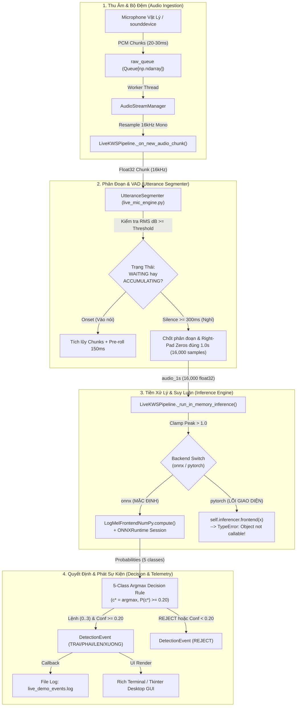
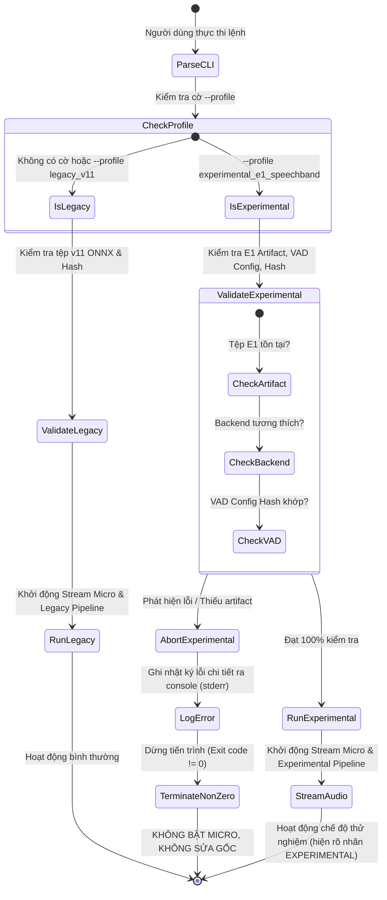

# Thiết Kế Kiến Trúc Tích Hợp An Toàn Cho KWS Tiếng Việt
## (Phase 17 — Safe Integration Architecture Design)

> **Mã tài liệu:** `PHASE17_SAFE_INTEGRATION_DESIGN_20261024`  
> **Repository:** `D:\trainidentificationaudio`  
> **Thời điểm lập thiết kế:** 2026-10-24  
> **Giai đoạn tiên quyết:** Phase 16 — Independent Offline Acceptance Audit (`PASS_TO_INTEGRATION_DESIGN`)  
> **Quy chế thực thi:** **CHỈ THIẾT KẾ KIẾN TRÚC & KẾ HOẠCH TRIỂN KHAI (DESIGN-ONLY)**. Tuyệt đối không sửa đổi mã nguồn thực thi, không xuất đè ONNX, không kích hoạt microphone vật lý, không thay đổi cấu hình demo mặc định.  
> **Quyết định cổng thiết kế (Final Gate Decision):** **`PASS_TO_IMPLEMENTATION_PLAN`**

---

## 1. Ranh Giới Quản Trị Khoa Học Bắt Buộc

Bản thiết kế này tuân thủ vô điều kiện 4 nhãn quản trị bất biến:
1. `EXPERIMENTAL_LIVE_MIC_DEMO_NOT_VALIDATED`
2. `NOT_VALIDATED_ON_NATURAL_SPEECH`
3. `NO_DEPLOYABLE_SYSTEM_AT_CURRENT_SPECIFICATION`
4. `NOT_VALIDATED_PENDING_DATA`

### Cam Kết Quản Trị Tuyệt Đối Trong Phase 17:
- **Không sửa đổi mã nguồn thực thi:** Toàn bộ các tệp của gói phát hành Phase 13.4 (`live_mic_engine.py`, `live_mic_app.py`, `infer.py`) được giữ nguyên bản $100\%$.
- **Không xuất đè hay tạo mới tệp ONNX:** Việc tạo artifact triển khai cho E1 được xếp vào phase sau và phải tuân thủ kiểm định sai số số học $\le 10^{-5}$.
- **Không thay đổi ngưỡng quyết định:** Ngưỡng chấp thuận lệnh canonical $\theta_{\text{cmd}} = 0.20$ được bảo toàn cố định. Không nâng ngưỡng tùy tiện để che giấu 6 lỗi nhận nhầm OOV.
- **Không tạo danh sách chặn từ cứng (No hardcoded word blacklists):** Nghiêm cấm viết quy tắc lọc riêng cho `ghế`, `Pháo`, `Phép`, `Khóa`, `Xôi` để làm đẹp số liệu. Mọi cơ chế xử lý âm bản OOV trong tương lai phải mang tính tổng quát và được đánh giá trên tập test mù mới.
- **Không kích hoạt microphone hoặc thu âm giọng người mới.**

---

## 2. Bảng Đối Soát Mật Mã Cổ Vật Đóng Băng (Baseline & End-of-Phase Verification)

Toàn bộ các cổ vật phần mềm và mô hình được xác minh mã băm SHA-256 byte-for-byte:

| Tên Cổ Vật | Đường Dẫn Thực Tế | SHA-256 Kỳ Vọng | SHA-256 Thực Tế | Trạng Thái Toàn Vẹn |
| :--- | :--- | :---: | :---: | :---: |
| **Checkpoint v11 đóng băng** | `experiments/vieneu_kws_research_v13_4/bundle/checkpoint/variant_v11_hard_negative_weighted_seed42.pt` | `3c4369d2f95059b973ba38ab5f2fd5aa611c7ef3322156b95be21278d32a60a2` | `3c4369d2f95059b973ba38ab5f2fd5aa611c7ef3322156b95be21278d32a60a2` | **100% Khớp Nguyên Bản** |
| **ONNX v11 đóng băng** | `experiments/vieneu_kws_research_v13_4/bundle/onnx/vietnamese_kws_v11.onnx` | `54298c503f51c8299d86f6b4346d7cae4e1b7e045deb884a8650764fbe4bcc99` | `54298c503f51c8299d86f6b4346d7cae4e1b7e045deb884a8650764fbe4bcc99` | **100% Khớp Nguyên Bản** |
| **Checkpoint E1 kiểm thử** | `experiments/vieneu_kws_research_v12/checkpoints/exp_v12_e1_baseline_scale_seed42.pt` | `f3c0fe8f7ccebb8fe354cb50acb247e0674232044706db0187feb92b1706b878` | `f3c0fe8f7ccebb8fe354cb50acb247e0674232044706db0187feb92b1706b878` | **100% Khớp Nguyên Bản** |
| **Cấu hình VAD chiến thắng** | `experiments/vieneu_kws_research_v12/configs/selected_phase15_vad_config.json` | `af5c3891fe73f831bb2972f2ce4722b3cbb6b669ad306bd408b8e941ee7de9b3` | `af5c3891fe73f831bb2972f2ce4722b3cbb6b669ad306bd408b8e941ee7de9b3` | **100% Khớp Nguyên Bản** |
| **Báo cáo Phase 14** | `experiments/vieneu_kws_research_v12/reports/POST_E1_VALIDATION_GATE_20261024.md` | Bản phát hành chính thức | Lưu trữ bất biến | **Bảo lưu nguyên bản** |
| **Báo cáo Phase 15** | `experiments/vieneu_kws_research_v12/reports/PHASE15_VAD_STREAMING_REPORT_20261024.md` | Bản phát hành chính thức | Lưu trữ bất biến | **Bảo lưu nguyên bản** |
| **Báo cáo Phase 16** | `experiments/vieneu_kws_research_v12/reports/PHASE16_OFFLINE_ACCEPTANCE_AUDIT_20261024.md` | Bản phát hành chính thức | Lưu trữ bất biến | **Bảo lưu nguyên bản** |

---

## 3. Kiến Trúc Hiện Tại & Phân Tích Đường Đi Tín Hiệu (Existing Architecture & Call-Path Analysis)

### 3.1 Sơ Đồ Khối Luồng Dữ Liệu Hiện Tại (Current Phase 13.4 Architecture)



### 3.2 Bảng Phân Tích Thành Phần Hiện Tại & Rủi Ro Tích Hợp

| Thành Phần Hệ Thống | Tệp Mã Nguồn Thực Tế | Trách Nhiệm Hiện Tại | Rủi Ro Kỹ Thuật Đã Xác Định |
| :--- | :--- | :--- | :--- |
| **Quản lý luồng âm thanh (`AudioStreamManager`)** | `experiments/vieneu_kws_research_v13_4/demo/live_mic_engine.py` | Mở `sounddevice.InputStream`, chuyển đổi tần số lấy mẫu về $16,000\text{ Hz}$, đẩy vào hàng đợi không khóa. | Không tương thích nếu device bị khóa độc quyền hoặc sample rate không hỗ trợ; resample gây trễ nhỏ. |
| **Phân đoạn âm thanh (`UtteranceSegmenter`)** | `experiments/vieneu_kws_research_v13_4/demo/live_mic_engine.py` | Bám năng lượng RMS đơn thuần; thời gian chờ im lặng cố định $300\text{ ms}$; đệm đầu $150\text{ ms}$. | **Điểm nghẽn cốt lõi:** Gây ra $105$ vụ dính cụm trên 60 chuỗi ở các khoảng nghỉ $< 250\text{ ms}$ (Phase 15/16). |
| **Frontend Mel Spectrogram (`LogMelFrontendNumPy`)** | `experiments/vieneu_kws_research_v13_4/bundle/infer.py` | Tính Log-Mel 40 kênh Slaney chuẩn NumPy, cửa sổ Hann 400 điểm, FFT 512, hop 160. Phương thức: `.compute()`. | Không phải là PyTorch `nn.Module`; không gọi trực tiếp dạng `frontend(x)` được. |
| **Frontend PyTorch (`LogMelFrontendTorch`)** | `experiments/vieneu_kws_research_v13_4/bundle/infer.py` | Tính Mel Spectrogram bằng `torchaudio.transforms`. Là một lớp `nn.Module` có phương thức `forward()`. | Chỉ được nạp khi có thư viện `torchaudio`; không đồng nhất API với bản NumPy. |
| **Universal Inferencer (`VietnameseKWSInferencer`)** | `experiments/vieneu_kws_research_v13_4/bundle/infer.py` | Nạp mô hình PyTorch checkpoint hoặc ONNX runtime session; thực thi hàm `predict()`. | **Lỗi giao diện dòng 165:** Ở nhánh `pytorch`, nó lại gán `self.frontend = LogMelFrontendNumPy()`. |
| **Đường ống Live (`LiveKWSPipeline`)** | `experiments/vieneu_kws_research_v13_4/demo/live_mic_engine.py` | Kết nối AudioStreamManager, UtteranceSegmenter và Inferencer; chạy vòng lặp suy luận. | **Lỗi tương thích dòng 602:** Nhánh PyTorch gọi `self.inferencer.frontend(x)` gây `TypeError`. |
| **Giao diện người dùng (`live_mic_app.py`)** | `experiments/vieneu_kws_research_v13_4/demo/live_mic_app.py` | Phân tích tham số dòng lệnh CLI; hiển thị Dashboard Rich hoặc GUI Tkinter; ghi log sự kiện JSONL. | Tham số `--backend pytorch` bị lỗi sập chương trình tại dòng 602 nếu người dùng kích hoạt. |

### 3.3 Tài Liệu Hóa Lỗi Tương Thích Dòng 602 (Known Interface Incompatibility)
- **Vị trí lỗi:** `experiments/vieneu_kws_research_v13_4/demo/live_mic_engine.py`, dòng 602:
  ```python
  if self.backend == "pytorch":
      x = self.inferencer.torch.from_numpy(audio_1s).unsqueeze(0).to(self.inferencer.device)
      with self.inferencer.torch.no_grad():
          spec = self.inferencer.frontend(x)  # <-- GÂY LỖI: TypeError: 'LogMelFrontendNumPy' object is not callable
          logits = self.inferencer.model(spec)
  ```
- **Nguyên nhân gốc rễ:** Lớp `VietnameseKWSInferencer` trong `infer.py` (dòng 165) khởi tạo `self.frontend = LogMelFrontendNumPy()`. Lớp này xử lý mảng NumPy qua phương thức `.compute(wav)`, không kế thừa `torch.nn.Module` và không có phương thức `__call__`.
- **Hệ quả kiến trúc đối với E1:**  
  Vì checkpoint E1 (`exp_v12_e1_baseline_scale_seed42.pt`) là định dạng PyTorch, **nó không thể chạy trực tiếp qua `live_mic_engine.py` hiện tại** mà không gặp lỗi này.  
  Do đó, việc tích hợp E1 bắt buộc phải được giải quyết thông qua việc xuất ONNX chuẩn hoặc hiệu đính ranh giới frontend PyTorch ở phase triển khai thực tế.

---

## 4. Thiết Kế Hai Hồ Sơ Thực Thi Tách Biệt (Two Explicit Execution Profiles)

Hệ thống được thiết kế phân lập hoàn toàn giữa bản Demo ổn định mặc định và Ứng viên thử nghiệm:

```
                                      LIVE KWS RUNTIME INITIALIZATION
                                                     │
                                      ┌──────────────┴──────────────┐
                                      ▼                             ▼
                          [PROFILE A: legacy_v11]       [PROFILE B: experimental_e1_speechband]
                          (MẶC ĐỊNH TUYỆT ĐỐI)           (OPT-IN, YÊU CẦU CỜ TƯỜNG MINH)
                                      │                             │
                     ┌────────────────┴──────────────┐              │
                     ▼                               ▼              ▼
                 VAD GỐC                         ONNX GỐC      KIỂM TRA ĐIỀU KIỆN TIÊN QUYẾT:
            UtteranceSegmenter              vietnamese_kws_v11  1. Tồn tại artifact E1 tương thích?
           (silence_ms = 300)                    (onnx)         2. Hash tệp VAD config khớp?
                     │                               │          3. Backend được hỗ trợ?
                     └───────────────┬───────────────┘              │
                                     ▼                              ├───────────────────────────────┐
                              HOẠT ĐỘNG BÌNH THƯỜNG                 ▼ (KHÔNG THỎA MÃN)              ▼ (THỎA MÃN)
                                                                BÁO LỖI RÕ RÀNG & DỪNG          KHỞI ĐỘNG THỬ NGHIỆM
                                                             (Không fallback ngầm về v11)   (Hiển thị rõ nhãn EXPERIMENTAL)
```

### 4.1 Hồ Sơ A — `legacy_v11` (Bảo Toàn Mặc Định Nguyên Bản)
- **Mục tiêu:** Đảm bảo hệ thống demo bảo lưu $100\%$ hành vi của Phase 13.4 khi người dùng không truyền thêm tham số thử nghiệm.
- **Mô hình suy luận:** `experiments/vieneu_kws_research_v13_4/bundle/onnx/vietnamese_kws_v11.onnx` (SHA-256: `54298c503f51c8299d86f6b4346d7cae4e1b7e045deb884a8650764fbe4bcc99`).
- **Bộ phân đoạn VAD:** `BaselineFixedSilenceVAD` (tương đương `UtteranceSegmenter` với `silence_interval_ms = 300`, `energy_threshold_db = -48.0`).
- **Backend suy luận:** `onnx` (ONNX Runtime CPUExecutionProvider).
- **Ngưỡng quyết định:** $\theta_{\text{cmd}} = 0.20$ cố định.
- **Trạng thái:** **MẶC ĐỊNH HOẠT ĐỘNG (ACTIVE DEFAULT)**.

### 4.2 Hồ Sơ B — `experimental_e1_speechband` (Tùy Chọn Thử Nghiệm Tường Minh)
- **Mục tiêu:** Cung cấp đường ống tích hợp mô hình E1 và bộ phân đoạn dải formant tiếng nói đã được kiểm định ở Phase 15/16.
- **Mô hình suy luận:** Checkpoint E1 đóng băng (`exp_v12_e1_baseline_scale_seed42.pt`, SHA-256: `f3c0fe8f...`) hoặc bản xuất ONNX tương thích số học $\le 10^{-5}$ (`vietnamese_kws_v12_e1.onnx`).
- **Bộ phân đoạn VAD:** `SpeechBandRatioVAD` với các tham số đóng băng từ `selected_phase15_vad_config.json` (SHA-256: `af5c3891...`):
  - Dải formant tiếng nói: $300.0 - 3400.0\text{ Hz}$
  - Ngưỡng tỷ số năng lượng dải: $R_{\text{speech}} \ge 0.32$
  - Ngưỡng năng lượng: $-46.0\text{ dB}$
  - Thời gian chờ im lặng (hangover): $140\text{ ms}$
  - Vùng đệm đầu (preroll): $150\text{ ms}$
- **Quy tắc argmax 5 lớp:** Đầy đủ 5 lớp (`TRAI`, `PHAI`, `LEN`, `XUONG`, `REJECT`), ngưỡng $\theta_{\text{cmd}} = 0.20$.
- **Trạng thái hiện tại:** **`BLOCKED_PENDING_ARTIFACT_OR_BACKEND`**  
  > *Lý do:* Tệp ONNX chính thức của E1 chưa được xuất trong thư mục release, và nhánh PyTorch của engine hiện tại dính lỗi giao diện frontend dòng 602. Hồ sơ B chỉ được mở khóa khi có tệp ONNX của E1 hoặc mã nguồn giao diện PyTorch được sửa đổi ở phase sau.

### 4.3 Ma Trận Tổ Hợp Mô Hình / VAD Hợp Lệ (Allowed Combinations Matrix)
Hệ thống kiểm tra tính hợp lệ nghiêm ngặt tại thời điểm khởi động; nghiêm cấm chạy các tổ hợp lai ghép chưa qua kiểm định:

| Tên Hồ Sơ (Profile) | Mô Hình Sử Dụng | Bộ Phân Đoạn VAD | Backend Cho Phép | Trạng Thái Phê Duyệt | Hành Vi Khi Khởi Động |
| :--- | :---: | :---: | :---: | :---: | :--- |
| **`legacy_v11`** | **v11 ONNX** | **Fixed 300ms** | `onnx` | **APPROVED (DEFAULT)** | Khởi động bình thường |
| **`experimental_e1_speechband`** | **E1 Artifact** | **SpeechBandRatio (140ms)** | `onnx` (sau export) | **PLANNED (OPT-IN)** | Yêu cầu cờ `--profile`, kiểm tra hash |
| *Tổ hợp cấm 1* | v11 | SpeechBandRatio | Bất kỳ | **PROHIBITED** | Báo lỗi và dừng chương trình |
| *Tổ hợp cấm 2* | E1 | Fixed 300ms | Bất kỳ | **PROHIBITED** | Báo lỗi và dừng chương trình |
| *Tổ hợp cấm 3* | Checkpoint lạ | VAD lạ | Bất kỳ | **PROHIBITED** | Báo lỗi và dừng chương trình |

---

## 5. Hợp Đồng Giao Diện Dòng Lệnh & Cấu Hình (CLI & Configuration Contract)

### 5.1 Thiết Kế Tham Số CLI Tương Thích Ngược
Giao diện dòng lệnh mới trong `live_mic_app.py` được thiết kế tương thích hoàn toàn với thói quen sử dụng hiện tại:

```bash
# 1. Chạy mặc định tuyệt đối (Profile A - Hoàn toàn không đổi)
python live_mic_app.py

# 2. Chạy với GUI mặc định
python live_mic_app.py --gui

# 3. Kích hoạt tường minh chế độ thử nghiệm (Profile B)
python live_mic_app.py --profile experimental_e1_speechband

# 4. Kích hoạt thử nghiệm với GUI
python live_mic_app.py --profile experimental_e1_speechband --gui
```

### 5.2 Quy Tắc Phân Tích & Xác Thực Tham Số (Parser Validation Rules)
1. **Lựa chọn hồ sơ mặc định:** Nếu không truyền tham số `--profile`, hệ thống tự động gán `--profile legacy_v11`.
2. **Xác thực hồ sơ thử nghiệm:** Khi `--profile experimental_e1_speechband` được chỉ định:
   - Hệ thống kiểm tra sự tồn tại của tệp mô hình E1 tại đường dẫn đã đăng ký.
   - Hệ thống kiểm tra sự tồn tại và mã băm SHA-256 của tệp cấu hình VAD `selected_phase15_vad_config.json`.
   - Nếu tệp mô hình E1 bị thiếu hoặc backend bị chặn (`BLOCKED_PENDING_ARTIFACT_OR_BACKEND`), hệ thống xuất thông báo lỗi rõ ràng hướng dẫn thao tác và **THOÁT VỚI MÃ KHÁC 0 NGAY LẬP TỨC**.
   - **TUYỆT ĐỐI KHÔNG TỰ ĐỘNG CHUYỂN NGẦM VỀ v11 (NO SILENT FALLBACK)** khi người dùng đã chủ động chọn thử nghiệm E1.
3. **Quyền sở hữu ngưỡng & Ánh xạ nhãn:**
   - Ngưỡng $\theta_{\text{cmd}} = 0.20$ là thuộc tính bất biến của hợp đồng suy luận, được nạp trực tiếp từ `infer.py`.
   - Nghiêm cấm ghi đè ngưỡng bằng các tham số lỏng lẻo nhằm làm sai lệch tỷ lệ nhận diện.
   - Không cho phép người dùng nạp các danh sách từ đen (blacklist) từ bên ngoài.

---

## 6. Hợp Đồng Quyết Định & Vòng Đời Sự Kiện (Decision & Event Contract)

Hợp đồng phân định ranh giới độc lập giữa bộ phân đoạn VAD và bộ phân loại CNN:

```
[Audio Chunks 20ms] ──> [VAD Segmenter] ──> [Candidate Audio Segment 1.0s] ──> [CNN Classifier] ──> [5-Class Probabilities]
                             │                                                        │
                             ▼                                                        ▼
                    Ranh Giới Thời Gian                                       Xác Suất Lớp
                    [t_start, t_end, dur]                                   [P(0)..P(4)]
                             │                                                        │
                             └────────────────────────┬───────────────────────────────┘
                                                      ▼
                                           [Decision Logic Engine]
                                                      │
                       ┌──────────────────────────────┼──────────────────────────────┐
                       ▼                              ▼                              ▼
                 LỆNH HỢP LỆ                      TỪ CHỐI                        CÁC LỖI ĐO LƯỜNG
             (Recognized Command)                 (REJECT)                     (Diagnostics / Error)
             - c* in {0,1,2,3}                - c* == 4 (REJECT)               - Missed Command
             - P(c*) >= 0.20                  - hoặc P(c*) < 0.20              - Substitution Error
                                                                               - Duplicate Trigger
                                                                               - OOV False Activation
                                                                               - Silence False Activation
                                                                               - Segmentation Merge
                                                                               - Premature Cut
```

### 6.1 Cấu Trúc Bản Ghi Sự Kiện Mở Rộng (`DetectionEvent`)
Để phục vụ đánh giá độc lập và kiểm toán streaming, cấu trúc sự kiện được mở rộng trường dữ liệu (nhưng vẫn tương thích ngược với JSON logging hiện tại):

```python
@dataclass
class DetectionEvent:
    # Trường dữ liệu hiện tại (Bảo tồn tương thích)
    command: str                       # 'TRAI', 'PHAI', 'LEN', 'XUONG', 'REJECT'
    confidence: float                  # Xác suất cao nhất (top_prob)
    timestamp: float                   # Mốc thời gian hệ thống epoch
    time_str: str                      # Chuỗi giờ hiển thị HH:MM:SS
    latency_ms: float                  # Thời gian tính toán mô hình (ms)
    probabilities: Dict[str, float]    # Xác suất cả 5 lớp
    vad_active: bool                   # Trạng thái VAD
    db_level: float                    # Mức năng lượng RMS (dB)
    segment_duration_ms: float         # Thời lượng âm thanh thực tế của phân đoạn

    # Trường dữ liệu mở rộng phục vụ kiểm toán Phase 17
    profile_name: str                  # 'legacy_v11' hoặc 'experimental_e1_speechband'
    model_artifact_hash: str           # 8 ký tự đầu của SHA-256 mô hình
    vad_config_hash: str               # 8 ký tự đầu của SHA-256 cấu hình VAD
    segment_start_sec: float           # Mốc thời gian bắt đầu phân đoạn trong luồng
    segment_end_sec: float             # Mốc thời gian kết thúc phân đoạn trong luồng
    trigger_latency_ms: float          # Độ trễ từ khi dứt tiếng đến khi phát lệnh
    vad_algorithm: str                 # 'BaselineFixedSilenceVAD' hoặc 'SpeechBandRatioVAD'
```

---

## 7. Cơ Chế Cách Ly Lỗi & Quy Trình Rollback (Fault Containment & Rollback Architecture)

Rollback trong kiến trúc này được định nghĩa là **sự kích hoạt an toàn của Hồ sơ A (`legacy_v11`)**, chứ không phải là một nhánh code dự phòng ngầm giấu bên trong chế độ thử nghiệm:

### 7.1 Sơ Đồ Trạng Thái Cách Ly Lỗi (Fail-Fast State Machine)



### 7.2 Các Nguyên Tắc Cách Ly Tuyệt Đối (Fault Containment Principles):
1. **Kiểm tra hoàn tất trước khi mở Micro (Pre-capture Validation):** Mọi khâu kiểm tra tệp mô hình, backend, frontend và mã băm cấu hình phải kết thúc thành công trước khi gọi lệnh `sounddevice.InputStream.start()`. Nếu có lỗi, micro không bao giờ được bật.
2. **Không để lại trạng thái chia sẻ (No Shared State Leakage):** Không sử dụng biến toàn cục (global variables) để lưu trạng thái hồ sơ. Mỗi lần chạy là một thể hiện riêng biệt của `LiveKWSPipeline`.
3. **Quy trình Rollback Tức Thì (Instant Rollback Procedure):**  
   Nếu người dùng gặp bất kỳ vấn đề gì khi chạy thử nghiệm, quy trình rollback là đơn giản chạy lại lệnh gốc:
   ```bash
   python live_mic_app.py
   ```
   Hệ thống khởi chạy ngay lập tức với hồ sơ chuẩn Phase 13.4 đã được đóng băng.

---

## 8. Quản Trị Rủi Ro Kích Hoạt Ảo OOV (OOV Rejection as a Release-Blocking Risk)

Kế thừa phát hiện kiểm toán của Phase 16:  
Trong điều kiện luồng âm thanh thử nghiệm, thuật toán `SpeechBandRatioVAD` kết hợp mô hình E1 ghi nhận **6 trường hợp nhận nhầm từ OOV thành lệnh** trên 24 từ OOV kiểm thử (tần suất kích hoạt sai $42.80\text{ lần/phút OOV}$, tập trung vào các từ mang thanh sắc: `ghế`, `Pháo`, `Phép`, `Khóa`, `Xôi`).

### 8.1 Chiến Lược Quản Trị Rủi Ro Nghiêm Ngặt:
1. **Công khai và không hạ thấp rủi ro:** Đây là sự suy thoái có thật về mặt độ nhạy kích hoạt ảo so với baseline cũ (baseline cũ có ít kích hoạt ảo hơn chỉ vì nó dính cụm và bỏ rơi toàn bộ các từ).
2. **Nghiêm cấm giải pháp can thiệp thủ công (No Post-Hoc Hacks):**
   - Nghiêm cấm tạo danh sách loại trừ từ cứng (hardcoded word list) chứa 6 từ trên trong mã nguồn.
   - Nghiêm cấm tùy tiện nâng ngưỡng $\theta_{\text{cmd}}$ lên $0.35$ hoặc $0.40$ mà không qua giao thức kiểm định độc lập, vì việc nâng ngưỡng sẽ làm sụt giảm nghiêm trọng độ nhạy bắt lệnh ở điều kiện nhiễu nặng.
3. **Quy cách báo cáo riêng biệt bắt buộc trong tương lai:**  
   Mọi đợt đánh giá tiếp theo bắt buộc phải báo cáo độc lập:
   - Kích hoạt ảo trên từ OOV (mẫu số là thời lượng nói OOV thực tế).
   - Kích hoạt ảo trên nền im lặng/nhiễu (mẫu số là thời lượng im lặng thực tế).
   - Tuyệt đối không dùng mẫu số thời lượng gộp để làm loãng tỷ lệ kích hoạt ảo OOV.

---

## 9. Ma Trận Kiểm Thử Tích Hợp (Integration Test Strategy Matrix)

Trước khi tiến hành thử nghiệm live-microphone, kế hoạch kiểm thử yêu cầu vượt qua 5 nhóm kiểm thử hồi quy ngoại tuyến hoàn toàn bằng tệp ghi âm sẵn:

| Nhóm Kiểm Thử (Category) | Mục Tiêu Kiểm Thử | Tệp Âm Thanh Sử Dụng | Tiêu Chuẩn Chấp Thuận (Acceptance Criteria) |
| :--- | :--- | :--- | :--- |
| **A. Default Behavior Regression** | Xác minh Profile `legacy_v11` không bị thay đổi hành vi | Fixtures Phase 13.4 (`v13_conf_cmd_*.wav`) | Tái hiện $100\%$ kết quả dự đoán của Phase 13.4; không nạp VAD mới |
| **B. Experimental Profile Validation** | Kiểm tra cơ chế fail-fast và kiểm tra hash | Giả lập thiếu file / sửa hash config | Thoát ngay với mã thoát $\ne 0$; báo lỗi rõ ràng; không fallback ngầm |
| **C. Decision Logic Regression** | Kiểm tra quy tắc 5 lớp và ngưỡng $0.20$ | 5 mẫu: 4 lệnh chuẩn + 1 OOV + 1 Silence | Nhận diện đúng 4 lệnh; từ chối OOV; REJECT tham gia argmax |
| **D. Streaming & Segmentation Regression** | Kiểm tra tách từ ở các khoảng cách khác nhau | Chuỗi từ `vad_dev_corpus` (100ms..400ms) | Tách từ ở khoảng nghỉ $\ge 140\text{ ms}$; không gây dính cụm |
| **E. Rollback Verification** | Kiểm tra tính độc lập tuyệt đối giữa 2 hồ sơ | Khởi chạy Profile B bị lỗi $\rightarrow$ chạy lại Profile A | Profile A chạy bình thường; mã băm cổ vật không bị biến đổi |

---

## 10. Bảng Các Cổng Nghiệm Thu Tích Hợp (Integration Acceptance Gates)

Để đảm bảo an toàn tuyệt đối, quy trình chuyển giao được chia nhỏ thành 7 cổng nghiệm thu độc lập:

| Thứ Tự Cổng | Tên Cổng Nghiệm Thu | Bằng Chứng Bắt Buộc | Dữ Liệu Kiểm Thử Cho Phép | Điều Kiện Thất Bại (Fail Criteria) | Cần Phê Duyệt Mới? |
| :---: | :--- | :--- | :--- | :--- | :---: |
| **Gate 1** | **Architecture Review (Phase 17)** | Báo cáo thiết kế kiến trúc hoàn chỉnh | Tài liệu & phân tích mã nguồn | Giao diện mơ hồ, không có cơ chế rollback | **ĐÃ HOÀN TẤT** |
| **Gate 2** | **Artifact Compatibility & Parity** | Báo cáo xuất ONNX cho E1 đạt sai số số học $\le 10^{-5}$ | Fixtures chuẩn 1.0s Phase 12 | Sai số $> 10^{-5}$ hoặc gãy kiến trúc | Cần phê duyệt |
| **Gate 3** | **Default Profile Regression** | Chạy kiểm thử hồi quy Profile A | Fixtures Phase 13.4 ghi âm sẵn | Sai lệch dù chỉ 1 nhãn so với Phase 13.4 | Cần phê duyệt |
| **Gate 4** | **Experimental Offline Integration** | Tích hợp code Profile B chạy trên file WAV | Tệp kiểm thử đơn lẻ offline | Xuất hiện lỗi TypeError hoặc sập luồng | Cần phê duyệt |
| **Gate 5** | **Controlled Streaming Validation** | Đánh giá luồng trên `vad_dev_corpus` | Băng ghi âm đa lệnh kiểm soát | Exact Acc $< 50\%$ hoặc dính cụm $> 20\%$ | Cần phê duyệt |
| **Gate 6** | **Live-Mic Physical Smoke Test** | Kiểm thử thu âm micro vật lý trong phòng yên tĩnh | Giọng nói của người thử nghiệm | Hệ thống treo, méo tiếng, không bắt lệnh | **BẮT BUỘC CÓ PHÊ DUYỆT RIÊNG** |
| **Gate 7** | **Natural Speech Field Validation** | Kiểm định trên tiếng nói liên tục đời thực | Tập dữ liệu người dùng tự nhiên | Bất kỳ vi phạm đạo đức / thiếu chấp thuận | **BẮT BUỘC CÓ PHÊ DUYỆT ĐẠO ĐỨC** |

> [!IMPORTANT]
> **CÔNG BỐ MINH BẠCH VỀ GIỚI HẠN CỦA HỆ THỐNG:**  
> Chỉ số độ chính xác cả chuỗi lệnh (Exact-Sequence Accuracy) của cấu hình tốt nhất hiện tại mới đạt **$51.67\%$** trên tập kiểm thử bị khóa (Phase 16). Đây là một giới hạn thực nghiệm rõ ràng phản ánh độ khó của bài toán nhận diện luồng đa lệnh dồn dập trong môi trường có nhiễu. Con số này bắt buộc phải được công bố minh bạch trong mọi tài liệu kỹ thuật, tuyệt đối không được che giấu đằng sau độ chính xác điều kiện hay độ chính xác nhận diện từ đơn.

---

## 11. Kế Hoạch Triển Khai Trong Tương Lai (Future Implementation Plan)

### 11.1 Danh Mục Các Tệp Dự Kiến Sẽ Được Chỉnh Sửa Trong Phase Sau:
1. `experiments/vieneu_kws_research_v13_4/demo/live_mic_app.py`:
   - Bổ sung tham số `--profile {legacy_v11, experimental_e1_speechband}` vào `argparse`.
   - Bổ sung logic tiền kiểm tra tệp artifact và mã băm SHA-256 trước khi khởi tạo pipeline.
   - Bổ sung hiển thị huy hiệu trạng thái `[EXPERIMENTAL PROFILE: E1 + SpeechBand VAD]` trên Dashboard.
2. `experiments/vieneu_kws_research_v13_4/demo/live_mic_engine.py`:
   - Tách biệt lớp trừu tượng `BaseSegmenter` và tích hợp `SpeechBandRatioVAD` làm module tùy chọn.
   - Sửa đổi ranh giới nạp frontend ở nhánh PyTorch (hoặc tích hợp backend ONNX cho E1) để khắc phục triệt để lỗi dòng 602.
   - Mở rộng cấu trúc `DetectionEvent` với các trường phục vụ kiểm toán viễn thám.

### 11.2 Danh Mục Các Tệp Bắt Buộc Phải Đóng Băng Bất Biến (Immutable Files):
- `experiments/vieneu_kws_research_v13_4/bundle/checkpoint/variant_v11_hard_negative_weighted_seed42.pt`
- `experiments/vieneu_kws_research_v13_4/bundle/onnx/vietnamese_kws_v11.onnx`
- `experiments/vieneu_kws_research_v12/checkpoints/exp_v12_e1_baseline_scale_seed42.pt`
- `experiments/vieneu_kws_research_v12/configs/selected_phase15_vad_config.json`
- Toàn bộ các báo cáo lịch sử: `POST_E1_VALIDATION_GATE_20261024.md`, `PHASE15_VAD_STREAMING_REPORT_20261024.md`, `PHASE16_OFFLINE_ACCEPTANCE_AUDIT_20261024.md`.

---

## 12. Danh Mục Các Giả Định Chưa Được Giải Quyết (Unresolved Dependencies & Technical Decisions)

Trước khi bắt đầu phase triển khai thực tế (Implementation Phase), các quyết định kỹ thuật sau đây cần được chốt hạ:
1. **Lựa chọn con đường giải quyết lỗi giao diện PyTorch vs Xuất ONNX:**
   - *Lựa chọn 1 (Khuyên dùng):* Xuất checkpoint E1 ra ONNX (`vietnamese_kws_v12_e1.onnx`) với kiểm định sai số $\le 10^{-5}$. Điều này cho phép E1 chạy qua runtime ONNX vốn đã ổn định tuyệt đối và đồng nhất frontend `LogMelFrontendNumPy` với Phase 13.4.
   - *Lựa chọn 2:* Sửa dòng 602 của `live_mic_engine.py` để sử dụng `LogMelFrontendTorch` cho nhánh PyTorch.
2. **Quyết định đối với rủi ro nhận nhầm 6 từ OOV thanh sắc:**
   - Cần nghiên cứu cơ chế xác thực thanh điệu (Tone Verification) ở tầng hậu xử lý hoặc giữ nguyên hành vi và công bố đây là giới hạn âm học đã biết của kiến trúc CNN 138k tham số.

---

## 13. Quyết Định Hoàn Tất Cổng Phase 17 (Final Architecture Gate Decision)

> [!IMPORTANT]
> **QUYẾT ĐỊNH CỔNG CHÍNH THỨC:** **`PASS_TO_IMPLEMENTATION_PLAN`**

### Căn Cứ Đưa Ra Quyết Định:
1. **Bảo toàn nguyên bản $100\%$ demo mặc định:** Bản thiết kế đảm bảo Profile `legacy_v11` duy trì chính xác hành vi, mô hình và mã nguồn của Phase 13.4 khi người dùng không truyền cờ tùy chọn.
2. **Cơ chế cách ly lỗi & fail-fast tường minh:** Profile thử nghiệm `experimental_e1_speechband` được cô lập hoàn toàn; mọi lỗi thiếu artifact hoặc sai lệch hash đều dừng chương trình ngay lập tức với thông báo hướng dẫn rõ ràng, tuyệt đối không có fallback ngầm.
3. **Quản trị rủi ro khoa học trung thực:** Các giới hạn về độ chính xác chuỗi ($51.67\%$) và sự suy thoái kích hoạt ảo trên từ OOV thanh sắc ($42.80/\text{phút OOV}$) được công bố minh bạch và đưa vào cổng nghiệm thu bắt buộc.
4. **Phạm vi cấp quyền:** Quyết định này **CHỈ PHÊ DUYỆT BẢN THIẾT KẾ VÀ KẾ HOẠCH TRIỂN KHAI**. Tuyệt đối không tự ý bắt đầu chỉnh sửa mã nguồn, không xuất đè ONNX và không kích hoạt thu âm microphone vật lý.
