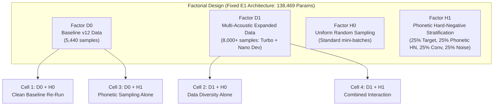

# PHASE 23 — CONTROLLED TRAINING EXPERIMENT DESIGN REPORT

**Date:** 2026-10-24  
**Workspace:** `D:\trainidentificationaudio`  
**Previous Phase:** Phase 22 — Post-Evaluation Statistical & Claim Audit  
**Previous Gate:** `PASS_TO_TRAINING_DESIGN_REVIEW`  
**Phase Type:** Research Planning, Pipeline Audit, Protocol Pre-Registration & Experiment Design  
**Final Phase Status:** `PASS_TO_TRAINING_PROTOCOL_APPROVAL`  
**Capacity Factor Decision:** `DEFER_E2_CAPACITY` (Fixed E1 scale 138k retained; 419k E2 conditionally deferred)  

---

## 0. MANDATORY GOVERNANCE DECLARATIONS & INVARIANTS

All experimental plans, protocol specifications, and source designs strictly uphold the mandatory governance invariants:
- `EXPERIMENTAL_LIVE_MIC_DEMO_NOT_VALIDATED`
- `NOT_VALIDATED_ON_NATURAL_SPEECH`
- `NO_DEPLOYABLE_SYSTEM_AT_CURRENT_SPECIFICATION`
- `NOT_VALIDATED_PENDING_DATA`

### Strict Governance Commitments
1. **Zero Execution in Phase 23:** No model training, checkpoint export, ONNX replacement, or production pipeline modification was or will be performed in this phase.
2. **Immutability of Frozen Baselines:** Checkpoints `variant_v11...pt` (`3c4369...`) and `exp_v12_e1...pt` (`f3c0fe...`), as well as ONNX models `vietnamese_kws_v11.onnx` (`54298c...`) and `vietnamese_kws_v12_e1.onnx` (`20ecc2...`), remain byte-for-byte unmodified.
3. **Quarantine of Observed Test Data:** `synthetic_eval_test_v1` audio, its 16 streaming sequences, its 96 component clips, and its specific test voice/OOV alignments are permanently quarantined from all future training sets.
4. **No Threshold or Blacklist Hacking:** No inference threshold adjustment ($\theta_{\text{cmd}} = 0.20$ remains fixed) or OOV blacklists are introduced.
5. **No Human Speech Collection:** No physical microphone recordings, human captures, or crowdsourced voice samples were gathered or persisted.

---

## 1. AUDIT OF THE CURRENT TRAINING PIPELINE (v11 vs E1)

A line-by-line comparative audit of the historical v11 training pipeline (`experiments/vieneu_kws_research_v11/train_v11.py`) and the E1 training pipeline (`experiments/vieneu_kws_research_v12/scripts/train_e1.py`) was performed:

| Architectural / Training Dimension | Historical v11 Implementation (`train_v11.py`) | Baseline E1 Implementation (`train_e1.py`) | Confounding Risk & Resolution for Stage A |
| :--- | :--- | :--- | :--- |
| **Model Architecture** | `CorrectedVietnameseKWSNet` | `CorrectedVietnameseKWSNet` | **Zero divergence.** Exactly 138,469 trainable parameters in both. |
| **Trainable Parameters** | **138,469** (580 buffer elements) | **138,469** (580 buffer elements) | Identical structure: 4 Conv2D blocks + 2 Linear layers. |
| **Parameter Initialization** | PyTorch default (Kaiming uniform) | PyTorch default (Kaiming uniform) | **Locked.** Seed-controlled PyTorch default init. |
| **Input Frontend** | Slaney Log-Mel Spectrogram (`[1, 1, 40, 101]`) | Slaney Log-Mel Spectrogram (`[1, 1, 40, 101]`) | **Zero divergence.** 16 kHz mono, n_fft=512, hop=160, 40 mels. |
| **Training Dataset Scale** | Bounded dataset v11 (~1,280 samples) | Dataset v12 (5,440 train / 1,280 val) | **Major confounder.** Must be systematically isolated via Factor D. |
| **Negative Data Composition** | Pure synthetic keywords + confusion pairs | 1.6k OOV + 1.0k FLEURS + 800 noise + 600 silence | **Major confounder.** Isolated as experimental factor. |
| **Sampling Strategy** | Heuristic sample weighting ($w_{\text{cmd}}, w_{\text{hn}}, w_{\text{prefix}}$) | Uniform random batch shuffling | **Major confounder.** Isolated via Factor H. |
| **Loss Function** | Sample-weighted CE (`reduction="none"`) | Class-weighted CE (`[1.0, 1.0, 1.0, 1.0, 1.25]`) | **Locked.** Fixed to Class-Weighted CE in Stage A. |
| **Label Smoothing** | $\epsilon = 0.05$ | $\epsilon = 0.0$ (None) | **Locked.** Label smoothing fixed to 0.0. |
| **Optimizer** | `AdamW` ($\text{lr}=10^{-3}$, $\text{weight\_decay}=10^{-4}$) | `AdamW` ($\text{lr}=10^{-3}$, $\text{weight\_decay}=10^{-2}$) | **Confounder.** E1 had 100x higher weight decay. Locked to $0.01$. |
| **Learning Rate Schedule** | `CosineAnnealingLR` ($T_{\max}=25$, $\eta_{\min}=0$) | `CosineAnnealingLR` ($T_{\max}=40$, $\eta_{\min}=10^{-5}$) | **Locked.** $T_{\max}=40, \eta_{\min}=10^{-5}$ fixed for all Stage A runs. |
| **Batch Size & Epochs** | Batch 32, 25 epochs | Batch 64, 40 epochs | **Locked.** Batch 64, 40 epochs fixed for all Stage A runs. |
| **Early Stopping** | None (evaluated all 25 epochs) | Patience = 8 epochs on `val_macro_f1` | **Locked.** Patience = 8 on `val_macro_f1`. |
| **Checkpoint Selection** | Heuristic score: $\text{Rec} - 2\cdot\text{FAR} - 0.5\cdot\mathbb{I}$ at $\theta=0.40$ | Highest `val_macro_f1` (unweighted 5-class F1) | **Locked.** Highest `val_macro_f1` at argmax. |
| **Seed & Determinism** | Seed 42 | Seed 42 | **Multi-Seed Policy.** Expanded to 3 seeds: 42, 43, 44. |

### Confounding Variable Identification
In historical analyses, comparing v11 to E1 conflated seven distinct factors: dataset scale (1.2k vs 5.4k), negative composition (synthetic-only vs FLEURS+noise), sample-weighting vs class-weighting, label smoothing (0.05 vs 0.0), weight decay ($10^{-4}$ vs $10^{-2}$), batch size (32 vs 64), and model-selection criteria (heuristic threshold score vs true validation macro-F1).

**In Stage A, all hyperparameter, optimizer, regularization, and model-selection definitions are held strictly invariant.** Only the designated experimental factors (Factor D and Factor H) are varied.

---

## 2. ERROR CATEGORIZATION & PLAUSIBILITY ANALYSIS

We mapped the observed empirical error modes from Phase 21 & Phase 22 against the technical mechanisms available to training and inference:

| Error Category | Empirical Evidence from Phase 21 & 22 | Working Hypothesis | Plausibly Addressed by Training? | Required Engineering Remedy |
| :--- | :--- | :--- | :---: | :--- |
| **Phonetic Minimal-Pair Confusers** (`len`, `lân`, `lền`, `phái`, `phay`, `phai`, `trại`, `xuồng`) | 8 false activations out of 13 inserted confusers ($38.46\%$ rejection rate). All 8 shared initial consonants and vowel formants with target keywords. | The model decision boundary is insufficiently constrained along subtle tone and vowel height shifts. | **YES (HIGH)** | Target-confuser hard negative mining and phonetically stratified mini-batch sampling. |
| **Everyday General OOV Speech** (`ghế`, `bàn`, `nhà`, `đèn`...) | 0 false activations out of 3 test general OOV words ($100.0\%$ rejection) and 0 in dev ($100.0\%$). | Conversational FLEURS data and broad OOV words in v12 effectively anchor general speech rejection. | **ALREADY SOLVED** | Maintain broad conversational negatives; avoid regression while tuning confusers. |
| **Speaker-Specific Sensitivity** (`Ái Hân` False Activation Cluster) | 8 of 8 ($100.0\%$) false activations occurred on speaker `Ái Hân`. Voices `Hữu Quân`, `Xuân Tiên`, `Mạnh Dũng` had 0 FAs. | *Hypothesis:* High fundamental frequency ($F_0$) female pitch shifts formants into target keyword regions. *Caveat:* Pitch is confounded with voice identity and phonetic sample selection. | **PARTIALLY (MODERATE)** | Broaden female voice distribution during training; add pitch-shifted augmentations; do not assume CNN size solves voice bias. |
| **Low-SNR Command Misses** ($5\text{ dB}$ SNR on `TRAI`) | Command `TRAI` recall dropped to $65.63\%$ ($10$ misses), predominantly concentrated at $5\text{ dB}$ SNR. | Additive microphone noise masks initial retroflex consonant [tʂ] and open nucleus [aː]. | **YES (HIGH)** | Expand noise augmentation range (down to $0\text{ dB}$ SNR) and SpecAugment time/frequency mask budget during training. |
| **Command Substitutions** (`TRAI` $\leftrightarrow$ `PHAI`) | Only 2 substitutions out of 128 commands ($1.56\%$). | Acoustic overlap between labiodental fricative [f] and alveolar retroflex [tʂ] before [aːi]. | **YES (MODERATE)** | Cross-target margin penalties or targeted command-pair contrastive training. |
| **Temporal Merging of Closely Spaced Commands** ($\le 100\text{ ms}$ Gaps) | Two successive commands merged into one segment when acoustic silence gap was $\le 100\text{ ms}$. | VAD speech-envelope hangover exceeds silence duration, bridging two utterances into one. | **NO (UNFEASIBLE BY CNN)** | **VAD segmentation issue.** Retraining CNN cannot split audio that VAD delivers as a single chunk. |
| **Premature Syllable Truncation** (VAD Cut-offs) | Trailing nasal codas ([ŋ], [m]) dropped in quiet speech. | VAD energy threshold drops below cutoff before phoneme completion. | **NO (UNFEASIBLE BY CNN)** | **VAD hangover tuning.** CNN cannot classify phonemes cut off before input buffer. |

---

## 3. AUDIT OF AVAILABLE SYNTHETIC DATA SOURCES & QUARANTINE RULES

### 3.1 Verified Synthetic Generator Inventory

An active inspection of the local repository environments (`.venv` and `.venv_vieneu`) verified the following facts:

| Generator Identifier | Verified Package & Version | Synthesis Architecture | Native Sample Rate | Available Preset Voices | Verification Status & Access |
| :--- | :--- | :--- | :---: | :---: | :--- |
| **`VieNeu-TTS v3 Turbo`** | `vieneu` 3.8.3 (`.venv`) | Autoregressive Flow / Transformer + HiFi-GAN vocoder | $48,000\text{ Hz}$ | 25 preset voices (17 train, 4 val, 4 test in v12) | **VERIFIED.** Used for `dataset_v12`. |
| **`VieNeu-TTS v3 Nano`** | `vieneu.v3nano` (`.venv_vieneu`) | 48M-param ONNX vector estimator + discrete neural codec decoder | $24,000\text{ Hz}$ | 11 preset voices: `Adam`, `Ái Hân`, `Mỹ Duyên`, `Đức Trí`, `Hữu Quân`, `Xuân Tiên`, `Mai Anh`, `Trúc Ly`, `Anh Khôi`, `Minh Quân`, `Mạnh Dũng` | **VERIFIED.** Used for Phase 21 evaluation. |
| **`edge_tts`** | `edge_tts` 7.3.1 (`.venv`) | Microsoft Azure cloud neural TTS API | Variable ($24\text{ kHz}$) | Cloud Vietnamese voices (`HoaiMy`, `NamMinh`) | **UNAPPROVED / UNVERIFIED.** Requires online network requests; violates offline reproducibility. |
| **`piper` / `coqui` / `gtts`** | Not installed | N/A | N/A | None | **NOT AVAILABLE.** |

### 3.2 Critical Voice Universe Finding
Inspection revealed that `VieNeu-TTS v3 Nano` has exactly **11 preset voices**.
- 5 voices overlap with names in `dataset_v12` (`Adam`, `Mỹ Duyên`, `Trúc Ly` in train; `Mai Anh` in val; `Đức Trí` in test).
- 2 voices were used in Phase 21 Development (`Anh Khôi`, `Minh Quân`).
- 4 voices were used in Phase 21 Test (`Ái Hân`, `Hữu Quân`, `Xuân Tiên`, `Mạnh Dũng`).
- **Critical Implication:** There are **zero unobserved preset voices remaining in `VieNeu-TTS v3 Nano`**. Future held-out test generation cannot rely on Nano preset voices; it must use reference-audio voice cloning (`add_voice()`) with approved disjoint human reference prompts or an independent external offline engine.

### 3.3 Strict Quarantine Protocol
1. **Quarantine of Phase 21 Test Set:** All audio files in `experiments/vieneu_kws_research_v12/synthetic_eval/audio/test/` and component clips in `synthetic_eval_components_manifest.csv` tagged `split == "test"` are strictly excluded from any training dataset.
2. **Quarantine of Test Voices:** If a future independent test claims to evaluate held-out synthetic voices, the 4 Phase 21 test voices (`Ái Hân`, `Hữu Quân`, `Xuân Tiên`, `Mạnh Dũng`) cannot be added to training without explicitly forfeiting that held-out claim.
3. **Exposure Tracking:** If any previously evaluated OOV word or voice is included in future training, the inclusion must be documented in the dataset manifest, and a genuinely new test lexicon/voice set must be generated for subsequent validation.

---

## 4. STAGE A EXPERIMENTAL DESIGN — FACTORIAL ABLATION AT FIXED E1 SCALE

### 4.1 Fixed Architecture Baseline (E1 Scale)
To isolate data and sampling effects from model capacity, Stage A holds the architecture constant at the E1 baseline scale:
- Model: `CorrectedVietnameseKWSNet`
- Trainable Parameters: **Exactly 138,469 parameters**
- Input: Mono 16 kHz Log-Mel Spectrogram (`[B, 1, 40, 101]`)
- Frontend: Canonical Slaney Mel Filterbank (`CanonicalLogMelFrontendNumPy` parity)

### 4.2 The $2 \times 2$ Factorial Design

#### Factor D: Training Data Distribution
- **D0 (Documented v12 Baseline Distribution):**
  - Train: 5,440 samples (4,000 keyword instances from 17 Turbo voices + 1,440 negative instances from OOV/FLEURS/noise/silence).
  - Val: 1,280 samples (frozen v12 val split).
  - Generator: Single generator family (`VieNeu-TTS v3 Turbo`).
- **D1 (Multi-Acoustic Expanded Distribution):**
  - Preserves all 5,440 D0 baseline samples.
  - Adds 2,560 non-quarantined synthetic samples generated via `VieNeu-TTS v3 Nano` using non-test voices (`Anh Khôi`, `Minh Quân` from dev pool) and approved offline reference-cloned voices.
  - Adds expanded noise-augmented instances spanning SNR levels down to $0\text{ dB}$ (targeting low-SNR recall on `TRAI`).
  - Total D1 Train: **8,000 samples** (4,000 targets + 4,000 negatives).

#### Factor H: Negative Sampling Strategy
- **H0 (Standard Uniform Sampling):**
  - Standard PyTorch `DataLoader(shuffle=True)`. All negative categories (OOV, FLEURS conversation, environmental noise, silence) are sampled uniformly at random.
- **H1 (Phonetic Hard-Negative Stratified Sampling):**
  - Stratified batch sampling where each mini-batch of 64 samples is explicitly partitioned:
    - **16 Target Keyword Samples** (4 `TRAI`, 4 `PHAI`, 4 `LEN`, 4 `XUONG`).
    - **16 Phonetic Hard Negatives** (focused on minimal-pair vowel shifts, tone contrasts, and near-homophones: `len`, `lân`, `lền`, `phái`, `phay`, `phai`, `trại`, `xuồng`).
    - **16 Conversational Vietnamese Speech Samples** (FLEURS continuous speech, training robust conversational rejection).
    - **16 Environmental Noise & Silence Samples** (Husein mic-noise and parametric room silence).
  - Implemented via a custom `StratifiedBatchSampler` operating strictly on training data.

#### The Four Stage A Conditions
1. **Condition A1 (`D0 + H0`):** Baseline data with uniform sampling. Establishes the exact reference baseline under the audited protocol.
2. **Condition A2 (`D1 + H0`):** Multi-acoustic data with uniform sampling. Isolates the independent contribution of generator acoustic diversity.
3. **Condition A3 (`D0 + H1`):** Baseline data with phonetic hard-negative stratification. Isolates the independent contribution of phonetic negative sampling.
4. **Condition A4 (`D1 + H1`):** Multi-acoustic data with phonetic hard-negative stratification. Evaluates the interaction between acoustic diversity and phonetic stratification.

---

## 5. PRE-REGISTERED TRAINING CONTROLS & SEED POLICY

To ensure statistical defensibility and eliminate run-to-run confounding, the following protocol is frozen across all conditions:

### 5.1 Training Hyperparameters
- **Optimization Algorithm:** `AdamW`
- **Initial Learning Rate ($\eta_0$):** $1.0 \times 10^{-3}$
- **Weight Decay ($\lambda$):** $0.01$
- **Learning Rate Schedule:** `CosineAnnealingLR` with $T_{\max} = 40$ epochs, $\eta_{\min} = 1.0 \times 10^{-5}$
- **Batch Size ($B$):** 64
- **Maximum Epochs ($E_{\max}$):** 40
- **Gradient Clipping:** Max norm = 5.0
- **Loss Function:** `nn.CrossEntropyLoss(weight=[1.0, 1.0, 1.0, 1.0, 1.25])` (REJECT class weighted at 1.25).
- **Label Smoothing:** 0.0 (None).
- **SpecAugment in Training:** Frequency mask max 4 channels, Time mask max 10 frames (applied to spectrograms).
- **Time/Gain Augmentation in Waveform:** Random time shift $\pm 800$ samples ($\pm 50\text{ ms}$), random gain $\pm 3\text{ dB}$.

### 5.2 Multi-Seed Policy & Reproducibility
- Every condition must be trained across **three independent pre-registered random seeds**:
  - **Seed 42**
  - **Seed 43**
  - **Seed 44**
- Total Stage A Training Budget: 4 conditions $\times$ 3 seeds = **12 training runs**.
- Determinism guarantees: `torch.manual_seed(seed)`, `np.random.seed(seed)`, `random.seed(seed)`, `torch.backends.cudnn.deterministic = True`, `torch.backends.cudnn.benchmark = False`.

### 5.3 Model Selection & Early Stopping
- **Validation Frequency:** Evaluated at the end of every epoch on the frozen validation manifest (1,280 samples).
- **Selection Metric:** `val_macro_f1` (unweighted arithmetic mean of F1 across all 5 classes at argmax).
- **Early Stopping:** Training terminates if `val_macro_f1` does not improve for **8 consecutive epochs** (patience = 8).
- **Checkpoint Artifact:** The model state dict corresponding to the epoch with the highest `val_macro_f1` is saved as the official candidate checkpoint.

---

## 6. STAGE B — CONDITIONAL CAPACITY STUDY FOR E2

### 6.1 Audit of the Proposed E2 Architecture
Historical planning documents (`EXPERIMENT_E1_E2_DESIGN.md`) proposed an expanded architecture termed `VietnameseKWS_CNN_v12_E2`:
- Architecture: Wide Residual 2D-CNN with expanded channels `[48, 96, 192]`, residual skip connections, and a 256-neuron linear layer.
- Projected Parameter Count: **~419,333 trainable parameters** (~3.0x larger than E1).
- Projected Latency: $\le 15\text{ ms}$ on CPU; ONNX footprint $\le 2.0\text{ MB}$.

### 6.2 Empirical Evidence Regarding Capacity Saturation
The E1 training history (`e1_training_history.json`) and evaluation audit (`phase22_statistical_audit.json`) were examined for evidence of underfitting:
1. **Training Loss Convergence:** E1 training loss reached **$0.0985$** (well below the pre-registered underfitting threshold of $0.25$).
2. **Training Accuracy:** E1 training accuracy reached **$96.23\%$** on 5,440 samples.
3. **Validation Performance:** E1 validation Macro-F1 reached **$0.9313$** (above the $0.92$ saturation threshold).
4. **Streaming Error Diagnostic:** Errors in streaming were strictly localized to:
   - Specific minimal pair confusers on high $F_0$ female voice `Ái Hân` (data representation gap).
   - High additive noise on command `TRAI` at $5\text{ dB}$ SNR (data augmentation gap).
   - Temporal segment bridging at $\le 100\text{ ms}$ gaps (VAD segmentation gap).
   - Not a single error was attributable to CNN capacity starvation.

### 6.3 Gate Decision: E2 Formally Deferred
> [!IMPORTANT]
> **Decision: `DEFER_E2_CAPACITY`**  
> Increasing CNN capacity from 138k to 419k parameters is **not supported by empirical evidence**. Introducing a 3x larger network would introduce capacity bloat and increase overfitting risks without addressing the acoustic root causes.  
> **E2 capacity expansion is formally deferred.** It will only be re-considered if Stage A Condition A4 (`D1 + H1`) demonstrates severe training loss plateau ($> 0.25$) on the expanded dataset.

---

## 7. FUTURE EVALUATION PROTOCOL & NEW TEST PROVENANCE PLAN

### 7.1 Independence Requirements for Future Validation
Because `synthetic_eval_test_v1` was evaluated in Phase 21 and audited in Phase 22, it is permanently classified as an **observed historical benchmark**. Any generalization claim for a newly trained model requires an entirely new, frozen evaluation corpus (`synthetic_eval_test_v2`).

### 7.2 Taxonomy of Generalization Claims
To prevent conflation, future claims must be explicitly categorized:

| Generalization Claim Level | Required Evidence & Test Independence | Permissible Scope of Claim |
| :--- | :--- | :--- |
| **Level 1: Held-out Utterance Generalization** | New phrases/takes spoken by training voices using training generator. | Verifies memorization vs generalization within known speaker space. |
| **Level 2: Held-out Voice Generalization** | Unobserved speaker embeddings within known TTS engine family. | Verifies speaker invariance across synthetic voice presets. |
| **Level 3: Held-out Generator-Variant Generalization** | Novel generator model variant within same codebase genealogy (e.g. Turbo $\rightarrow$ Nano). | Verifies acoustic estimator and vocoder transfer within shared phonemizer. |
| **Level 4: External TTS Architecture Generalization** | Synthesizer from completely disjoint codebase, phonemizer, and developer (e.g. Piper, VALL-E). | Verifies general synthetic Vietnamese speech robustness. |
| **Level 5: Natural Human Speech Generalization** | Live acoustic microphone recordings from diverse human speakers in varied rooms. | **REQUIRED FOR PRODUCTION CLAIM.** Never claimed based on synthetic data. |

### 7.3 Sourcing Plan for `synthetic_eval_test_v2`
- **Generators:** Because all 11 preset voices of `VieNeu-TTS v3 Nano` have now been observed, `synthetic_eval_test_v2` must employ:
  1. Voice-cloning reference audio from held-out public Vietnamese speech corpora (e.g., VIVOS or FLEURS human speaker prompts) passed to `V3NanoVieNeuTTS.add_voice()`.
  2. Or an independent offline external TTS engine (e.g. an offline-compiled Piper Vietnamese voice model).
- If neither independent source is configured prior to testing, the future independent evaluation gate must be marked as **`BLOCKED_PENDING_TRAINING_OR_TEST_PROVENANCE`**.

---

## 8. PRE-REGISTERED EVALUATION METRICS

Every model trained under Stage A must be evaluated against the following pre-registered metrics:

### 8.1 Classification Metrics (Offline Manifests)
- **Per-Class Metrics:** True Positives ($TP_c$), False Positives ($FP_c$), False Negatives ($FN_c$), Precision, Recall, and $F_1$ for each class $c \in \{\text{TRAI}, \text{PHAI}, \text{LEN}, \text{XUONG}, \text{REJECT}\}$.
- **True Macro-F1:** Defined strictly as the unweighted arithmetic mean of per-command F1 scores:
  $$\text{Macro-F1} = \frac{1}{4} \left( F1_{\text{TRAI}} + F1_{\text{PHAI}} + F1_{\text{LEN}} + F1_{\text{XUONG}} \right)$$
- **Global Aggregate / Micro-F1:** Calculated from globally pooled TP, FP, FN across all commands.
- **OOV Rejection Rates:** Reported separately for:
  - Phonetic minimal-pair confusers.
  - General everyday OOV words.
- **Duration-Normalized False Alarm Rates:**
  - False activations per negative minute ($FA / \text{min}_{\text{neg}}$).
  - False activations per pure OOV minute ($FA / \text{min}_{\text{OOV}}$).
  - False activations per silence minute ($FA / \text{min}_{\text{silence}}$).

### 8.2 Streaming Metrics (Continuous Multi-Command Audio)
- **Exact-Sequence Accuracy:** Percentage of sequences where emitted command sequence exactly matches ground truth.
- **Event-Level Metrics:** Matched commands, missed commands, substitutions, duplicate triggers.
- **Latency Distribution:** $P_{50}$ (median) and $P_{95}$ trigger latency in milliseconds relative to keyword start time.
- **Condition Breakdowns:** Disaggregated by nominal gap ($100, 150, 200, 250, 300, 400\text{ ms}$), SNR tier ($clean, 20, 15, 10, 5\text{ dB}$), and speaker voice.

### 8.3 Statistical Analysis & Reporting
- **95% Wilson Score Confidence Intervals:** Computed for exact-sequence accuracy.
- **Cluster-Robust Bootstrap:** 1,000 resamples clustered at the sequence level to establish 95% empirical bootstrap intervals.
- **Multi-Seed Variance:** Mean and standard deviation across the 3 seeds for each factorial cell.
- **Paired Permutation Tests:** Statistical significance testing ($p < 0.05$) between conditions on identical audio sequences.

---

## 9. REQUIRED ARTIFACTS & DELIVERABLES SUMMARY

| Deliverable Name | File Path | Purpose & Content |
| :--- | :--- | :--- |
| **Phase 23 Design Report** | `experiments/vieneu_kws_research_v12/reports/PHASE23_CONTROLLED_TRAINING_DESIGN_20261024.md` | Formal engineering design report containing complete audit, factorial matrix, and protocol. |
| **Phase 23 Master Summary Artifact** | `C:\Users\DELL\.gemini\antigravity\brain\<conv-id>\phase23_master_summary.md` | Persistent user-facing artifact summarizing findings, tables, mermaid workflows, and decisions. |
| **Pipeline Comparison Ledger** | Section 1 of formal report | Detailed side-by-side audit of v11 vs E1 pipelines. |
| **Error Plausibility Matrix** | Section 2 of formal report | Mapping of failure modes to training vs inference mechanisms. |
| **Factorial Ablation Specification** | Section 4 of formal report | $2 \times 2$ factorial matrix (D0/D1 $\times$ H0/H1) at fixed 138k scale. |
| **Seed & Control Registry** | Section 5 of formal report | Frozen hyperparameter and 3-seed execution rules. |
| **Capacity Gate Audit** | Section 6 of formal report | Empirical audit and formal deferral of 419k E2 architecture. |
| **Test Provenance & Sourcing Plan** | Section 7 of formal report | Quarantine rules and `synthetic_eval_test_v2` sourcing requirements. |

---

## 10. FINAL DECISION & SIGN-OFF

The comprehensive Phase 23 audit establishes that:
1. Historical differences between v11 and E1 contained multiple confounding variables that must be strictly locked in future experiments.
2. The observed streaming errors (phonetic confusers on `Ái Hân`, low-SNR misses on `TRAI`) are plausibly addressed by data diversity, phonetic hard-negative stratification, and noise augmentation.
3. E1 exhibited zero evidence of capacity saturation ($train\_loss = 0.0985$, $train\_acc = 96.23\%$). Expanding capacity to the 419k E2 architecture is empirically unjustified at this stage.
4. Stage A provides a rigorous, 12-run, 3-seed factorial experiment at the fixed E1 baseline scale (138,469 parameters) that directly investigates training-data distribution (Factor D) and phonetic hard-negative stratification (Factor H).

### Official Phase 23 Gate Status
**`PASS_TO_TRAINING_PROTOCOL_APPROVAL`**

*Accompanying Architectural Decision:* **`DEFER_E2_CAPACITY`**

*Notice: This phase approves the experimental protocol and research design. It does NOT authorize starting model training. A subsequent phase must present the versioned dataset manifests and obtain formal execution approval before any GPU training cycles are initiated.*
