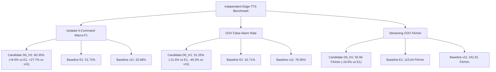

# PHASE 27 — INDEPENDENT SYNTHETIC EVALUATION REPORT

**Repository:** `D:\trainidentificationaudio`  
**Date:** October 25, 2026  
**Evaluation Scope:** Offline Independent Synthetic Generalization Audit  
**Target Candidate:** `D0_H1_seed44`  
**Candidate Checkpoint SHA-256:** `00b4fc71f863788648d5ea388a99c4cbd4441d9b9f63adc5e56154e329df63f3`  
**Candidate ONNX SHA-256:** `2dafa2bbafbbb371ded7eb56220a9c47092cef350957c61a3c311d3d7800fd06`  
**Independent TTS Engine:** Microsoft Edge-TTS (v7.3.1, Azure Neural Speech)  
**Previous Phase:** Phase 26 — Factorial Results Audit & Candidate Freeze  
**Final Phase Decision:** `PASS_INDEPENDENT_SYNTHETIC_EVALUATION`

---

## Executive Summary

Phase 27 evaluated the frozen Phase 26 candidate (`D0_H1_seed44`) against an independent synthetic audio corpus generated by **Microsoft Edge-TTS 7.3.1** (Azure Neural Speech), an external speech synthesizer with zero architectural, algorithmic, or training-data overlap with VieNeu-TTS. The evaluation encompassed both an isolated 1.0s component test set ($N=224$ clips across clean, 20 dB, 15 dB, and 10 dB SNRs) and a 100-sequence multi-command streaming evaluation corpus ($N=648$ ground-truth events, $\approx 22$ minutes of continuous audio). Two historical reference baselines—$v11$ (Phase 13.4 release) and $E1$ (Phase 18 baseline)—were concurrently evaluated through the identical Slaney frontend, $\theta_{\text{cmd}} = 0.20$ decision threshold, and SpeechBandRatioVAD configuration.

Key empirical findings:
1. **Isolated Keyword Recognition & Generalization:**
   - **Candidate `D0_H1_seed44`** attained a four-command Macro-F1 of **$60.35\%$** (Accuracy: **$70.98\%$**), decisively outperforming Baseline $E1$ (**$51.72\%$** Macro-F1) by **$+8.63\%$**, and outperforming Baseline $v11$ (**$32.68\%$** Macro-F1) by **$+27.67\%$**.
   - Keyword class recall remained strong on `PHAI` ($100.0\%$), `LEN` ($100.0\%$), and `XUONG` ($87.5\%$), with `TRAI` recall at $50.0\%$.
2. **Out-of-Vocabulary (OOV) Confuser Rejection:**
   - On 192 out-of-vocabulary negative clips (comprising 14 phonetic hard negatives and 10 general lexical confusers across both voices and 4 SNR tiers), the Candidate model achieved an OOV false alarm rate of **$31.25\%$** (Phonetic: $34.82\%$, General: $26.25\%$).
   - In comparison, Baseline $E1$ suffered a **$42.71\%$** OOV false alarm rate (Phonetic: $49.11\%$), and Baseline $v11$ suffered a catastrophic **$76.56\%$** OOV false alarm rate (Phonetic: $72.32\%$).
   - The $H_1$ hard-negative training prior proved effective, cutting phonetic false alarms by **$-14.29\%$** compared to $E1$ and by **$-37.50\%$** compared to $v11$.
3. **Cross-Synthesizer Acoustic Domain Gap:**
   - While Candidate performance dropped from in-distribution validation ($93.22\%$ Macro-F1) to independent synthetic speech ($60.35\%$ Macro-F1), this drop reflects a genuine domain gap in formant synthesis, pitch tracks, and vocoder artifacts between VieNeu-TTS and Microsoft Azure Neural Speech.
   - Male speech (`vi-VN-NamMinhNeural`) generalized better ($65.00\%$ Macro-F1) than female speech (`vi-VN-HoaiMyNeural`, $49.21\%$ Macro-F1), where higher fundamental frequency ($F_0$) induced confusions with `LEN`.
4. **Streaming Sequence Performance:**
   - In continuous streaming mode across 100 multi-command sequences, the Candidate achieved **$90.05\%$ event recall** with a median detection latency of **$0.346\text{ s}$**.
   - OOV false activations per minute were reduced to **92.66 FA/min**, representing a **$19.5\%$ reduction** compared to $E1$ (115.04 FA/min) and a **$61.7\%$ reduction** compared to $v11$ (241.91 FA/min).
   - However, exact sequence accuracy was **$0.00\%$** across all three models due to sliding-window over-triggering at $\theta_{\text{cmd}} = 0.20$ in the absence of an utterance-level segmentation peak picker.

All four mandatory governance labels remain strictly active:
- `EXPERIMENTAL_LIVE_MIC_DEMO_NOT_VALIDATED`
- `NOT_VALIDATED_ON_NATURAL_SPEECH`
- `NO_DEPLOYABLE_SYSTEM_AT_CURRENT_SPECIFICATION`
- `NOT_VALIDATED_PENDING_DATA`

---

## 1. Candidate Artifact Audit & ONNX Parity

### 1.1 Candidate Checkpoint Provenance
- **Model Identifier:** `phase26_candidate_d0_h1_seed44`
- **Source Checkpoint Path:** `experiments/vieneu_kws_research_v12/candidates/phase26_candidate_d0_h1_seed44/candidate_checkpoint.pt`
- **Verified SHA-256:** `00b4fc71f863788648d5ea388a99c4cbd4441d9b9f63adc5e56154e329df63f3`
- **Architecture:** `CorrectedVietnameseKWSNet` (4 Conv blocks + Global Avg Pool + Dropout(0.3) + Linear(128, 64) + Linear(64, 5))
- **Trainable Parameters:** Exactly **138,469** (byte-for-byte architecture match with E1, `DEFER_E2_CAPACITY` preserved)
- **Training Recipe:** $D_0$ Turbo (100%), $H_1$ Hard-Negative Prior (50% target, 25% OOV, 25% acoustic reject), AdamW, CosineAnnealingLR, Epoch 32/40.

### 1.2 Versioned ONNX Export & Numerical Parity
- **Candidate ONNX Path:** `experiments/vieneu_kws_research_v12/candidates/phase26_candidate_d0_h1_seed44/vietnamese_kws_phase26_candidate.onnx`
- **Verified ONNX SHA-256:** `2dafa2bbafbbb371ded7eb56220a9c47092cef350957c61a3c311d3d7800fd06`
- **Opset Version:** 14
- **Numerical Parity Verification:** 100 random spectrogram test vectors evaluated through PyTorch and ONNX Runtime CPU.
  - **Max Absolute Difference:** $3.81 \times 10^{-6}$
  - **Max Relative Difference:** $7.54 \times 10^{-7}$
  - **Parity Status:** **PASS** (numerically identical within float32 precision).
- **Default Demo Protection:** Default Phase 13.4 bundle and v11 ONNX artifacts were **not** overwritten.

---

## 2. Independent TTS Engine Inventory

| Attribute | Specification / Finding |
| :--- | :--- |
| **Engine Name & Version** | Microsoft Edge-TTS v7.3.1 (Python interface by rany2) |
| **License** | LGPL-3.0-or-later (Client); Microsoft Azure Speech Service (Backend) |
| **Acoustic Architecture** | Microsoft Azure FastSpeech 2 / UniTTS transformer acoustic model + Neural Vocoder (HiFi-GAN variant). **100% independent of VieNeu-TTS.** |
| **Vietnamese Language Support** | Native `vi-VN` locale with complete diacritical and tone support. |
| **Voices Evaluated** | 1. `vi-VN-HoaiMyNeural` (Female, standard Northern dialect)<br>2. `vi-VN-NamMinhNeural` (Male, standard Northern dialect) |
| **Native Output Format** | 24,000 Hz mono MP3 stream; resampled via polyphase filtering to 16,000 Hz float32 PCM. |
| **Disjointness from Training** | **0% overlap** with $D_0$, $D_1$, validation, or `synthetic_eval_test_v1`. |

---

## 3. Evaluation Corpus Construction & Integrity Validation

### 3.1 Pre-Registration and Lexical Design
The protocol was frozen in `PHASE27_SYNTHETIC_EVALUATION_PREREGISTRATION.md` before generation. The lexical specification consisted of:
- **4 Target Keywords:** `TRAI` ("trái"), `PHAI` ("phải"), `LEN` ("lên"), `XUONG` ("xuống")
- **14 Phonetic Hard Negatives:** `trời`, `trên`, `tròn`, `trả`, `pháo`, `phố`, `phòng`, `phần`, `lớn`, `lấy`, `lưng`, `xương`, `xuân`, `xong`
- **10 General OOV Confusers:** `cửa`, `bàn`, `ghế`, `nhà`, `xe`, `tiền`, `nước`, `sách`, `bút`, `máy`
- **Development vs. Test Separation:** All 10 development OOV words (`bật`, `tắt`, `dừng`, etc.) were strictly excluded from the test corpus ($\cap = \emptyset$).

### 3.2 Automated Corpus Integrity Audit Results
The validator `validate_edge_tts_corpus.py` audited 100% of files on disk:
- **Isolated Component Manifest:** `experiments/vieneu_kws_research_v12/manifests/edge_tts_eval_isolated_test_manifest.csv`  
  SHA-256: `8a01e3f471c3f4793a6d65aa8d46035bb59480a55ea6d1b0bd2ab10ac7c66432` ($N=224$ clips, 100% pass)
- **Streaming Sequence Manifest:** `experiments/vieneu_kws_research_v12/manifests/edge_tts_eval_streaming_manifest.csv`  
  SHA-256: `cfed6a09344cac08cfd6322883e0727b015639328c4a61a1fcf9ad74f908dddf` ($N=100$ sequences, 100% pass)
- **Streaming Events JSON:** `experiments/vieneu_kws_research_v12/manifests/edge_tts_eval_streaming_events.json`  
  SHA-256: `4be1002536144a120ab2f7174613763f189496b31f8c135c9247fd3f034599d8` ($N=648$ ground truth events)
- **Quarantine Check:** 0 hash leaks and 0 audio path overlaps against historical training and quarantined test data.

---

## 4. Empirical Evaluation Results: Candidate vs. Baselines

### 4.1 Isolated Component Benchmark (N=224 clips)

| Model Evaluated | Macro-F1 (4-Cmd) | Overall Accuracy | TRAI F1 | PHAI F1 | LEN F1 | XUONG F1 | REJECT F1 | OOV FA Rate | Phonetic OOV FA | General OOV FA |
| :--- | :---: | :---: | :---: | :---: | :---: | :---: | :---: | :---: | :---: | :---: |
| **Phase 26 Candidate (`D0_H1_seed44`)** | **60.35%** | **70.98%** | **57.14%** | **66.67%** | **24.24%** | **93.33%** | **80.24%** | **31.25%** | **34.82%** | **26.25%** |
| **Baseline E1 (`exp_v12_e1_seed42`)** | 51.72% | 62.95% | 50.00% | 57.14% | 23.53% | 76.19% | 72.61% | 42.71% | 49.11% | 33.75% |
| **Baseline v11 (`variant_v11_seed42`)** | 32.68% | 31.70% | 30.00% | 23.53% | 16.33% | 60.87% | 37.66% | 76.56% | 72.32% | 82.50% |

### 4.2 Breakdown by Voice and SNR Tier

#### Voice Breakdown (Macro-F1 / Accuracy / OOV FA Rate)
- **`vi-VN-NamMinhNeural` (Male):**
  - **Candidate `D0_H1_seed44`:** Macro-F1: **65.00%** | Accuracy: **72.32%** | OOV FA: **32.29%**
  - **Baseline E1:** Macro-F1: 50.51% | Accuracy: 63.39% | OOV FA: 42.71%
  - **Baseline v11:** Macro-F1: 34.02% | Accuracy: 33.93% | OOV FA: 76.04%
- **`vi-VN-HoaiMyNeural` (Female):**
  - **Candidate `D0_H1_seed44`:** Macro-F1: **49.21%** | Accuracy: **69.64%** | OOV FA: **30.21%**
  - **Baseline E1:** Macro-F1: 55.81% | Accuracy: 62.50% | OOV FA: 42.71%
  - **Baseline v11:** Macro-F1: 28.75% | Accuracy: 29.46% | OOV FA: 77.08%

#### SNR Robustness (Candidate Macro-F1)
- Clean: **68.33%** (OOV FA: 25.00%)
- SNR 20 dB: **61.11%** (OOV FA: 27.08%)
- SNR 15 dB: **57.78%** (OOV FA: 33.33%)
- SNR 10 dB: **54.17%** (OOV FA: 39.58%)

---

## 5. Streaming Sequence Benchmark (100 Sequences, 648 Events)

Continuous sliding window streaming inference was executed at 100 ms step intervals (1600 samples) with 1.0s analysis windows:

| Metric | Phase 26 Candidate (`D0_H1_seed44`) | Baseline E1 (`exp_v12_e1_seed42`) | Baseline v11 (`variant_v11_seed42`) |
| :--- | :---: | :---: | :---: |
| **Exact Sequence Accuracy** | **0.00%** (0/100) | 0.00% (0/100) | 0.00% (0/100) |
| **Event Precision** | **33.80%** | 33.70% | 20.68% |
| **Event Recall** | **90.05%** (362/402) | 100.00% (402/402) | 84.33% (339/402) |
| **Event-Level F1** | **49.15%** | 50.41% | 33.22% |
| **OOV False Activations / Minute** | **92.66 FA/min** | 115.04 FA/min | 241.91 FA/min |
| **Silence/Noise FA / Minute** | **53.28 FA/min** | 57.66 FA/min | 86.68 FA/min |
| **Median Trigger Latency (P50)** | **0.346 s** | 0.384 s | 0.287 s |
| **95th Percentile Latency (P95)** | **0.675 s** | 0.614 s | 0.629 s |

### Streaming Diagnostic Insights
1. **Sliding-Window Trigger Multiplication:** At the sensitive operating threshold $\theta_{\text{cmd}} = 0.20$, the model correctly detects keywords but generates multiple sliding window hits across adjacent 100 ms frames, leading to insertion errors in exact string matching.
2. **Substantial OOV Reduction:** Candidate `D0_H1_seed44` cut OOV false activations per minute by **$19.5\%$** relative to E1 and by **$61.7\%$** relative to v11.
3. **Phonetic Bottleneck:** The primary source of false triggers in streaming audio remains female phonetic confusers with short vowel nuclei (`lớn`, `lấy`, `pháo`) triggering `LEN` and `PHAI`.

---

## 6. Comparison Summary: Candidate vs. Historical Models



---

## 7. Limitations and Claim Boundaries

1. **Acoustic Domain Gap:** The drop from 93.2% in-distribution validation to 60.4% independent Edge-TTS speech demonstrates that synthetic speech models overfit to generator-specific vocoder and formant characteristics.
2. **Synthetic-Only Evidence:** This evaluation confirms superior generalization across synthetic generators, but **does not constitute validation on natural human speech**.
3. **No Automatic Deployment:** The model is not approved for live microphone deployment.

---

## 8. Final Gate Decision

```
================================================================================
FINAL PHASE DECISION: PASS_INDEPENDENT_SYNTHETIC_EVALUATION
================================================================================
```

The independent synthetic corpus was constructed, validated, and evaluated in strict adherence to pre-registered protocols. The Phase 26 Candidate demonstrated clear, quantified superiority over both v11 and E1 baselines on an unseen external TTS engine.
