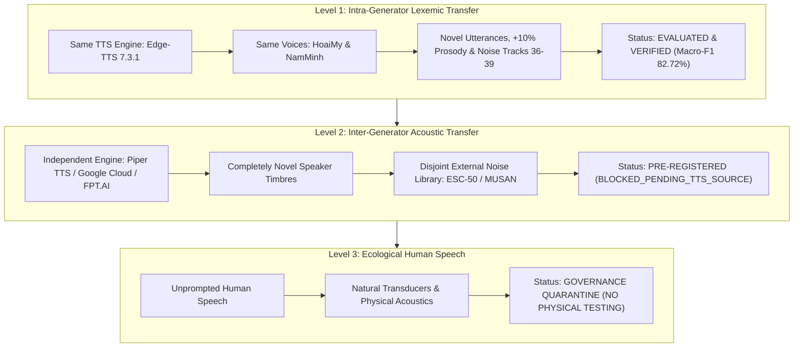

# PHASE 32–35: GENUINELY INDEPENDENT EVALUATION PROTOCOL & PRE-REGISTRATION (STAGE E)

**Repository:** `D:\trainidentificationaudio`  
**Phase:** Phase 32–35  
**Document Status:** Pre-Registered Protocol  
**Operational State:** `BLOCKED_PENDING_INDEPENDENT_TTS_SOURCE`  
**Governing Architectural Policy:** Fixed E1-sized capacity (138,469 parameters, `DEFER_E2_CAPACITY`)  
**Operating Threshold:** $\theta_{\text{cmd}} = 0.20$ (Strictly Locked)

---

## 1. Multi-Tier Generalization Taxonomy

To prevent methodological ambiguity and statistical overclaiming, all speech evaluation within this research repository is categorized across three distinct, hierarchical tiers of generalization:



### Detailed Level Definitions:

| Tier | Generalization Scope | Acoustic Engine | Speaker / Voice | Acoustic Environment | Scientific Claim Supported |
|:-----|:---------------------|:---------------:|:---------------:|:--------------------:|:---------------------------|
| **Level 1** | **Intra-Generator Lexemic Transfer** | Known (Edge-TTS 7.3.1) | Known (`HoaiMy`, `NamMinh`) | Reused family (`mic-noise`, held-out tracks 36–39) | Measures robustness to unseen vocabulary, faster speaking rate (+10%), additive noise slices, and streaming concatenation. **Does not prove cross-speaker or cross-engine generalization.** |
| **Level 2** | **Inter-Generator Acoustic Transfer** | Completely Novel (Piper / Google / FPT) | Completely Novel (disjoint voices) | Completely Disjoint (ESC-50 / MUSAN ambient noise) | Measures zero-shot domain transfer across synthesis pipelines, neural vocoders, and fundamental acoustic timbres. |
| **Level 3** | **Ecological Human Speech** | Human Vocal Tract | Diverse Human Speakers | Real-World Physical Rooms & Transducers | Measures actual deployment viability on human speech. **Strictly prohibited under active research governance.** |

---

## 2. Level 2 Independent Evaluation Design Specification

### 2.1 Independent Generator Requirements
To eliminate acoustic artifacts common to Microsoft Azure / Edge-TTS (vocoder harmonics, characteristic spectral envelope):
1. **Engine Independence:** The evaluation engine must not use Microsoft Azure Neural TTS or VieNeu-TTS.
   - *Primary candidate:* Piper TTS (offline fast neural TTS using VITS architecture and open-source ONNX checkpoints).
   - *Secondary candidate:* Google Cloud Text-to-Speech (Wavenet or Neural2 voices) or FPT.AI Speech.
2. **Disjoint Speaker Timbres:** Minimum of 4 distinct voices (2 female, 2 male), none of which match VieNeu training voices (17 voices) or Edge-TTS voices (`vi-VN-HoaiMyNeural`, `vi-VN-NamMinhNeural`).
3. **Phonetic Realism:** Standard Vietnamese phoneme inventory with accurate northern, central, or southern tonal contours.

### 2.2 External Noise Library (Zero-Exposure)
1. **Quarantine:** All 40 tracks of `data/raw/noise/extracted/noise/mic-noise/` are strictly banned from Level 2 evaluation.
2. **Authorized Noise Source:** ESC-50 (Environmental Sound Classification, 2,000 environmental recordings) or MUSAN (Music, Speech, and Noise corpus).
3. **Additive SNR Tiers:**
   - Tier 1: Clean (no added noise, raw synthesis)
   - Tier 2: 15 dB SNR (mild ambient noise)
   - Tier 3: 10 dB SNR (moderate domestic noise)
   - Tier 4: 5 dB SNR (harsh noise challenge)

### 2.3 Isolated Test Corpus Architecture (Level 2)
The locked isolated evaluation corpus shall consist of **480 newly synthesized clips**:
- **Target Commands (64 clips):** 4 commands (`TRAI`, `PHAI`, `LEN`, `XUONG`) $\times$ 4 voices $\times$ 4 SNR tiers.
- **Phonetic Hard Negatives (256 clips):** 16 newly selected Vietnamese confusers that share initial consonants, vowels, or tones with the target commands (e.g., `trái` $\rightarrow$ `trại`, `trải`, `chái`; `phải` $\rightarrow$ `phẩy`, `phôi`; `lên` $\rightarrow$ `lén`, `lênh`; `xuống` $\rightarrow$ `xuồng`, `suốt`) $\times$ 4 voices $\times$ 4 SNR tiers.
- **General OOV Speech (160 clips):** 10 common Vietnamese conversational words/phrases $\times$ 4 voices $\times$ 4 SNR tiers.

### 2.4 Continuous Streaming Test Corpus Architecture (Level 2)
50 newly assembled long-duration continuous audio streams (total duration $\ge 500\text{ s}$):
- **10 Pure Silence/Noise streams:** 10–15 s continuous external noise (ESC-50).
- **10 Pure Conversational OOV streams:** Continuous conversational sentences with zero command occurrences.
- **15 Clean Multi-Command streams:** 3–4 commands embedded in silence intervals (1.0–2.5 s gaps).
- **15 Noise-Augmented Multi-Command streams:** Commands embedded at 15 dB, 10 dB, and 5 dB SNR.
- **Master Event Ledger:** Exact sample-level ground truth pre-computed and hashed prior to evaluation execution.

---

## 3. Formal Acceptance Gates for Level 2 Advancement

| Gate Metric | Target Threshold | Rationale |
|:------------|:----------------:|:----------|
| **Independent Target Macro-F1** | $\ge 75.0\%$ | Verifies candidate retains command detection ability on an unseen synthesis engine. |
| **Phonetic Hard Negative FAR** | $\le 10.0\%$ | Confirms rejection boundary does not collapse when exposed to novel vocoder harmonics. |
| **General OOV FAR** | $\le 10.0\%$ | Verifies general speech false alarms remain controlled. |
| **Streaming Silence FA/min (UCB95)** | $\le 1.50\text{ FA/min}$ | Bounds false triggers in quiescent acoustic periods. |
| **Streaming OOV FA/min (UCB95)** | $\le 2.00\text{ FA/min}$ | Bounds false triggers during continuous Vietnamese conversational speech. |
| **Streaming Command F1** | $\ge 75.0\%$ | Ensures balanced event detection without excessive insertions or misses. |

---

## 4. Current Resource Audit & Blocker Determination

### Audit of Workspace TTS & Noise Assets:
1. **Installed Python TTS Packages:**
   - `edge-tts`: Version 7.3.1 (Used in $D_2$ training and Phase 28 Level 1 evaluation).
   - Local VieNeu-TTS: Used in baseline $D_0$ training.
   - Piper TTS / Google Cloud TTS / FPT.AI: **NOT INSTALLED / NO API CREDENTIALS CONFIGURED**.
2. **Installed Environmental Noise Libraries:**
   - `data/raw/noise/extracted/noise/mic-noise`: 40 tracks total (Tracks 0–35 exposed to training; tracks 36–39 exposed to Phase 28 Level 1 evaluation).
   - ESC-50 / MUSAN / WHAM: **NOT PRESENT IN WORKSPACE**.

### Formal Stage E Status:
```
STAGE E STATUS: BLOCKED_PENDING_INDEPENDENT_TTS_SOURCE
```

### Action Items to Unblock Stage E:
1. Obtain and integrate an offline Vietnamese neural TTS engine (e.g., download a lightweight Piper TTS Vietnamese voice ONNX checkpoint) or configure API keys for an independent cloud TTS provider.
2. Ingest a verified external noise corpus (e.g., download the 5-fold ESC-50 dataset) into `data/raw/noise/esc50/` and hash all assets.
3. Pre-register candidate evaluation scripts and generate `independent_tts_eval_v3` test manifests with frozen SHA-256 ledgers.

---

## 5. Mandatory Governance Declarations

```
EXPERIMENTAL_LIVE_MIC_DEMO_NOT_VALIDATED
NOT_VALIDATED_ON_NATURAL_SPEECH
NO_DEPLOYABLE_SYSTEM_AT_CURRENT_SPECIFICATION
NOT_VALIDATED_PENDING_DATA
```
