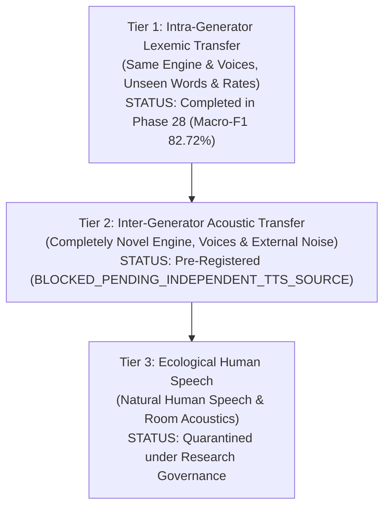

# PHASE 36–39: INDEPENDENT EVALUATION PROTOCOL & PRE-REGISTRATION

**Repository:** `D:\trainidentificationaudio`  
**Phase:** Phase 38–39 (Independent Evaluation Protocol Pre-Registration)  
**Document Status:** Pre-Registered Protocol Specification  
**Pre-Registration Date:** 2026-10-25  
**Governing Gate Condition:** `BLOCKED_PENDING_INDEPENDENT_TTS_SOURCE`  
**Architecture Policy:** Fixed E1 capacity (138,469 parameters, `DEFER_E2_CAPACITY`)  
**Operating Threshold:** $\theta_{\text{cmd}} = 0.20$ (Strictly Locked)  
**VAD Engine:** `SpeechBandRatioVAD` (300–3400 Hz, ratio $\ge 0.32$, energy $\ge -46\text{ dB}$, Strictly Locked)

---

## 1. Multi-Tier Generalization Framework

To prevent conflation of different acoustic domains, all model evaluations are governed by a 3-tier hierarchy:



- **Tier 1:** Tests robustness to novel phrases, speech rate acceleration (+10%), and noise slices within a known synthesis engine family.
- **Tier 2:** Tests zero-shot acoustic generalization across completely disjoint neural synthesis architectures, novel speaker timbres, and novel environmental noise distributions.
- **Tier 3:** Tests deployment on real-world human speech. Strictly prohibited under current governance invariants.

---

## 2. Pre-Registered Test Corpus Architecture (Tier 2)

### 2.1 Isolated Test Corpus (480 Clips Total)
The locked isolated evaluation corpus shall comprise exactly **480 one-second audio clips** (16,000 samples at 16 kHz):

- **Target Commands (64 clips):**
  - 4 Commands: `TRAI`, `PHAI`, `LEN`, `XUONG` (16 clips per command).
  - 4 Distinct Unseen Voices $\times$ 2 Prosody Rates (1.0x, 1.1x) $\times$ 4 SNR Tiers.
- **Phonetic Hard Negatives (256 clips):**
  - 16 Vietnamese Confusers calibrated to share initial consonants, vowels, or tones with target commands (e.g. `trưa`, `trước`, `trường`, `trẻ`, `phát`, `phút`, `phim`, `phương`, `luôn`, `làm`, `lòng`, `lớp`, `xa`, `xanh`, `xem`, `xuyên`).
  - 16 base texts $\times$ 4 voices $\times$ 2 rates $\times$ 4 SNRs = 256 clips.
- **General OOV Speech (160 clips):**
  - 10 Everyday Conversational Vietnamese words (`biển`, `bóng`, `cây`, `hoa`, `núi`, `quạt`, `quần`, `sông`, `áo`, `đèn`).
  - 10 base texts $\times$ 4 voices $\times$ 2 rates $\times$ 4 SNRs = 160 clips.
- **Additive SNR Tiers:**
  - Clean (No added noise, raw speech synthesis).
  - 15 dB SNR (Mild ambient background noise).
  - 10 dB SNR (Moderate domestic background noise).
  - 5 dB SNR (Harsh acoustic challenge).

### 2.2 Continuous Streaming Test Corpus (50 Sequences Total)
50 concatenated continuous audio streams (total duration $\ge 400\text{ s}$):
- **10 Pure Silence / Ambient Noise Sequences:** $8\text{ s}$ to $12\text{ s}$ duration with zero speech events.
- **10 Pure OOV Conversational Sequences:** Continuous multi-sentence speech containing only OOV vocabulary.
- **15 Clean Multi-Command Sequences:** 3 to 4 target commands embedded with variable inter-command gaps ($1.0\text{ s}$ to $2.5\text{ s}$).
- **15 Noise-Augmented Multi-Command Sequences:** Commands embedded at 15 dB, 10 dB, and 5 dB SNR using external unexposed noise assets.

---

## 3. Evaluation Metrics & Matching Tolerances

### 3.1 Decision Policy & Matching Tolerance
- **Inference Threshold:** $\theta_{\text{cmd}} = 0.20$ strictly locked across all candidate models.
- **Classification Policy:** 5-class REJECT-inclusive argmax over softmax probabilities:
  $$\hat{y} = \begin{cases} \operatorname{argmax}_{c \in \{0,1,2,3\}} P(c), & \text{if } \max_{c \in \{0,1,2,3\}} P(c) \ge 0.20 \\ 4\text{ (REJECT)}, & \text{otherwise} \end{cases}$$
- **Event Alignment Tolerance:** A detected event is scored as a True Positive if its detection timestamp falls within $\pm 500\text{ ms}$ of the ground truth command interval.
- **Latency Definition:** Latency is defined strictly as the difference in milliseconds between the ground-truth command offset and the detection triggering timestamp.

### 3.2 Pre-Registered Metrics
1. **Isolated Metrics:**
   - 4-Command Macro-F1 (TRAI, PHAI, LEN, XUONG).
   - 5-Class Overall Macro-F1 (including REJECT).
   - Per-Class Precision, Recall, and F1.
   - Phonetic Hard-Negative False Alarm Rate ($N = 256$).
   - General OOV False Alarm Rate ($N = 160$).
2. **Streaming Metrics:**
   - Exact Sequence Accuracy (number of fully matched sequences / 50).
   - Command Event Recall, Precision, and F1.
   - Error Taxonomy: Misses, Substitutions, False Insertions, Duplicates, Merges, Splits.
   - Cohort-Specific False Alarm Rate (FA/min):
     $$\text{FA/min} = \frac{\text{False Alarms}}{\text{Duration in Minutes}}$$
   - **Zero-Event Uncertainty Bound (Rule of Three):** If observed false alarms equal zero:
     $$\text{UCB}_{95\%} = \frac{3.0}{\text{Duration in Minutes}}$$

### 3.3 Statistical Uncertainty & Clustered Analysis Plan
1. **Cluster Bootstrap by Source Text:**
   - Unit of resampling: 30 base text clusters (resampled with replacement).
   - Iterations: $B = 10,000$, deterministic random seed = 42.
   - Output: Mean $\Delta \text{Macro-F1}$ and cluster-robust 95% Confidence Interval.
2. **Paired Sequence Bootstrap:**
   - Unit of resampling: Complete continuous sequences ($N = 50$).
   - Iterations: $B = 10,000$.

---

## 4. Minimum Acceptance Thresholds for Level 2 Advancement

| Gate Metric | Target Threshold | Rationale |
|:------------|:----------------:|:----------|
| **Independent Target Macro-F1** | $\ge 75.0\%$ | Verifies candidate retains command detection on an unseen synthesis engine. |
| **Phonetic Hard Negative FAR** | $\le 10.0\%$ | Confirms rejection boundary does not collapse under novel vocoder harmonics. |
| **General OOV FAR** | $\le 10.0\%$ | Verifies general speech false alarms remain controlled. |
| **Streaming Silence FA/min (UCB95)** | $\le 1.50\text{ FA/min}$ | Bounds false triggers in quiescent acoustic periods. |
| **Streaming OOV FA/min (UCB95)** | $\le 2.00\text{ FA/min}$ | Bounds false triggers during continuous Vietnamese conversational speech. |
| **Streaming Command F1** | $\ge 75.0\%$ | Ensures balanced event detection without excessive insertions or misses. |

---

## 5. Execution Preconditions (Unblocking Requirements)

Evaluation inference for Phase 39 must NOT execute until:
1. Piper TTS Vietnamese tone phoneme map omission warnings are resolved or an authorized alternative independent TTS API is provisioned.
2. An external, traceable noise dataset (ESC-50 / MUSAN) with 0% historical exposure is downloaded, verified, and hashed.
3. The evaluation manifest SHA-256 and event ledger are frozen prior to model inference.

```
OPERATIONAL STATUS: BLOCKED_PENDING_INDEPENDENT_TTS_SOURCE
```

---

## 6. Mandatory Governance Declarations

```
EXPERIMENTAL_LIVE_MIC_DEMO_NOT_VALIDATED
NOT_VALIDATED_ON_NATURAL_SPEECH
NO_DEPLOYABLE_SYSTEM_AT_CURRENT_SPECIFICATION
NOT_VALIDATED_PENDING_DATA
```
