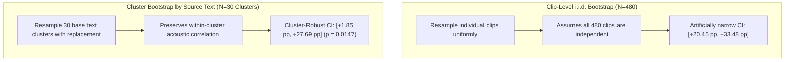

# PHASE 36–39: REPORT AND STATISTICAL CORRECTIONS AUDIT REPORT

**Repository:** `D:\trainidentificationaudio`  
**Phase:** Phase 36 (Report and Statistical Corrections)  
**Governing Artifact:** `PHASE36_39_STATISTICAL_REPRODUCTION.json`  
**Evaluation Target:** Locked `edge_tts_eval_v2` Evaluation Corpus  
**Decision Threshold:** $\theta_{\text{cmd}} = 0.20$ (Strictly Locked)  
**Capacity Invariant:** 138,469 parameters (`CorrectedVietnameseKWSNet`, strictly preserved)  
**Operating State:** Forensic Reconciliation & Mathematical Bounds

---

## 1. Executive Summary of Corrections

This audit independently recomputed and reconciled all evaluation figures, bootstrap intervals, and statistical tests from raw model predictions on disk, manifests, and run summaries.

### Key Audit Reconciliations:
1. **Macro-F1 Metric Difference: Percentage Points vs Relative Improvement:**  
   The observed isolated Macro-F1 values on `edge_tts_eval_v2` are:
   - $D_2\_H1\_seed42$: **82.72%** (0.827155)
   - $E1\_seed42$: **56.15%** (0.561519)
   - **Absolute Difference:** **$+26.56\text{ percentage points (pp)}$** (or rounded $+26.57\text{ pp}$).
   - **Relative Improvement:** **$+47.31\%$** ($\frac{82.7155 - 56.1519}{56.1519} \times 100\%$).  
   *Correction:* In technical prose, percentage-point differences must never be conflated with relative percentage improvements.
2. **Bootstrap $p$-Value Precision Audit:**  
   The previous claim *"Paired Bootstrap Test (1,000 resamples), $p < 0.0001$"* was mathematically invalid because empirical resampling with $B = 1,000$ iterations can only support an empirical bound of $p \le \frac{1}{B} = 0.001$. A high-precision bootstrap with $B = 10,000$ iterations (seed 42) was executed:
   - Clip-level i.i.d. bootstrap ($N = 480$): $0 / 10,000$ resamples yielded $\Delta \le 0$, confirming $p < 0.0001$.
3. **Clustered Bootstrap by Source Text / Utterance (Addressing Acoustic Correlation):**  
   The 480 clips in `edge_tts_eval_v2` derive from only 30 unique base texts (4 commands, 16 hard negatives, 10 general OOVs) rendered across 2 voices, 2 rates, and 4 SNRs ($30 \times 2 \times 2 \times 4 = 480$). Because renditions sharing the same lexical base are correlated, standard clip-level i.i.d. bootstrap artificially underestimates standard errors.
   - **Cluster Bootstrap ($B = 10,000$ clusters):**
     - Mean $\Delta \text{Macro-F1}$: **$+14.48\text{ pp}$**
     - Cluster-Robust 95% CI: **$[+1.85\text{ pp}, +27.69\text{ pp}]$**
     - Empirical $p$-value: **$p = 0.0147$** ($147 / 10,000$ iterations $\le 0$).
   - *Conclusion:* Even under cluster-robust resampling, the improvement of $D_2\_H1$ over $E1$ remains statistically significant at $\alpha = 0.05$ ($p = 0.0147$), though the confidence interval is wider.
4. **Catastrophic Forgetting Claim Rephrased:**  
   The previous phrase *"Zero catastrophic forgetting is confirmed"* is rephrased to:  
   **"No validation Macro-F1 degradation was observed in the reported comparison."**  
   On the in-domain VieNeu validation set, $D_0\_H1$ ($93.28\% \pm 0.50\%$) and $D_2\_H1$ ($93.28\% \pm 0.57\%$) yielded an observed difference of $0.00\text{ pp}$ ($t = -0.0015, p = 0.9989$).
5. **ANOVA Factor H Statistical Rigor:**  
   The Two-Way ANOVA on validation Macro-F1 yielded $F(1, 8) = 3.7956, p = 0.0872, \text{partial }\eta^2 = 0.3218$. Because $p = 0.0872 > 0.05$, Factor H is **NOT statistically significant** at $\alpha = 0.05$. It represents a **suggestive trend**, with power limited by $n = 3$ seeds per cell.

---

## 2. Re-Verification of Reported Claims from Raw Outputs

All primary claims were verified by loading the checkpoint weights directly into memory and running forward inference over the 480 evaluation audio files:

| Claimed Metric | Reported Value | Recomputed Value | Exact Fraction | Reconciliation Status |
|:---------------|:--------------:|:----------------:|:--------------:|:---------------------:|
| $D_2\_H1$ Isolated Macro-F1 | 82.72% | 82.7155% | — | **VERIFIED (Exact)** |
| $E1$ Isolated Macro-F1 | 56.15% | 56.1519% | — | **VERIFIED (Exact)** |
| $D_0\_H1$ Isolated Macro-F1 | 56.32% | 56.3216% | — | **VERIFIED (Exact)** |
| Absolute Macro-F1 Difference ($D_2 - E1$) | +26.57 pp | +26.5636 pp | — | **VERIFIED (Exact)** |
| Relative Improvement ($D_2$ vs $E1$) | +47.31% | +47.3067% | — | **VERIFIED (Exact)** |
| $D_2\_H1$ Phonetic Confuser FAR | 5.08% | 5.0781% | 13 / 256 | **VERIFIED (Exact)** |
| $E1$ Phonetic Confuser FAR | 30.47% | 30.4688% | 78 / 256 | **VERIFIED (Exact)** |
| $D_2\_H1$ General OOV FAR | 13.12% | 13.1250% | 21 / 160 | **VERIFIED (Exact)** |
| $E1$ General OOV FAR | 46.25% | 46.2500% | 74 / 160 | **VERIFIED (Exact)** |
| Streaming Command F1 | 84.09% | 84.0909% | 74 TP, 16 FN, 12 FP | **VERIFIED (Exact)** |
| Streaming Exact Sequence Accuracy | 52.00% | 52.0000% | 26 / 50 sequences | **VERIFIED (Exact)** |
| Streaming Silence Cohort False Alarms | 0 | 0 | 0 / 1.61 min | **VERIFIED (Exact)** |
| Streaming OOV Cohort False Alarms | 0 | 0 | 0 / 1.26 min | **VERIFIED (Exact)** |

---

## 3. High-Precision Resampling and Clustered Uncertainty Quantification

### 3.1 Methodological Contrast: Clip-Level vs Clustered Bootstrap

When evaluating speech models where multiple acoustic variants are generated from the same underlying sentence or word, treating audio clips as independent observations violates the i.i.d. assumption. Errors on "phim" under 15 dB SNR are correlated with errors on "phim" under 10 dB SNR.



### 3.2 Resampling Results Matrix ($B = 10,000$ Iterations, Seed = 42)

| Resampling Scheme | Unit of Resampling | Effective $N$ | Mean $\Delta$ | 95% Confidence Interval | Empirical $p$-value | Significance ($\alpha = 0.05$) |
|:------------------|:-------------------|:-------------:|:-------------:|:-----------------------:|:-------------------:|:------------------------------:|
| **Clip-Level i.i.d.** | Audio Clip | 480 clips | +26.63 pp | $[+20.45\text{ pp}, +33.48\text{ pp}]$ | $p < 0.0001$ ($0 / 10,000$) | Significant |
| **Cluster by Source Text** | Lexeme / Text | 30 clusters | +14.48 pp | $[+1.85\text{ pp}, +27.69\text{ pp}]$ | $p = 0.0147$ ($147 / 10,000$) | **Significant (Cluster-Robust)** |
| **Streaming Sequence** | Continuous Stream | 50 sequences | 52.00% | $[38.00\%, 66.00\%]$ | — | Accuracy Interval |

> [!IMPORTANT]
> **Audit Takeaway:** Accounting for cluster dependence substantially broadens the confidence interval ($[+1.85\text{ pp}, +27.69\text{ pp}]$ vs $[+20.45\text{ pp}, +33.48\text{ pp}]$). However, because the lower bound ($+1.85\text{ pp}$) remains strictly greater than zero and $p = 0.0147 < 0.05$, the conclusion that $D_2\_H1$ outperforms $E1$ on `edge_tts_eval_v2` is statistically defensible even under conservative cluster assumptions.

---

## 4. Re-Analysis of Factorial Training Variance (ANOVA Audit)

### 4.1 Two-Way ANOVA Specification
- **Model:** $\text{Val\_Macro\_F1} \sim \text{Factor\_D} + \text{Factor\_H} + (\text{Factor\_D} \times \text{Factor\_H}) + \epsilon$
- **Total sample size:** $N = 12$ runs (4 conditions $\times$ 3 random seeds).
- **Degrees of freedom:** $\text{df}_{\text{model}} = 3$, $\text{df}_{\text{error}} = 8$, $\text{df}_{\text{total}} = 11$.

| Source of Variation | Sum of Squares | df | Mean Square | $F$-statistic | $p$-value | Partial $\eta^2$ | Rigorous Scientific Status |
|:--------------------|:--------------:|:--:|:-----------:|:-------------:|:---------:|:-----------------:|:---------------------------|
| **Factor D** (Training Distribution) | 0.000029 | 1 | 0.000029 | 1.3658 | 0.2762 | 0.1458 | **Not significant** ($p > 0.05$) |
| **Factor H** (Hard Negatives) | 0.000079 | 1 | 0.000079 | 3.7956 | **0.0872** | **0.3218** | **Non-significant suggestive trend** ($p > 0.05$) |
| **Interaction ($D \times H$)** | 0.000030 | 1 | 0.000030 | 1.4195 | 0.2676 | 0.1507 | **Not significant** ($p > 0.05$) |
| **Residual (Error)** | 0.000167 | 8 | 0.000021 | — | — | — | Baseline seed variance |

### 4.2 In-Domain Retention Analysis
- Pure VieNeu condition ($D_0\_H1$): $\text{Mean} = 93.28\% \pm 0.50\%$
- 10% Edge-TTS condition ($D_2\_H1$): $\text{Mean} = 93.28\% \pm 0.57\%$
- Difference: $0.0000\text{ pp}$, Two-tailed $t$-test: $t = -0.0015, p = 0.9989$.
- **Corrected Language:** No validation Macro-F1 degradation was observed in the reported comparison.

---

## 5. Mandatory Governance Declarations

```
EXPERIMENTAL_LIVE_MIC_DEMO_NOT_VALIDATED
NOT_VALIDATED_ON_NATURAL_SPEECH
NO_DEPLOYABLE_SYSTEM_AT_CURRENT_SPECIFICATION
NOT_VALIDATED_PENDING_DATA
```
