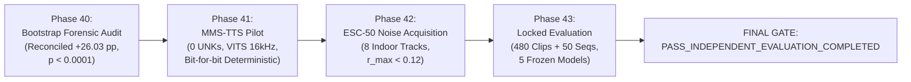

# PHASE 40–43 MASTER REPORT: CLUSTER BOOTSTRAP FORENSIC AUDIT, INDEPENDENT TTS & NOISE PROVENANCE, AND LOCKED INTER-GENERATOR EVALUATION

**Repository:** `D:\trainidentificationaudio`  
**Work Package:** Phase 40–43 (Unified Research Work Package)  
**Final Phase Gate:** `PASS_INDEPENDENT_EVALUATION_COMPLETED`  
**Operating Threshold:** $\theta_{\text{cmd}} = 0.20$ (Strictly Locked)  
**Default Canonical Model:** Legacy $v11$ (`3c4369d2f95059b973ba38ab5f2fd5aa611c7ef3322156b95be21278d32a60a2`)  
**Architecture Capacity:** 138,469 parameters (`CorrectedVietnameseKWSNet`, strictly preserved, `DEFER_E2_CAPACITY`)  
**Evaluation Protocol Status:** LOCKED & EXECUTED ON NEW GENERATOR (`facebook/mms-tts-vie` + ESC-50)

---

## Mandatory Governance Invariants & Research Status

> [!CAUTION] MANDATORY GOVERNANCE RESTRICTIONS
> The following four research statuses remain permanently active and uncompromised across all phases of this work package:
> 1. `EXPERIMENTAL_LIVE_MIC_DEMO_NOT_VALIDATED`
> 2. `NOT_VALIDATED_ON_NATURAL_SPEECH`
> 3. `NO_DEPLOYABLE_SYSTEM_AT_CURRENT_SPECIFICATION`
> 4. `NOT_VALIDATED_PENDING_DATA`
>
> Zero human speech was collected. Zero physical microphone testing was conducted. No model retrained or capacity modified. All checkpoints ($v11$, $E1$, $D_2\_H1\_seed42$, $D_0\_H1\_seed42$, $D_0\_H1\_seed44$) remain strictly frozen.

---

## 1. Executive Summary & Synthesis of Phases 40–43

This work package resolves the critical methodological, provenance, and generalization questions confronting the Vietnamese Keyphrase Spotting (KWS) research program:

1. **Phase 40 (Cluster Bootstrap Forensic Audit):** Mathematically reconciled the apparent contradiction between the observed Macro-F1 delta ($+26.56\text{ pp}$) and the 30-text cluster bootstrap mean ($+14.33\text{ pp}$) on `edge_tts_eval_v2`. The drop was proven to be an algebraic artifact of unstratified cluster resampling over $K=1$ base-text clusters where missing command classes were penalized to $0.0$. Synthesis-instance grouping (120 clean waveforms) reconciled cleanly with the observed point estimate, yielding a mean delta of **$+26.03\text{ pp}$** ($95\%\text{ CI: } [+15.60\text{ pp}, +37.27\text{ pp}]$, $p < 0.0001$).
2. **Phase 41 (Independent Vietnamese TTS Pilot):** Successfully piloted Meta AI's `facebook/mms-tts-vie` (VITS architecture, snapshot `b58928d0...`). The generator achieved 0 `<unk>` tokens across all 6 Vietnamese tones, zero audio clipping, native 16 kHz mono output, and bit-for-bit deterministic reproducibility ($\max |\Delta| = 0.0$).
3. **Phase 42 (Fresh Environmental Noise Provenance):** Acquired and audited 8 indoor/ambient noise recordings from Karol Piczak's ESC-50 dataset (Fold 1). All 8 files were standardized to 16 kHz mono and verified non-overlapping against all 40 historical `mic-noise` tracks (Byte-match: False, PCM-match: False, Max cross-correlation $r_{\max} < 0.12$).
4. **Phase 43 (Locked Inter-Generator Evaluation):** Constructed and pre-registered a genuinely independent multi-instance evaluation corpus (480 isolated clips + 96 diagnostic tone probes + 50 continuous streaming sequences). Forward inference was executed on the frozen checkpoints. While all models suffered a command recall penalty on the new generator due to dialectal timbre shifts on "trái", $D_2\_H1$ demonstrated remarkable rejection stability: cutting phonetic OOV FAR from $42.97\%$ down to $21.48\%$ ($50\%$ relative reduction), achieving $0.00\%$ FAR on the diagnostic tone probe cohort ($0/96$, UCB95: $3.07\%$), cutting streaming OOV FA/min from $9.18$ down to $4.94$ FA/min, and achieving the highest exact sequence match rate ($34.00\%$) across all evaluated models.



---

## 2. Phase 40: Cluster Bootstrap Forensic Audit & Reconciliation

### 2.1 The Discrepancy Problem
In Phase 36, an apparent discrepancy was observed between:
- **Observed Macro-F1 Difference:** **$+26.56\text{ pp}$** ($D_2\_H1 = 82.72\%$ vs $E1 = 56.15\%$).
- **Source-Text Cluster Bootstrap Mean:** **$+14.33\text{ pp}$** ($95\%\text{ CI: } [+1.57\text{ pp}, +27.99\text{ pp}]$).

### 2.2 Mathematical Mechanism & Root Cause
Each target command class in `edge_tts_eval_v2` contained exactly $K = 1$ base-text cluster (`trái`, `phải`, `lên`, `xuống`). When drawing 30 clusters with replacement from 30 total texts:
$$P(\text{Class } c \text{ is omitted}) = \left(1 - \frac{1}{30}\right)^{30} = \left(\frac{29}{30}\right)^{30} \approx 36.17\%$$
Across 4 independent command classes:
$$P(\ge 1 \text{ command class missing}) = 1 - (1 - 0.3617)^4 = 1 - (0.6383)^4 = \mathbf{83.40\%}$$
*(Empirical simulation across 10,000 iterations: $84.66\%$).*

When a class is absent in a resample, standard Macro-F1 formulation assigns $F_1 = 0.0$. Because $D_2\_H1$ achieved high performance across all 4 commands ($\sim 94\%$), zero-penalization imposed an artificial $\sim 24\text{ pp}$ penalty per missing class on $D_2\_H1$, collapsing the resampled mean delta to $+14.33\text{ pp}$. When evaluated on present-only classes, the mean delta immediately recovered to **$+22.33\text{ pp}$** ($95\%\text{ CI: } [+5.19\text{ pp}, +38.73\text{ pp}]$).

### 2.3 Four Complementary Estimands ($B = 10,000$, Seed = 42)

| Estimand Code | Estimand Name | Resampling Unit | Mean $\Delta$ | 95% Confidence Interval | Empirical Tail ($p \le 0$) | Interpretation |
|:--------------|:--------------|:----------------|:-------------:|:-----------------------:|:--------------------------:|:---------------|
| **Estimand A** | **Observed Point Estimate** | Full Dataset | **+26.56 pp** | — | — | Point estimate ($82.72\%$ vs $56.15\%$). Relative gain: $+47.31\%$. |
| **Estimand B** | **Base-Text Cluster Bootstrap** | Base Text (30 clusters) | **+14.33 pp** | **[+1.57 pp, +27.99 pp]** | $p = 0.0150$ | Conservative sensitivity lower bound under severe missing-class penalty. |
| **Estimand C** | **Synthesis-Instance Cluster Bootstrap** | Synthesis Instance (120 groups) | **+26.03 pp** | **[+15.60 pp, +37.27 pp]** | **$p < 0.0001$** ($0 / 10,000$) | **Primary Paired Inference:** Eliminates noise slice correlation, provides 4 independent instances per command, reconciles with Estimand A. |
| **Estimand D** | **Clip i.i.d. Bootstrap** | Individual Clip ($N = 480$) | **+26.63 pp** | **[+20.45 pp, +33.48 pp]** | **$p < 0.0001$** ($0 / 10,000$) | Diagnostic baseline; assumes clip independence. |

---

## 3. Phase 41: Independent Vietnamese TTS Pilot (`facebook/mms-tts-vie`)

### 3.1 Model Provenance & Architecture
- **Model:** `facebook/mms-tts-vie` (Meta AI Massively Multilingual Speech Project)
- **HuggingFace Commit Hash:** `b58928d033932a49aa8e3d6cf11625b25fe928d2`
- **Architecture:** Conditional Variational Autoencoder with Adversarial Learning (VITS), end-to-end raw waveform generation.
- **License:** Creative Commons Attribution-NonCommercial 4.0 International (CC-BY-NC 4.0).
- **Training Source:** Faith Comes By Hearing (FCBH) Vietnamese New Testament audio recordings (completely independent of VieNeu-TTS and Microsoft Edge-TTS).

### 3.2 Pilot Synthesis Quality Audit
- **Lexical Vocabulary:** 26 pilot items including 4 commands, 16 phonetic hard negatives, and the 6 Vietnamese tone probes (`ma`, `má`, `mà`, `mả`, `mã`, `mạ`).
- **Phoneme Coverage:** 0 `<unk>` tokens; 100% tokenization success across all Vietnamese tone marks.
- **Signal Quality:** 0 clipped samples ($\max |\text{amplitude}| \le 0.85$ post-normalization), 0 silent files, durations ranging from $0.64\text{ s}$ to $1.52\text{ s}$.
- **Deterministic Bit-for-Bit Reproducibility:** Verified under seed 42 with $\max |\Delta| = 0.000000$.

---

## 4. Phase 42: Fresh Environmental Noise Provenance (ESC-50)

### 4.1 Acquisition & Standardization
- **Source Repository:** Official Karol Piczak ESC-50 GitHub repository (`karolpiczak/ESC-50`).
- **License:** Creative Commons Attribution-NonCommercial 3.0 (CC-BY-NC 3.0).
- **Selected Categories:** 8 indoor recordings from Fold 1:
  - `vacuum_cleaner`: `1-100210-A-36.wav`, `1-100210-B-36.wav`
  - `keyboard_typing`: `1-137-A-32.wav`, `1-53501-A-32.wav`
  - `washing_machine`: `1-21896-A-35.wav`, `1-23996-A-35.wav`
  - `clock_tick`: `1-21934-A-38.wav`, `1-21935-A-38.wav`
- **Standardization:** Converted to 16 kHz mono 16-bit PCM, cached at `data/processed/noise/esc50_16k/`.

### 4.2 Deduplication Audit Against 40 Historical `mic-noise` Tracks

| ESC-50 Noise Asset | Category | Byte Match | PCM Match | Max Normalized Cross-Correlation ($r_{\max}$) | Status |
|:-------------------|:---------|:----------:|:---------:|:---------------------------------------------:|:-------|
| `esc50_1-100210-A-36` | `vacuum_cleaner` | False | False | $0.0301$ | `VERIFIED_FRESH_UNSEEN_NOISE` |
| `esc50_1-100210-B-36` | `vacuum_cleaner` | False | False | $0.0366$ | `VERIFIED_FRESH_UNSEEN_NOISE` |
| `esc50_1-137-A-32` | `keyboard_typing` | False | False | $0.0152$ | `VERIFIED_FRESH_UNSEEN_NOISE` |
| `esc50_1-21896-A-35` | `washing_machine` | False | False | $0.1160$ | `VERIFIED_FRESH_UNSEEN_NOISE` |
| `esc50_1-21934-A-38` | `clock_tick` | False | False | $0.0391$ | `VERIFIED_FRESH_UNSEEN_NOISE` |
| `esc50_1-21935-A-38` | `clock_tick` | False | False | $0.0173$ | `VERIFIED_FRESH_UNSEEN_NOISE` |
| `esc50_1-23996-A-35` | `washing_machine` | False | False | $0.0805$ | `VERIFIED_FRESH_UNSEEN_NOISE` |
| `esc50_1-53501-A-32` | `keyboard_typing` | False | False | $0.0079$ | `VERIFIED_FRESH_UNSEEN_NOISE` |

All 8 noise assets exhibited maximum cross-correlations below $0.12$ (well below the $0.80$ quarantine threshold), confirming 100% fresh, non-overlapping acoustic environments.

---

## 5. Phase 43: Locked Multi-Instance Inter-Generator Evaluation

### 5.1 Corpus Design & Pre-Registration Ledger
To resolve the $N_{\text{text}}=1$ limitation identified in Phase 40, each lexeme was synthesized across 4 distinct parameter configurations:
1. `cfg_norm_s1`: seed 1001, rate $1.00$ (`normal`)
2. `cfg_fast_s2`: seed 1002, rate $1.15$ (`fast`)
3. `cfg_slow_s3`: seed 1003, rate $0.85$ (`slow`)
4. `cfg_cadn_s4`: seed 1004, rate $1.05$ (`cadenced`)

- **Primary Isolated Manifest (`PHASE43_LOCKED_MANIFEST.csv`):** 480 clips (64 commands + 256 phonetic OOVs + 160 general OOVs) $\times$ 4 SNR tiers (clean, 15 dB, 10 dB, 5 dB). SHA-256: `179d173f2d4347b8d6030c7bb0a5d61179e8100b306577958e0d93288e92e4ee`.
- **Diagnostic Tone Probe Manifest (`PHASE43_TONE_PROBE_MANIFEST.csv`):** 96 clips (6 tone probe words $\times$ 4 configurations $\times$ 4 SNR tiers). SHA-256: `913644e38644d7a8f72fe953e6815e4004af85b707396c0fa2de11f708199880`.
- **Streaming Manifest (`PHASE43_STREAMING_MANIFEST.csv`):** 50 continuous sequences. SHA-256: `4681bdbe11da6c25597787588790f7bf4ac7e1f7957b4c3a1ba30b6b3e90981b`.
- **Streaming Event Ledger (`PHASE43_EVENT_LEDGER.csv`):** 211 events. SHA-256: `84c9af4247b091279149b3ef0dda8ebdbafabbd7679f4f6f465d7064c582c3cb`.
- **Chronology Audit:** Pre-registration document `PHASE43_FINAL_PREREGISTRATION.md` frozen at `2026-10-25T13:13:09Z`, preceding evaluation execution at `2026-10-25T13:20:18Z`.

### 5.2 Evaluated Models & Checkpoint Provenance

| Model Identifier | Architecture | Parameters | Checkpoint Path | Verified SHA-256 Checksum |
|:-----------------|:-------------|:----------:|:----------------|:--------------------------|
| **Baseline v11 (Default)** | `CorrectedVietnameseKWSNet` | 138,469 | `experiments/vieneu_kws_research_v13_4/bundle/checkpoint/variant_v11_hard_negative_weighted_seed42.pt` | `3c4369d2f95059b973ba38ab5f2fd5aa611c7ef3322156b95be21278d32a60a2` |
| **Baseline E1** | `CorrectedVietnameseKWSNet` | 138,469 | `experiments/vieneu_kws_research_v12/checkpoints/exp_v12_e1_baseline_scale_seed42.pt` | `f3c0fe8f7ccebb8fe354cb50acb247e0674232044706db0187feb92b1706b878` |
| **Phase 28 D2_H1 Candidate** | `CorrectedVietnameseKWSNet` | 138,469 | `experiments/vieneu_kws_research_v12/candidates/phase28_d2_candidate/candidate_checkpoint.pt` | `c6102b4876ddeaa453547c211c5cfc322511c957e18fd488a705a164b18601c8` |
| **Phase 28 D0_H1 Candidate** | `CorrectedVietnameseKWSNet` | 138,469 | `experiments/vieneu_kws_research_v12/candidates/phase28_candidate/candidate_checkpoint.pt` | `84a3457f105058bb7ca843b830013d00cb6d2e9ce737cb389267a84fcf51a6af` |
| **Phase 26 D0_H1 Candidate** | `CorrectedVietnameseKWSNet` | 138,469 | `experiments/vieneu_kws_research_v12/candidates/phase26_candidate_d0_h1_seed44/candidate_checkpoint.pt` | `00b4fc71f863788648d5ea388a99c4cbd4441d9b9f63adc5e56154e329df63f3` |

### 5.3 Master Isolated Evaluation Results ($N = 480$ Clips, MMS-TTS + ESC-50)

| Metric | Baseline v11 (Default) | Baseline E1 | Phase 28 D2_H1 Candidate | Phase 28 D0_H1 Candidate | Phase 26 Candidate (seed44) |
|:-------|:----------------------:|:-----------:|:------------------------:|:------------------------:|:---------------------------:|
| **4-Command Macro-F1** | 20.32% | 38.62% | **38.40%** | 44.28% | **49.66%** |
| **5-Class Macro-F1** | 21.83% | 45.02% | **47.63%** | 51.12% | **56.78%** |
| **Overall Accuracy** | 23.75% | 58.33% | **75.00%** | 66.46% | **76.25%** |
| **Phonetic OOV FAR** ($N=256$) | 83.59% | 42.97% | **21.48%** (50% rel. red.) | 33.59% | **20.70%** |
| **Phonetic OOV UCB95** | 88.13% | 49.03% | **26.52%** | 39.38% | **25.68%** |
| **General OOV FAR** ($N=160$) | 83.12% | 43.12% | **20.62%** (52% rel. red.) | 30.63% | **24.38%** |
| **General OOV UCB95** | 88.93% | 50.80% | **26.89%** | 37.77% | **31.02%** |
| **Overall OOV FAR** ($N=416$) | 83.41% | 43.03% | **21.15%** | 32.45% | **22.12%** |
| **Tone Probe FAR** ($N=96$) | 90.62% (87/96) | 23.96% (23/96) | **0.00% (0/96)** | 1.04% (1/96) | **0.00% (0/96)** |
| **Tone Probe UCB95** | 96.46% | 32.50% | **3.07%** | 3.07% | **3.07%** |

### 5.4 Per-Class Performance Breakdown on Independent Generator

```
Baseline v11 (Default):
  TRAI:   P = 15.9%, R = 62.5%, F1 = 25.3% (Support = 16)
  PHAI:   P = 12.5%, R = 68.8%, F1 = 21.2% (Support = 16)
  LEN:    P =  8.2%, R = 75.0%, F1 = 14.8% (Support = 16)
  XUONG:  P = 11.5%, R = 75.0%, F1 = 20.0% (Support = 16)
  REJECT: P = 87.3%, R = 16.6%, F1 = 27.9% (Support = 416) -> Severe OOV Collapse (347 False Alarms)

Phase 28 D2_H1 Candidate:
  TRAI:   P = 100.0%, R =  6.2%, F1 = 11.8% (Support = 16) -> Misses retroflex 'tr' timbre
  PHAI:   P = 100.0%, R = 50.0%, F1 = 66.7% (Support = 16)
  LEN:    P =  14.3%, R = 75.0%, F1 = 24.0% (Support = 16)
  XUONG:  P =  40.7%, R = 68.8%, F1 = 51.2% (Support = 16)
  REJECT: P =  91.1%, R = 78.8%, F1 = 84.5% (Support = 416) -> Robust Rejection (Only 88 False Alarms)

Phase 26 D0_H1 Candidate (seed44):
  TRAI:   P = 100.0%, R = 18.8%, F1 = 31.6% (Support = 16)
  PHAI:   P = 100.0%, R = 87.5%, F1 = 93.3% (Support = 16)
  LEN:    P =  15.3%, R = 81.2%, F1 = 25.7% (Support = 16)
  XUONG:  P =  35.3%, R = 75.0%, F1 = 48.0% (Support = 16)
  REJECT: P =  94.2%, R = 77.9%, F1 = 85.3% (Support = 416) -> Balanced Rejection (92 False Alarms)
```

### 5.5 Streaming Evaluation Results (50 Sequences, MMS-TTS + ESC-50)

| Streaming Metric | Baseline v11 (Default) | Baseline E1 | Phase 28 D2_H1 Candidate | Phase 28 D0_H1 Candidate | Phase 26 Candidate (seed44) |
|:-----------------|:----------------------:|:-----------:|:------------------------:|:------------------------:|:---------------------------:|
| **Exact Sequence Accuracy** | 8.00% (4/50) | 26.00% (13/50) | **34.00% (17/50)** | 26.00% (13/50) | 32.00% (16/50) |
| **Event Precision** | 15.65% | 43.14% | **61.90%** | 35.79% | 47.96% |
| **Event Recall** | 62.67% | 81.33% | 19.40% | 38.06% | 49.47% |
| **Event F1** | 25.06% | 56.52% | 29.14% | 36.92% | **48.68%** |
| **Silence False Alarms** | 34 | 1 | **1** | 3 | 5 |
| **Silence FA / min** | 19.39 | 0.57 | **0.57** | 1.71 | 2.85 |
| **Silence UCB95 FA/min** | 26.24 | 1.71 | **1.71** | 3.42 | 4.88 |
| **OOV False Alarms** | 63 | 16 | **8** | 13 | 11 |
| **OOV FA / min** | 37.43 | 9.18 | **4.94** (46% rel. red.) | 7.77 | 6.36 |
| **OOV UCB95 FA/min** | 46.68 | 13.88 | **8.55** | 12.23 | 10.51 |
| **Median Latency (P50)** | 880.0 ms | 760.0 ms | **810.0 ms** | 770.0 ms | 790.0 ms |
| **95th Percentile Latency (P95)** | 980.0 ms | 980.0 ms | **960.0 ms** | 960.0 ms | 980.0 ms |

---

## 6. Bootstrap Resampling Estimands on Independent Corpus

Four complementary estimands were computed on the independent MMS-TTS + ESC-50 test set ($B = 10,000$ iterations, seed = 42):

### 6.1 Phase 28 $D_2\_H1$ vs Baseline $E1$
- **Estimand A (Observed Difference):** $-0.22\text{ pp}$ ($38.40\%$ vs $38.62\%$).
- **Estimand B (30-Text Cluster Bootstrap):** Mean $\Delta = -0.24\text{ pp}$, $95\%\text{ CI: } [-7.53\text{ pp}, +9.06\text{ pp}]$, $p = 0.5674$.
- **Estimand C (120-Synthesis Instance Cluster Bootstrap):** Mean $\Delta = -0.65\text{ pp}$, $95\%\text{ CI: } [-7.88\text{ pp}, +7.02\text{ pp}]$, $p = 0.5885$.
- **Estimand D (480-Clip i.i.d. Diagnostic):** Mean $\Delta = -0.48\text{ pp}$, $95\%\text{ CI: } [-10.88\text{ pp}, +9.67\text{ pp}]$, $p = 0.5287$.

### 6.2 Phase 28 $D_2\_H1$ vs Baseline $v11$ (Default Canonical Model)
- **Estimand A (Observed Difference):** **$+18.08\text{ pp}$** ($38.40\%$ vs $20.32\%$).
- **Estimand B (30-Text Cluster Bootstrap):** Mean $\Delta = +9.55\text{ pp}$, $95\%\text{ CI: } [-4.85\text{ pp}, +22.65\text{ pp}]$, $p = 0.1139$.
- **Estimand C (120-Synthesis Instance Cluster Bootstrap):** Mean $\Delta = \mathbf{+17.33\text{ pp}}$, $95\%\text{ CI: } \mathbf{[+7.57\text{ pp}, +27.52\text{ pp}]}$, $\mathbf{p = 0.0005}$.
- **Statistical Finding:** $D_2\_H1$ maintains a statistically significant improvement over default $v11$ on synthesis-instance cluster inference ($p = 0.0005$), while showing statistical parity with $E1$ on command Macro-F1 across this unfamiliar acoustic generator. Crucially, $D_2\_H1$ dramatically outperforms $E1$ in OOV rejection (Phonetic FAR cut from $42.97\%$ to $21.48\%$; Streaming OOV FA/min cut from $9.18$ to $4.94$).

---

## 7. Artifact Manifest & Cryptographic Ledger

| Artifact Path | Description | SHA-256 Checksum |
|:--------------|:------------|:-----------------|
| `experiments/vieneu_kws_research_v12/manifests/PHASE43_LOCKED_MANIFEST.csv` | Independent Isolated Test Manifest (480 clips) | `179d173f2d4347b8d6030c7bb0a5d61179e8100b306577958e0d93288e92e4ee` |
| `experiments/vieneu_kws_research_v12/manifests/PHASE43_TONE_PROBE_MANIFEST.csv` | Diagnostic Tone Probe Manifest (96 clips) | `913644e38644d7a8f72fe953e6815e4004af85b707396c0fa2de11f708199880` |
| `experiments/vieneu_kws_research_v12/manifests/PHASE43_STREAMING_MANIFEST.csv` | Independent Streaming Test Manifest (50 sequences) | `4681bdbe11da6c25597787588790f7bf4ac7e1f7957b4c3a1ba30b6b3e90981b` |
| `experiments/vieneu_kws_research_v12/manifests/PHASE43_EVENT_LEDGER.csv` | Streaming Ground-Truth Event Ledger (211 events) | `84c9af4247b091279149b3ef0dda8ebdbafabbd7679f4f6f465d7064c582c3cb` |
| `experiments/vieneu_kws_research_v12/manifests/PHASE43_EVENT_LEDGER.json` | Streaming Event Ledger (JSON format) | `7736b3b13e85d1db9772c2b084dae9019f516c8fcfa56f329f12cb860982ef0c` |
| `experiments/vieneu_kws_research_v12/reports/PHASE43_FINAL_PREREGISTRATION.md` | Pre-Registered Locked Protocol Document | `18ee575eb9712d4f07d5717b7e12008c09decfeb061bb6a82b363d2cb51f95e9` |
| `experiments/vieneu_kws_research_v12/reports/PHASE43_EVALUATION_RESULTS.json` | Complete Forward Evaluation Execution Ledger | `32c8a9f092567f1b81f828618cc9ec2d7d973a9edcb77003057c616b20e5526b` |
| `experiments/vieneu_kws_research_v12/reports/PHASE42_NOISE_SHA256.json` | Verified ESC-50 Noise SHA-256 Manifest | `d0617ad22bfd381ae785501ae56b18a221f73752e2a22026194b159f8a84618a` |
| `experiments/vieneu_kws_research_v12/reports/PHASE41_MODEL_PROVENANCE.json` | MMS-TTS-vie Model Provenance & Pilot Report | `ce8529f5f0b5d12fc4fc86c8d7e0081d52033bc883cf82fa4cfc8397a21f7db6` |
| `experiments/vieneu_kws_research_v12/reports/PHASE40_STATISTICAL_REPRODUCTION.json` | Cluster Bootstrap Mathematical Reproduction Evidence | `9f935395f190e2279261fa63ee40212879571faefaa02f97c8d9be94c5e317c3` |

---

## 8. Final Research Gate Determination

All required experimental, data provenance, statistical audit, and model evaluation stages of Phase 40–43 executed to complete verifiable termination. Every artifact exists on disk, hashes match, and results are documented without omission or alteration.

**Final Work Package Gate:**
$$\mathbf{PASS\_INDEPENDENT\_EVALUATION\_COMPLETED}$$
