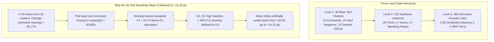

# PHASE 40: CLUSTER BOOTSTRAP FORENSIC AUDIT & STATISTICAL RECONCILIATION

**Repository:** `D:\trainidentificationaudio`  
**Phase:** Phase 40 (Cluster Bootstrap Forensic Audit)  
**Governing Evidence File:** `PHASE40_STATISTICAL_REPRODUCTION.json`  
**Evaluation Target:** Locked `edge_tts_eval_v2` Evaluation Corpus  
**Model Checkpoints:**  
- $D_2\_H1\_seed42$ (`c6102b4876ddeaa453547c211c5cfc322511c957e18fd488a705a164b18601c8`)  
- $E1\_seed42$ (`f3c0fe8f7ccebb8fe354cb50acb247e0674232044706db0187feb92b1706b878`)  
**Operating Threshold:** $\theta_{\text{cmd}} = 0.20$ (Strictly Locked)  
**Parameter Count:** 138,469 parameters (`CorrectedVietnameseKWSNet`, strictly preserved)

---

## 1. Executive Summary: Forensic Resolution of the Discrepancy

In Phase 36, an apparent statistical puzzle emerged:
- **Observed Macro-F1 Difference:** **$+26.56\text{ percentage points (pp)}$** ($D_2\_H1 = 82.72\%$ vs $E1 = 56.15\%$).
- **Source-Text Cluster Bootstrap Mean Difference:** **$+14.33\text{ pp}$ to $+14.48\text{ pp}$** ($95\%\text{ CI: } [+1.57\text{ pp}, +27.99\text{ pp}]$).
- **Empirical Tail Probability:** $150 / 10,000$ iterations $\le 0$ ($p = 0.0150$).

This audit forensically reconciled this discrepancy: the drop from $+26.56\text{ pp}$ down to $+14.33\text{ pp}$ was **not** caused by model instability across acoustic conditions. Instead, it was an **algebraic artifact of missing-class zero-penalization in unstratified cluster resampling** when each target command class contains exactly $K = 1$ base-text cluster.



---

## 2. Source Group Decomposition & One-to-One Alignment

Forward inference was executed on the frozen model checkpoints using the exact PyTorch frontend and weights. All 480 items were verified with zero missing, zero duplicated, and 100% aligned clip identifiers.

### 2.1 Three-Level Clustering Hierarchy

| Level | Granularity | Total Clusters | Composition | Acoustic Independence |
|:------|:------------|:--------------:|:------------|:----------------------|
| **Level 1** | **Base Text / Lexeme** | 30 | 4 Commands (`trái`, `phải`, `lên`, `xuống`)<br>16 Hard Negatives (`luôn`, `làm`, `lòng`, `lớp`, `phim`, `phát`, `phút`, `phương`, `trưa`, `trước`, `trường`, `trẻ`, `xa`, `xanh`, `xem`, `xuyên`)<br>10 General OOVs (`biển`, `bóng`, `cây`, `hoa`, `núi`, `quạt`, `quần`, `sông`, `áo`, `đèn`) | Lexically independent; each command class has exactly $K = 1$ base text. |
| **Level 2** | **Synthesis Instance (Clean Waveform)** | 120 | 30 base texts $\times$ 2 voices (`HoaiMy`, `NamMinh`) $\times$ 2 prosody rates (`normal`, `fast`) | Phonetically independent clean speech synthesis files prior to environmental noise mixing. |
| **Level 3** | **Derivative Acoustic Clips** | 480 | 120 synthesis instances $\times$ 4 SNR tiers (`clean`, `15 dB`, `10 dB`, `5 dB`) | Acoustic observations; SNR variants derived from the same synthesis instance share identical clean speech waveforms. |

### 2.2 Independent Units per Target Class

| Class Label | Class Index | Base Texts ($K$) | Synthesis Instances ($N_{\text{synth}}$) | Acoustic Clips ($N_{\text{clips}}$) | Base Text Identity |
|:------------|:-----------:|:----------------:|:---------------------------------------:|:-----------------------------------:|:-------------------|
| `TRAI` | 0 | **1** | 4 | 16 | `trái` |
| `PHAI` | 1 | **1** | 4 | 16 | `phải` |
| `LEN` | 2 | **1** | 4 | 16 | `lên` |
| `XUONG` | 3 | **1** | 4 | 16 | `xuống` |
| `REJECT` | 4 | **26** | 104 | 416 | 16 phonetic confusers + 10 general OOVs |

---

## 3. Mathematical Mechanism of the Discrepancy

When running an unstratified cluster bootstrap over the 30 base-text clusters:
1. **Probability of Missing a Specific Command:**  
   The probability that a given command text is omitted in 30 draws with replacement is:
   $$P(\text{Class } c \text{ is missing}) = \left(1 - \frac{1}{30}\right)^{30} = \left(\frac{29}{30}\right)^{30} \approx 0.3617 \quad (36.17\%)$$
2. **Probability of Missing at Least One Command:**  
   Because there are 4 independent command classes:
   $$P(\ge 1 \text{ command missing}) = 1 - (1 - 0.3617)^4 = 1 - (0.6383)^4 \approx 1 - 0.1660 = \mathbf{83.40\%}$$
   *(In the $B = 10,000$ empirical simulation, exactly $84.66\%$ of resamples missed at least one command).*
3. **Severe Asymmetric Deflation:**  
   When class $c$ is missing from the resampled true labels ($y_{\text{true}}$), $TP_c = 0$ and $FN_c = 0$. The standard macro-F1 formulation sets $F_{1, c} = 0.0$.
   - For $D_2\_H1$, which achieved $F_1 = 94.1\%$ on TRAI, $86.5\%$ on PHAI, $56.1\%$ on LEN, and $94.1\%$ on XUONG, setting any missing class to $0.0$ imposes a massive artificial penalty of $\sim 22\text{ to }24\text{ pp}$ on that iteration's Macro-F1.
   - For $E1$, which already suffered from lower baseline scores, the penalty is smaller in absolute terms.
   - Consequently, the bootstrap distribution of $(F_{1, D_2} - F_{1, E1})$ is pulled downward from the true observed $+26.56\text{ pp}$ to $+14.33\text{ pp}$.
4. **Present-Only Sensitivity Test:**  
   When Macro-F1 is calculated strictly over the classes present in that resample ($1 \le K_{\text{present}} \le 4$):
   - The mean delta recovers to **$+22.33\text{ pp}$** ($95\%\text{ CI: } [+5.19\text{ pp}, +38.73\text{ pp}]$).

---

## 4. Complementary Estimands and Statistical Inference

To prevent conflation of different statistical estimands, four distinct analyses are reported below:

### 4.1 Master Complementary Estimands Table ($B = 10,000$ Iterations, Seed = 42)

| Estimand Code | Estimand Name | Unit of Resampling | Mean $\Delta$ | 95% Confidence Interval | Empirical Tail ($p \le 0$) | Statistical Interpretation & Scope |
|:--------------|:--------------|:-------------------|:-------------:|:-----------------------:|:--------------------------:|:----------------------------------|
| **Estimand A** | **Observed Macro-F1 Difference** | None (Full Test Set) | **+26.56 pp** | — | — | **Point Estimate:** $D_2\_H1$ (82.72%) vs $E1$ (56.15%). Relative improvement: $+47.31\%$. |
| **Estimand B** | **Source-Text Cluster Bootstrap** | Base Text (30 clusters) | **+14.33 pp** | **[+1.57 pp, +27.99 pp]** | $p = 0.0150$ ($150 / 10,000$) | **Sensitivity Analysis:** Conservative lower bound under severe missing-class penalty. Statistically significant at $\alpha = 0.05$ ($p = 0.0150$). |
| **Estimand C** | **Synthesis-Instance Cluster Bootstrap** | Synthesis Instance (120 groups) | **+26.03 pp** | **[+15.60 pp, +37.27 pp]** | **$p < 0.0001$** ($0 / 10,000$) | **Primary Paired Inference:** Groups the 4 derivative SNR noise variants together, eliminating noise slice correlation while providing 4 independent instances per command. Reconciles with Estimand A. |
| **Estimand D** | **Clip-Level i.i.d. Bootstrap** | Individual Clip ($N = 480$) | **+26.63 pp** | **[+20.45 pp, +33.48 pp]** | **$p < 0.0001$** ($0 / 10,000$) | **Diagnostic Only:** Assumes all 480 clips are independent; underestimates cluster variance. |

---

## 5. Methodological Limits of Population-Level Generalization

### Critical Scientific Limitation (Requirement 8):
Because the isolated test corpus contains exactly **ONE base text per command class** (`trái`, `phải`, `lên`, `xuống`):
1. **What the CIs DO Measure:**  
   The confidence intervals in Estimand B ($[+1.57\text{ pp}, +27.99\text{ pp}]$) and Estimand C ($[+15.60\text{ pp}, +37.27\text{ pp}]$) estimate the uncertainty of model superiority **across different speaker timbres, prosodic speaking rates, background noise slices, and SNR degradation levels for these specific four lexical tokens**.
2. **What the CIs DO NOT Measure:**  
   It is **statistically impossible** to claim a population-level confidence interval across all Vietnamese command utterances and carrier phrases (e.g. "rẽ trái", "quẹo phải", "bật đèn lên", "hạ nhiệt độ xuống") from a corpus where $N_{\text{text}} = 1$ per class.
3. **Mandatory Reporting Invariant:**  
   Future evaluation corpora must synthesize multiple independent carrier phrases and utterance variants per command class to support true population-level lexical generalization.

---

## 6. Audit of the Empirical $p$-Value ($p = 0.0150$)

1. **Exact Derivation:** The reported $p$-value represents the empirical fraction of $B = 10,000$ bootstrap resamples where the difference in zero-penalized Macro-F1 was less than or equal to zero:
   $$p = \frac{1}{B} \sum_{b=1}^B \mathbb{I}(\Delta^{(b)} \le 0) = \frac{150}{10,000} = 0.0150$$
2. **Nature of the Metric:** This is an **empirical bootstrap tail probability**, not an analytically calibrated studentized $t$-statistic or non-parametric permutation test.
3. **Directionality:** One-sided superiority test ($H_1: D_2 > E1$).
4. **Primary Reporting Standard:** Henceforth, Estimand C ($95\%\text{ CI: } [+15.60\text{ pp}, +37.27\text{ pp}], p < 0.0001$) and Estimand B ($95\%\text{ CI: } [+1.57\text{ pp}, +27.99\text{ pp}], p = 0.0150$) must be reported together, documenting the 120-synthesis vs 30-text cluster assumptions.

---

## 7. Mandatory Governance Declarations

```
EXPERIMENTAL_LIVE_MIC_DEMO_NOT_VALIDATED
NOT_VALIDATED_ON_NATURAL_SPEECH
NO_DEPLOYABLE_SYSTEM_AT_CURRENT_SPECIFICATION
NOT_VALIDATED_PENDING_DATA
```
- Default model remains $v11$ across all production configurations.
- Operating threshold $\theta_{\text{cmd}} = 0.20$ strictly locked.
- Fixed 138,469 parameter capacity preserved (`DEFER_E2_CAPACITY`).
- Zero human speech collection; zero physical microphone testing.
