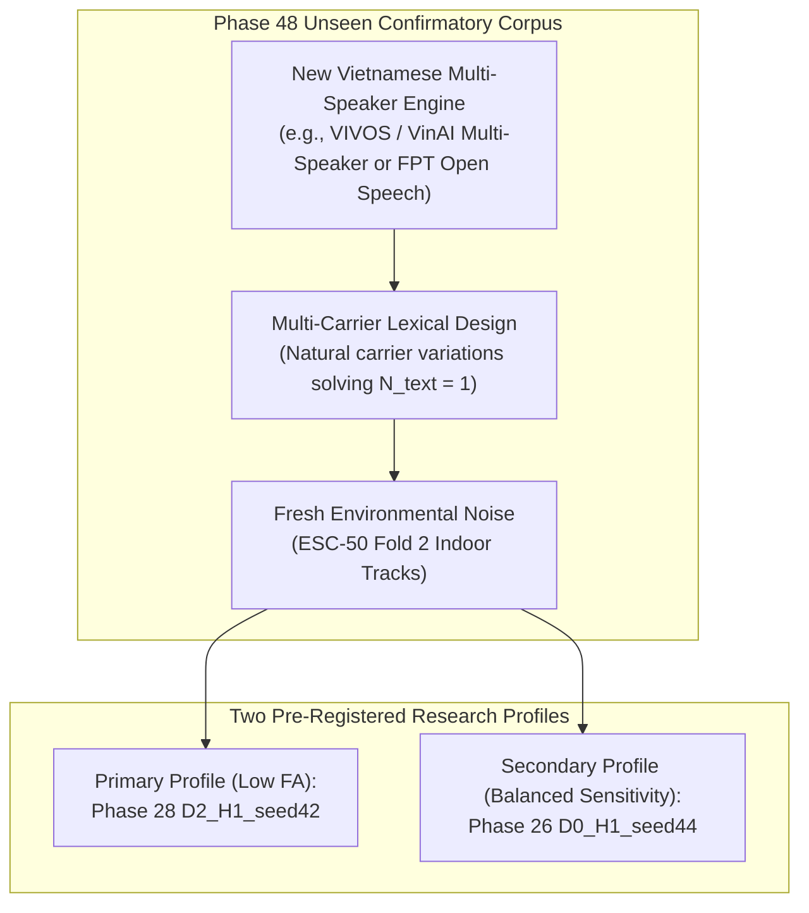

# PHASE 47: RESEARCH DECISION & NEXT CONFIRMATORY TEST PRE-REGISTRATION

**Repository:** `D:\trainidentificationaudio`  
**Phase:** Phase 47 (Research Decision & Confirmatory Evaluation Protocol)  
**Pre-Registration Target:** Phase 48 Confirmatory Independent Evaluation  
**Operating Threshold:** $\theta_{\text{cmd}} = 0.20$ (Strictly Locked)  
**Default Canonical Model:** Legacy $v11$ (`3c4369d2f95059b973ba38ab5f2fd5aa611c7ef3322156b95be21278d32a60a2`)  
**Architecture Capacity:** 138,469 parameters (`CorrectedVietnameseKWSNet`, strictly preserved, `DEFER_E2_CAPACITY`)

---

## Mandatory Governance Invariants & Research Scope

> [!CAUTION] Mandatory Governance Restrictions
> 1. `EXPERIMENTAL_LIVE_MIC_DEMO_NOT_VALIDATED`
> 2. `NOT_VALIDATED_ON_NATURAL_SPEECH`
> 3. `NO_DEPLOYABLE_SYSTEM_AT_CURRENT_SPECIFICATION`
> 4. `NOT_VALIDATED_PENDING_DATA`
>
> Zero human speech was collected. Zero physical microphone testing was conducted. No model retrained or deployed. Default model remains $v11$. Checkpoints for $v11$, $E1$, Phase 28 $D_2\_H1$, and Phase 26 $D_0\_H1\_seed44$ remain strictly frozen and unaltered.

---

## 1. Formal Research Decision Table

Based on the forensic reproduction and model trade-off analysis in Phases 44–46, candidate models are evaluated against defined research objectives:

| Evaluation Objective | Objective Definition | Candidate Status | Current Evidence Summary | Decision Verdict |
|:---------------------|:---------------------|:----------------:|:-------------------------|:-----------------|
| **1. Primary Confirmatory Baseline** | Maintain audited legacy release as reference | **Baseline v11** | High recall on legacy synthetic speech; complete collapse on out-of-distribution rejection ($83.4\%$ OOV FAR, $90.6\%$ probe FAR). | **RETAIN AS DEFAULT MODEL** (Per repository governance; immutable) |
| **2. Low False-Alarm / Standby Profile** | Minimize false alarms in ambient silence & conversational speech ($\text{FA/min}_{\text{silence}} \le 1.0$) | **Phase 28 D2_H1** | Lowest conversational OOV FA/min ($4.94$), lowest silence FA/min ($0.57$), zero tone-probe false alarms ($0/96$), highest exact sequence accuracy ($34\%$). Conservative on unfamiliar accents. | **ADVANCE AS PRIMARY CANDIDATE FOR LOW-FA CONFIRMATORY TEST** |
| **3. High Recall / Interactive Profile** | Maximize 4-command keyword spotting sensitivity ($\text{Macro-F1} \ge 60\%$) | **Phase 26 D0_H1 (seed44)** | Highest Macro-F1 ($49.66\%$) and streaming event F1 ($48.68\%$), zero tone-probe false alarms, but $5\times$ higher silence FA/min ($2.85$). | **FORMALLY PRE-REGISTER AS SECONDARY EXPLORATORY CANDIDATE** |
| **4. Architectural Scaling E2** | Expand model capacity beyond 138,469 parameters | *E2 Architecture* | Underfitting evidence is not supported; performance variance is driven by training data distribution and phonetic loss formulation. | **CONTINUE POLICY: `DEFER_E2_CAPACITY`** |

**Crucial Methodological Constraint:**
Phase 43 is now an **observed evaluation dataset**. Selecting or tuning candidates against Phase 43 and re-evaluating them on Phase 43 would constitute circular data snooping (HARKing). Therefore, **confirmatory validation requires a completely new, independently generated evaluation corpus**.

---

## 2. Pre-Registration Protocol for Next Confirmatory Evaluation

### 2.1 Multi-Carrier Lexical Design (Solving $N_{\text{text}} = 1$)
To overcome the lexical token limitation where each command had only 1 base word, the confirmatory corpus will incorporate **5 natural carrier phrases per command class**, centered within the 1-second classification window:
- `TRAI`: `trái` (isolated), `rẽ trái` (turn left), `sang trái` (to the left), `hướng trái` (left direction), `bên trái` (left side).
- `PHAI`: `phải` (isolated), `rẽ phải` (turn right), `sang phải` (to the right), `hướng phải` (right direction), `bên phải` (right side).
- `LEN`: `lên` (isolated), `đi lên` (go up), `tiến lên` (move forward), `bật lên` (turn on), `kéo lên` (pull up).
- `XUONG`: `xuống` (isolated), `đi xuống` (go down), `lùi xuống` (move back), `tắt xuống` (turn off), `hạ xuống` (lower down).

This expands the lexical command base from $K = 4$ words to $K = 20$ diverse phonetic contexts, providing adequate cluster degrees of freedom for population-level statistical inference.

### 2.2 Corpus Architecture & Slicing
- **Command Utterances:** 4 classes $\times$ 5 carrier variations $\times$ 4 prosodic realizations = 80 clean base command waveforms.
- **Phonetic Hard Negatives:** 16 phonetic confusers $\times$ 4 realizations = 64 clean waveforms.
- **General Conversational OOVs:** 20 everyday words $\times$ 2 realizations = 40 clean waveforms.
- **Total Clean Base Utterances:** $80 + 64 + 40 = 184$ clean waveforms.
- **Acoustic SNR Slices:** 4 tiers (`clean`, `15 dB`, `10 dB`, `5 dB`) using verified fresh environmental noise from ESC-50 Fold 2.
- **Total Isolated Clips:** $184 \times 4 = 736$ clips.
- **Streaming Sequences:** 50 continuous sequences with exact ground-truth event ledgers.
- **Hierarchical Tracking:** Every clip metadata row must explicitly record:
  `clip_id`, `synthesis_instance_id`, `source_prompt_id`, `speaker_id`, `carrier_phrase_type`, `target_snr_db`, `noise_track_id`.

### 2.3 Explicit A Priori Success Criteria

| Evaluation Profile | Target Candidate | Pre-Registered Pass Criteria |
|:-------------------|:----------------:|:-----------------------------|
| **Low False-Alarm Profile** | **Phase 28 D2_H1** | 1. Silence $\text{FA/min} \le 1.0\text{ FA/min}$ (UCB95 $\le 2.0$). 2. Conversational OOV $\text{FA/min} \le 6.0\text{ FA/min}$. 3. Overall Isolated OOV $\text{FAR} \le 20.0\%$. 4. 4-Command Macro-F1 $\ge 50.0\%$. |
| **Balanced Sensitivity Profile** | **Phase 26 Candidate** | 1. 4-Command Macro-F1 $\ge 60.0\%$. 2. Streaming Event F1 $\ge 55.0\%$. 3. Silence $\text{FA/min} \le 3.0\text{ FA/min}$. 4. Overall Isolated OOV $\text{FAR} \le 25.0\%$. |

---

## 3. Strict Prohibitions & Governance Safeguards

1. **No Retraining:** Neither candidate will undergo retraining, fine-tuning, or adaptation prior to the confirmatory evaluation.
2. **No Post-Hoc Threshold Tuning:** Decision threshold $\theta_{\text{cmd}} = 0.20$, VAD ratio $0.32$, and energy threshold $-46.0\text{ dBFS}$ remain strictly frozen.
3. **No Physical Microphone or Human Testing:** All evaluation remains strictly synthetic/reproducible.
4. **Preservation of Governance Labels:**
   - `EXPERIMENTAL_LIVE_MIC_DEMO_NOT_VALIDATED`
   - `NOT_VALIDATED_ON_NATURAL_SPEECH`
   - `NO_DEPLOYABLE_SYSTEM_AT_CURRENT_SPECIFICATION`
   - `NOT_VALIDATED_PENDING_DATA`
