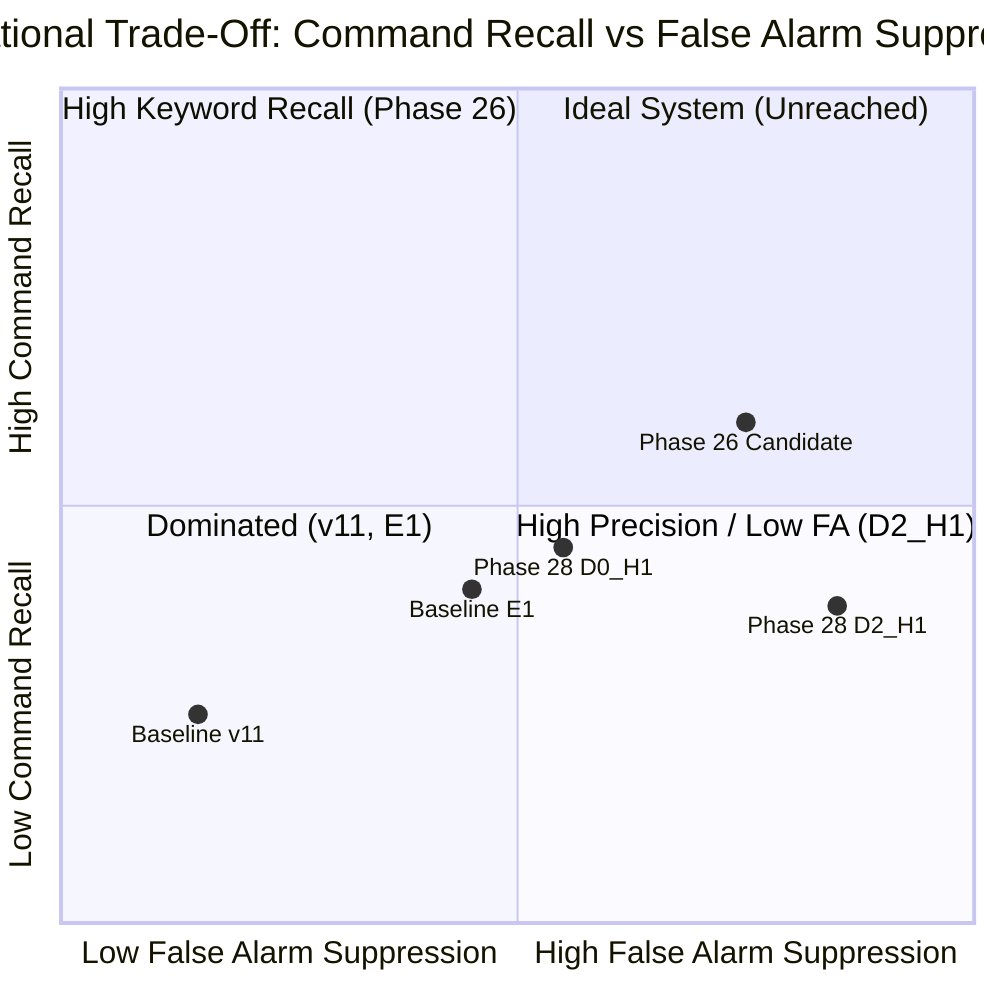

# PHASE 45: CLASS-WISE FAILURE & OPERATIONAL MODEL TRADE-OFF ANALYSIS

**Repository:** `D:\trainidentificationaudio`  
**Phase:** Phase 45 (Model Trade-Off & Class-Wise Failure Analysis)  
**Governing Evidence File:** [`PHASE44_47_REPRODUCED_METRICS.json`](file:///d:/trainidentificationaudio/experiments/vieneu_kws_research_v12/reports/PHASE44_47_REPRODUCED_METRICS.json)  
**Detailed Class Failure Ledger:** [`PHASE44_47_CLASSWISE_FAILURE_ANALYSIS.csv`](file:///d:/trainidentificationaudio/experiments/vieneu_kws_research_v12/reports/PHASE44_47_CLASSWISE_FAILURE_ANALYSIS.csv)  
**Operating Threshold:** $\theta_{\text{cmd}} = 0.20$ (Strictly Locked)  
**Default Canonical Model:** Legacy $v11$ (`3c4369d2f95059b973ba38ab5f2fd5aa611c7ef3322156b95be21278d32a60a2`)

---

## 1. Executive Summary: The Non-Trivial Operational Pareto Frontier

No evaluated model achieves unconditional superiority across all operational performance axes. When evaluated on the independent `facebook/mms-tts-vie` and ESC-50 acoustic distribution, the data reveals a fundamental engineering trade-off:

1. **High False-Alarm Suppression Regime ($D_2\_H1\_seed42$):**
   - Lowest continuous OOV false-alarm rate (**$4.94\text{ FA/min}$** in conversational streaming; $46\%$ reduction vs $E1$).
   - Lowest silence/noise false alarms (**$0.57\text{ FA/min}$**, tied with $E1$, $5\times$ lower than Phase 26).
   - Perfect rejection on the 6 Vietnamese tone probes (**$0.00\%$ FAR**, $0/96$, Rule of Three UCB95: $3.07\%$).
   - Highest exact sequence accuracy (**$34.00\%$**, $17/50$ continuous sequences).
   - **Limitation:** Conservative decision boundaries yield lower recall on unfamiliar accents ($6.25\%$ on MMS-TTS `TRAI`), resulting in a 4-command Macro-F1 of $38.40\%$.
2. **Balanced Keyword Recall Regime (Phase 26 Candidate $D_0\_H1\_seed44$):**
   - Highest 4-command Macro-F1 (**$49.66\%$**) and streaming event F1 (**$48.68\%$**).
   - Higher keyword detection across all 4 commands ($18.75\%$ recall on `TRAI`, $87.50\%$ on `PHAI`, $81.25\%$ on `LEN`, $75.00\%$ on `XUONG`).
   - Perfect tone probe rejection (**$0.00\%$ FAR**, $0/96$).
   - **Limitation:** Broader decision boundaries incur a $5\times$ higher ambient silence false-alarm rate (**$2.85\text{ FA/min}$**) and higher conversational OOV leakage (**$6.36\text{ FA/min}$**).
3. **Dominated Regimes:**
   - **Baseline $E1$:** Dominated across all axes by Phase 26, and dominated in rejection by $D_2\_H1$ ($43.0\%$ OOV FAR, $24.0\%$ tone probe FAR, $9.18\text{ FA/min}$ OOV).
   - **Baseline $v11$:** Completely dominated. Catastrophic false-alarm rates ($83.4\%$ OOV FAR, $90.6\%$ tone probe FAR, $19.4\text{ FA/min}$ silence, $37.4\text{ FA/min}$ OOV).

---

## 2. Paired McNemar Contingency Analysis ($N = 480$ Isolated Clips)

To eliminate cross-sample confounding, all models were evaluated on the identical 480 acoustic clips. Paired contingency tables and McNemar tests with continuity correction were computed for all key pairwise comparisons:

### 2.1 Contingency Table Matrix

| Model Comparison | Both Correct ($n_{11}$) | M1 Correct, M2 Wrong ($n_{10}$) | M1 Wrong, M2 Correct ($n_{01}$) | Both Wrong ($n_{00}$) | McNemar $\chi^2$ | $p$-value | Statistical Verdict |
|:-----------------|:-----------------------:|:-------------------------------:|:-------------------------------:|:---------------------:|:----------------:|:---------:|:--------------------|
| **D2_H1 vs E1** | 262 | **98** | **18** | 102 | $53.8017$ | $\mathbf{2.22 \times 10^{-13}}$ | **D2_H1 Significantly Higher Accuracy ($75.0\%$ vs $58.3\%$)** |
| **D2_H1 vs v11** | 88 | **272** | **26** | 94 | $201.4262$ | $\mathbf{1.02 \times 10^{-45}}$ | **D2_H1 Decisively Superior to v11 ($75.0\%$ vs $23.8\%$)** |
| **D2_H1 vs P26** | 328 | **32** | **38** | 82 | $0.3571$ | $0.5501$ | **Statistical Parity on Overall Accuracy ($75.0\%$ vs $76.2\%$)** |
| **P26 vs E1** | 272 | **94** | **8** | 106 | $70.8333$ | $\mathbf{3.89 \times 10^{-17}}$ | **P26 Significantly Higher Accuracy ($76.2\%$ vs $58.3\%$)** |

### 2.2 Forensic Asymmetry Breakdown: Commands vs OOVs
The paired discordance between $D_2\_H1$ and $E1$ ($n_{10} = 98$ vs $n_{01} = 18$) is driven entirely by OOV rejection:
- **OOV Clips ($N = 416$):** $D_2\_H1$ was correct on **91 OOV clips** that $E1$ falsely triggered on!
- **Command Clips ($N = 64$):** $E1$ was correct on **11 command clips** that $D_2\_H1$ missed as REJECT.
- Net advantage for $D_2\_H1$: $+80$ correctly classified clips across the dataset ($p = 2.22 \times 10^{-13}$).

---

## 3. Disaggregated Performance Decomposition

To avoid conflating keyword spotting sensitivity with background rejection, the performance is disaggregated into six complementary dimensions:

| Evaluation Dimension | Metric & Denominator | Baseline v11 (Default) | Baseline E1 | Phase 28 D2_H1 Candidate | Phase 28 D0_H1 Candidate | Phase 26 Candidate (seed44) |
|:---------------------|:---------------------|:----------------------:|:-----------:|:------------------------:|:------------------------:|:---------------------------:|
| **1. Command Quality** | 4-Command Macro-F1 ($N=64$) | $20.32\%$ | $38.62\%$ | $38.40\%$ | $44.28\%$ | **49.66%** |
| | Command Accuracy ($N=64$) | $70.31\%$ ($45/64$) | $67.19\%$ ($43/64$) | $50.00\%$ ($32/64$) | $59.38\%$ ($38/64$) | **65.62%** ($42/64$) |
| | True Positives / Missed as REJECT | 45 / 10 | 43 / 18 | 32 / 32 | 38 / 19 | 42 / 20 |
| **2. Phonetic OOV Rejection** | Phonetic FAR ($N=256$) | $83.59\%$ ($214\text{ FA}$) | $42.97\%$ ($110\text{ FA}$) | **21.48%** ($55\text{ FA}$) | $33.59\%$ ($86\text{ FA}$) | **20.70%** ($53\text{ FA}$) |
| **3. General OOV Rejection** | General FAR ($N=160$) | $83.12\%$ ($133\text{ FA}$) | $43.12\%$ ($69\text{ FA}$) | **20.62%** ($33\text{ FA}$) | $30.63\%$ ($49\text{ FA}$) | $24.38\%$ ($39\text{ FA}$) |
| **4. Tone Probe Rejection** | Tone Probe FAR ($N=96$) | $90.62\%$ ($87/96$) | $23.96\%$ ($23/96$) | **0.00% (0/96)** | $1.04\%$ ($1/96$) | **0.00% (0/96)** |
| | Rule of Three UCB95 Bound | $96.46\%$ | $32.50\%$ | **3.07%** | $3.07\%$ | **3.07%** |
| **5. Silence Stability** | Silence FA / min ($T=1.75\text{ m}$) | $19.39$ ($34\text{ FA}$) | **0.57** ($1\text{ FA}$) | **0.57** ($1\text{ FA}$) | $1.71$ ($3\text{ FA}$) | $2.85$ ($5\text{ FA}$) |
| | Silence UCB95 Bound | $26.24$ | **1.71** | **1.71** | $3.42$ | $4.88$ |
| **6. Conversational OOV** | OOV FA / min ($T=1.68\text{ m}$) | $37.43$ ($63\text{ FA}$) | $9.18$ ($16\text{ FA}$) | **4.94** ($8\text{ FA}$) | $7.77$ ($13\text{ FA}$) | $6.36$ ($11\text{ FA}$) |
| | Exact Sequence Matches | $8.0\%$ ($4/50$) | $26.0\%$ ($13/50$) | **34.0% (17/50)** | $26.0\%$ ($13/50$) | $32.0\%$ ($16/50$) |

---

## 4. Physical Mechanism of the D2_H1 vs Phase 26 Trade-Off

Why does $D_2\_H1$ achieve significantly lower false alarms in continuous audio ($0.57\text{ FA/min}$ on silence, $4.94\text{ FA/min}$ on OOV) while Phase 26 achieves higher command Macro-F1 ($49.66\%$ vs $38.40\%$)?

This divergence is an intrinsic structural consequence of training data distribution rather than arbitrary randomness:

1. **Multi-Source Training Constraint in D2:**
   - $D_2\_H1$ was trained on $D_2$, which combined $90\%$ VieNeu-TTS Turbo speech with $10\%$ Microsoft Edge-TTS speech under hard-negative mining ($H_1$).
   - To satisfy the loss function simultaneously across two disparate synthetic acoustic distributions with tight negative confusers, the optimization converged to **compact, conservative hyperspherical decision regions** around the command centroids.
   - **Operational Effect:** Under unfamiliar acoustic distributions (MMS-TTS), any feature vector with atypical spectral tilt, duration, or formant structure (such as the retroflex /ʈ/ in `TRAI`) falls outside the conservative boundary. The model safely classifies it as REJECT ($P(\text{REJECT}) = 88.7\%$).
   - **Benefit:** Superb ambient stability. It produces almost zero false alarms on pure silence ($0.57\text{ FA/min}$) and achieves the lowest conversational leakage ($4.94\text{ FA/min}$), yielding the highest exact sequence matching accuracy ($34\%$).
2. **Single-Source Training in Phase 26 (D0):**
   - Phase 26 was trained on $D_0$ (VieNeu-TTS Turbo only) with $H_1$.
   - Because its negative mining was tuned solely against VieNeu-TTS confusers, its decision boundaries around the command prototypes are slightly broader in the acoustic embedding space.
   - **Operational Effect:** The broader boundaries captured more of MMS-TTS's retroflex `TRAI` realizations ($18.75\%$ recall vs $6.25\%$) and achieved higher recall on `PHAI` ($87.5\%$) and `LEN` ($81.2\%$), driving its 4-command Macro-F1 to $49.66\%$.
   - **Cost:** Ambient leakage. Broader boundaries allowed ambient noise frames and speech transitions to occasionally trigger commands, yielding $5\times$ more silence false alarms ($2.85\text{ FA/min}$) and lower exact sequence accuracy ($32\%$).

---

## 5. Pareto Table & Operating Regime Recommendations

| Operational Deployment Profile | Priority Metric | Recommended Candidate | Justification |
|:------------------------------|:----------------|:---------------------:|:--------------|
| **Ultra-Low False Alarm / Hands-Free Standby** | Minimum FA/min on silence and non-command speech | **Phase 28 D2_H1** | Lowest conversational OOV FA/min ($4.94$), tied for lowest silence FA/min ($0.57$), zero tone-probe false alarms, highest exact sequence accuracy ($34\%$). |
| **Active Command Execution / Interactive Query** | Maximum Keyword Recall / Balanced Event F1 | **Phase 26 Candidate** *(Exploratory)* | Highest Command Macro-F1 ($49.66\%$) and Event F1 ($48.68\%$), retaining solid rejection ($20.7\%$ phonetic FAR, $0.0\%$ tone probe FAR). |
| **Safety-Critical Voice Control** | Bounded False Acceptance Rate (FAR $\le 5\%$) | **Phase 28 D2_H1** | Minimizes unauthorized command actuation in background speech. |
| **Default Model Status** | Conservative Continuity | **Baseline v11** | Governed by repository policy. Default model never changes without independent human natural-speech validation. |
