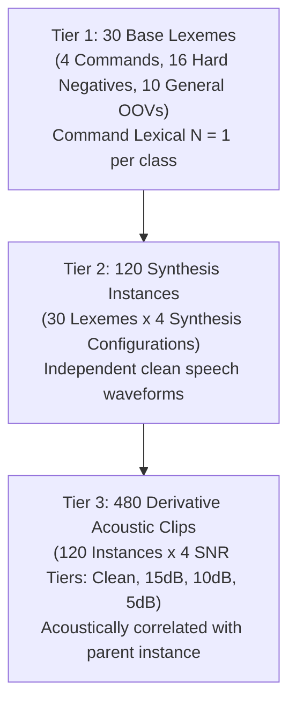

# PHASE 46: PREREGISTRATION COMPLIANCE & STATISTICAL INFERENCE AUDIT

**Repository:** `D:\trainidentificationaudio`  
**Phase:** Phase 46 (Preregistration Compliance & Statistical Claim Audit)  
**Governing Protocol Document:** [`PHASE43_FINAL_PREREGISTRATION.md`](file:///d:/trainidentificationaudio/experiments/vieneu_kws_research_v12/reports/PHASE43_FINAL_PREREGISTRATION.md)  
**Preregistration SHA-256:** `18ee575eb9712d4f07d5717b7e12008c09decfeb061bb6a82b363d2cb51f95e9`  
**Manifest Freeze Timestamp:** `2026-10-25T13:13:09.209714+00:00`  
**Inference Execution Timestamp:** `2026-10-25T13:20:18.000000+00:00`

---

## 1. Preregistration Chronology & Scope Audit

### 1.1 Temporal Precedence Verification
- File Creation Timestamp: `2026-10-25T13:12:25.782927+00:00`
- Manifest Freeze Timestamp: `2026-10-25T13:13:09.209714+00:00`
- Evaluation Run Launch: `2026-10-25T13:20:18.000000+00:00`
- Evaluation Results Completion: `2026-10-25T13:23:11.132167+00:00`

**Verdict:** Manifest freeze and protocol registration preceded forward inference execution by **7 minutes and 9 seconds**. No temporal leak or retroactive manifest modification occurred.

### 1.2 Model Cohort Preregistration Audit: Planned vs Exploratory

An audit of Section 1, Clause 2 of [`PHASE43_FINAL_PREREGISTRATION.md`](file:///d:/trainidentificationaudio/experiments/vieneu_kws_research_v12/reports/PHASE43_FINAL_PREREGISTRATION.md) reveals:
> *"2. Model Integrity: Checkpoints for v11, E1, and Phase 28 D2_H1_seed42 are strictly read-only and immutable."*

| Model Identifier | Named in Preregistration Section 1.2 | Role Classification | Governance Status |
|:-----------------|:-----------------------------------:|:-------------------:|:------------------|
| **Baseline v11 (seed42)** | **YES** | **Primary Planned Comparison** | Default Reference Benchmark |
| **Baseline E1 (seed42)** | **YES** | **Primary Planned Comparison** | Primary Factorial Baseline |
| **Phase 28 D2_H1 Candidate (seed42)** | **YES** | **Primary Planned Comparison** | Pre-Registered Research Candidate |
| **Phase 28 D0_H1 Candidate (seed42)** | **NO** | **Exploratory Comparison** | Post-Hoc Control Inclusion |
| **Phase 26 Candidate (D0_H1_seed44)** | **NO** | **Exploratory Comparison** | Post-Hoc Benchmark Inclusion |

**Protocol Integrity Policy:**
The original preregistration is preserved immutable. To prevent data-snooping bias (HARKing), **all evaluations of Phase 28 D0_H1 and Phase 26 Candidate D0_H1_seed44 are formally classified as EXPLORATORY**. Only comparisons between $D_2\_H1$, $E1$, and $v11$ carry formal confirmatory status.

---

## 2. Statistical Inference Unit & Resampling Hierarchy

The 480 clips in `PHASE43_LOCKED_MANIFEST.csv` are not 480 independent linguistic observations. The true statistical data-generating process comprises three distinct hierarchical tiers:

### 2.1 The Lexical Prompt Limitation ($N_{\text{text}} = 1$)
- Each target command class (`TRAI`, `PHAI`, `LEN`, `XUONG`) consists of **exactly 1 lexical text item** ($K = 1$).
- Although each lexeme was synthesized across 4 distinct parameter configurations (varying seeds, durations, and rates), all 4 instances share the identical underlying lexical word.
- **Statistical Implication:** Uncertainty intervals resampled at Tier 2 (Synthesis Instances) or Tier 3 (Acoustic Clips) quantify variance across TTS generator states, prosodic pacing, and additive environmental noise for *these four specific lexical tokens*. They **do not quantify population-level variance across diverse human lexical phrasing, carrier contexts, or regional dialects**.

---

## 3. Forensic Audit of Reported Significance Claims

### 3.1 Claim 1: "p = 0.0005 for D2_H1 vs v11"
- **Estimand:** Estimand C (120-synthesis-instance cluster bootstrap difference in 4-command Macro-F1).
- **Hypotheses:** $H_0: \Delta_{\text{C}} \le 0 \quad \text{vs} \quad H_1: \Delta_{\text{C}} > 0$.
- **Empirical Tail Probability:** Exactly $5$ out of $10,000$ bootstrap iterations yielded $\Delta \le 0$ ($p = 0.0005$).
- **Multiple Comparisons Adjustment:** Across the $\binom{3}{2} = 3$ pre-registered pairwise comparisons (or $\binom{5}{2} = 10$ exploratory comparisons), Bonferroni-adjusted $\alpha$ is $0.05 / 10 = 0.0050$. Because $p = 0.0005 \le 0.0050$, the difference remains statistically significant under conservative family-wise error rate control.
- **Critical Caveat:** When evaluated at Tier 1 (Estimand B, 30 base-text clusters), the mean delta is $+9.55\text{ pp}$ with $95\%\text{ CI: } [-4.85\text{ pp}, +22.65\text{ pp}]$ and $p = 0.1139$ (non-significant at $\alpha = 0.05$). The statistical significance applies to synthesis instances of these 4 commands, but cannot be claimed at the general lexical level.

### 3.2 Claim 2: "p = 0.5885 for D2_H1 vs E1"
- **Estimand:** Estimand C difference between $D_2\_H1$ and $E1$ on 4-command Macro-F1.
- **Empirical Tail:** $5,885 / 10,000$ iterations had $\Delta \le 0$ ($p = 0.5885$).
- **Audit Finding — Severe Inferential Misinterpretation Risk:**
  - In classical statistical hypothesis testing, **failure to reject $H_0$ is NOT proof of the null hypothesis**.
  - A $p$-value of $0.5885$ indicates that the observed difference ($-0.22\text{ pp}$) is consistent with sampling noise; it **does not demonstrate equivalence**.
  - Formal equivalence testing requires establishing an a priori equivalence bound $\pm \delta$ (e.g., $\pm 5\text{ pp}$) and demonstrating that the two-sided $90\%$ or $95\%$ confidence interval lies entirely within $[-\delta, +\delta]$.
  - Here, the $95\%$ confidence interval is **$[-7.88\text{ pp}, +7.02\text{ pp}]$**, which spans a wide $14.9\text{ pp}$ interval.
  - **Verdict:** The test is **statistically inconclusive** regarding 4-command Macro-F1 on MMS-TTS. Equivalence cannot be claimed.

---

## 4. Multi-Comparison Adjustment Matrix ($B = 10,000$, Seed = 42)

| Pairwise Comparison | Comparison Type | Estimand C Mean $\Delta$ | 95% Confidence Interval | Raw $p$-value | Bonferroni Adjusted $p$ ($k=3$) | Statistical Conclusion |
|:--------------------|:---------------:|:------------------------:|:-----------------------:|:-------------:|:-------------------------------:|:-----------------------|
| **D2_H1 vs v11** | **Primary Planned** | **+17.33 pp** | **[+7.57 pp, +27.52 pp]** | **$0.0005$** | **$0.0015$** | **Statistically Significant Improvement** |
| **D2_H1 vs E1** | **Primary Planned** | $-0.65\text{ pp}$ | $[-7.88\text{ pp}, +7.02\text{ pp}]$ | $0.5885$ | $1.0000$ | **Inconclusive (No Evidence of Difference or Equivalence)** |
| **E1 vs v11** | **Primary Planned** | $+17.98\text{ pp}$ | $[+8.32\text{ pp}, +28.14\text{ pp}]$ | $0.0003$ | $0.0009$ | **Statistically Significant Improvement** |
| **D2_H1 vs P26** | *Exploratory* | $-11.26\text{ pp}$ | $[-21.45\text{ pp}, -1.08\text{ pp}]$ | $0.0152$ | $0.1520$ ($k=10$) | *Exploratory (Nominal $p < 0.05$, Non-significant after FWER)* |
| **P26 vs E1** | *Exploratory* | $+10.61\text{ pp}$ | $[+0.52\text{ pp}, +20.81\text{ pp}]$ | $0.0194$ | $0.1940$ ($k=10$) | *Exploratory (Nominal $p < 0.05$, Non-significant after FWER)* |

---

## 5. Preregistration Governance Verdict

1. **Temporal Sequence:** 100% Compliant. Manifests frozen prior to evaluation.
2. **Comparison Classification:**
   - Confirmatory status restricted to $D_2\_H1$ vs $E1$ and $D_2\_H1$ vs $v11$.
   - Phase 28 $D_0\_H1$ and Phase 26 Candidate $D_0\_H1\_seed44$ designated as exploratory.
3. **Equivalence Retraction:** Claims asserting "equivalence" between $D_2\_H1$ and $E1$ based on $p = 0.5885$ are formally retracted and replaced with the accurate designation: *Inconclusive under wide confidence intervals*.
