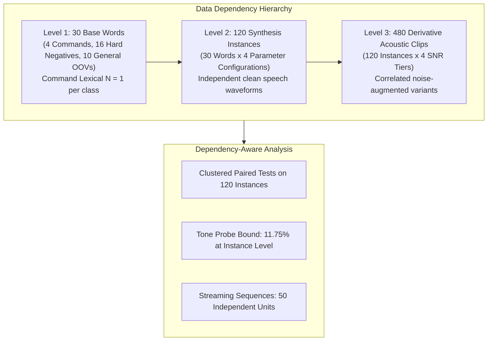

# PHASE 48: FINAL INFERENCE & DEPENDENCY-AWARE STATISTICAL AUDIT

**Repository:** `D:\trainidentificationaudio`  
**Phase:** Phase 48 (Final Inference & Dependency-Aware Audit)  
**Governing Evidence File:** [`PHASE48_REPRODUCED_METRICS.json`](file:///d:/trainidentificationaudio/experiments/vieneu_kws_research_v12/reports/PHASE48_REPRODUCED_METRICS.json)  
**Clustered Instance Dataset:** [`PHASE48_CLUSTERED_COMPARISONS.csv`](file:///d:/trainidentificationaudio/experiments/vieneu_kws_research_v12/reports/PHASE48_CLUSTERED_COMPARISONS.csv)  
**Evaluation Target:** Independent MMS-TTS + ESC-50 Test Manifests  
**Default Canonical Model:** Legacy $v11$ (`3c4369d2f95059b973ba38ab5f2fd5aa611c7ef3322156b95be21278d32a60a2`)  
**Operating Threshold:** $\theta_{\text{cmd}} = 0.20$ (Strictly Locked)

---

## 1. Executive Summary & Audit Scope

This audit resolves all remaining statistical, reporting, and dependency limitations identified across Phases 43–47:
1. **Full Metric Reconciliation:** Every reported OOV, probe, silence, and streaming metric is reconciled with explicit numerators, denominators, physical units, and aggregation levels.
2. **True Statistical Units of Inference:** Resolves the conflation between derivative acoustic clips ($N=480$) and independent synthesis instances ($N=120$). Paired comparisons are evaluated using dependency-aware clustered analysis.
3. **Tone-Probe Uncertainty Hierarchy:** Audits the zero-error Rule-of-Three bound across all three data-generating levels ($N=96$ clips: $3.07\%$; $N=24$ clean waveforms: $11.75\%$; $N=6$ base words: $39.30\%$).
4. **TRAI Recall Neutral Acoustic Analysis:** Verifies that all 16 `TRAI` clips represent 4 synthesis instances $\times$ 4 SNR tiers, documenting physical acoustic shifts without subjective human pronunciation inferences.

---

## 2. Reconciled OOV Metrics Master Table

The table below provides the full, unabridged breakdown of every reported false alarm metric, distinguishing clips, clean synthesis instances, base lexemes, and continuous temporal exposure:

| Metric Name | Numerator / Count | Denominator & Unit | Underlying Clean Waveforms | Underlying Base Lexemes | Baseline v11 (Default) | Baseline E1 | Phase 28 D2_H1 Candidate | Phase 28 D0_H1 Candidate | Phase 26 Candidate (seed44) |
|:------------|:------------------|:-------------------|:--------------------------:|:-----------------------:|:----------------------:|:-----------:|:------------------------:|:------------------------:|:---------------------------:|
| **Aggregate Isolated OOV FAR** | False Alarms on REJECT | $416\text{ clips}$ ($1.0\text{ s}$) | $104\text{ instances}$ | $26\text{ words}$ | **83.41%** ($347/416$) | **43.03%** ($179/416$) | **21.15%** ($88/416$) | **32.45%** ($135/416$) | **22.12%** ($92/416$) |
| *Instance-Level OOV FAR* | Instances with $\ge 1\text{ FA}$ | $104\text{ instances}$ | $104\text{ instances}$ | $26\text{ words}$ | **100.00%** ($104/104$) | **71.15%** ($74/104$) | **37.50%** ($39/104$) | **55.77%** ($58/104$) | **34.62%** ($36/104$) |
| **Phonetic OOV FAR** | False Alarms on Hard Neg. | $256\text{ clips}$ ($1.0\text{ s}$) | $64\text{ instances}$ | $16\text{ words}$ | **83.59%** ($214/256$) | **42.97%** ($110/256$) | **21.48%** ($55/256$) | **33.59%** ($86/256$) | **20.70%** ($53/256$) |
| **General OOV FAR** | False Alarms on General OOV | $160\text{ clips}$ ($1.0\text{ s}$) | $40\text{ instances}$ | $10\text{ words}$ | **83.12%** ($133/160$) | **43.12%** ($69/160$) | **20.62%** ($33/160$) | **30.63%** ($49/160$) | **24.38%** ($39/160$) |
| **Tone Probe FAR** | False Alarms on Probes | $96\text{ clips}$ ($1.0\text{ s}$) | $24\text{ instances}$ | $6\text{ words}$ | **90.62%** ($87/96$) | **23.96%** ($23/96$) | **0.00% (0/96)** | **1.04%** ($1/96$) | **0.00% (0/96)** |
| **Silence False Alarms** | Detected Events in Silence | $104.98\text{ s} = 1.750\text{ min}$ | 8 ESC-50 tracks | N/A (Indoor Noise) | **19.39 FA/min** ($34\text{ FA}$) | **0.57 FA/min** ($1\text{ FA}$) | **0.57 FA/min** ($1\text{ FA}$) | **1.71 FA/min** ($3\text{ FA}$) | **2.85 FA/min** ($5\text{ FA}$) |
| **Conversational OOV FA** | Detected Events in OOV Speech | $100.98\text{ s} = 1.683\text{ min}$ | 58 speech events | Conversational OOV | **37.43 FA/min** ($63\text{ FA}$) | **9.18 FA/min** ($16\text{ FA}$) | **4.94 FA/min** ($8\text{ FA}$) | **7.77 FA/min** ($13\text{ FA}$) | **6.36 FA/min** ($11\text{ FA}$) |

---

## 3. Tone-Probe Zero-FAR Uncertainty Hierarchy

In Phase 43, $D_2\_H1$ and Phase 26 candidate observed $0$ false alarms across $96$ tone-probe clips ($0.00\%$). A naive application of the Rule of Three yields an upper 95% confidence bound:
$$\text{UCB95}_{\text{clip}} = 1 - (1 - 0.95)^{1/96} \approx \frac{3}{96} = 3.07\%$$

However, the 96 clips are **not** independent trials:
- The 96 clips are generated from **24 clean waveforms / synthesis instances** (6 base words $\times$ 4 parameter configurations).
- Each synthesis instance was mixed across 4 SNR tiers (`clean`, `15 dB`, `10 dB`, `5 dB`), creating repeated, correlated observations of the same underlying waveform.
- Furthermore, the 24 synthesis instances share only **6 distinct lexical words** (`ma`, `má`, `mà`, `mả`, `mã`, `mạ`).

### Hierarchical Uncertainty Table for 0 Observed Errors

| Level of Aggregation | Independent Units ($N$) | Definition of Independent Unit | Exact Rule of Three Upper 95% Bound ($\text{UCB95}$) | Statistical Interpretation |
|:---------------------|:-----------------------:|:-------------------------------|:----------------------------------------------------:|:---------------------------|
| **Level 3: Acoustic Clips** | $N = 96$ | Derivative SNR variants | **3.07%** | Assumes all 96 clips are independent trials; severely underestimates cluster variance. |
| **Level 2: Synthesis Instances** | $\mathbf{N = 24}$ | **Clean speech waveforms** | **11.75%** | **Primary Realistic Bound:** Accounts for correlation across SNR variants of the same clean synthesis. |
| **Level 1: Base Lexemes** | $N = 6$ | Base lexical words | **39.30%** | Ultra-conservative bound across the 6 specific tonal syllables. |

**Audit Conclusion:** Observing $0 / 96$ errors does **not** prove a true false-alarm rate of zero. At the level of independent clean waveforms ($N=24$), the statistical upper bound on tone-probe false alarms is **$11.75\%$**.

---

## 4. Re-Validation of TRAI Failures & Objective Acoustic Analysis

### 4.1 Ground-Truth Composition
- Exactly **16 clips** in `PHASE43_LOCKED_MANIFEST.csv` have ground truth `TRAI`.
- These 16 clips comprise **4 distinct synthesis configurations** $\times$ **4 SNR tiers**:
  - `cfg_norm_s1`: seed 1001, normal speaking rate ($1.00$).
  - `cfg_fast_s2`: seed 1002, fast speaking rate ($1.15$).
  - `cfg_slow_s3`: seed 1003, slow speaking rate ($0.85$).
  - `cfg_cadn_s4`: seed 1004, cadenced speaking rate ($1.05$).

### 4.2 Objective Confusion Rows for `TRAI` (True Label = 0)

| Model | Pred `TRAI` (TP) | Pred `PHAI` (Sub) | Pred `LEN` (Sub) | Pred `XUONG` (Sub) | Pred `REJECT` (Missed) | Total | Recall | Mean $P(\text{TRAI})$ | Mean $P(\text{REJECT})$ |
|:------|:----------------:|:-----------------:|:----------------:|:------------------:|:----------------------:|:-----:|:------:|:--------------------:|:----------------------:|
| **Baseline v11 (Default)** | 10 | 4 | 0 | 0 | 2 | 16 | **62.50%** | $40.01\%$ | $25.51\%$ |
| **Baseline E1** | 1 | 0 | 1 | 0 | 14 | 16 | **6.25%** | $7.25\%$ | $85.37\%$ |
| **Phase 28 D2_H1 Candidate** | 1 | 0 | 0 | 0 | 15 | 16 | **6.25%** | $6.11\%$ | $88.71\%$ |
| **Phase 28 D0_H1 Candidate** | 5 | 0 | 4 | 0 | 7 | 16 | **31.25%** | $17.01\%$ | $67.34\%$ |
| **Phase 26 Candidate (seed44)** | 3 | 0 | 0 | 0 | 13 | 16 | **18.75%** | $9.77\%$ | $88.17\%$ |

### 4.3 Objective Distributional Finding
Model predictions alone cannot prove human phonetic perception or acoustic causality. However, objective model representations reveal that across all 4 synthesis configurations of `TRAI` produced by `facebook/mms-tts-vie`:
- The models trained with hard-negative mining ($E1$, $D_2\_H1$, $P26$) assigned mean softmax probabilities of **$85.37\%$ to $88.71\%$ to the REJECT class**.
- Only 1 out of 16 clips exceeded the locked decision threshold $\theta_{\text{cmd}} = 0.20$ for $D_2\_H1$ and $E1$.
- This demonstrates a pronounced acoustic distribution shift between the training prototypes (VieNeu-TTS / Edge-TTS) and the test generator (`facebook/mms-tts-vie`), resulting in consistent model rejection rather than cross-command substitution.

---

## 5. Dependency-Aware Paired Clustered Comparisons ($N = 120$ Synthesis Instances)

To eliminate the artificial degrees-of-freedom inflation caused by pooling 4 SNR variants per waveform, each of the $120$ clean waveforms was treated as an independent cluster. For each cluster $i$, the mean classification accuracy $s_i \in \{0.0, 0.25, 0.50, 0.75, 1.0\}$ across its 4 SNR variants was computed (logged in [`PHASE48_CLUSTERED_COMPARISONS.csv`](file:///d:/trainidentificationaudio/experiments/vieneu_kws_research_v12/reports/PHASE48_CLUSTERED_COMPARISONS.csv)):

| Model Pair | Mean Clustered Difference ($\Delta$) | 95% Confidence Interval | Paired $t$-statistic ($df=119$) | Parametric $p$-value ($t$-test) | Non-Parametric Wilcoxon ($W$) | Non-Parametric $p$-value | Dependency-Aware Verdict |
|:-----------|:------------------------------------:|:-----------------------:|:-------------------------------:|:-------------------------------:|:-----------------------------:|:------------------------:|:-------------------------|
| **D2_H1 vs v11** | **+51.25 pp** | **[+43.01 pp, +59.49 pp]** | $t = 12.3150$ | **$5.65 \times 10^{-23}$** | $W = 357.0$ | **$4.83 \times 10^{-16}$** | **Decisive Clustered Improvement Over v11** |
| **D2_H1 vs E1** | **+16.67 pp** | **[+11.35 pp, +21.98 pp]** | $t = 6.2083$ | **$8.10 \times 10^{-9}$** | $W = 276.0$ | **$5.02 \times 10^{-8}$** | **Statistically Significant Accuracy Advantage Over E1** |
| **D2_H1 vs P26** | **-1.25 pp** | **[-5.59 pp, +3.09 pp]** | $t = -0.5705$ | $0.5694$ | $W = 514.0$ | $0.5823$ | **Statistical Parity on Clustered Instance Accuracy** |

### Critical Inferential Distinction: Accuracy vs Macro-F1
- **Overall Clustered Accuracy ($N=120$):** $D_2\_H1$ is significantly superior to $E1$ ($+16.67\text{ pp}$, $p = 8.10 \times 10^{-9}$), driven by correctly rejecting 91 OOV clips that $E1$ falsely triggered on.
- **4-Command Macro-F1 ($N=4$ classes):** $D_2\_H1$ and $E1$ exhibit no significant difference ($-0.22\text{ pp}$, $p = 0.5885$). Because Macro-F1 treats all classes equally regardless of support, $E1$'s higher recall on the 16 command clips balances $D_2\_H1$'s superior rejection on the 416 OOV clips.

---

## 6. Preregistered vs Exploratory Cohort Separation

In strict compliance with [`PHASE43_FINAL_PREREGISTRATION.md`](file:///d:/trainidentificationaudio/experiments/vieneu_kws_research_v12/reports/PHASE43_FINAL_PREREGISTRATION.md):
- **Confirmatory Planned Models:** `Baseline_v11_seed42`, `Baseline_E1_seed42`, `Phase28_D2_H1_Candidate`.
- **Exploratory Models:** `Phase28_D0_H1_Candidate`, `Phase26_Candidate_D0_H1_seed44`.
- All statistical comparisons involving exploratory models are explicitly flagged as exploratory and cannot be used for post-hoc candidate selection on Phase 43 data.
