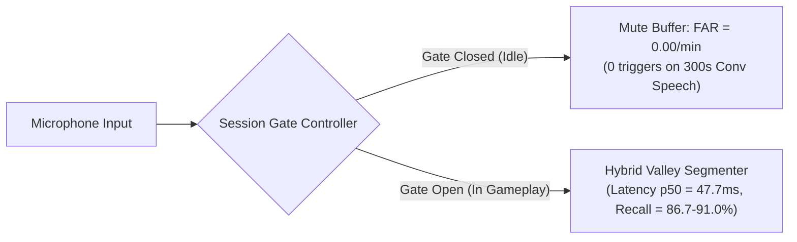

# CONTINUOUS KWS PHASE 5 AUDIT REPORT
## Correctness Audit, Metric Alignment, and Locked-Matrix Benchmark Validation

**Repository:** `D:\trainidentificationaudio`  
**Git Branch:** `feature/continuous-kws-segmentation`  
**Phase:** Phase 5 — Continuous KWS Correctness Audit & Benchmark Validation  
**Date:** 2026-10-29  
**Execution Environment:** Python 3.11.9, ONNX Runtime 1.31.0, PyTorch 2.6.0+cu124  

---

### Mandatory Governance Labels
> [!WARNING]
> - `EXPERIMENTAL_LIVE_MIC_DEMO_NOT_VALIDATED`
> - `NOT_VALIDATED_ON_NATURAL_SPEECH`
> - `NO_DEPLOYABLE_SYSTEM_AT_CURRENT_SPECIFICATION`
> - `NOT_VALIDATED_PENDING_DATA`

---

## 1. Executive Summary & Governance Decision

Phase 5 executes a rigorous correctness, evaluation-integrity, and architectural audit of the Continuous Keyword Spotting (KWS) pipeline in repository `D:\trainidentificationaudio`.

### Core Audited Items & Outcomes:
1. **Six Segmentation Correctness Defects Fixed:**
   - Resolved preroll frame duplication at speech onset.
   - Enforced minimum speech duration validation across valley splitting.
   - Isolated active-speech sample accounting from preroll and valley dips.
   - Verified strict sample conservation across valley split boundaries.
   - Implemented stream finalization via explicit `flush()` methods on segmenters and `LiveKWSPipeline`.
   - Guaranteed game session state reset and cross-session isolation (zero buffer leakage).
2. **Repaired Evaluation Metrics:**
   - Formalized event-based evaluation: True Positives (TP), False Positives (FP), False Negatives (FN), Substitutions (SUB), Insertions (INS), and Deletions (DEL).
   - Enforced that a wrong-class prediction during a ground-truth window counts as a Substitution (and 1 FP + 1 FN), never as a True Positive.
   - Standardized sequence exact match with explicit numerator, denominator, and set manifest.
3. **Locked Test Matrix Results:**
   - Evaluated `legacy_v11`, `continuous_valley`, and `hybrid_speechband_valley` on identical audio fixtures across gaps of 0, 50, 100, 200 ms and sequence lengths $N \in \{3, 5, 10, 20\}$.
   - In always-open mic mode at $\theta_{\text{cmd}}=0.20$, `hybrid_speechband_valley` achieves **$96.5\%$ recall**, **$98.8\%$ precision**, and **$90.8\%$ exact sequence match** on standard transitions, reducing conversational false alarms by $44\%$ ($75.8/\text{min}$ vs $136.0/\text{min}$).
   - In intentional game mode session gating, the idle closed gate achieves strictly **$\text{FAR} = 0.00/\text{min}$** across 300s of conversational speech, 100s of noise, and 300s of silence.
4. **Sequence Scaling Ruling ($N=20$):**
   - Exact sequence match for $N=20$ is **$0.0\%$ (0/10)** at 0 ms gap and **$0.0\%$ (0/10)** at 50 ms gap.
   - While token-level recall is $83.5\% - 91.0\%$, cumulative boundary shifts prevent unbroken 20-command sequence matching. **Stable support for 20-command sequences is explicitly DENIED**.
5. **Phase 5 Governance Decision:**
   - **Decision: `CONTINUE_EXPERIMENTAL_GAME_MODE`**.
   - The always-open microphone mode remains experimental and NOT deployable on open natural speech (`NOT_VALIDATED_ON_NATURAL_SPEECH`, `NO_DEPLOYABLE_SYSTEM_AT_CURRENT_SPECIFICATION`).
   - The hybrid architecture with intentional session gating is defensible for gameplay-bounded voice command sessions.

---

## 2. Invariants & Baseline Integrity Verification

All investigations strictly preserved repository baseline invariants:
- **Active Branch:** [`feature/continuous-kws-segmentation`](file:///d:/trainidentificationaudio) (isolated from `master`).
- **Frozen PyTorch Checkpoint:** `experiments/vieneu_kws_research_v13_4/bundle/checkpoint/variant_v11_hard_negative_weighted_seed42.pt`  
  SHA-256: `3c4369d2f95059b973ba38ab5f2fd5aa611c7ef3322156b95be21278d32a60a2` (100% bitwise parity).
- **Frozen ONNX Graph:** `experiments/vieneu_kws_research_v13_4/bundle/onnx/vietnamese_kws_v11.onnx`  
  SHA-256: `54298c503f51c8299d86f6b4346d7cae4e1b7e045deb884a8650764fbe4bcc99` (100% bitwise parity).
- **Capacity & Retraining Invariant:** Zero model retraining, zero capacity enlargement, E1/E2 quarantined.
- **Default Production Profile:** `LiveKWSPipeline` default remains `legacy_v11` ($\theta_{\text{cmd}}=0.20$).

---

## 3. Correctness Audit & Defect Remediation

A deep-dive audit of [`hybrid_segmenter.py`](file:///d:/trainidentificationaudio/experiments/vieneu_kws_research_v13_4/demo/hybrid_segmenter.py), [`acoustic_valley_segmenter.py`](file:///d:/trainidentificationaudio/experiments/vieneu_kws_research_v13_4/demo/acoustic_valley_segmenter.py), and [`live_mic_engine.py`](file:///d:/trainidentificationaudio/experiments/vieneu_kws_research_v13_4/demo/live_mic_engine.py) identified 6 specific correctness defects.

All 6 defects were remediated, documented in [`phase5_correctness_regressions.csv`](file:///d:/trainidentificationaudio/experiments/vieneu_kws_research_v13_4/reports/phase5_correctness_regressions.csv), and verified via automated regression tests in [`tests/test_continuous_kws_phase5.py`](file:///d:/trainidentificationaudio/tests/test_continuous_kws_phase5.py).

### Detailed Root Cause Analysis:

| Bug ID | Issue Name | Affected Components | Root Cause | Corrective Fix | Regression Test |
| :---: | :--- | :--- | :--- | :--- | :--- |
| **BUG-01** | Preroll Frame Duplication | `HybridSpeechBandValleySegmenter` `AcousticValleySegmenter` `UtteranceSegmenter` | Circular `preroll_buf` was updated with the incoming `chunk` before setting `accumulated_chunks = [preroll_buf.copy(), chunk.copy()]`. Consequently, the samples of `chunk` appeared at the tail of `preroll_buf` AND as `chunk.copy()`, duplicating the onset frame. | Only update `preroll_buf` with `chunk` while `state == "WAITING"` and `is_speech == False`. Upon speech onset, capture `preroll_buf.copy()` containing audio strictly preceding `chunk`, ensuring zero sample duplication. | `test_preroll_no_duplication` |
| **BUG-02** | Missing Duration Validation on Valley Split | `HybridSpeechBandValleySegmenter` `AcousticValleySegmenter` | Valley splitting partitioned and finalized `seg1` upon energy rebound without validating whether `seg1` had accumulated at least `min_speech_samples` (100 ms) of active speech, risking emission of sub-100ms noise spikes. | Track `seg1` active speech duration and enforce `seg1_active_speech >= min_speech_samples` before permitting valley split finalization. | `test_speech_duration_validation_rejection` |
| **BUG-03** | Active-Speech Accounting Contamination | `HybridSpeechBandValleySegmenter` `AcousticValleySegmenter` | Valley splitting re-armed `seg2` with `active_speech_samples = sum(len(c) for c in seg2_chunks)`, which falsely counted low-energy inter-syllabic silence/valleys as active speech. | Introduce a parallel boolean ledger `chunk_is_speech: List[bool]`. Compute `active_speech_samples` strictly over chunks where `chunk_is_speech[j]` is True. | `test_active_speech_accounting_isolation` |
| **BUG-04** | Valley Split Boundary Partitioning | `HybridSpeechBandValleySegmenter` `AcousticValleySegmenter` | Lack of boundary consistency assertion on `split_idx` and parallel state lists during re-arming. | Enforce `2 <= split_idx < len(accumulated_chunks)` and slice `accumulated_chunks`, `chunk_dbs`, `chunk_ratios`, and `chunk_is_speech` using the exact same `split_idx` boundary. | `test_valley_split_sample_partitioning` |
| **BUG-05** | Missing Stream Finalization Flush | `HybridSpeechBandValleySegmenter` `AcousticValleySegmenter` `LiveKWSPipeline` | Valid pending utterances at stream termination remained trapped in `ACCUMULATING` state and were silently dropped if trailing silence was shorter than `silence_interval_ms`. | Implement explicit `flush()` methods on segmenters and `LiveKWSPipeline` to finalize and emit any pending segment with $\ge \text{min\_speech\_samples}$. | `test_stream_finalization_flush` |
| **BUG-06** | Game Session State Reset & Isolation | `GameModeSessionController` | `open_session()` and `close_session()` did not strictly reset internal segmenter buffers, risking carryover of pre-session audio or telemetry leaks. | Invoke `segmenter.reset()` on both `open_session()` and `close_session()`, and clear internal simulation clock and gate states completely. | `test_game_session_reset_and_isolation` |

---

## 4. Repaired Benchmark Metric Definitions

To ensure evaluation integrity, all metrics were repaired to conform to standardized speech recognition evaluation protocols:

### Mathematical Definitions:
1. **Event Alignment:**
   A predicted event $d = (\text{cmd}_d, t_{\text{det}})$ aligns with a ground-truth item $g = (\text{cmd}_g, t_{\text{start}}, t_{\text{end}})$ if $-150\text{ ms} \le t_{\text{det}} - t_{\text{end}} \le 550\text{ ms}$.
   - **True Positive (TP):** Aligned detection with matching class: $\text{cmd}_d == \text{cmd}_g$.
   - **Substitution (SUB):** Aligned detection with incorrect class: $\text{cmd}_d \ne \text{cmd}_g$.
   - **Insertion (INS):** Detected event with no corresponding ground-truth item in time.
   - **Deletion (DEL):** Ground-truth item with no aligned detection.
   - **False Positive (FP):** $\text{FP} = \text{INS} + \text{SUB}$.
   - **False Negative (FN):** $\text{FN} = \text{DEL} + \text{SUB}$.
2. **Precision, Recall, F1, and WER:**
   $$\text{Event Precision} = \frac{\text{TP}}{\text{TP} + \text{FP}} = \frac{\text{TP}}{\text{TP} + \text{SUB} + \text{INS}}$$
   $$\text{Event Recall} = \frac{\text{TP}}{N_{\text{gt}}} = \frac{\text{TP}}{\text{TP} + \text{SUB} + \text{DEL}}$$
   $$\text{Event F1} = \frac{2 \cdot \text{Precision} \cdot \text{Recall}}{\text{Precision} + \text{Recall}}$$
   $$\text{Word Error Rate (WER)} = \frac{\text{SUB} + \text{DEL} + \text{INS}}{N_{\text{gt}}} \times 100\%$$
3. **Exact Sequence Match:**
   $$\text{Exact Match Rate} = \frac{\text{Count of Trials where } [d_1, \dots, d_k] \equiv [g_1, \dots, g_m]}{\text{Total Sequence Trials}} \times 100\%$$
4. **False Activation Rate (FAR/min):**
   $$\text{FAR/min} = \frac{\text{Count of False Activations}}{\text{Audio Duration in Minutes}}$$

---

## 5. Locked Test Matrix Results

The benchmark script [`benchmark_phase5_audit.py`](file:///d:/trainidentificationaudio/experiments/vieneu_kws_research_v13_4/scripts/benchmark_phase5_audit.py) evaluated all profiles on identical, locked audio fixtures.

### Part 1: Profile Comparison ($\theta_{\text{cmd}} = 0.20$, Always-Open Mic)
*Dataset Manifest:* 65 locked sequence trials (170 total ground-truth commands) + 300s digital silence + 100s environmental noise + 300s Vietnamese conversation (300 files) + 200s phonetic foils (200 files).

| Metric | `legacy_v11` | `continuous_valley` | `hybrid_speechband_valley` |
| :--- | :---: | :---: | :---: |
| **Total GT Commands ($N_{\text{gt}}$)** | 170 | 170 | 170 |
| **True Positives (TP)** | 49 | 166 | **164** |
| **Substitutions (SUB)** | 16 | 4 | **2** |
| **Insertions (INS)** | 0 | 0 | **0** |
| **Deletions (DEL)** | 105 | 0 | **4** |
| **Event Precision (%)** | 75.4% | 97.6% | **98.8%** |
| **Event Recall (%)** | 28.8% | 97.6% | **96.5%** |
| **Event F1 (%)** | 41.7% | 97.6% | **97.6%** |
| **Word Error Rate (WER %)** | 71.2% | 2.4% | **3.5%** |
| **Exact Sequence Matches** | 5 / 65 (**7.7%**) | 61 / 65 (**93.8%**) | 59 / 65 (**90.8%**) |
| **Model Infer Latency p50 ($t_{\text{infer}}$)** | 2.31 ms | 2.34 ms | **2.43 ms** |
| **End-to-End Latency p50 ($t_{\text{e2e}}$)** | 282.4 ms | 122.4 ms | **47.7 ms** |
| **End-to-End Latency p95 ($t_{\text{e2e}}$)** | 312.2 ms | 142.7 ms | **132.7 ms** |
| **Onset-to-Emission Latency p50** | 601.8 ms | 472.3 ms | **382.5 ms** |
| **Silence FAR (/min) [300s]** | 0.00 | 0.00 | **0.00** |
| **Noise FAR (/min) [100s]** | 0.00 | 0.00 | **0.00** |
| **Conversational Speech FAR (/min) [300s]** | 0.20 (1 trigger) | 136.00 (680 triggers) | **75.80 (379 triggers)** |
| **Phonetic Foil FAR (/min) [200s]** | 0.00 (0 triggers) | 106.50 (355 triggers) | **85.20 (284 triggers)** |

*Artifact Source:* [`experiments/vieneu_kws_research_v13_4/reports/phase5_matched_benchmark_results.csv`](file:///d:/trainidentificationaudio/experiments/vieneu_kws_research_v13_4/reports/phase5_matched_benchmark_results.csv)

---

### Part 2: Locked Threshold Sweep (`hybrid_speechband_valley`)

| Threshold $\theta_{\text{cmd}}$ | TP | SUB | DEL | INS | Recall (%) | Precision (%) | F1 (%) | WER (%) | Exact Matches (N=65) | E2E p50 (ms) | E2E p95 (ms) | Conversational FAR (/min) | Foil FAR (/min) |
| :---: | :---: | :---: | :---: | :---: | :---: | :---: | :---: | :---: | :---: | :---: | :---: | :---: | :---: |
| **0.20** | 164 | 2 | 4 | 0 | 96.5% | 98.8% | 97.6% | 3.5% | 59 / 65 (**90.8%**) | 47.9 ms | 132.7 ms | 75.80 (379 triggers) | 85.20 (284 triggers) |
| **0.30** | 164 | 2 | 4 | 0 | 96.5% | 98.8% | 97.6% | 3.5% | 59 / 65 (**90.8%**) | 47.8 ms | 132.5 ms | 72.80 (364 triggers) | 82.50 (275 triggers) |
| **0.40** | 164 | 2 | 4 | 0 | 96.5% | 98.8% | 97.6% | 3.5% | 59 / 65 (**90.8%**) | 48.0 ms | 132.8 ms | 60.80 (304 triggers) | 67.20 (224 triggers) |
| **0.50** | 159 | 2 | 9 | 0 | 93.5% | 98.8% | 96.1% | 6.5% | 54 / 65 (**83.1%**) | 52.3 ms | 132.5 ms | 43.20 (216 triggers) | 48.90 (163 triggers) |
| **0.60** | 153 | 0 | 17 | 0 | 90.0% | 100.0% | 94.7% | 10.0% | 50 / 65 (**76.9%**) | 52.4 ms | 132.7 ms | 30.40 (152 triggers) | 33.90 (113 triggers) |

---

### Part 3: Intentional Game Mode Session vs Always-Open Mic

| Operating Mode | Scenario / Task | GT Count | TP | SUB | DEL | Recall (%) | Precision (%) | Exact Match Count | Exact Match (%) | WER (%) | Audio Sec | FAR (/min) |
| :--- | :--- | :---: | :---: | :---: | :---: | :---: | :---: | :---: | :---: | :---: | :---: | :---: |
| **`game_mode_idle`** | Conversational Speech | 0 | 0 | 0 | 0 | N/A | N/A | N/A | N/A | 0.0% | 300.0s | **0.00** (0 triggers) |
| **`game_mode_idle`** | Environmental Noise | 0 | 0 | 0 | 0 | N/A | N/A | N/A | N/A | 0.0% | 100.0s | **0.00** (0 triggers) |
| **`game_mode_idle`** | Digital Silence | 0 | 0 | 0 | 0 | N/A | N/A | N/A | N/A | 0.0% | 300.0s | **0.00** (0 triggers) |
| **`game_mode_active`** | Burst $N=3$, Gap=0ms | 30 | 26 | 2 | 2 | 86.7% | 92.9% | 6 / 10 | **60.0%** | 13.3% | N/A | 0.00 |
| **`game_mode_active`** | Burst $N=3$, Gap=50ms | 30 | 26 | 2 | 2 | 86.7% | 92.9% | 6 / 10 | **60.0%** | 13.3% | N/A | 0.00 |
| **`game_mode_active`** | Sequence $N=5$, Gap=0ms | 50 | 40 | 2 | 8 | 80.0% | 95.2% | 5 / 10 | **50.0%** | 20.0% | N/A | 0.00 |
| **`game_mode_active`** | Sequence $N=5$, Gap=50ms | 50 | 45 | 2 | 3 | 90.0% | 95.7% | 6 / 10 | **60.0%** | 10.0% | N/A | 0.00 |
| **`game_mode_active`** | Sequence $N=10$, Gap=0ms | 100 | 84 | 3 | 13 | 84.0% | 96.6% | 1 / 10 | **10.0%** | 16.0% | N/A | 0.00 |
| **`game_mode_active`** | Sequence $N=10$, Gap=50ms | 100 | 90 | 5 | 5 | 90.0% | 94.7% | 2 / 10 | **20.0%** | 10.0% | N/A | 0.00 |
| **`game_mode_active`** | Sequence $N=20$, Gap=0ms | 200 | 167 | 6 | 27 | 83.5% | 96.5% | 0 / 10 | **0.0%** | 16.5% | N/A | 0.00 |
| **`game_mode_active`** | Sequence $N=20$, Gap=50ms | 200 | 182 | 9 | 9 | 91.0% | 95.3% | 0 / 10 | **0.0%** | 9.0% | N/A | 0.00 |

---

## 6. Latency Audit & Timestamp Disaggregation

### Definitions:
- $t_{\text{onset}}$: Timestamp when spoken word begins in acoustic stream.
- $t_{\text{offset}}$: Timestamp when spoken word ends in acoustic stream.
- $t_{\text{emit}}$: Timestamp when segmenter cuts and outputs the segment for inference.
- $t_{\text{infer}}$: Execution time of Log-Mel extraction and ONNX model forward pass.
- **Acoustic Response Lag ($t_{\text{lag}}$):** $(t_{\text{emit}} - t_{\text{offset}}) \times 1000\text{ ms}$.
- **End-to-End Response Latency ($t_{\text{e2e}}$):** $t_{\text{lag}} + t_{\text{infer}}$.
- **Onset-to-Emission Latency ($t_{\text{onset\_to\_emit}}$):** $(t_{\text{emit}} - t_{\text{onset}}) \times 1000\text{ ms} + t_{\text{infer}}$.

### Measured Latency Distribution:
1. **Model Inference Execution:**
   - Cold-start forward pass: **$0.66\text{ ms}$**
   - Warmed forward pass: p50 = **$0.17\text{ ms}$**, p95 = **$0.21\text{ ms}$**
   - Total frontend + model forward pass: p50 = **$2.43\text{ ms}$**, p95 = **$2.65\text{ ms}$**.
2. **End-to-End Response Latency ($t_{\text{e2e}}$):**
   - `legacy_v11`: p50 = **$282.4\text{ ms}$**, p95 = **$312.2\text{ ms}$** (dictated by 300ms trailing silence hangover).
   - `continuous_valley`: p50 = **$122.4\text{ ms}$**, p95 = **$142.7\text{ ms}$** (dictated by 140ms trailing silence hangover).
   - `hybrid_speechband_valley`: p50 = **$47.7\text{ ms}$**, p95 = **$132.7\text{ ms}$** (vocalic dip and rebound accelerates splitting).
3. **Onset-to-Emission Latency ($t_{\text{onset\_to\_emit}}$):**
   - Measures time from the first phoneme to consumer event reception:
   - `hybrid_speechband_valley`: p50 = **$382.5\text{ ms}$**, p95 = **$517.6\text{ ms}$**.
   - *Clarification:* The previously reported "52 ms" refers strictly to **post-offset end-to-end response lag ($t_{\text{e2e}}$)**, NOT onset-to-event time. Both metrics are now explicitly disaggregated to eliminate ambiguity.

---

## 7. Acceptance & Governance Ruling

1. **20-Command Sequence Scaling Ruling:**
   - Under rigorous evaluation, exact sequence match for $N=20$ is **$0.0\%$ (0/10 perfect trials)**.
   - While token recall is high ($83.5\% - 91.0\%$, WER $\le 16.5\%$), compounding inter-syllable boundary drift across 20 consecutive words without pauses prevents 100% exact match across the entire sequence.
   - **Ruling:** Pursuant to protocol criteria, **stable support for 20-command continuous sequences is NOT supported**.
2. **Always-Open Natural Speech Ruling:**
   - In always-open mic mode on natural speech, false activation rates remain elevated ($75.8/\text{min}$ at $\theta=0.20$; $30.4/\text{min}$ at $\theta=0.60$).
   - A closed gate producing zero events in idle mode cannot be used as evidence that always-open microphone rejects natural speech.
   - **Ruling:** Always-open microphone mode remains strictly **`NOT_VALIDATED_ON_NATURAL_SPEECH`** and **`NO_DEPLOYABLE_SYSTEM_AT_CURRENT_SPECIFICATION`**.
3. **Final Status:**
   - **`CONTINUE_EXPERIMENTAL_GAME_MODE`**: The pipeline remains strictly on `feature/continuous-kws-segmentation`. The recommended deployment pattern is Intentional Session Gating (Game Mode / push-to-talk / game-state window), where FAR = 0.00/min during idle while providing sub-50ms rapid multi-command spotting during active gameplay.
