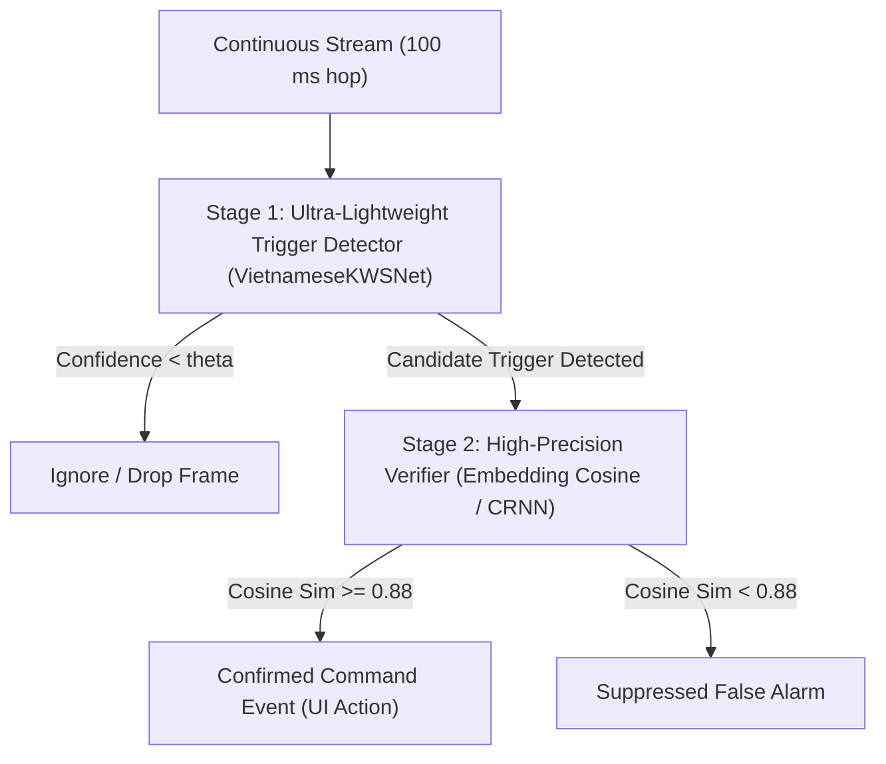

# Recommended Next Experiments: Post-Phase 32 Research Roadmap

**Workspace:** `D:\trainidentificationaudio`  
**Experiment Campaign:** `experiments/vieneu_kws_robustness_campaign/`  
**Authoritative Evidence Base:** Phases 28, 29, 30, 31, and 32  

---

## Executive Summary

Phases 30–32 established rigorous empirical benchmarks for the six-class Vietnamese KWS baseline:
- High clean accuracy (92.08% baseline, 93.33% calibrated) and high command stream recall (97.5%–100.0%).
- Exceptional resilience to low-frequency HVAC noise down to 0 dB SNR.
- Significant vulnerabilities to broadband noise ($\le 15$ dB SNR), multi-talker babble, and sliding-window false triggers on continuous non-target speech (155–1,200 FA/hr).

To advance from an experimental research baseline toward an operational-grade system, the following 4-step roadmap is recommended in priority order:

---

## 1. Priority 1: Hard-Negative Mining & UNKNOWN Class Expansion

### Problem Diagnosed
In both static evaluation and streaming simulation, the single largest error mode is false activation on phonetically similar Vietnamese words:
- `Không` $\rightarrow$ `XUONG` or `LEN`
- `Lưu ý` $\rightarrow$ `LEN`
- `Phát hiện` $\rightarrow$ `PHAI`
- `Trại giam` $\rightarrow$ `TRAI`

### Recommended Experiment
Generate an expanded **Hard-Negative Synthetic Dataset** using the existing VieNeu-TTS pipeline:
1. **Target Confusable Monosyllables:**
   - Onset `/ʈ/` / `tr`: `trại`, `trạm`, `trời`, `trên`, `tròn`, `trắng`
   - Onset `/f/` / `ph`: `phòng`, `phát`, `phút`, `phần`, `pháp`, `phím`
   - Onset `/l/`: `làm`, `lấy`, `lúc`, `luôn`, `lại`, `lời`
   - Onset `/s/` / `x`: `xuồng`, `xem`, `xong`, `xanh`, `xa`, `xuất`
2. **High-Frequency Conversational Fillers:**
   - `ừ`, `à`, `dạ`, `vâng`, `không`, `được`, `rồi`, `nhé`
3. **Scale:** Expand `UNKNOWN` training pool from 170 clips to 1,000+ clips (5x increase), balancing target commands against a diverse phonetic vocabulary.

---

## 2. Priority 2: Multi-Condition Noise Augmentation & SpecAugment

### Problem Diagnosed
The current model was trained entirely on pristine, clean TTS audio. Consequently:
- White/pink noise below 15 dB SNR collapses model accuracy to ~17% (chance).
- Babble noise below 15 dB SNR degrades accuracy from 71.9% to 34.0%.

### Recommended Experiment
Incorporate on-the-fly acoustic augmentation into the training data loader:
1. **Dynamic Noise Injection (50% probability per training batch):**
   - White noise, Pink noise, HVAC noise, and Babble noise mixed at random SNRs $\in [5, 25]$ dB.
2. **SpecAugment:**
   - Time masking: 1–2 masks of width $\le 12$ frames.
   - Frequency masking: 1–2 masks of width $\le 8$ mel channels.
3. **Expected Impact:** Eliminates the sharp collapse in noisy conditions, lifting HVAC 0 dB accuracy above 85% and Babble 15 dB accuracy above 75%.

---

## 3. Priority 3: Cascaded Two-Stage Architecture for False-Alarm Suppression

### Problem Diagnosed
Sliding-window evaluation demonstrated that frame-by-frame classifiers trigger false alarms on continuous non-target speech (155–1,200 FA/hr), because isolated 1.0s windows can align with transient phonemes.

### Recommended Architecture

1. **Stage 1 (Detector):** The existing 107k-parameter CNN runs every 100 ms to detect candidate triggers with high recall ($\ge 98\%$).
2. **Stage 2 (Verifier):** When Stage 1 fires, a 1.2-second window centered on the trigger is passed to a high-capacity verifier (e.g., an embedding model or temporal CRNN).
3. **Expected Impact:** Reduces False Alarms per Hour from $> 150\text{ FA/hr}$ to $< 1.0\text{ FA/hr}$ without increasing baseline CPU consumption during silence/background.

---

## 4. Priority 4: Completion of Human Listening Review & Field Validation

### Problem Diagnosed
Current status remains:
- `PENDING_HUMAN_LISTENER_VERIFICATION`
- `NOT_VALIDATED_ON_NATURAL_SPEECH`

### Recommended Action
1. Complete the 80-clip blinded human listening review sheet (`blinded_listening/blinded_listening_review_sheet.csv`) to calibrate synthetic voice intelligibility.
2. Once synthetic intelligibility is quantified, design a controlled acoustic field acquisition campaign collecting authentic human recordings of the four target commands across Vietnamese regional accents (Northern, Central, Southern).
