# Phase 32: Continuous-Stream Simulation and False-Trigger/Latency Report

**Workspace:** `D:\trainidentificationaudio`  
**Experiment Campaign:** `experiments/vieneu_kws_robustness_campaign/`  
**Streaming Engine:** `SlidingWindowStreamingEngine`  
**Baseline Checkpoints:** Seeds 42, 43, 44 (`VietnameseKWSNet`, 6 classes)  
**Evaluation Dates:** October 2026  

---

## Governance & Integrity Boundaries

> [!WARNING]
> **GOVERNANCE STATUS: PENDING_HUMAN_LISTENER_VERIFICATION**  
> All streams evaluated were composed of synthetic clips generated by VieNeu-TTS v3 Turbo. The 80-clip subjective human listening review remains pending.

> [!CAUTION]
> **GOVERNANCE STATUS: NOT_VALIDATED_ON_NATURAL_SPEECH**  
> Stream evaluation was conducted on concatenated synthetic speech and synthetic babble/noise. Real-world continuous speech characteristics (prosodic variation, conversational overlap, room reverberation) are not represented in this synthetic simulation.

---

## 1. Executive Summary

Phase 32 evaluates the six-class Vietnamese KWS model in a realistic continuous-streaming setting using sliding-window inference with consecutive-hit integration and hysteresis debouncing:

1. **Target Command Detection & Latency:**
   - On continuous command streams (11.13 minutes, 160 target utterances interspersed with distractors and silence), the model achieves **97.5% – 100.0% True Positive Recall**.
   - Average trigger latency is **428.6 ms – 471.2 ms** from speech onset, well within acceptable interactive voice UI limits (< 600 ms).
   - Applying confidence calibration improves command stream precision from **80.8% – 87.2%** up to **86.2% – 90.8%**.

2. **False Alarms in Continuous Non-Target Speech:**
   - In a 20.0-minute continuous background stream with zero target commands (composed of conversational multi-talker babble, non-target Vietnamese speech, and ambient pauses), the uncalibrated detector exhibits a high false alarm rate (**230.8 – 1,274.1 FA/hr**).
   - Post-processing confidence calibration ($\theta = 0.60 – 0.85$) consistently reduces false alarms across all seeds:
     - **Seed 44 ($\theta = 0.85$):** Reduces FA/hr from **230.84** down to **155.89 FA/hr** (-32.5%).
     - **Seed 43 ($\theta = 0.75$):** Reduces FA/hr from **1,274.09** down to **1,190.15 FA/hr**.
     - **Seed 42 ($\theta = 0.60$):** Reduces FA/hr from **1,031.26** down to **956.32 FA/hr**.
3. **Core Architectural Finding:**
   - While confidence thresholding and 2-frame consecutive-hit debouncing significantly suppress false activations, a frame-by-frame 1.0-second CNN without temporal recurrent memory or streaming CTC loss remains vulnerable to transient phonemic false alarms on unconstrained continuous speech.

---

## 2. Streaming Simulation Architecture

```mermaid
flowchart LR
    A["Continuous Audio Stream (16 kHz)"] --> B["Ring Buffer (16,000 samples / 1.0s)"]
    B --> C["Log-Mel Spectrogram (40x101)"]
    C --> D["VietnameseKWSNet CNN Logits"]
    D --> E["Softmax Probabilities"]
    E --> F["Confidence Policy (Threshold theta)"]
    F --> G["Consecutive-Hit Filter (N=2 frames)"]
    G --> H["Debounce / Cooldown Lockout (0.60s)"]
    H --> I["Trigger Event (Timestamp & Class)"]
```

### 2.1 Engine Parameters
- **Window Length:** 1.0 second (16,000 samples).
- **Hop / Stride:** 100 ms (1,600 samples) $\rightarrow$ 10 inferences per second.
- **Decision Rule:**
  - Prediction must be a target command (`TRAI`, `PHAI`, `LEN`, `XUONG`).
  - Softmax probability $\ge \theta$ (calibrated per seed).
  - Sustained for $\ge 2$ consecutive windows (200 ms confirmation).
  - Lockout period: 0.60 seconds after trigger event.

### 2.2 Continuous Audio Streams
1. **Command Stream (`continuous_command_stream.wav`):**
   - Duration: 667.5 seconds (11.13 minutes).
   - Content: 160 held-out test target commands + 53 UNKNOWN distractors + silence pauses (1.5s–3.5s).
   - Total reference ground-truth events: 213 events.
2. **Non-Target Stream (`continuous_nontarget_stream.wav`):**
   - Duration: 1200.9 seconds (20.01 minutes).
   - Content: Pure UNKNOWN phrases, multi-talker Vietnamese babble bursts, and ambient silence.
   - Ground truth target commands: 0 (Pure negative stream for FA/hr calculation).

---

## 3. Streaming Results Summary (3 Seeds, Before vs After Calibration)

| Seed | Operating Mode | $\theta$ | Command Recall (%) | Command Precision (%) | Mean Latency (ms) | P90 Latency (ms) | Non-Target Stream FA/hr |
| :---: | :---: | :---: | :---: | :---: | :---: | :---: | :---: |
| **42** | Uncalibrated | 0.00 | 98.1% | 84.0% | 449.3 ms | 536.0 ms | 1031.26 |
| **42** | **Calibrated** | **0.60** | **98.1%** | **86.7%** | **458.2 ms** | **536.0 ms** | **956.32** |
| **43** | Uncalibrated | 0.00 | 98.1% | 87.2% | 428.6 ms | 511.0 ms | 1274.09 |
| **43** | **Calibrated** | **0.75** | **98.8%** | **90.8%** | **464.9 ms** | **538.0 ms** | **1190.15** |
| **44** | Uncalibrated | 0.00 | 100.0% | 80.8% | 447.4 ms | 522.0 ms | 230.84 |
| **44** | **Calibrated** | **0.85** | **97.5%** | **86.2%** | **471.2 ms** | **551.0 ms** | **155.89** |

---

## 4. Latency Distribution Analysis

| Metric | Seed 42 (Calibrated) | Seed 43 (Calibrated) | Seed 44 (Calibrated) |
| :--- | :---: | :---: | :---: |
| **Min Latency** | 224.0 ms | 215.0 ms | 240.0 ms |
| **Median Latency** | 451.0 ms | 462.0 ms | 468.0 ms |
| **Mean Latency** | 458.2 ms | 464.9 ms | 471.2 ms |
| **90th Percentile (P90)** | 536.0 ms | 538.0 ms | 551.0 ms |
| **Max Latency** | 732.0 ms | 718.0 ms | 744.0 ms |

The ~450–470 ms mean latency corresponds physically to:
- ~150 ms pre-speech silence in the 1.0s window.
- ~150 ms active consonant/vowel phoneme articulation.
- ~150 ms trailing buffer needed for the CNN receptive field to establish high command probability.
- 100 ms hop step + 2nd consecutive hit confirmation.

---

## 5. False Trigger Analysis & Root Causes

1. **Phonetic Substring Alignments:**
   - In continuous streams, sentences containing Vietnamese words with identical onset consonants or vowels align momentarily with the 1.0-second window.
   - For example:
     - `Không` (shared `/k/` velar plosive or open back vowel) momentarily triggers `XUONG` or `LEN`.
     - `Lưu ý` or `Làm việc` momentarily triggers `LEN`.
     - `Phát thanh` or `Phát hiện` momentarily triggers `PHAI`.
2. **Seed 44 Superiority in FA Suppression:**
   - Seed 44 achieved the highest calibrated threshold ($\theta = 0.85$), yielding an FA rate of **155.89 FA/hr**, compared to ~1000 FA/hr for seeds 42 and 43.
   - However, even 155 FA/hr means approximately 2.6 false triggers per minute of continuous non-target speech, which is unsuitable for always-on open-microphone consumer devices without a secondary verification stage.
