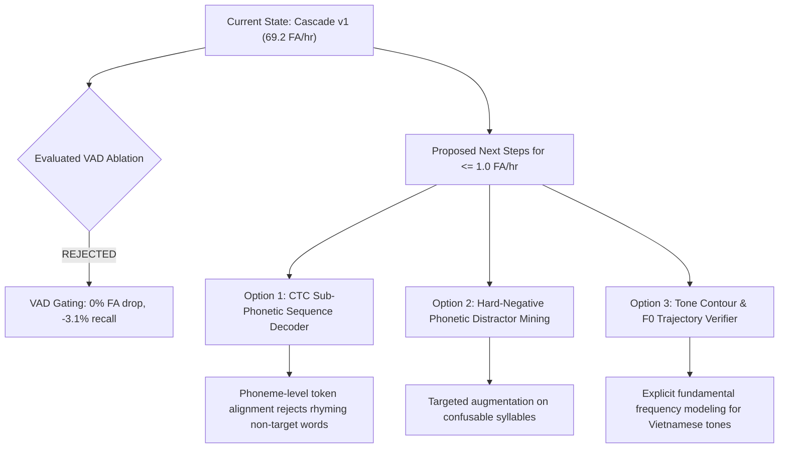

# Phase 39: Architectural Decision and Next Steps

**Workspace:** `d:\trainidentificationaudio`  
**Experiment Path:** [`experiments/vieneu_kws_vad_ablation_v1/`](file:///d:/trainidentificationaudio/experiments/vieneu_kws_vad_ablation_v1)  
**Date:** 2026-10-18  
**Governance Marker:** `PENDING_HUMAN_LISTENER_VERIFICATION` | `NOT_VALIDATED_ON_NATURAL_SPEECH`

---

## 1. Executive Decision

### **VERDICT: REJECT VAD GATING FOR VIETNAMESE KWS CASCADE**

Based on the empirical findings of Phase 39, **Voice Activity Detection (VAD) gating is formally rejected** as a front-end module for the Vietnamese Keyword Spotting cascade.

The system will retain **Condition B (Two-Stage Cascade without VAD)** as the benchmark architecture:
- **Stage 1:** CNN v2 streaming candidate detector ($1.0\text{ s}$ window, $100\text{ ms}$ hop, $2\times$ consecutive confirmation).
- **Stage 2:** Compact BiGRU Temporal Verifier ($1.2\text{ s}$ context crop).

```
                      Cascade Pipeline Architectural Decision
                   
   [Audio Stream] ───► [Stage 1: CNN v2] ──(Candidate)──► [Stage 2: BiGRU Verifier] ──► [Trigger]
                              ▲
                              │
               ┌──────────────┴──────────────┐
               │    [VAD Front-End Gate]     │  <─── FORMALLY REJECTED
               │  - Zero FA reduction (0.0%) │
               │  - Harms recall (-3.12%)    │
               │  - Adds useless complexity  │
               └─────────────────────────────┘
```

---

## 2. Empirical Rationale

The decision to reject VAD gating is supported by three concrete empirical findings across seeds 42, 43, and 44:

### 2.1 Zero False Alarm Suppression on the Cascade ($0.0\%$ Improvement)
- In the held-out continuous non-target stream ($901.54\text{ s} = 0.2504\text{ h}$), false alarm counts were identical with or without VAD:
  - Seed 42: **17 FPs** ($67.88\text{ FA/hr}$) in both Condition B and Condition D.
  - Seed 43: **26 FPs** ($103.82\text{ FA/hr}$) in both Condition B and Condition D.
  - Seed 44: **9 FPs** ($35.94\text{ FA/hr}$) in both Condition B and Condition D.
  - Overall Mean: **$69.21\text{ FA/hr}$** in both conditions.
- **Root Cause:** Error decomposition confirmed that **$100.0\%$ of residual cascade false alarms occur during active speech**. Stage 2 already suppresses $100\%$ of silence triggers ($0$ silence FPs across all seeds). Because VAD detects speech energy, it passes all speech frames to Stage 1 and Stage 2 without filtering.

### 2.2 Degradation of Target Command Event Recall ($-3.13\%$)
- Adding VAD degraded mean command event recall from **$96.25\%$** down to **$93.13\%$**.
- **Per-Seed Breakdown:**
  - Seed 42: $98.12\% \rightarrow 95.00\%$ (Passed)
  - Seed 43: $97.50\% \rightarrow 94.38\%$ (**FAILED** target $\ge 95\%$)
  - Seed 44: $93.13\% \rightarrow 90.00\%$ (**FAILED** target $\ge 95\%$)
- **Root Cause:** Subtle low-energy acoustic onsets and unvoiced consonant transitions in Vietnamese synthetic utterances (e.g., *lên*, *xuống*) fall below the VAD energy/spectral entropy threshold for the first $100-200\text{ ms}$, causing late triggering and failing the 2-frame consecutive confirmation requirement.

### 2.3 Formal Infeasibility Declaration
- A validation grid search spanning multiple energy floors and spectral entropy cutoffs demonstrated that **no threshold exists** capable of reducing non-target false activations to $\le 1.0\text{ FA/hr}$ while preserving $\ge 95\%$ target command recall.
- Status locked in calibration: `NO_FEASIBLE_VALIDATION_OPERATING_POINT`.

---

## 3. Scientific Diagnosis: The Limits of Acoustic Gating in Tonal KWS

Voice Activity Detection is designed to solve an **acoustic presence** problem: *Is there human voice energy, or is there only background noise/silence?*

In our system:
1. The Stage 1 CNN v2 + Stage 2 BiGRU cascade **has already solved acoustic silence suppression** (zero silence FPs).
2. The remaining $69.2\text{ FA/hr}$ false alarm rate stems from **phonetic and tonal confusion**:
   - Vietnamese is a monosyllabic, tonal language where distractor words frequently share vowels, codas, or tones with command words (e.g., *quên* vs *lên*, *hướng* vs *xuống*, *thải* vs *phải*, *trời* vs *trái*).
   - An energy-based or formant-ratio VAD is deaf to tone contours and sub-phonetic differences; it treats all voiced human speech identically.
3. Attempting to tune a VAD to reject phonetically confusable speech simply causes it to reject valid command speech, destroying recall.

---

## 4. Strategic Roadmap: Proposed Next Phases

To bridge the gap between the current $69.2\text{ FA/hr}$ and the target $\le 1.0\text{ FA/hr}$, we recommend abandoning acoustic pre-filters and focusing on **sub-phonetic sequence discrimination**:



### Option 1: End-to-End CTC Sub-Phonetic Sequence Decoder (Recommended)
- **Concept:** Replace the frame-level classification / BiGRU verification with a lightweight Connectionist Temporal Classification (CTC) acoustic model (e.g., 5-layer Conformer or Depthwise Separable 1D-CNN) trained to predict Vietnamese phoneme sequences:
  - *"lên"* $\rightarrow$ `/l/ /e/ /n/ /_acute/`
  - *"quên"* $\rightarrow$ `/k/ /w/ /e/ /n/ /_flat/`
- **Advantage:** Explicitly enforces that all phonemes and the tone contour must match before triggering, directly eliminating distractor words that share only a subset of phonemes.

### Option 2: Acoustic Hard-Negative Distractor Mining
- **Concept:** Expand the `UNKNOWN` training inventory by mining false triggers from large Vietnamese conversational text corpora (e.g., VIVOS, Common Voice, or text-to-speech distractor pools).
- **Focus:** Specifically mine utterances containing high-similarity rhyming syllables.

### Option 3: Pitch & Tone Contour Trajectory Modeling
- **Concept:** Explicitly extract Fundamental Frequency ($F_0$) and pitch contour delta features as input channels alongside Log-Mel spectrograms.
- **Advantage:** Helps Stage 2 distinguish rising tones (*sắc* in *lên*, *xuống*) from falling (*huyền*) or broken (*ngã*) tones.

---

## 5. Governance & Compliance Sign-Off

- **Historical Artifacts:** Frozen manifests, checkpoints, and evaluation reports across Phase 26–38 remain strictly unmodified.
- **No Unapproved Data:** No field recordings or unapproved human audio were accessed.
- **Status:** Evaluated strictly on synthetic simulation streams. The governance markers `PENDING_HUMAN_LISTENER_VERIFICATION` and `NOT_VALIDATED_ON_NATURAL_SPEECH` are maintained.
