# Chương 01: Phạm vi Dự án & Yêu cầu Kỹ thuật (Project Scope & Requirements)

## 1. Định nghĩa Bài toán (Problem Statement)
Hệ thống Phát hiện Từ khóa (Keyword Spotting - KWS) là thành phần tiền xử lý giọng nói quan trọng trên thiết bị biên. Mục tiêu của dự án là nhận diện tức thời 4 lệnh định hướng trong tiếng Việt từ luồng âm thanh thu âm đơn kênh (mono) ở tần số lấy mẫu chuẩn $16\text{ kHz}$:
- `TRAI` (/tʂaːj˧˦/ hoặc /tɕaːj˧˦/)
- `PHAI` (/faːj˨˩˦/)
- `LEN` (/lɛn˧˧/)
- `XUONG` (/sɨəŋ˧˩/ hoặc /ʂɨəŋ˧˩/)

Bên cạnh 4 lệnh hợp lệ, hệ thống phải liên tục giám sát và loại bỏ mọi âm thanh không mong muốn bằng cách phân loại chúng vào lớp từ chối (`REJECT` hoặc tập hợp các lớp phụ `UNKNOWN` và `BACKGROUND_NOISE`).

## 2. Bounded-Utterance vs. Streaming Inference
Một trong những bài học kỹ thuật quan trọng nhất của dự án là sự phân biệt rõ ràng giữa hai chế độ suy luận:

```mermaid
flowchart TD
    subgraph BoundedUtterance ["Chế độ Đoạn Bọc Đóng Khung (Bounded-Utterance) - ĐÃ ĐẠT CHUẨN"]
        A1["Âm thanh đầu vào"] --> B1["Cắt đúng 1.0 giây (16.000 mẫu)"]
        B1 --> C1["Chuẩn hóa biên độ (max abs > 1.0)"]
        C1 --> D1["Log-Mel Spectrogram (40 mel bins, N_fft=512)"]
        D1 --> E1["Mô hình CNN (variant_v11)"]
        E1 --> F1{"P(cmd) >= 0.20 ?"}
        F1 -->|"Có"| G1["Kích hoạt Lệnh (TRAI/PHAI/LEN/XUONG)"]
        F1 -->|"Không"| H1["Từ chối (REJECT)"]
    end

    subgraph Streaming ["Chế độ Luồng Micro Mở (Streaming Open-Mic) - CHƯA TRIỂN KHAI"]
        A2["Luồng Micro Liên tục (48/16 kHz)"] --> B2["Bộ đệm Vòng (Circular Ring Buffer)"]
        B2 --> C2["Bộ Phát hiện Giọng nói (VAD Engine)"]
        C2 --> D2["Cửa sổ trượt (Hop 100-200ms)"]
        D2 --> E2["Lọc Khử Nảy (Debounce & State Machine)"]
        E2 --> F2["Mô hình CNN KWS"]
        F2 --> G2["Trạng thái: NO_DEPLOYABLE_SYSTEM_AT_CURRENT_SPECIFICATION"]
    end
```

### 2.1. Chế độ Bounded-Utterance (Hiện trạng Thẩm định)
- **Cấu trúc dữ liệu:** Mỗi mẫu kiểm thử là một tệp âm thanh đơn lẻ có thời lượng cố định $1.0\text{ giây}$ ($16.000$ mẫu PCM 16-bit mono).
- **Căn chỉnh khẩu lệnh:** Khẩu lệnh mục tiêu nằm trọn vẹn trong khoảng thời gian này, được căn giữa hoặc phân bố ngẫu nhiên kèm khoảng lặng đệm (padding) tối thiểu $100\text{ ms}$ ở hai đầu.
- **Tính toán xác suất:** Mô hình chỉ thực hiện một lần chuyển tiếp (forward pass) duy nhất trên ma trận Log-Mel Spectrogram kích thước $[1, 1, 40, 101]$ để đưa ra quyết định cuối cùng.

### 2.2. Chế độ Streaming Open-Mic (Chưa sẵn sàng)
- Trong môi trường thực tế, micro ghi âm liên tục và không có ranh giới bắt đầu/kết thúc từ trước.
- Để triển khai dạng streaming, hệ thống bắt buộc phải có:
  1. Module VAD để phát hiện khi nào người dùng bắt đầu nói và dừng nói.
  2. Cơ cấu cửa sổ trượt (sliding window) với bước nhảy (hop length) từ $100\text{ ms}$ đến $250\text{ ms}$.
  3. Bộ máy trạng thái (state machine) để khử kích hoạt lặp (debounce / non-maximum suppression) khi cùng một từ lệnh kéo dài qua nhiều khung hình trượt.
- **Kết luận hiện trạng:** Kho mã nguồn hiện nay mới chỉ xây dựng các tệp kịch bản kiểm thử giả lập sơ khai cho streaming ([`src/models/evaluate_streaming.py`](file:///d:/trainidentificationaudio/src/models/evaluate_streaming.py)), chưa có kiến trúc bộ đệm vòng (ring buffer) tối ưu hóa C++ hay bộ lọc khử nhiễu hoàn chỉnh. Do đó, hệ thống được gắn nhãn chính thức: `NO_DEPLOYABLE_SYSTEM_AT_CURRENT_SPECIFICATION` đối với yêu cầu micro mở liên tục.

## 3. Sự Tiến hóa của Cơ chế Từ chối (Rejection Mechanism Evolution)

| Thế hệ Mô hình | Không gian Nhãn (Label Space) | Cơ chế Từ chối (Rejection Strategy) | Điểm yếu Cốt tử |
| :--- | :--- | :--- | :--- |
| **Giai đoạn Đầu (Phase 27 - 35)** | 4 Lớp (`TRAI`, `PHAI`, `LEN`, `XUONG`) | Softmax Argmax đơn thuần không có ngưỡng | Mô hình buộc phải gán nhãn 1 trong 4 lệnh cho mọi tiếng động (FAR $\approx 100\%$ khi có tạp âm). |
| **Giai đoạn Thêm Lớp Nền (Phase 36 - 60)** | 5 Lớp (`TRAI`, `PHAI`, `LEN`, `XUONG`, `NOISE`) | Softmax Argmax trên 5 lớp | Tạp âm môi trường được hấp thụ, nhưng tiếng nói người nói từ khác (speech out-of-vocabulary) vẫn bị kích hoạt nhầm. |
| **Giai đoạn 6 Lớp Phân tách (Phase 61 - 89)** | 6 Lớp (`TRAI`, `PHAI`, `LEN`, `XUONG`, `UNKNOWN`, `BACKGROUND_NOISE`) | Softmax Argmax + Ngưỡng Margin $\Delta P > 0.3$ | Phân biệt được tiếng nói lạ và tiếng ồn nền, tuy nhiên nhạy cảm với sự chênh lệch phân phối xác suất. |
| **Giai đoạn Hoàn thiện v11 - v13 (Hiện tại)** | 5 Lớp Logic / 2 Lớp Quyết định (`COMMAND` vs `REJECT`) | **Hard-Negative Weighted Cross Entropy + Ngưỡng Quyết định $\theta_{\text{cmd}} = 0.20$** | **Khắc phục triệt để:** Bắt buộc $P(\text{cmd}) \ge \theta_{\text{cmd}}$ VÀ $P(\text{cmd}) = \max_j P(c_j)$. Giảm tỷ lệ FAR từ $7.5\%$ xuống $0.63\% - 0.75\%$. |

## 4. Yêu cầu Kỹ thuật Cốt lõi (System Targets)
Theo đặc tả thiết kế hệ thống KWS công nghiệp:
- **Command Recall (Độ nhạy nhận lệnh):** $\ge 95.0\%$ trên tất cả các lệnh mục tiêu độc lập.
- **False Alarm Rate (Tỷ lệ báo động giả):** $\le 1.0\%$ (chấp nhận tối đa $\le 2.0\%$ trong các điều kiện kiểm thử nhiễu khắc nghiệt).
- **Inference Latency (Độ trễ suy luận):** $\le 20.0\text{ ms}$ trên CPU ARM Cortex-A / x86 phổ thông; không vượt quá $50.0\text{ ms}$.
- **Bộ nhớ Mô hình (Model Footprint):** Kích thước file trọng số $< 2.0\text{ MB}$; RAM hoạt động $< 10.0\text{ MB}$.
