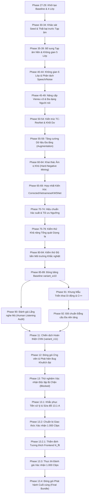

# Chương 02: Lịch sử Nghiên cứu Theo Tiến trình Thời gian (Chronological Research History)

## 1. Tổng quan Tiến trình 26 Giai đoạn Nghiên cứu
Dự án Phát hiện Từ khóa Tiếng Việt (Vietnamese Keyword Spotting - KWS) đã trải qua 26 giai đoạn phát triển liên tục, từ các thử nghiệm phân loại ban đầu đến hệ thống CNN siêu nhẹ được kiểm định độc lập và đóng gói phát hành chuẩn công nghiệp.

Dưới đây là sơ đồ dòng thời gian tiến hóa của các mốc nghiên cứu chính:

---

## 2. Chi tiết Từng Giai đoạn Nghiên cứu

### 2.1. Giai đoạn Sơ khởi: 4 Lớp và Ảo tưởng Hiệu năng (Phase 27 - 34)
- **Mục tiêu:** Xây dựng mô hình phân loại 4 hướng (`TRAI`, `PHAI`, `LEN`, `XUONG`) từ dữ liệu tổng hợp thử nghiệm.
- **Phương pháp:** Sử dụng mô hình CNN 2D cơ bản với đầu vào Spectrogram thô, phân loại bằng hàm Softmax Argmax trực tiếp trên 4 lớp.
- **Hiện tượng & Thất bại:**
  - Trên tập dữ liệu đóng (chỉ gồm 4 từ khóa đọc rõ ràng), mô hình đạt độ chính xác gần như tuyệt đối ($> 99\%$).
  - Tuy nhiên, khi đưa vào môi trường có tiếng ồn hoặc người dùng nói bất kỳ từ nào khác (ví dụ: *"chạy đi"*, *"xin chào"*), mô hình bắt buộc phải gán vào 1 trong 4 nhãn lệnh. Tỷ lệ kích hoạt nhầm (False Alarm Rate) trên âm thanh ngoại lai tiệm cận **$100\%$**.
- **Bài học rút ra:** Hệ thống KWS thực tế không thể chỉ là bài toán phân loại đóng (closed-set classification), mà phải có khả năng từ chối (open-set rejection).

### 2.2. Giai đoạn Hấp thụ Tạp âm & Không gian 5 Lớp (Phase 35 - 39)
- **Mục tiêu:** Bổ sung lớp thứ 5 đại diện cho tạp âm (`NOISE` / `BACKGROUND_NOISE`) để hấp thụ các âm thanh môi trường.
- **Phương pháp:** Thu thập các đoạn âm thanh nhiễu từ bộ dữ liệu ESC-50 và tiếng ồn văn phòng, đưa vào huấn luyện như một lớp độc lập. Quét dải SNR từ $+20\text{ dB}$ xuống $0\text{ dB}$.
- **Kết quả:** Mô hình có khả năng loại bỏ tiếng gõ bàn phím, tiếng quạt gió và tiếng vỗ tay rất tốt.
- **Hạn chế tồn tại:** Mô hình vẫn kích hoạt nhầm khi gặp tiếng nói con người không phải từ khóa (human speech out-of-vocabulary). Tiếng nói ngoài mục tiêu có phổ tần số rất khác tạp âm môi trường và gần với khẩu lệnh hơn, khiến lớp `NOISE` bị bất lực.

### 2.3. Không gian 6 Lớp & Phân tách Giọng nói Ngoài Danh mục (Phase 40 - 44)
- **Mục tiêu:** Tách riêng tạp âm không phải tiếng nói (`BACKGROUND_NOISE`) và tiếng nói không phải khẩu lệnh (`UNKNOWN`).
- **Không gian nhãn:** `[TRAI, PHAI, LEN, XUONG, UNKNOWN, BACKGROUND_NOISE]`.
- **Đóng góp kỹ thuật:** Áp dụng cơ chế ngưỡng biên độ chênh lệch xác suất (Probability Margin Thresholding):
  $$\max_{j \in \text{commands}} P(c_j) - P(\text{UNKNOWN}) > \Delta_{\text{margin}}$$
- **Kết quả:** Giảm mạnh các kích hoạt nhầm thông thường. Tuy nhiên, mô hình vẫn dễ bị nhầm lẫn bởi các từ có âm vị tương đồng (phonetic confusions).

### 2.4. Nâng cấp Bộ Tổng hợp Vieneu v3 & Đa dạng Người nói (Phase 45 - 49)
- **Nâng cấp dữ liệu:** Chuyển đổi toàn bộ pipeline tổng hợp sang **Vieneu TTS v3-Turbo**, hỗ trợ tạo âm thanh tiếng Việt tự nhiên với bộ phiên âm âm vị eSpeak-ng chuẩn xác.
- **Phân tách người nói:** Thiết lập quy tắc cách ly giọng đọc nghiêm ngặt. Phân bổ các ID giọng cố định cho Train, Val và Test để tránh hiện tượng rò rỉ đặc trưng người nói (speaker leakage).

### 2.5. Khảo sát Kiến trúc TC-ResNet & Khối Dư Thời gian (Phase 50 - 59)
- **Cải tiến kiến trúc:** Áp dụng họ kiến trúc **Temporal Convolutional Residual Network (TC-ResNet)** với các tích chập 1D theo trục thời gian trên đặc trưng Mel Spectrogram, kết hợp kết nối tắt (residual skip connections).
- **Tăng cường dữ liệu đa tầng (Phase 55 - 59):** Bổ sung dịch chuyển thời gian ngẫu nhiên (time shift $\pm 100\text{ ms}$), co giãn tốc độ (time stretch), thay đổi cao độ (pitch shift), và trộn nhiễu ngẫu nhiên với SNR biến thiên từ $+5\text{ dB}$ đến $+20\text{ dB}$.

### 2.6. Khai thác Âm vị Khó (Hard-Negative Mining) & Hợp nhất Kiến trúc (Phase 60 - 69)
- **Phát hiện lỗi âm vị:** Qua kiểm thử, phát hiện các từ tiếng Việt có tiền tố hoặc vần gần giống gây kích hoạt nhầm nghiêm trọng:
  - *"tai"*, *"lái"*, *"trại"* $\rightarrow$ nhầm thành `TRAI`
  - *"bên phải"*, *"phấn"*, *"hải"* $\rightarrow$ nhầm thành `PHAI`
  - *"lén"*, *"lên trên"*, *"bền"* $\rightarrow$ nhầm thành `LEN`
  - *"xuồng"*, *"buông"*, *"uống"* $\rightarrow$ nhầm thành `XUONG`
- **Chiến lược Hard-Negative:** Tổng hợp hàng ngàn mẫu âm thanh chứa các từ gây nhiễu này và đưa vào tập huấn luyện với trọng số phạt cao hơn.
- **Kiến trúc `CorrectedVietnameseKWSNet`:** Chuẩn hóa kiến trúc CNN với các tầng tích chập chuẩn hóa Batch Normalization, Dropout chống quá khớp, và Global Average Pooling trước lớp phân loại tuyến tính.

### 2.7. Tối ưu Ngưỡng & Đóng băng Baseline `variant_w10` (Phase 70 - 89)
- **Tối ưu ngưỡng (Phase 70 - 74):** Thay vì sử dụng Argmax, áp dụng ngưỡng quyết định lệnh $\theta_{\text{cmd}}$. Khẩu lệnh chỉ được kích hoạt nếu:
  $$P(c^*) \ge \theta_{\text{cmd}} \quad \text{và} \quad c^* = \arg\max_{c} P(c)$$
- **Đóng băng Baseline (Phase 85 - 89):** Đóng băng mô hình `variant_w10_seed42.pt` với frontend 40 Mel bins, $N_{\text{fft}} = 400$, và $\theta_{\text{cmd}} = 0.40$. Mô hình này phục vụ làm thước đo đối chuẩn (frozen baseline) cho các giai đoạn tiếp theo.

### 2.8. Kiểm thử Mù trên Người (Phase 90) & Triển khai Di động (Phase 91 - 92)
- **Kiểm thử mù Phase 90:** Thiết kế bộ 120 clip kiểm thử mù (40 clips lệnh, 80 clips không phải lệnh) giao cho 6 người đánh giá độc lập. Thẩm tra thực tế cho thấy: chỉ có **01 người đánh giá** (`reviewer_01`) hoàn thành nộp kết quả; 5 người còn lại bỏ dở. Checkpoint `variant_w10` đạt 39/40 lệnh đúng, nhưng có tới 9/80 mẫu ngoại lai bị kích hoạt nhầm (FAR = $11.25\%$).
- **Triển khai di động Phase 91 - 92:** Xây dựng khung mã nguồn xuất ONNX, mã bao C++ và khung ứng dụng Android/iOS. Đo đạc độ trễ trên CPU và kiểm tra tính nhất quán giữa PyTorch và ONNX Runtime.

### 2.9. Chiến dịch Hoàn thiện CNN v11 (Phase 11 Completion Campaign)
- **Động lực:** Khắc phục tỷ lệ báo động giả cao ($11.25\%$) của `variant_w10` trên các âm vị khó.
- **Giải pháp v11:**
  1. Nâng cấp frontend trích xuất Log-Mel sang cấu hình chuẩn lũy thừa 2: $N_{\text{fft}} = 512$, $W_{\text{len}} = 400$, $H_{\text{len}} = 160$.
  2. Bổ sung tập dữ liệu Hard Negatives mở rộng với các từ ngữ âm tương đồng sâu.
  3. Áp dụng hàm mất mát **Hard-Negative Weighted Cross Entropy Loss** (tăng trọng số phạt cho các lỗi âm vị lên 1.5x - 2.0x).
- **Kết quả:** Huấn luyện 3 hạt ngẫu nhiên (seeds 42, 43, 44). Hạt **seed 42** thể hiện sự vượt trội toàn diện trên tập kiểm thử khóa với FAR giảm xuống mức kỷ lục **$0.63\%$** (3/480 clips) và Recall đạt **$99.17\%$** (119/120 clips) tại ngưỡng $\theta_{\text{cmd}} = 0.20$. Checkpoint `variant_v11_hard_negative_weighted_seed42.pt` được chọn làm Champion.

### 2.10. Khủng hoảng Tiền xử lý & Khắc phục Toàn diện (Phase 12 - 13.2.1)
- **Phase 12 (Đóng gói Ứng viên):** Tạo bundle phát hành v12. Tuy nhiên, mã suy luận trong `infer.py` đã tự ý áp dụng hàm chuẩn hóa đỉnh biên độ $-1.0\text{ dBFS}$ vô điều kiện cho mọi tín hiệu âm thanh vào.
- **Phase 13 (Thử nghiệm Xác nhận Bị Chặn):** Trong đợt kiểm thử độc lập Phase 13, kiểm toán viên phát hiện: khi đưa một đoạn âm thanh gần như yên lặng (nhiễu phòng với biên độ cực đại $0.005$) vào `infer.py`, hàm này đã khuếch đại tín hiệu lên $+45\text{ dB}$, biến nhiễu nền thành một xung âm thanh lớn và kích hoạt nhầm thành lệnh `TRAI`. Cuộc kiểm thử bị đình chỉ ngay lập tức (**BLOCKED**).
- **Phase 13.1 (Khắc phục Tiền xử lý & Sửa đổi 13.1-A):**
  - Khôi phục logic chuẩn hóa chính xác của tập huấn luyện `train_v11.py`: **Chỉ co tỷ lệ khi $\max(|x|) > 1.0$**; các tín hiệu âm lượng nhỏ hoặc bình thường được giữ nguyên biên độ tự nhiên.
  - Thông qua Sửa đổi 13.1-A (Amendment 13.1-A): Giới hạn phạm vi tuyên bố xác nhận độc lập vào 8 giọng tổng hợp mới thuộc phương ngữ Miền Bắc; tạm hoãn tuyên bố cho giọng Trung và Nam cho đến khi có dữ liệu độc lập.
- **Phase 13.2 & 13.2.1 (Chuẩn bị & Thẩm định Khớp Frontend):**
  - Đăng ký trước (preregister) giao thức 1.000 clips độc lập.
  - Giải quyết dứt điểm bất đồng $N_{\text{fft}} = 400$ vs $512$: Làm rõ rằng con số 400 trong báo cáo Phase 92 là dành riêng cho baseline cũ `variant_w10`, còn kiến trúc `variant_v11` sử dụng chính xác $N_{\text{fft}} = 512$ trong toàn bộ mã huấn luyện và suy luận.

### 2.11. Đánh giá Xác nhận Độc lập Phase 13.3 & Đóng gói Phát hành Phase 13.4
- **Thực thi Phase 13.3:** Đánh giá 1 lần duy nhất (one-shot execution) trên 1.000 clips âm thanh tổng hợp mới tinh từ 8 giọng Bắc chưa từng thấy. Kết quả vượt qua toàn bộ 8/8 tiêu chí nghiệm thu nghiêm ngặt (Accuracy $99.20\%$, Recall $99.00\%$, FAR $0.75\%$).
- **Phát hành Phase 13.4:** Đóng gói toàn bộ mô hình, mã nguồn suy luận, tệp cấu hình hợp đồng tiền xử lý, mô hình ONNX đã đối chuẩn và các bản kiểm toán bảo mật vào bundle chuẩn hóa tại `experiments/vieneu_kws_research_v13_4/bundle/`. Checkpoint được đóng băng vĩnh viễn với nhãn `FROZEN_CNN_RELEASE_CANDIDATE`.
