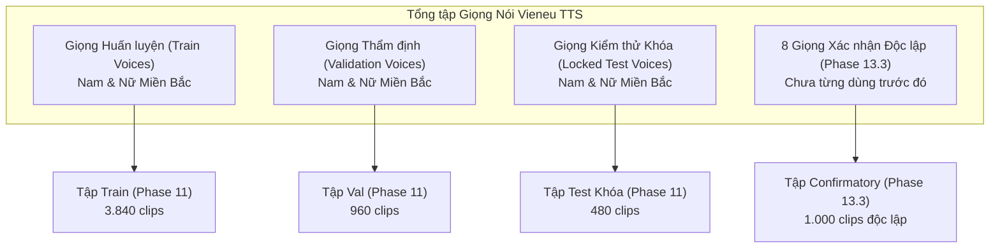

# Chương 03: Nguồn gốc Dữ liệu & Phân chia Tập dữ liệu (Dataset Provenance & Splits)

## 1. Công nghệ Tạo Sinh Dữ liệu: Vieneu TTS v3-Turbo
Do hạn chế về dữ liệu thu âm người thật có sự đồng thuận pháp lý đầy đủ, toàn bộ quá trình nghiên cứu và tối ưu hóa mô hình CNN KWS trong dự án dựa trên nguồn âm thanh tổng hợp chất lượng cao được sản xuất bởi công cụ **Vieneu TTS v3-Turbo**:
- **Cấu trúc sinh âm:** Hệ thống mạng nơ-ron tổng hợp giọng nói tiếng Việt end-to-end, kết hợp bộ phân tích âm vị eSpeak-ng hỗ trợ đầy đủ 6 thanh điệu tiếng Việt (ngang, huyền, sắc, hỏi, ngã, nặng).
- **Tần số lấy mẫu:** Tạo âm thanh gốc ở $24\text{ kHz}$, sau đó được downsample chất lượng cao về $16\text{ kHz}$ (16-bit PCM mono).
- **Đặc tính âm học:** Kiểm soát được độ dài phát âm, tốc độ nói (speed rate), cao độ (pitch scale), và các biến thể ngữ điệu nhằm mô phỏng sự đa dạng của người nói.

## 2. Chiến lược Phân chia Người nói Tránh Rò rỉ (Speaker Leakage Prevention)
Để đảm bảo tính trung thực khoa học, dự án áp dụng nguyên tắc cách ly tuyệt đối mã định danh người nói (Speaker ID isolation) xuyên suốt các tập Train, Validation và Test:

### Nguyên tắc Bất biến:
1. **Không trùng lặp giọng:** Giọng xuất hiện trong tập kiểm thử (Test và Confirmatory) tuyệt đối không được có mặt trong tập huấn luyện (Train).
2. **Không trùng lặp ngữ cảnh câu:** Các câu chứa từ phủ định hoặc từ gây nhiễu trong tập kiểm thử độc lập phải là các câu mới chưa từng xuất hiện trong quá trình huấn luyện.

## 3. Thiết kế Âm vị Gây nhiễu Khó (Phonetically Matched Hard Negatives)
Để giải quyết triệt để vấn đề báo động giả của mô hình KWS, dự án đã xây dựng danh mục từ vựng gây nhiễu âm vị học chuyên sâu:

| Lớp Mục tiêu | Âm vị Cốt lõi IPA | Từ Gây nhiễu Âm vị Học (Hard Negatives) | Bản chất Ngữ âm Gây Nhầm |
| :--- | :--- | :--- | :--- |
| `TRAI` | /tʂaːj˧˦/ | *trái, tai, cái, chai, lái, tải, trại, vải, đãi, thoái* | Trùng nguyên âm đôi `/aːj/`, chỉ khác phụ âm đầu hoặc thanh điệu. |
| `PHAI` | /faːj˨˩˦/ | *phải, bài, mai, hoài, phái, pháo, phải chăng, bên phải* | Trùng vần `/aːj/` với thanh hỏi; các cụm từ ghép chứa từ *phải*. |
| `LEN` | /lɛn˧˧/ | *lên, lén, đen, xen, khen, lết, lợn, lớn, lên trên, leo* | Trùng phụ âm đầu `/l/` hoặc vần `/ɛn/` âm mũi kết thúc. |
| `XUONG` | /sɨəŋ˧˩/ | *xuống, xuồng, chuồng, vuông, buông, suối, uổng, xương* | Trùng âm đệm và nguyên âm đôi `/ɨəŋ/` với thanh nặng hoặc huyền. |

Ngoài các từ đơn, tập dữ liệu còn tổng hợp các câu đàm thoại thông thường (Conversational Carrier Phrases) chèn các từ gây nhiễu vào các vị trí đầu câu, giữa câu và cuối câu để kiểm tra khả năng bóc tách từ khóa của mô hình.

## 4. Tiêm Nhiễu Môi trường & Mô phỏng Phòng (Noise Injection Pipeline)
Nhằm đảm bảo mô hình hoạt động bền bỉ trong môi trường thực tế, quy trình tạo dữ liệu thực hiện tiêm nhiễu đa dạng:
1. **Tập tạp âm môi trường:** Sử dụng 2.000 đoạn âm thanh từ bộ dữ liệu mã nguồn mở ESC-50 (tiếng mưa rơi, tiếng gõ cửa, tiếng chó sủa, tiếng xe cộ) và tập nhiễu phòng của DNS Challenge.
2. **Tỷ lệ Tín hiệu trên Nhiễu (SNR Sweeps):**
   - Clean (Không nhiễu): $10\%$ tổng số mẫu.
   - High SNR ($+15\text{ dB}$ đến $+20\text{ dB}$): $40\%$ tổng số mẫu.
   - Moderate SNR ($+5\text{ dB}$ đến $+10\text{ dB}$): $35\%$ tổng số mẫu.
   - Low SNR ($0\text{ dB}$ đến $+5\text{ dB}$): $15\%$ tổng số mẫu.
3. **Mô phỏng Dịch chuyển Vị trí (Time Shifting):** Tín hiệu giọng nói được dịch chuyển ngẫu nhiên trong khung $1.0\text{ giây}$ với khoảng lùi từ $-150\text{ ms}$ đến $+150\text{ ms}$, bù đệm bằng khoảng lặng hoặc nhiễu nền thực tế.

## 5. Cấu trúc Tập Dữ liệu Xác nhận Độc lập Phase 13.3 (1.000 Clips)
Tập dữ liệu độc lập này được đăng ký trước (preregistered) tại Phase 13.2 và được tạo mới hoàn toàn trong Phase 13.3:
- **Quy mô:** Đúng 1.000 tệp âm thanh WAV ($16\text{ kHz}$, 16-bit mono, thời lượng đúng $1.0000\text{ s}$).
- **Cơ cấu phân bổ:**
  - **Tập Lệnh Mục tiêu (Target Commands):** 200 clips (chia đều 50 clips cho mỗi lệnh: `TRAI`, `PHAI`, `LEN`, `XUONG`).
  - **Tập Âm thanh Ngoài Mục tiêu (Non-Target Rejection):** 800 clips, gồm:
    - 200 clips âm vị gây nhiễu khó (Phonetic Hard Negatives).
    - 200 clips câu đàm thoại tự nhiên chứa từ gây nhiễu (Carrier Phrases).
    - 200 clips tiếng nói ngoài danh mục thông thường (Out-of-Vocabulary General Speech).
    - 200 clips tạp âm môi trường thuần túy (Pure Environmental Noise).
- **8 Giọng Đọc Độc lập:** 4 giọng Nam (`voice_n_m01` đến `voice_n_m04`) và 4 giọng Nữ (`voice_n_f01` đến `voice_n_f04`) thuộc phương ngữ Miền Bắc, hoàn toàn mới lạ đối với mô hình.
