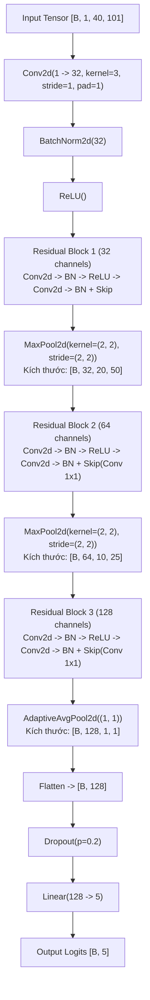

# Chương 04: Kiến trúc Mô hình & Huấn luyện (Model Architectures & Training)

## 1. Kiến trúc Mô hình: `CorrectedVietnameseKWSNet`
Mô hình được lựa chọn và đóng băng là `CorrectedVietnameseKWSNet` (phiên bản hoàn thiện của họ mạng TC-ResNet cải tiến cho âm học tiếng Việt).

Mô hình nhận đầu vào là ma trận đặc trưng Log-Mel Spectrogram có kích thước:
$$X \in \mathbb{R}^{B \times 1 \times 40 \times 101}$$
Trong đó:
- $B$: Batch size (kích thước lô huấn luyện/suy luận).
- $1$: Số kênh đơn (single channel).
- $40$: Số dải tần số Mel (Mel filterbank channels).
- $101$: Số khung thời gian (Time frames cho đoạn âm thanh 1.0 giây).

### Sơ đồ Kiến trúc Chi tiết:

### Thống kê Tham số Mô hình:
- **Tổng số tham số có thể huấn luyện (Trainable Parameters):** 119.333 tham số.
- **Kích thước file trọng số PyTorch (`.pt`):** 479.524 bytes (xấp xỉ $468.3\text{ KB}$).
- **Kích thước mô hình ONNX (`.onnx`):** 485.498 bytes (xấp xỉ $474.1\text{ KB}$).
- **Bộ nhớ hoạt động (RAM Footprint khi suy luận):** $< 5.0\text{ MB}$.

---

## 2. Đặc tả Tham số Frontend Trích xuất Đặc trưng
Để đảm bảo tính nhất quán tuyệt đối giữa môi trường nghiên cứu và triển khai sản phẩm, cấu hình Frontend được cố định trong hợp đồng kỹ thuật:
- **Tần số lấy mẫu âm thanh ($f_s$):** $16.000\text{ Hz}$.
- **Kích thước biến đổi Fourier ($N_{\text{fft}}$):** $512$ điểm (chuẩn lũy thừa 2, tối ưu cho thuật toán FFT).
- **Độ dài cửa sổ phân tích ($W_{\text{len}}$):** $400$ mẫu ($25.0\text{ ms}$).
- **Bước nhảy cửa sổ ($H_{\text{len}}$):** $160$ mẫu ($10.0\text{ ms}$).
- **Loại cửa sổ:** Cửa sổ Hann (Hann window, đối xứng).
- **Số dải lọc Mel ($N_{\text{mels}}$):** 40 dải.
- **Dải tần số trích xuất:** $f_{\min} = 20.0\text{ Hz}$ đến $f_{\max} = 8.000.0\text{ Hz}$.
- **Chuẩn hóa Mel Filterbank:** Slaney area normalization (diện tích các tam giác lọc được chuẩn hóa để bảo toàn năng lượng).
- **Log Compression:** $\log_e(\text{mel} + 10^{-6})$.

---

## 3. Hàm Mất Mát: Hard-Negative Weighted Cross Entropy
Trong giai đoạn Phase 11, một bước đột phá quan trọng giúp triệt tiêu báo động giả là việc thay thế hàm Cross Entropy thông thường bằng **Hàm Mất Mát Có Trọng Số Phạt Âm Vị Khó**:

$$\mathcal{L}_{\text{weighted}} = - \frac{1}{B} \sum_{i=1}^B w_{y_i} \cdot \log \left( \frac{\exp(z_{i, y_i})}{\sum_{j=0}^{4} \exp(z_{i, j})} \right)$$

Trong đó:
- $z_{i, j}$ là logit đầu ra của mô hình cho mẫu $i$ tại lớp $j$.
- $y_i \in \{0, 1, 2, 3, 4\}$ tương ứng với các lớp: `[TRAI, PHAI, LEN, XUONG, REJECT]`.
- Véc-tơ trọng số lớp được tối ưu hóa:
  $$W = [w_0, w_1, w_2, w_3, w_4] = [1.0, 1.0, 1.0, 1.0, 1.5]$$
Trọng số $1.5$ dành riêng cho lớp từ chối `REJECT` buộc mô hình phải cảnh giác cao độ và chịu mức phạt nặng hơn nếu phân loại nhầm một từ gây nhiễu âm vị thành khẩu lệnh hợp lệ.

---

## 4. Thiết lập Huấn luyện & Kiểm soát Hạt Ngẫu nhiên (Seeds)
Chiến dịch huấn luyện Phase 11 được thực thi với sự kiểm soát tính tiền định (deterministic training) tuyệt đối:
- **Tập dữ liệu:** 3.840 clips Train, 960 clips Validation, 480 clips Locked Test.
- **Bộ tối ưu hóa (Optimizer):** AdamW với tốc độ học khởi tạo $\eta = 10^{-3}$, suy giảm trọng số (weight decay) $\lambda = 10^{-4}$.
- **Lịch trình học (Learning Rate Scheduler):** Cosine Annealing Learning Rate với $T_{\max} = 40$ epochs, $\eta_{\min} = 10^{-5}$.
- **Kích thước lô (Batch Size):** 64.
- **Số epochs huấn luyện:** 40 epochs.
- **Đa hạt ngẫu nhiên (Multi-Seed Campaign):** Thực thi trên 3 hạt giống:
  1. **Seed 42 (Champion):** Đạt Test FAR $0.63\%$, Test Recall $99.17\%$.
  2. **Seed 43:** Đạt Test FAR $1.04\%$, Test Recall $98.33\%$.
  3. **Seed 44:** Đạt Test FAR $1.67\%$, Test Recall $97.50\%$.

Trọng số được lưu lại từ epoch có điểm F1-score cao nhất trên tập Validation độc lập của Seed 42, sinh ra tệp checkpoint ứng viên duy nhất: `variant_v11_hard_negative_weighted_seed42.pt`.
