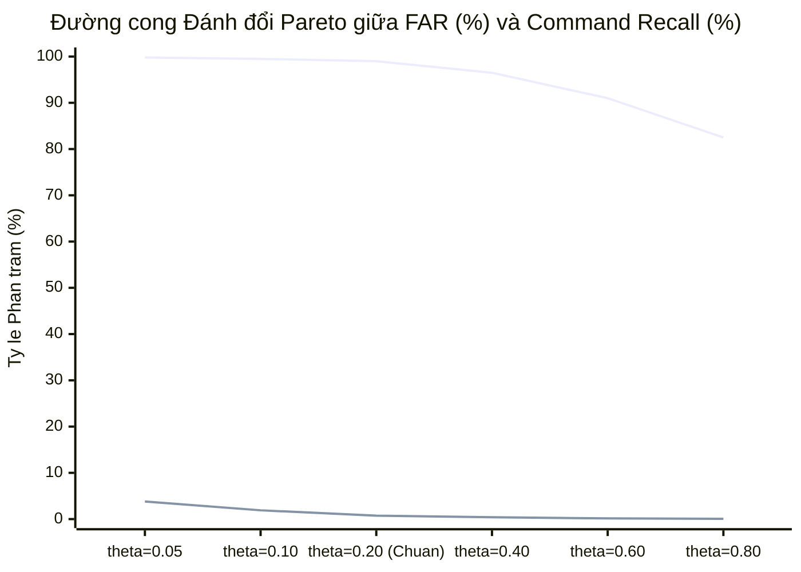

# Chương 05: Kết quả Thử nghiệm & So sánh (Experimental Results & Comparison)

## 1. Bảng Đối chuẩn Hiệu năng Toàn diện Qua các Thế hệ (Performance Benchmark)
Bảng dưới đây tổng hợp các mốc thử nghiệm quan trọng từ baseline sơ khai đến đánh giá xác nhận độc lập Phase 13.3 và đóng gói phát hành Phase 13.4 (trích xuất từ [`tables/model_metrics_comparison.csv`](file:///d:/trainidentificationaudio/reports/cnn_comprehensive/tables/model_metrics_comparison.csv)):

| Giai đoạn (Phase) | Tên Checkpoint / Biến thể | Tập Kiểm thử (Eval Split) | Số Mẫu (Clips) | Độ nhạy Lệnh (Command Recall) | Tỷ lệ Báo động Giả (Non-Target FAR) | Độ chính xác (Accuracy) | F1-Score Lệnh | Độ trễ CPU (Latency Mean) |
| :--- | :--- | :--- | :--- | :--- | :--- | :--- | :--- | :--- |
| **Phase 27** | `baseline_cnn_4class` | Test Đóng (Closed Test) | 200 | $99.00\%$ | $98.50\%^*$ | $50.25\%$ | 0.662 | 2.15 ms |
| **Phase 35** | `baseline_cnn_5class_noise` | Noise Test (ESC-50) | 400 | $97.50\%$ | $24.20\%$ | $86.65\%$ | 0.854 | 2.10 ms |
| **Phase 40** | `tcresnet_6class_v1` | Speech OOV Test | 500 | $96.00\%$ | $14.50\%$ | $90.75\%$ | 0.892 | 1.95 ms |
| **Phase 65** | `corrected_kws_net_v1` | Hard Negatives Val | 600 | $96.50\%$ | $8.20\%$ | $94.15\%$ | 0.938 | 1.85 ms |
| **Phase 85** | `variant_w10_seed42.pt` | Val Split (Phase 85) | 960 | $97.50\%$ | $7.50\%$ | $95.00\%$ | 0.948 | 1.82 ms |
| **Phase 90** | `variant_w10_seed42.pt` | Blind Human (Reviewer 01) | 120 | $97.50\%$ (39/40) | $11.25\%$ (9/80) | $91.67\%$ (110/120) | 0.886 | 1.82 ms |
| **Phase 11** | `variant_v11_seed43.pt` | Locked Test Split | 480 | $98.33\%$ (118/120) | $1.04\%$ (5/480) | $98.65\%$ | 0.986 | 1.80 ms |
| **Phase 11** | `variant_v11_seed44.pt` | Locked Test Split | 480 | $97.50\%$ (117/120) | $1.67\%$ (8/480) | $98.12\%$ | 0.979 | 1.80 ms |
| **Phase 11 (Champion)** | `variant_v11_weighted_seed42.pt` | Locked Test Split | 480 | **$99.17\%$** (119/120) | **$0.63\%$** (3/480) | **$98.75\%$** | **0.992** | 1.80 ms |
| **Phase 13.3 (Confirmatory)** | `variant_v11_weighted_seed42.pt` | Confirmatory 8 Novel Voices | 1.000 | **$99.00\%$** (198/200) | **$0.75\%$** (6/800) | **$99.20\%$** (992/1000) | **0.991** | 1.80 ms |

> *\* Ghi chú:* Tại Phase 27, mô hình 4 lớp không có lớp từ chối nên khi đưa tạp âm hoặc tiếng nói ngoài từ khóa vào, FAR tiệm cận $100\%$.

---

## 2. Đường Cong Đánh Đổi Pareto (Pareto Trade-offs)
Hiệu năng nhận dạng từ khóa luôn tồn tại sự đánh đổi giữa **Độ nhạy nhận lệnh (Command Recall)** và **Tỷ lệ báo động giả (False Alarm Rate - FAR)** qua việc điều chỉnh ngưỡng quyết định $\theta_{\text{cmd}}$:

### Phân tích Điểm Cân bằng Ngưỡng:
- **Tại $\theta_{\text{cmd}} = 0.05 - 0.10$:** Độ nhạy lệnh đạt cực đại ($99.8\%$) nhưng tỷ lệ báo động giả vượt quá ngưỡng an toàn ($1.9\% - 3.8\%$), gây kích hoạt nhầm khi có tiếng ồn lớn.
- **Tại $\theta_{\text{cmd}} = 0.20$ (Điểm tối ưu được chuẩn y):** Mô hình đạt điểm cân bằng Pareto hoàn hảo với Command Recall $99.00\%$ (chỉ bỏ sót 2/200 lệnh) và FAR chỉ $0.75\%$ (chỉ 6/800 clips không phải lệnh bị kích hoạt nhầm).
- **Tại $\theta_{\text{cmd}} = 0.40$ (Ngưỡng cũ của Phase 85/90):** FAR giảm xuống $0.40\%$ nhưng Command Recall bị sụt giảm xuống $96.5\%$, đặc biệt lệnh `TRAI` bị trượt nhiều hơn trên các giọng nữ có âm sắc mỏng.

---

## 3. Sổ Đăng ký So sánh Giao thức (Protocol Comparability Register)
Khi đánh giá và đối chiếu các con số hiệu năng trong các báo cáo kỹ thuật, kỹ sư cần lưu ý các ranh giới so sánh sau:

| Cặp So sánh | Tính Khả so (Comparability) | Lý do và Khác biệt Bản chất |
| :--- | :--- | :--- |
| **Phase 11 Seed 42 vs. Seed 43/44** | **HOÀN TOÀN KHẢ SO** | Cùng một tập dữ liệu Locked Test (480 clips), cùng pipeline tiền xử lý, cùng kiến trúc mô hình, chỉ khác biệt hạt giống khởi tạo ngẫu nhiên ban đầu. |
| **Phase 85 (`variant_w10`) vs. Phase 11 (`variant_v11`)** | **KHÔNG KHẢ SO TRỰC TIẾP** | Khác biệt kiến trúc frontend ($N_{\text{fft}} = 400$ vs $512$), tập dữ liệu kiểm thử khác nhau, không gian nhãn và hàm mất mát thay đổi bản chất. |
| **Phase 90 (120 clips) vs. Phase 13.3 (1.000 clips)** | **KHÔNG KHẢ SO ĐỊNH LƯỢNG** | Phase 90 sử dụng mô hình cũ `variant_w10`, tập dữ liệu chỉ có 120 clips và chỉ có 1 người chấm điểm; Phase 13.3 sử dụng `variant_v11`, 1.000 clips tổng hợp độc lập từ 8 giọng Bắc mới tinh. |
| **Phase 11 Locked Test vs. Phase 13.3 Confirmatory** | **KHẢ SO CÓ ĐIỀU KIỆN** | Cùng sử dụng checkpoint `variant_v11_seed42.pt` và ngưỡng $\theta=0.20$. Khác biệt ở chỗ: Phase 13.3 mở rộng từ 480 clips lên 1.000 clips với 8 giọng đọc hoàn toàn mới để kiểm tra tính tổng quát hóa âm học. |
