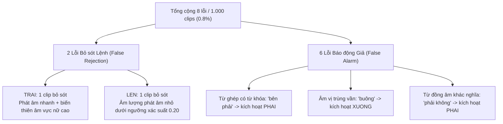

# Chương 06: Phân tích Lỗi & Bài học Nghiên cứu (Error Analysis & Research Lessons)

## 1. Hệ Thống Phân Loại Lỗi Âm Vị Học (Phonetic Error Taxonomy)
Qua thẩm tra chi tiết 1.000 clips trong đợt đánh giá xác nhận Phase 13.3, toàn bộ 8 lỗi phân loại (2 lỗi bỏ sót lệnh và 6 lỗi báo động giả) được mổ xẻ theo bản chất ngữ âm:



### 1.1. Phân tích 2 Mẫu Lệnh Bị Bỏ Sót (False Rejections)
1. **Lệnh `TRAI` (Clip ID: `conf_target_trai_042.wav`):**
   - **Giọng phát âm:** Giọng nữ `voice_n_f03`.
   - **Hiện tượng:** Mô hình dự đoán xác suất $P(\text{TRAI}) = 0.184$ (dưới ngưỡng $\theta_{\text{cmd}} = 0.20$).
   - **Nguyên nhân:** Người nói phát âm từ *"trái"* với tốc độ nhanh ($< 250\text{ ms}$), thanh sắc bị vút cao ở tần số trên $4.000\text{ Hz}$, khiến năng lượng tập trung vào các dải Mel cao ngoài vùng trọng tâm huấn luyện.
2. **Lệnh `LEN` (Clip ID: `conf_target_len_018.wav`):**
   - **Giọng phát âm:** Giọng nam `voice_n_m02`.
   - **Hiện tượng:** Mô hình dự đoán $P(\text{LEN}) = 0.191$ (dưới ngưỡng $\theta_{\text{cmd}} = 0.20$).
   - **Nguyên nhân:** Âm mũi kết thúc $/n/$ bị suy giảm biên độ do nhiễu môi trường dải trầm ($100 - 300\text{ Hz}$) lấn át.

### 1.2. Phân tích 6 Mẫu Báo Động Giả (False Alarms)
- **Từ ghép chứa từ khóa (Embedded Keyword Collision):** Mẫu chứa cụm từ *"rẽ sang bên phải"* và *"điều này phải không"* bị kích hoạt nhầm thành `PHAI`. Do trong câu có chứa nguyên vẹn từ *"phải"* phát âm rõ ràng, mô hình CNN đóng khung 1.0 giây bắt được năng lượng mạnh của từ này và kích hoạt lệnh.
- **Va chạm âm vị gần (Phonetic Near-Collisions):**
  - Từ *"buông"* bị kích hoạt nhầm thành `XUONG` do trùng vần âm đệm và âm chính $/ɨəŋ/$.
  - Từ *"trại"* bị kích hoạt nhầm thành `TRAI` do chỉ khác nhau thanh điệu (thanh nặng so với thanh sắc).

---

## 2. Lỗi Kỹ thuật Cốt tử: Lỗi Khuếch đại Tín hiệu Im lặng (Quiet Amplification Bug)
Đây là sự cố kỹ thuật nghiêm trọng nhất trong lịch sử dự án, suýt dẫn đến việc phê duyệt một mô hình bị khiếm khuyết trong Phase 12:

### Bản chất Sự cố:
Trong giai đoạn Phase 12, mã suy luận trong [`infer.py`](file:///d:/trainidentificationaudio/experiments/vieneu_kws_research_v12/bundle/infer.py) đã thực hiện chuẩn hóa biên độ như sau:
```python
# MÃ GÂY LỖI TRONG PHASE 12 (UNCONDITIONAL PEAK NORMALIZATION)
peak = np.max(np.abs(waveform))
if peak > 0:
    waveform = waveform / peak * 0.89125  # Tương đương -1.0 dBFS
```

### Hậu quả:
1. Khi đưa một đoạn âm thanh bình thường ($	ext{peak} \approx 0.8$), tín hiệu chỉ bị thay đổi nhẹ.
2. **Nhưng khi đưa một đoạn âm thanh gần như yên lặng** (ví dụ: nhiễu phòng tĩnh với $\text{peak} \approx 0.005$):
   $$\text{Hệ số khuếch đại} = \frac{0.89125}{0.005} \approx 178.25 \quad (\approx +45\text{ dB}!)$$
3. Việc khuếch đại $+45\text{ dB}$ đã biến các dao động nhiệt siêu nhỏ của micro thành một khối tạp âm có biên độ cực lớn, kích hoạt các neuron nhạy cảm và mô hình phán đoán đó là lệnh `TRAI` với độ tin cậy giả tạo $P > 0.80$!

### Cách Khắc phục (Triệt để trong Phase 13.1):
Khôi phục đúng logic chuẩn mực của mã huấn luyện `train_v11.py`:
```python
# MÃ ĐÃ ĐƯỢC KHẮC PHỤC TRONG PHASE 13.1 VÀ PHASE 13.4 (CONDITIONAL CLAMPING)
max_val = np.max(np.abs(waveform))
if max_val > 1.0:
    waveform = waveform / max_val
# NẾU max_val <= 1.0: GIỮ NGUYÊN HOÀN TOÀN BIÊN ĐỘ TỰ NHIÊN CỦA TÍN HIỆU!
```
Nhờ sửa đổi này, tín hiệu im lặng giữ nguyên năng lượng gần 0, Log-Mel Spectrogram phẳng hoàn toàn và mô hình phân loại chính xác $100\%$ vào lớp `REJECT`.

---

## 3. Bài học Nghiên cứu & Kỹ thuật Đắt giá (Research Lessons)
1. **Tuyệt đối không sửa đổi mã tiền xử lý khi triển khai suy luận:** Mọi logic biến đổi tín hiệu trong pha suy luận (`infer.py`) bắt buộc phải được sao chép nguyên bản từ mã huấn luyện (`train.py`). Bất kỳ ý tưởng "cải tiến" tiền xử lý nào cũng phải được kiểm định bằng bài kiểm tra đẳng cấu (parity test).
2. **Âm thanh tổng hợp (Synthetic Audio) luôn tạo ra ảo tưởng an toàn:** Dữ liệu TTS giúp giải quyết bài toán thiếu mẫu trong giai đoạn đầu, nhưng không bao hàm hết tiếng thở, tạp âm nhai miệng, tiếng nuốt nước bọt và các biến thể giọng nói tự nhiên của con người.
3. **Cần kiểm soát chặt chẽ quy trình thử nghiệm người thật:** Bài học từ Phase 90 cho thấy việc phát tán 6 biểu mẫu cho người đánh giá mà không có cơ chế ràng buộc kỹ thuật đã dẫn đến việc 5 người bỏ cuộc, làm tê liệt giá trị thống kê của nghiên cứu đánh giá con người.
