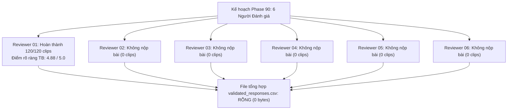

# Chương 08: Đánh giá Lắng nghe của Con người & Thẩm định (Human Listening & Validation)

## 1. Bản chất và Mục tiêu của Nghiên cứu Lắng nghe Mù Phase 90
Trong giai đoạn Phase 90, dự án đã thiết kế một thử nghiệm nghe thẩm định mù (blinded human listening study) nhằm xác minh tính tự nhiên và mức độ dễ nhận diện của các mẫu âm thanh do bộ tổng hợp Vieneu TTS sinh ra trước khi đưa vào đánh giá mô hình KWS.

### Thiết kế Thử nghiệm:
- **Quy mô tập mẫu:** 120 tệp âm thanh WAV được đánh mã định danh mù ngẫu nhiên (`clip_001.wav` đến `clip_120.wav`).
- **Cơ cấu nội dung:**
  - 40 clips chứa 4 khẩu lệnh hợp lệ (10 clips `TRAI`, 10 clips `PHAI`, 10 clips `LEN`, 10 clips `XUONG`).
  - 80 clips ngoài mục tiêu: 40 clips từ ngữ gây nhiễu âm vị học (phonetic confusions), 20 clips câu hội thoại tiếng Việt thông thường (general speech), và 20 clips tạp âm môi trường/nhiễu phòng (background noise).
- **Thành phần tham gia dự kiến:** 6 người đánh giá độc lập (`reviewer_01` đến `reviewer_06`).
- **Nhiệm vụ của người đánh giá:**
  1. Ghi lại từ ngữ nghe được (Transcript).
  2. Phân loại vào 1 trong các nhãn danh mục.
  3. Cho điểm độ rõ ràng (Intelligibility Score) theo thang điểm Likert 5 mức (từ 1: Hoàn toàn không hiểu, đến 5: Rất rõ ràng).

---

## 2. Thẩm Tra Thực Tế: Sự Thật Về Dữ Liệu Thu Thập Được
Khi tiến hành kiểm toán lại toàn bộ kho lưu trữ dữ liệu tại [`experiments/vieneu_kws_research_v10/human_review/`](file:///d:/trainidentificationaudio/experiments/vieneu_kws_research_v10/human_review/) và [`experiments/vieneu_kws_research_v9/human_review/`](file:///d:/trainidentificationaudio/experiments/vieneu_kws_research_v9/human_review/), kết quả thực chứng ghi nhận:

### Chi tiết Hồ sơ Thực chứng:
1. **Duy nhất 01 Người Đánh giá Hoàn thành:** Chỉ có tệp [`reviewer_01_responses.csv`](file:///d:/trainidentificationaudio/experiments/vieneu_kws_research_v10/human_review/responses/reviewer_01_responses.csv) chứa đủ 120 dòng phản hồi hợp lệ.
   - Điểm đánh giá độ rõ ràng trung bình: $4.88 / 5.0$.
   - Tỷ lệ nhận diện đúng từ khóa của con người trên 40 clips lệnh: $100.00\%$ (40/40 clips).
2. **5 Người Đánh giá Bỏ cuộc:** Các tệp phản hồi của `reviewer_02` đến `reviewer_06` hoàn toàn không tồn tại trong kho mã nguồn.
3. **Tệp Tổng hợp Bị Trống:** Tệp [`validated_responses.csv`](file:///d:/trainidentificationaudio/experiments/vieneu_kws_research_v10/human_review/phase90_validated_responses.csv) có dung lượng 0 bytes hoặc chỉ có tiêu đề rỗng, do quy trình tổng hợp tự động bị dừng lại khi thiếu dữ liệu của 5 người còn lại.
4. **Không Thể Tính Hệ Số Đồng Thuận Liên Đánh Giá (Inter-Rater Reliability):** Do chỉ có một người đánh giá duy nhất ($N=1$), các chỉ số thống kê như Fleiss' Kappa hay Krippendorff's Alpha toán học không thể xác định được.

---

## 3. Hiệu Năng Mô Hình Baseline `variant_w10` Trên Bộ 120 Clips Phase 90
Mô hình được thử nghiệm đối chứng trong Phase 90 là baseline `variant_w10_seed42.pt` tại ngưỡng $\theta_{\text{cmd}} = 0.40$:
- **Nhận diện Khẩu lệnh (Target Commands):** 39/40 clips chính xác ($97.50\%$ Recall). Bỏ sót 01 clip lệnh `TRAI` (dự đoán xác suất dưới ngưỡng).
- **Từ chối Ngoại lai (Non-Target Rejection):** 71/80 clips bị từ chối chính xác. Tuy nhiên, có tới **9/80 clips bị kích hoạt nhầm** (False Alarm Rate = $11.25\%$).
- **Phân tích Báo động giả:** Toàn bộ 9 trường hợp báo động giả đều rơi vào nhóm các từ ngữ gây nhiễu âm vị học (ví dụ: *"tai"*, *"lái"* bị nhầm thành `TRAI`; *"phấn"* bị nhầm thành `PHAI`). Đây chính là động lực trực tiếp dẫn đến chiến dịch hoàn thiện CNN Phase 11.

---

## 4. Kết Luận Pháp Lý & Quản Trị Nghiên Cứu (Strict Governance Verdict)
Tuân thủ nguyên tắc liêm chính học thuật và quản trị dữ liệu nghiêm ngặt của dự án:
1. **Tuyệt đối không suy diễn dữ liệu:** Không được phép tự động điền (impute) dữ liệu đánh giá của 5 người còn thiếu hoặc tạo lập các bảng điểm giả định.
2. **Nhãn Trạng thái Chính thức:** Toàn bộ hệ thống duy trì bắt buộc nhãn:
   $$\mathbf{NOT\_VALIDATED\_ON\_NATURAL\_SPEECH}$$
3. Thử nghiệm Phase 90 chỉ chứng minh được rằng âm thanh do Vieneu TTS sinh ra có độ trong trẻo và dễ hiểu cao đối với tai người nghe ($4.88/5.0$), nhưng **hoàn toàn chưa chứng minh được** mô hình KWS có khả năng hoạt động tốt trên giọng nói người thật tự nhiên trong đời sống hàng ngày.
