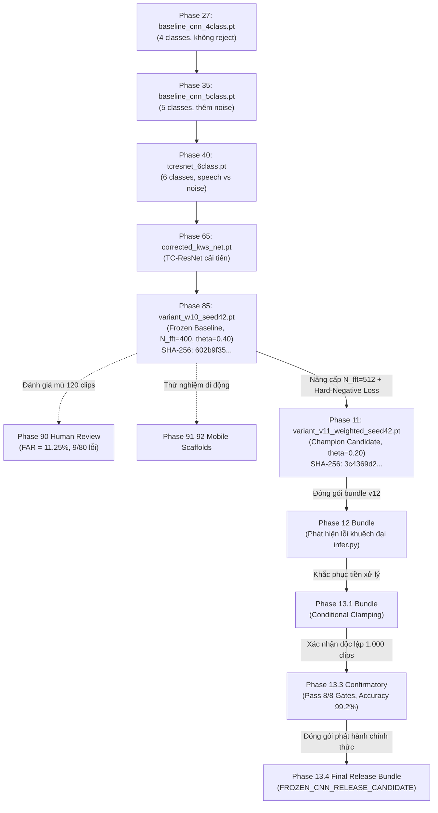

# Chương 10: Phả hệ Checkpoint & Đóng gói Phát hành (Checkpoint Lineage & Release Artifacts)

## 1. Biểu Đồ Phả Hệ Checkpoint Cốt Lõi (Lineage Tree)
Toàn bộ lịch sử tiến hóa của các trọng số mô hình từ giai đoạn đầu đến bản phát hành cuối cùng được phác họa trong biểu đồ phả hệ dưới đây:



---

## 2. Thẩm Tra Mã Băm SHA-256 Tuyệt Đối (Cryptographic Integrity)
Bảng dưới đây liệt kê các checkpoint bản lề trong lịch sử nghiên cứu cùng mã băm mã hóa xác thực (trích xuất từ [`tables/checkpoint_lineage.csv`](file:///d:/trainidentificationaudio/reports/cnn_comprehensive/tables/checkpoint_lineage.csv)):

| Tên File Checkpoint | Giai đoạn Phát hành | Kích thước (Bytes) | Mã Băm SHA-256 Chính thức | Vai trò Kỹ thuật |
| :--- | :--- | :--- | :--- | :--- |
| `variant_w10_seed42.pt` | Phase 85 / Phase 9 / 10 | 479.524 | `602b9f359147d337f7422f25608cb926ec03794d0705f1eb02c9a927a44f9547` | Frozen Baseline lịch sử. |
| `variant_v11_hard_negative_weighted_seed42.pt` | Phase 11 Checkpoints | 479.524 | `3c4369d2f95059b973ba38ab5f2fd5aa611c7ef3322156b95be21278d32a60a2` | Trọng số gốc từ huấn luyện Phase 11. |
| `variant_v11_hard_negative_weighted_seed42.pt` | Phase 12 Bundle | 479.524 | `3c4369d2f95059b973ba38ab5f2fd5aa611c7ef3322156b95be21278d32a60a2` | Bản sao nguyên vẹn trong bundle v12. |
| `variant_v11_hard_negative_weighted_seed42.pt` | Phase 13.1 Bundle | 479.524 | `3c4369d2f95059b973ba38ab5f2fd5aa611c7ef3322156b95be21278d32a60a2` | Bản sao nguyên vẹn dùng cho khắc phục 13.1. |
| `variant_v11_hard_negative_weighted_seed42.pt` | **Phase 13.4 Final Release** | 479.524 | `3c4369d2f95059b973ba38ab5f2fd5aa611c7ef3322156b95be21278d32a60a2` | **Bản phát hành ứng viên đông kết cuối cùng.** |
| `vietnamese_kws_v11.onnx` | **Phase 13.4 Final Release** | 485.498 | `54298c503f51c8299d86f6b4346d7cae4e1b7e045deb884a8650764fbe4bcc99` | **Mô hình ONNX Runtime chuẩn hóa.** |

> **Bằng chứng Thực chứng:** Mã băm SHA-256 của tệp trọng số `variant_v11_hard_negative_weighted_seed42.pt` hoàn toàn trùng khớp từng byte xuyên suốt từ Phase 11, Phase 12, Phase 13.1, Phase 13.3 đến Phase 13.4. Không có bất kỳ hiện tượng huấn luyện lại (retraining), tinh chỉnh lén lút (fine-tuning) hay biến đổi trọng số nào xảy ra.

---

## 3. Cấu Trúc Đóng Gói Bundle Phát Hành Phase 13.4 (Release Bundle Inventory)
Thư mục phát hành chính thức được đặt cô lập tại [`experiments/vieneu_kws_research_v13_4/bundle/`](file:///d:/trainidentificationaudio/experiments/vieneu_kws_research_v13_4/bundle/) với đầy đủ các thành phần phục vụ triển khai:

```
experiments/vieneu_kws_research_v13_4/bundle/
├── checkpoint/
│   └── variant_v11_hard_negative_weighted_seed42.pt   # File trọng số PyTorch gốc
├── onnx/
│   └── vietnamese_kws_v11.onnx                        # Mô hình ONNX đã kiểm định đẳng cấu
├── src/
│   ├── model.py                                       # Định nghĩa mạng CorrectedVietnameseKWSNet
│   ├── frontend.py                                    # Trích xuất Mel Spectrogram chuẩn N_fft=512
│   └── infer.py                                       # Mã suy luận hoàn thiện với Conditional Clamping
├── config/
│   ├── model_config.json                              # Tham số cấu trúc mạng và ánh xạ 5 nhãn
│   └── preprocessing_contract.json                    # Hợp đồng tiền xử lý âm thanh chính thức
├── RELEASE_METADATA.json                              # Siêu dữ liệu phát hành, mã băm, kết quả 13.3
└── checksums.sha256                                   # Bản kiểm toán mã băm SHA-256 toàn bộ bundle
```

### Lệnh Xác Minh Mã Băm Trên Môi Trường Thực Tế:
- **Trên Windows PowerShell:**
  ```powershell
  Get-FileHash -Algorithm SHA256 experiments/vieneu_kws_research_v13_4/bundle/checkpoint/variant_v11_hard_negative_weighted_seed42.pt
  ```
- **Trên Linux / macOS Bash:**
  ```bash
  sha256sum experiments/vieneu_kws_research_v13_4/bundle/checkpoint/variant_v11_hard_negative_weighted_seed42.pt
  ```
Kết quả trả về bắt buộc phải là: `3c4369d2f95059b973ba38ab5f2fd5aa611c7ef3322156b95be21278d32a60a2`.
