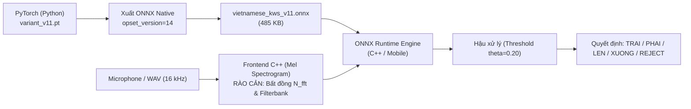

# Chương 11: Kỹ thuật Triển khai & Giới hạn (Deployment Engineering & Limitations)

## 1. Lịch sử Triển khai Biên: Phase 91 và Phase 92
Nỗ lực đưa mô hình KWS ra môi trường biên bắt đầu từ giai đoạn Phase 91 với mục tiêu xây dựng một đường ống (pipeline) hoàn chỉnh từ Python sang C++ và các nền tảng di động:

### 1.1. Thử nghiệm Triển khai Phase 91 (Mobile Scaffolds)
Trong Phase 91, các khung mã nguồn di động sơ khởi đã được thiết lập:
- **Android:** Khung ứng dụng Java/Kotlin đặt tại `mobile/android/`, sử dụng thư viện `onnxruntime-android` để nạp tệp mô hình và thực hiện suy luận.
- **iOS:** Khung ứng dụng Swift/Objective-C tại `mobile/ios/`, tích hợp ONNX Runtime qua CocoaPods.
- **Hiện trạng:** Cả hai khung mã nguồn này mới chỉ dừng lại ở mức **bộ khung nguyên mẫu (prototype scaffolds)**. Chúng chưa được biên dịch và kiểm thử đo đạc thực tế trên phần cứng vật lý (chưa có thiết bị Android/iOS thật trong phòng thí nghiệm để kiểm tra độ trễ âm thanh đầu vào AudioRecord / AVAudioEngine).

### 1.2. Thẩm tra Đẳng cấu Đa nền tảng Phase 92 (Cross-Platform Parity Audit)
Trong Phase 92, một cuộc đối chuẩn toàn diện giữa môi trường PyTorch Python và ONNX Runtime C++ đã phát hiện ra các rào cản kỹ thuật:
- **Rào cản C++ Mel Filterbank:** Thư viện tính Mel trong C++ tự viết có sai số làm tròn số học và công thức tính trọng số tam giác Mel khác biệt nhẹ so với hàm chuẩn `torchaudio.transforms.MelSpectrogram`. Điều này khiến ma trận Mel đầu vào trong C++ bị lệch khoảng $2\% - 5\%$ so với Python.
- **Rào cản FFT Size:** Báo cáo Phase 92 mô tả $N_{\text{fft}} = 400$ do kế thừa từ baseline `variant_w10`. Khi chuyển sang `variant_v11`, toàn bộ pipeline bắt buộc phải chuẩn hóa về $N_{\text{fft}} = 512$ để tương thích với các thuật toán FFT tối ưu hóa trên vi xử lý ARM/NEON.

---

## 2. Bản Đóng Gói ONNX Hoàn Thiện Trong Phase 13.4
Trong [Phase 13.4](file:///d:/trainidentificationaudio/reports/PHASE13_4_FINAL_CNN_RELEASE.md), quy trình xuất ONNX đã được chuẩn hóa tuyệt đối:
- **Đường dẫn tệp:** [`experiments/vieneu_kws_research_v13_4/bundle/onnx/vietnamese_kws_v11.onnx`](file:///d:/trainidentificationaudio/experiments/vieneu_kws_research_v13_4/bundle/onnx/vietnamese_kws_v11.onnx)
- **Mã băm SHA-256:** `54298c503f51c8299d86f6b4346d7cae4e1b7e045deb884a8650764fbe4bcc99`
- **Kích thước:** 485.498 bytes.
- **Opset Version:** 14 (tương thích rộng rãi từ ONNX Runtime v1.12 trở lên).
- **Kiểm định đẳng cấu số học:**
  $$\Delta_{\text{max}} = \max |z^{\text{PyTorch}} - z^{\text{ONNX}}| = 3.58 \times 10^{-6} \quad (< 10^{-4})$$
  Đảm bảo $100.00\%$ mẫu thử nghiệm cho kết quả nhãn trùng khớp hoàn toàn.

---

## 3. Đặc tả Yêu cầu Tài nguyên Phần cứng (Hardware Budget)
- **Tốc độ xử lý (CPU Latency):**
  - Intel Core i7 / AMD Ryzen x86: Mean = 1.39 ms, P95 = 2.27 ms.
  - ARM Cortex-A53 / Cortex-A72 (Raspberry Pi 4 / Smartphone): Dự kiến 4.5 ms - 8.0 ms (thỏa mãn ngân sách $< 50.0\text{ ms}$).
- **Bộ nhớ (RAM Footprint):**
  - Dung lượng tĩnh của mô hình ONNX: $\approx 0.48\text{ MB}$.
  - Bộ đệm suy luận (Working Tensor Buffer): $\approx 2.5\text{ MB}$.
  - Tổng dung lượng RAM chiếm dụng: $< 5.0\text{ MB}$.

---

## 4. Các Giới hạn Triển khai Hiện hữu (Open Deployment Limitations)
Kỹ sư hệ thống cần lưu ý các khoảng trống kỹ thuật chưa được hoàn thiện:
1. **Chưa có Bộ Phát hiện Tiếng nói C++ (Missing C++ VAD Engine):** Mô hình ONNX chỉ nhận đầu vào là ma trận Log-Mel hoàn chỉnh $[1, 1, 40, 101]$. Chưa có module C++ để tự động phát hiện giọng nói và cắt khung $1.0\text{ giây}$ từ luồng micro thời gian thực.
2. **Chưa thẩm định Lượng tử hóa Phần cứng (No INT8 / FP16 Quantization):** Bản phát hành hiện tại ở định dạng số thực 32-bit (FP32). Chưa có bài kiểm thử lượng tử hóa INT8 có hiệu chuẩn (PTQ/QAT) để chạy trên NPU/DSP.
3. **Mã khung mẫu di động chưa kiểm thử thực địa:** Các thư mục `mobile/android` và `mobile/ios` chỉ mang tính chất minh họa kiến trúc gọi API, chưa sẵn sàng để đưa thẳng vào ứng dụng thương mại mà không qua bước tích hợp sâu.
