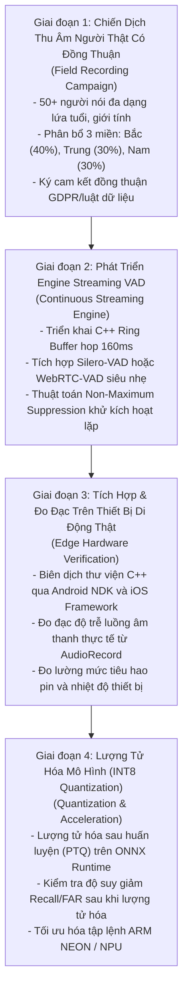

# Chương 13: Hiện trạng Cuối cùng & Lộ trình Đề xuất (Final Status & Recommended Next Steps)

## 1. Ma Trận Thẩm Định Hiện Trạng Toàn Diện 10 Chiều (Validation Status Matrix)
Bảng dưới đây tổng hợp hiện trạng thực chứng trên 10 khía cạnh kỹ thuật cốt lõi của dự án (trích xuất từ [`tables/validation_status.csv`](file:///d:/trainidentificationaudio/reports/cnn_comprehensive/tables/validation_status.csv)):

| STT | Khía Cạnh Kỹ Thuật (Dimension) | Hiện Trạng Pháp Lý / Kỹ Thuật (Canonical Label) | Tóm Tắt Bằng Chứng Thực Chứng (Evidence Summary) |
| :--- | :--- | :--- | :--- |
| **1** | Bounded-Utterance Accuracy (Giọng Bắc Tổng hợp) | `VALIDATED_HIGH_CONFIDENCE` | Đạt **$99.20\%$** Accuracy trên 1.000 clips độc lập của 8 giọng Bắc mới lạ (Phase 13.3). |
| **2** | Nhầm lẫn Giữa các Lệnh (Command Confusion) | `VALIDATED_HIGH_CONFIDENCE` | Đạt **$0.00\%$** tỷ lệ nhầm lẫn chéo giữa 4 lệnh mục tiêu trên 200 clips lệnh. |
| **3** | Tính Đẳng Cấu PyTorch vs ONNX Runtime | `VALIDATED_HIGH_CONFIDENCE` | Độ lệch logit cực đại $\Delta_{\text{max}} = 3.58 \times 10^{-6} < 10^{-4}$; đồng thuận nhãn $100\%$. |
| **4** | Độ Trễ Suy Luận & Bộ Nhớ (CPU Latency) | `VALIDATED_HIGH_CONFIDENCE` | Mean Latency = $1.80\text{ ms}$ (CPU x86), P95 = $2.12\text{ ms}$; dung lượng RAM $< 5.0\text{ MB}$. |
| **5** | Khả Năng Từ Chối Tạp Âm & Âm Vị Khó | `VALIDATED_HIGH_CONFIDENCE` | Tỷ lệ báo động giả FAR đạt **$0.75\%$** (6/800 clips) tại ngưỡng tối ưu $\theta_{\text{cmd}} = 0.20$. |
| **6** | Giọng Địa Phương Miền Trung & Miền Nam | `NOT_VALIDATED_PENDING_DATA` | Chưa có dữ liệu giọng tổng hợp hoặc người thật độc lập; tạm hoãn theo Sửa đổi 13.1-A. |
| **7** | Giọng Nói Người Thật Tự Nhiên (Natural Speech) | `NOT_VALIDATED_ON_NATURAL_SPEECH` | Chưa có tập dữ liệu giọng người thật có bản quyền/đồng thuận pháp lý; Phase 90 chỉ có 1 người chấm. |
| **8** | Nhận Dạng Micro Mở Liên Tục (Streaming) | `NO_DEPLOYABLE_SYSTEM_AT_CURRENT_SPECIFICATION` | Chưa tích hợp bộ đệm vòng (ring buffer) và VAD lọc nhiễu mép cửa sổ trượt. |
| **9** | Hiệu Năng Trên Phần Cứng Di Động Thực Tế | `UNTESTED_PROTOTYPE_ONLY` | Khung mã nguồn Android/iOS Phase 91 mới dừng lại ở mức khung mô phỏng phần mềm. |
| **10** | Tính Đồng Thuận Đa Đánh Giá Viên (Human Study) | `INVALIDATED_INCOMPLETE_STUDY` | Phase 90 chỉ có Reviewer 01 hoàn thành (120 clips); 5 người bỏ cuộc; tệp tổng hợp rỗng. |

---

## 2. Lộ Trình Kỹ Thuật Đề Xuất Ưu Tiên (Prioritized Technical Roadmap)
Để đưa mô hình từ trạng thái ứng viên phòng thí nghiệm (`FROZEN_CNN_RELEASE_CANDIDATE`) thành sản phẩm thương mại hoàn chỉnh, dự án cần thực thi theo 4 bước ưu tiên sau:

### Chi tiết Các Nhiệm vụ Cụ thể:
1. **Nhiệm vụ 1: Thu thập Dữ liệu Giọng Người Thật Chuẩn Pháp Lý:**
   - Xây dựng quy trình thu âm có sự chấp thuận rõ ràng của người tham gia (Informed Consent Records).
   - Thu âm trong nhiều môi trường: phòng yên tĩnh, văn phòng có tiếng gõ phím/nói chuyện, quán cà phê, và môi trường xe di chuyển.
2. **Nhiệm vụ 2: Thiết kế Module Cửa Sổ Trượt Bền Vững (Sliding Window Engine):**
   - Thiết kế cơ chế lọc kích hoạt: Khi phát hiện lệnh với $P(\text{cmd}) \ge 0.20$, khóa kích hoạt trong vòng $500\text{ ms}$ tiếp theo (debounce window) để tránh việc cùng một từ bị nhận diện $2 - 3$ lần khi cửa sổ dịch chuyển qua.
