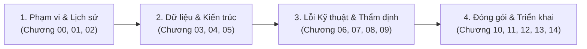

# Tóm Tắt Tổng Quan Dễ Hiểu Bộ Tài Liệu Kỹ Thuật KWS Tiếng Việt
*(Vietnamese Keyword Spotting - Documentation Navigation Summary)*

> **Dành cho ai?** Tài liệu này được biên soạn như một "bản đồ chỉ đường" ngắn gọn, trực quan, giúp kỹ sư AI, kỹ sư hệ thống nhúng hoặc quản trị viên dự án mới có thể nắm bắt bức tranh toàn cảnh của hệ thống trong 5 phút mà không bị ngợp trước hàng trăm trang báo cáo kỹ thuật.

---

## 1. Bức Tranh Toàn Cảnh Trong 3 Phút (The Big Picture)

1. **Dự án này làm gì?**
   Nhận diện **4 khẩu lệnh điều khiển** tiếng Việt bằng giọng nói trên thiết bị biên: `TRAI` (Trái), `PHAI` (Phải), `LEN` (Lên), `XUONG` (Xuống). Mọi âm thanh khác (tiếng ồn môi trường, câu nói thông thường, từ ngữ phát âm gần giống) đều phải bị từ chối dứt khoát vào lớp `REJECT`.
2. **Mô hình hiện tại đang ở đâu?**
   Đã đóng băng ứng viên cuối cùng tại [Phase 13.4](file:///d:/trainidentificationaudio/reports/PHASE13_4_FINAL_CNN_RELEASE.md) với checkpoint duy nhất: `variant_v11_hard_negative_weighted_seed42.pt` (kèm file ONNX đạt chuẩn). Mô hình vượt qua kiểm định độc lập 1.000 clips với độ chính xác **$99.20\%$**, độ nhạy lệnh **$99.00\%$**, báo động giả chỉ **$0.75\%$**, độ trễ CPU **$1.8\text{ ms}$**.
3. **Những giới hạn cốt tử cần nhớ (Không được hiểu nhầm):**
   - `NOT_VALIDATED_ON_NATURAL_SPEECH`: Mô hình **mới chỉ được thử nghiệm trên giọng nói tổng hợp (TTS)** và tạp âm nhân tạo; **chưa từng được kiểm chứng trên giọng người thật ngoài đời thực**.
   - `NO_DEPLOYABLE_SYSTEM_AT_CURRENT_SPECIFICATION`: Mô hình nhận diện theo **đoạn âm thanh cắt sẵn 1.0 giây (Bounded-Utterance)**; **chưa hỗ trợ micro mở liên tục (streaming)** vì chưa có bộ phát hiện tiếng nói (VAD).
   - `NOT_VALIDATED_PENDING_DATA`: Mới chỉ được kiểm định trên **phương ngữ Miền Bắc**; giọng Miền Trung và Miền Nam chưa được kiểm định độc lập.

---

## 2. Cấu Trúc Tài Liệu Theo 4 Cụm Chủ Đề (Logical Clusters)

Toàn bộ 15 chương kỹ thuật được chia thành 4 cụm chuyên đề rõ ràng:

### Cụm 1: Phạm Vi, Yêu Cầu & Lịch Sử Nghiên Cứu (Khởi Đầu)
* **[Chương 00: Tóm tắt Điều hành (Executive Summary)](file:///d:/trainidentificationaudio/reports/cnn_comprehensive/00_EXECUTIVE_SUMMARY.md)**: Đọc chương này đầu tiên để nắm các con số định lượng cốt lõi, mã băm SHA-256 của checkpoint đông kết và các ranh giới vận hành.
* **[Chương 01: Phạm vi Dự án & Yêu cầu Kỹ thuật](file:///d:/trainidentificationaudio/reports/cnn_comprehensive/01_PROJECT_SCOPE_AND_REQUIREMENTS.md)**: Phân biệt rõ sự khác nhau giữa nhận diện clip 1.0 giây đóng khung (Bounded) và micro mở liên tục (Streaming), cùng sự tiến hóa của cơ chế từ chối từ 4 lớp sơ khai đến 5 lớp tối ưu.
* **[Chương 02: Lịch sử Nghiên cứu Theo Tiến trình Thời gian](file:///d:/trainidentificationaudio/reports/cnn_comprehensive/02_CHRONOLOGICAL_RESEARCH_HISTORY.md)**: Dòng thời gian chi tiết qua 26 giai đoạn phát triển, giải thích vì sao mô hình phải đổi từ baseline `variant_w10` sang `variant_v11`.

### Cụm 2: Dữ Liệu Huấn Luyện & Thiết Kế Mô Hình (Bản Chất AI)
* **[Chương 03: Nguồn gốc Dữ liệu & Phân chia Tập dữ liệu](file:///d:/trainidentificationaudio/reports/cnn_comprehensive/03_DATASET_PROVENANCE_AND_SPLITS.md)**: Cơ chế sinh dữ liệu bằng Vieneu TTS v3-Turbo, nguyên tắc cách ly giọng đọc (zero-leakage), danh mục từ ngữ gây nhiễu âm vị học khó (`bên phải`, `lái xe`, `lén`, `buông`), và tiêm tạp âm môi trường ESC-50.
* **[Chương 04: Kiến trúc Mô hình & Huấn luyện](file:///d:/trainidentificationaudio/reports/cnn_comprehensive/04_MODEL_ARCHITECTURES_AND_TRAINING.md)**: Sơ đồ mạng `CorrectedVietnameseKWSNet` (119k tham số), chuẩn hóa Frontend $N_{\text{fft}}=512$, hàm mất mát có trọng số phạt âm vị khó (Hard-Negative Weighted Loss) và kiểm soát hạt ngẫu nhiên (seeds 42, 43, 44).
* **[Chương 05: Kết quả Thử nghiệm & So sánh](file:///d:/trainidentificationaudio/reports/cnn_comprehensive/05_EXPERIMENTAL_RESULTS_AND_COMPARISON.md)**: Bảng đối chuẩn hiệu năng đa thế hệ, đường cong đánh đổi Pareto giữa độ nhạy lệnh (Recall) và báo động giả (FAR), cùng sổ tay so sánh tính khả so giữa các giao thức.

### Cụm 3: Bài Học Lỗi Kỹ Thuật & Thẩm Định Độc Lập (Kiểm Toán Thực Chứng)
* **[Chương 06: Phân tích Lỗi & Bài học Nghiên cứu](file:///d:/trainidentificationaudio/reports/cnn_comprehensive/06_ERROR_ANALYSIS_AND_RESEARCH_LESSONS.md)**: Giải phẫu sự cố nghiêm trọng: lỗi khuếch đại tín hiệu im lặng $+45\text{ dB}$ trong Phase 12 suýt kích hoạt nhầm lệnh `TRAI`, bài toán va chạm tiền tố âm vị học và các bài học kỹ thuật xương máu.
* **[Chương 07: Hợp đồng Tiền xử lý & Suy luận](file:///d:/trainidentificationaudio/reports/cnn_comprehensive/07_PREPROCESSING_AND_INFERENCE_CONTRACT.md)**: Công thức toán học chuẩn mực cho việc tiền xử lý âm thanh (Conditional Clamping), ngưỡng quyết định chính thức $\theta_{\text{cmd}}=0.20$, và bài kiểm thử đẳng cấu PyTorch vs ONNX ($\Delta_{\text{max}} = 3.58 \times 10^{-6}$).
* **[Chương 08: Đánh giá Lắng nghe của Con người & Thẩm định](file:///d:/trainidentificationaudio/reports/cnn_comprehensive/08_HUMAN_LISTENING_AND_VALIDATION.md)**: Báo cáo kiểm toán cuộc thử nghiệm nghe mù Phase 90: chỉ duy nhất 1 người hoàn thành (Reviewer 01), 5 người bỏ cuộc; giải thích vì sao dự án kiên quyết gắn nhãn `NOT_VALIDATED_ON_NATURAL_SPEECH`.
* **[Chương 09: Đánh giá Xác nhận Độc lập Phase 13.3](file:///d:/trainidentificationaudio/reports/cnn_comprehensive/09_CONFIRMATORY_EVALUATION_V13_3.md)**: Báo cáo thực chứng cuộc kiểm tra độc lập 1.000 clips trên 8 giọng đọc Bắc mới lạ, vượt qua toàn bộ 8/8 cổng nghiệm thu khắt khe.

### Cụm 4: Đóng Gói Phát Hành, Triển Khai & Lộ Trình (Ứng Dụng)
* **[Chương 10: Phả hệ Checkpoint & Đóng gói Phát hành](file:///d:/trainidentificationaudio/reports/cnn_comprehensive/10_CHECKPOINT_LINEAGE_AND_RELEASE_ARTIFACTS.md)**: Cấu trúc thư mục phát hành Phase 13.4, bảng kiểm toán mã băm SHA-256 bất biến qua các phiên bản và hướng dẫn lệnh kiểm tra băm.
* **[Chương 11: Kỹ thuật Triển khai & Giới hạn](file:///d:/trainidentificationaudio/reports/cnn_comprehensive/11_DEPLOYMENT_ENGINEERING_AND_LIMITATIONS.md)**: Thực trạng bộ khung Android/iOS ở Phase 91, các rào cản tính toán Mel Filterbank trên C++, và ngân sách tài nguyên phần cứng.
* **[Chương 12: Khả năng Tái lập & Độ phủ Kiểm thử](file:///d:/trainidentificationaudio/reports/cnn_comprehensive/12_REPRODUCIBILITY_AND_TEST_COVERAGE.md)**: Hướng dẫn chạy lại toàn bộ quy trình bằng lệnh, danh mục 384 bài kiểm thử tự động với tỷ lệ vượt qua $100\%$.
* **[Chương 13: Hiện trạng Cuối cùng & Lộ trình Đề xuất](file:///d:/trainidentificationaudio/reports/cnn_comprehensive/13_FINAL_STATUS_AND_RECOMMENDED_NEXT_STEPS.md)**: Ma trận kiểm định 10 chiều và lộ trình kỹ thuật 4 bước để đưa mô hình ra sản phẩm thực tế (thu âm người thật, engine streaming VAD, phần cứng di động, lượng tử hóa INT8).
* **[Chương 14: Khoảng trống Bằng chứng & Bất đồng](file:///d:/trainidentificationaudio/reports/cnn_comprehensive/14_EVIDENCE_GAPS_AND_DISCREPANCIES.md)**: Sổ đăng ký 6 điểm mâu thuẫn kỹ thuật trong lịch sử và cách thức phân tích, giải quyết dứt điểm.

---

## 3. Bảng Tra Cứu Nhanh 1-Click (15 Chương + 5 Phụ Lục + 6 Bảng CSV)

| Mã Tài Liệu | Tên Chương / Tệp | Nội Dung Cốt Lõi Tóm Tắt Trong 1 Câu |
| :---: | :--- | :--- |
| **Index** | **[`README.md`](file:///d:/trainidentificationaudio/reports/cnn_comprehensive/README.md)** | Cổng điều hướng trung tâm và quy chuẩn định danh toàn hệ thống. |
| **Chương 00** | **[`00_EXECUTIVE_SUMMARY.md`](file:///d:/trainidentificationaudio/reports/cnn_comprehensive/00_EXECUTIVE_SUMMARY.md)** | Tóm tắt điều hành, số liệu định lượng Phase 13.3 và 3 cảnh báo pháp lý cốt tử. |
| **Chương 01** | **[`01_PROJECT_SCOPE_AND_REQUIREMENTS.md`](file:///d:/trainidentificationaudio/reports/cnn_comprehensive/01_PROJECT_SCOPE_AND_REQUIREMENTS.md)** | Phân biệt Bounded-Utterance và Streaming Open-Mic; bài toán 4 lệnh. |
| **Chương 02** | **[`02_CHRONOLOGICAL_RESEARCH_HISTORY.md`](file:///d:/trainidentificationaudio/reports/cnn_comprehensive/02_CHRONOLOGICAL_RESEARCH_HISTORY.md)** | Biên niên sử 26 giai đoạn từ baseline sơ khai đến đóng gói phát hành Phase 13.4. |
| **Chương 03** | **[`03_DATASET_PROVENANCE_AND_SPLITS.md`](file:///d:/trainidentificationaudio/reports/cnn_comprehensive/03_DATASET_PROVENANCE_AND_SPLITS.md)** | Nguồn gốc dữ liệu Vieneu TTS, chia giọng không rò rỉ và danh mục hard negatives. |
| **Chương 04** | **[`04_MODEL_ARCHITECTURES_AND_TRAINING.md`](file:///d:/trainidentificationaudio/reports/cnn_comprehensive/04_MODEL_ARCHITECTURES_AND_TRAINING.md)** | Kiến trúc mạng TC-ResNet cải tiến, frontend $N_{\text{fft}}=512$ và hàm mất mát có trọng số. |
| **Chương 05** | **[`05_EXPERIMENTAL_RESULTS_AND_COMPARISON.md`](file:///d:/trainidentificationaudio/reports/cnn_comprehensive/05_EXPERIMENTAL_RESULTS_AND_COMPARISON.md)** | Bảng so sánh 9 mô hình chính, đánh đổi Pareto và sổ tay so sánh giao thức. |
| **Chương 06** | **[`06_ERROR_ANALYSIS_AND_RESEARCH_LESSONS.md`](file:///d:/trainidentificationaudio/reports/cnn_comprehensive/06_ERROR_ANALYSIS_AND_RESEARCH_LESSONS.md)** | Phân tích lỗi âm vị học, lỗi khuếch đại tín hiệu im lặng $+45\text{ dB}$ và bài học kinh nghiệm. |
| **Chương 07** | **[`07_PREPROCESSING_AND_INFERENCE_CONTRACT.md`](file:///d:/trainidentificationaudio/reports/cnn_comprehensive/07_PREPROCESSING_AND_INFERENCE_CONTRACT.md)** | Hợp đồng tiền xử lý toán học, ngưỡng $\theta_{\text{cmd}}=0.20$ và kiểm định đẳng cấu ONNX. |
| **Chương 08** | **[`08_HUMAN_LISTENING_AND_VALIDATION.md`](file:///d:/trainidentificationaudio/reports/cnn_comprehensive/08_HUMAN_LISTENING_AND_VALIDATION.md)** | Kiểm toán nghiên cứu nghe mù Phase 90: chỉ 1 người nộp bài, bảo lưu nhãn tự nhiên. |
| **Chương 09** | **[`09_CONFIRMATORY_EVALUATION_V13_3.md`](file:///d:/trainidentificationaudio/reports/cnn_comprehensive/09_CONFIRMATORY_EVALUATION_V13_3.md)** | Kết quả thực chứng 1.000 clips độc lập của 8 giọng Bắc mới (Accuracy $99.20\%$). |
| **Chương 10** | **[`10_CHECKPOINT_LINEAGE_AND_RELEASE_ARTIFACTS.md`](file:///d:/trainidentificationaudio/reports/cnn_comprehensive/10_CHECKPOINT_LINEAGE_AND_RELEASE_ARTIFACTS.md)** | Biểu đồ phả hệ checkpoint, kiểm toán băm SHA-256 bất biến và thư mục bundle v13.4. |
| **Chương 11** | **[`11_DEPLOYMENT_ENGINEERING_AND_LIMITATIONS.md`](file:///d:/trainidentificationaudio/reports/cnn_comprehensive/11_DEPLOYMENT_ENGINEERING_AND_LIMITATIONS.md)** | Triển khai ONNX Runtime, rào cản C++ Mel Filterbank và khung mẫu Android/iOS. |
| **Chương 12** | **[`12_REPRODUCIBILITY_AND_TEST_COVERAGE.md`](file:///d:/trainidentificationaudio/reports/cnn_comprehensive/12_REPRODUCIBILITY_AND_TEST_COVERAGE.md)** | Lệnh tái lập kết quả từng bước và danh mục 384 bài kiểm thử đạt $100\%$. |
| **Chương 13** | **[`13_FINAL_STATUS_AND_RECOMMENDED_NEXT_STEPS.md`](file:///d:/trainidentificationaudio/reports/cnn_comprehensive/13_FINAL_STATUS_AND_RECOMMENDED_NEXT_STEPS.md)** | Ma trận thẩm định 10 khía cạnh và lộ trình 4 bước đưa mô hình ra sản phẩm thương mại. |
| **Chương 14** | **[`14_EVIDENCE_GAPS_AND_DISCREPANCIES.md`](file:///d:/trainidentificationaudio/reports/cnn_comprehensive/14_EVIDENCE_GAPS_AND_DISCREPANCIES.md)** | Sổ đăng ký 6 bất đồng kỹ thuật trong lịch sử và cách thức giải quyết triệt để. |
| **Phụ lục A** | **[`appendices/A_METRICS_DICTIONARY.md`](file:///d:/trainidentificationaudio/reports/cnn_comprehensive/appendices/A_METRICS_DICTIONARY.md)** | Định nghĩa toán học các chỉ số: Recall, FAR, F1, $\Delta_{\text{max}}$, Latency, Status Labels. |
| **Phụ lục B** | **[`appendices/B_MODEL_AND_CHECKPOINT_INVENTORY.md`](file:///d:/trainidentificationaudio/reports/cnn_comprehensive/appendices/B_MODEL_AND_CHECKPOINT_INVENTORY.md)** | Danh mục toàn bộ 41 checkpoint PyTorch và ONNX kèm dung lượng và mã băm SHA-256. |
| **Phụ lục C** | **[`appendices/C_DATASET_AND_SPLIT_INVENTORY.md`](file:///d:/trainidentificationaudio/reports/cnn_comprehensive/appendices/C_DATASET_AND_SPLIT_INVENTORY.md)** | Danh mục toàn bộ 116 manifest dữ liệu âm thanh kèm số dòng và mã băm. |
| **Phụ lục D** | **[`appendices/D_TEST_SUITE_INVENTORY.md`](file:///d:/trainidentificationaudio/reports/cnn_comprehensive/appendices/D_TEST_SUITE_INVENTORY.md)** | Danh mục chi tiết các tệp kiểm thử tự động trong kho mã nguồn (384 bài kiểm thử). |
| **Phụ lục E** | **[`appendices/E_SOURCE_REFERENCE_INDEX.md`](file:///d:/trainidentificationaudio/reports/cnn_comprehensive/appendices/E_SOURCE_REFERENCE_INDEX.md)** | Chỉ mục tham chiếu liên kết trực tiếp tới 114 báo cáo và các tệp mã nguồn chuẩn y. |
| **CSV 1** | **[`tables/experiment_timeline.csv`](file:///d:/trainidentificationaudio/reports/cnn_comprehensive/tables/experiment_timeline.csv)** | Bảng dữ liệu dòng thời gian 26 giai đoạn nghiên cứu. |
| **CSV 2** | **[`tables/model_metrics_comparison.csv`](file:///d:/trainidentificationaudio/reports/cnn_comprehensive/tables/model_metrics_comparison.csv)** | Bảng số liệu đối chuẩn 9 mô hình qua các mốc lịch sử. |
| **CSV 3** | **[`tables/checkpoint_lineage.csv`](file:///d:/trainidentificationaudio/reports/cnn_comprehensive/tables/checkpoint_lineage.csv)** | Bảng kiểm toán 41 tệp mô hình và mã băm SHA-256. |
| **CSV 4** | **[`tables/dataset_inventory.csv`](file:///d:/trainidentificationaudio/reports/cnn_comprehensive/tables/dataset_inventory.csv)** | Bảng kiểm toán 116 tệp manifest dữ liệu và số mẫu. |
| **CSV 5** | **[`tables/validation_status.csv`](file:///d:/trainidentificationaudio/reports/cnn_comprehensive/tables/validation_status.csv)** | Bảng hiện trạng thẩm định thực chứng trên 10 khía cạnh kỹ thuật. |
| **CSV 6** | **[`tables/unresolved_discrepancies.csv`](file:///d:/trainidentificationaudio/reports/cnn_comprehensive/tables/unresolved_discrepancies.csv)** | Bảng kiểm toán 6 bất đồng kỹ thuật trong lịch sử và cách xử lý. |

---

## 4. Hướng Dẫn Đọc Theo Vai Trò (Role-Based Reading Guide)

Nếu bạn không có thời gian đọc toàn bộ 15 chương, hãy chọn lộ trình đọc phù hợp với chuyên môn của mình:

* **Bạn là Nhà Nghiên Cứu AI / Data Scientist:**
  * Đọc: [Chương 03 (Dữ liệu)](file:///d:/trainidentificationaudio/reports/cnn_comprehensive/03_DATASET_PROVENANCE_AND_SPLITS.md) $\rightarrow$ [Chương 04 (Kiến trúc & Loss)](file:///d:/trainidentificationaudio/reports/cnn_comprehensive/04_MODEL_ARCHITECTURES_AND_TRAINING.md) $\rightarrow$ [Chương 05 (Kết quả so sánh)](file:///d:/trainidentificationaudio/reports/cnn_comprehensive/05_EXPERIMENTAL_RESULTS_AND_COMPARISON.md) $\rightarrow$ [Chương 06 (Phân tích lỗi âm vị)](file:///d:/trainidentificationaudio/reports/cnn_comprehensive/06_ERROR_ANALYSIS_AND_RESEARCH_LESSONS.md) $\rightarrow$ [Chương 09 (Thẩm định Phase 13.3)](file:///d:/trainidentificationaudio/reports/cnn_comprehensive/09_CONFIRMATORY_EVALUATION_V13_3.md).
  * Mục tiêu: Nắm vững cơ chế lọc âm vị khó (Hard Negatives), hàm mất mát Weighted Cross Entropy và cách thiết lập tập kiểm thử không rò rỉ người nói.

* **Bạn là Kỹ Sư Nhúng / Edge Deployment Engineer:**
  * Đọc: [Chương 07 (Hợp đồng Tiền xử lý)](file:///d:/trainidentificationaudio/reports/cnn_comprehensive/07_PREPROCESSING_AND_INFERENCE_CONTRACT.md) $\rightarrow$ [Chương 10 (Bundle phát hành)](file:///d:/trainidentificationaudio/reports/cnn_comprehensive/10_CHECKPOINT_LINEAGE_AND_RELEASE_ARTIFACTS.md) $\rightarrow$ [Chương 11 (Triển khai ONNX / C++)](file:///d:/trainidentificationaudio/reports/cnn_comprehensive/11_DEPLOYMENT_ENGINEERING_AND_LIMITATIONS.md) $\rightarrow$ [Chương 12 (Lệnh chạy tái lập)](file:///d:/trainidentificationaudio/reports/cnn_comprehensive/12_REPRODUCIBILITY_AND_TEST_COVERAGE.md).
  * Mục tiêu: Đảm bảo viết mã C++/Android/iOS đúng chuẩn $N_{\text{fft}}=512$, chuẩn hóa Conditional Clamping và nạp mô hình `vietnamese_kws_v11.onnx` mà không làm sai lệch kết quả số học.

* **Bạn là Quản Trị Dự Án / Product Owner / QA Lead:**
  * Đọc: [Chương 00 (Executive Summary)](file:///d:/trainidentificationaudio/reports/cnn_comprehensive/00_EXECUTIVE_SUMMARY.md) $\rightarrow$ [Chương 01 (Phạm vi Bounded vs Streaming)](file:///d:/trainidentificationaudio/reports/cnn_comprehensive/01_PROJECT_SCOPE_AND_REQUIREMENTS.md) $\rightarrow$ [Chương 08 (Sự thật đánh giá người thật)](file:///d:/trainidentificationaudio/reports/cnn_comprehensive/08_HUMAN_LISTENING_AND_VALIDATION.md) $\rightarrow$ [Chương 13 (Ma trận thẩm định & Lộ trình)](file:///d:/trainidentificationaudio/reports/cnn_comprehensive/13_FINAL_STATUS_AND_RECOMMENDED_NEXT_STEPS.md) $\rightarrow$ [Chương 14 (Sổ bất đồng)](file:///d:/trainidentificationaudio/reports/cnn_comprehensive/14_EVIDENCE_GAPS_AND_DISCREPANCIES.md).
  * Mục tiêu: Hiểu rõ ranh giới pháp lý của mô hình, tránh quảng bá sai sự thật (chưa chạy được micro mở, chưa kiểm tra giọng người thật và giọng Miền Trung/Nam) và chuẩn bị ngân sách cho chiến dịch thu âm người thật tiếp theo.
